# 🏛️ MASTER MODULE: Complete Real-Time Fraud Detection Pipeline
## Ultra-Microscopic End-to-End Transaction Flowchart — All 9 Modules Unified

> **Coverage:** Modules 1–9 | All transaction types | Every system layer from TCP socket to PostgreSQL audit log
> **Purpose:** Single source of truth for the complete architecture — use this to explain the entire pipeline in any interview

---

## 🗂️ TABLE OF CONTENTS
1. [Transaction Type Classification](#transaction-type-classification)
2. [Master Ultra-Microscopic Flowchart — All Paths](#master-flowchart)
3. [Phase-by-Phase Step Breakdown](#phase-breakdown)
4. [Latency Budget Summary](#latency-budget)
5. [System Component Reference](#component-reference)

---

## 🏷️ Transaction Type Classification

Every transaction entering the pipeline is one of **5 behavioral archetypes**. Each follows a unique path through the system:

| Type | Description | Fraud Pattern | Key Feature Signal | Final Decision |
|:---|:---|:---|:---|:---|
| **TYPE 1: Normal Retail** | Human cardholder, low frequency (0.01–2 TPS), domestic | None | Low velocity, home country match, normal z-score | AUTO-APPROVE |
| **TYPE 2: Velocity Spike** | Bot or cardholdering attack — 5–10 rapid micro-transactions | `velocity_spike` | count_1h > 10, amounts 5–50 INR, same merchant | STEP-UP AUTH or HARD DECLINE |
| **TYPE 3: Amount Outlier** | Single transaction 15–50× user's typical spend | `amount_outlier` | amount_zscore > 3–4σ, log_amount extreme | STEP-UP AUTH or HARD DECLINE |
| **TYPE 4: Impossible Travel** | Country change within 1–10 seconds of last transaction | `impossible_travel` | impossible_travel_flag=1, Δt ≤ 3600s, foreign device | HARD DECLINE |
| **TYPE 5: Graph Ring Member** | Account sharing device/merchant with confirmed fraudsters | Organized ring | shared_device_count > 5, hop_distance_to_fraud ≤ 2 | STEP-UP AUTH or HARD DECLINE |

---

## 🗺️ Master Ultra-Microscopic Flowchart — All 9 Modules

```mermaid
flowchart TD
    %% ══════════════════════════════════════════════════════════════
    %% MODULE 1 — INFRASTRUCTURE & CONCURRENCY
    %% ══════════════════════════════════════════════════════════════

    subgraph MOD1["📦 MODULE 1 — Infrastructure: Docker, asyncio, Gunicorn"]
        direction TB
        DOCKER["12-Service Docker Compose Cluster
        • Linux Namespaces: CLONE_NEWPID, CLONE_NEWNET
        • cgroups v2: memory.max=2g, cpus=4.0
        • User-Defined Bridge: DNS at 127.0.0.11
        • service_healthy conditions enforced"]

        GUNICORN["Gunicorn Master (PID 1 in Container)
        • fork() × 4 → Worker PIDs 101–104
        • SO_REUSEPORT: kernel hashes 4-tuple → worker queue
        • SIGHUP rolling reload, SIGCHLD crash recovery
        • NEVER touches HTTP payload bytes"]

        UVICORN["4× Uvicorn Workers (UvicornWorker)
        • uvloop (C-extension wrapping libuv)
        • Own GIL, own heap, own L1 TTLCache
        • Single-thread asyncio event loop per worker
        • epoll_create1() → Red-Black Tree of monitored FDs"]

        DOCKER --> GUNICORN --> UVICORN
    end

    %% ══════════════════════════════════════════════════════════════
    %% MODULE 2 — KAFKA INGESTION
    %% ══════════════════════════════════════════════════════════════

    subgraph MOD2["📨 MODULE 2 — Kafka KRaft: Transaction Ingestion"]
        direction TB

        PROD["Synthetic Producer (producer/main.py)
        • 200 deterministic users, seed=42
        • Gaussian typical_amount per user
        • FRAUD_RATE=5%: velocity_spike, amount_outlier, impossible_travel"]

        FRAUD_GEN{{"Fraud Pattern Injection
        (5% of transactions)"}  }

        TYPE1_GEN["TYPE 1 — Normal Retail
        • amount ~ Gaussian(10–300 INR)
        • home_country via SHA-256 hash of user_id"]
        TYPE2_GEN["TYPE 2 — Velocity Spike
        • 5–10 rapid micro-txns per user
        • amount: 5–50 INR, model_copy(update={'amount':x})"]
        TYPE3_GEN["TYPE 3 — Amount Outlier
        • amount = 15×–50× typical_amount
        • Single transaction, same user"]
        TYPE4_GEN["TYPE 4 — Impossible Travel
        • ip_country = foreign country
        • timestamp = last_ts + 1–10 seconds
        • new device_id injected"]

        MSGPACK["MessagePack Serialization
        (msgpack.packb — compact binary)"]

        MURMUR2["Murmur2 Partitioner Engine
        partition = (Murmur2(user_id.encode()) & 0x7fffffff) % 3
        • TYPE 1 users 1,3 → Partition 0
        • TYPE 2–4 high-vol → Partition 1 (skew risk)
        • TYPE 1 users 2,4 → Partition 2"]

        ACCUMULATOR["RecordAccumulator (32MB BufferPool)
        • linger.ms=5, batch.size=16384
        • acks='all', retries=5
        • Partition 1 fills 16KB batches in ~10ms (TYPE 2 attack)
        • Partition 0,2 fill over hours (TYPE 1 retail)"]

        KAFKA_BROKER["Kafka KRaft Broker (Confluent 7.6.0)
        • Node 1: Broker + Controller in same JVM
        • No ZooKeeper: Raft metadata log
        • Acceptor → Processor → KafkaRequestHandler
        • Append to .log segment (Page Cache dirty pages)
        • kworker flushes dirty pages to NVMe async"]

        DLQ_PROD["Poison payload → Dead Letter Queue
        transactions:dlq (Pydantic 422 rejection)"]

        PROD --> FRAUD_GEN
        FRAUD_GEN -->|"95%"| TYPE1_GEN
        FRAUD_GEN -->|"~1.7%"| TYPE2_GEN
        FRAUD_GEN -->|"~1.7%"| TYPE3_GEN
        FRAUD_GEN -->|"~1.7%"| TYPE4_GEN
        TYPE1_GEN & TYPE2_GEN & TYPE3_GEN & TYPE4_GEN --> MSGPACK
        MSGPACK --> MURMUR2 --> ACCUMULATOR --> KAFKA_BROKER
    end

    %% ══════════════════════════════════════════════════════════════
    %% MODULE 3 — FEATURE ENGINE (REDIS HOT STORE)
    %% ══════════════════════════════════════════════════════════════

    subgraph MOD3["⚡ MODULE 3 — Feature Engine: Redis 7.2 Hot Store"]
        direction TB

        KAFKA_CONSUMER["KafkaReader Consumer (common/kafka_reader.py)
        • group_id='feature_engine-cg'
        • enable_auto_commit=False (At-Least-Once)
        • Poll partition → recv() from kernel socket buffer
        • Pydantic v2 Rust validation on raw bytes"]

        EPOCH_TS["Epoch Timestamp Normalization
        now_ts = txn.timestamp.astimezone(UTC).timestamp()
        IEEE 754 float64 scalar (e.g., 1700000000.123456)"]

        READ_PIPE["Redis Pipelined Read (1 TCP RTT)
        pipe = r.pipeline()
        1. pipe.zremrangebyscore(hkey, 0, now_ts−86400)  → Lazy prune >24h
        2. pipe.zrangebyscore(hkey, now_ts−86400, now_ts) → Fetch 24h window
        3. pipe.hgetall(lkey)                             → User baseline hash
        pipe.execute() → Single send()/recv() syscall (0.5ms vs 1.5ms)"]

        REDIS_ENGINE["Redis 7.2 Engine (ae.c single-thread)
        ZSET: Skip List (O(log N) insert) + Hash Table (O(1) lookup)
        • Score = epoch timestamp (float64)
        • Member = '{now_ts}|{amount}|{merchant_id}'
        HASH: last_ts, last_ip_country, last_device_id"]

        FEATURE_COMPUTE["In-Memory Feature Computation Engine"]

        VEL_FEAT["Velocity Features
        count_1h = Σ I(ts >= now_ts−3600) + 1
        count_24h = len(history_24h) + 1
        distinct_merchants_1h, distinct_merchants_24h"]

        STAT_FEAT["Statistical Amount Features
        μ_24h = statistics.fmean(amounts_24h)
        σ_24h = statistics.pstdev(amounts_24h)
        Z = (txn.amount − μ) / σ  (if σ > 0 else 0.0)
        • TYPE 3 outlier: Z ≈ 15–50 → extreme signal"]

        TRAVEL_FEAT["Impossible Travel Heuristic
        Δt = now_ts − float(last_seen['last_ts'])
        FLAG=1 if country_current ≠ country_last AND Δt ≤ 3600s
        • TYPE 4: FLAG always = 1"]

        STATIC_FEAT["Static Transformations
        is_foreign_ip = (ip_country ≠ home_country)
        log_amount = math.log1p(float(txn.amount))
        high_risk_mcc = (merchant_category in HIGH_RISK_SET)"]

        GRAPH_HYDRATE["Graph Risk Feature Hydration (Neo4j Precomputed Cache)
        shared_device_count, shared_merchant_fraud_count
        hop_distance_to_fraud
        (Read from Redis hash — not live Neo4j query)"]

        FV_VALIDATE["FeatureVector Dataclass + Pandera Schema Validation
        17 finalized float features
        validate_feature_vector(fv) → contract enforcement"]

        WRITE_PIPE["Redis Pipelined Write (1 TCP RTT)
        write_pipe = r.pipeline()
        1. write_pipe.zadd(hkey, {member: now_ts})       → Append to history ZSET
        2. write_pipe.expire(hkey, 86700)                → 24h+5min TTL
        3. write_pipe.hset(lkey, mapping={...})          → Overwrite baseline hash
        4. write_pipe.hset(fkey, mapping=fv.as_redis_hash()) → Write serving vector
        write_pipe.execute() → Atomic single-RTT network commit"]

        PG_BUFFER["Postgres Snapshot Buffer
        _pending_records enqueued in-memory
        Flush if size>=20 OR elapsed>=2.0s
        psycopg2 execute_values() bulk INSERT
        → transactions + feature_snapshots tables"]

        KAFKA_COMMIT["Kafka Offset Commit
        reader.commit() → OffsetCommitRequest to Group Coordinator
        Only after Redis write + DB buffer enqueue succeed
        At-Least-Once: crash before commit → safe replay
        Downstream idempotency: ZADD uniqueness + ON CONFLICT DO NOTHING"]

        FLINK_BLUEPRINT["Enterprise Scale-Up (flink_streaming/)
        Apache Flink PyFlink Topology:
        • Bounded out-of-orderness watermarks (Δt_delay=30s)
        • keyBy(user_id) → local RocksDB embedded state
        • Zero network reads: local LSM-Tree NVMe state
        • Chandy-Lamport checkpoint barriers → EOS
        • Redis becomes write-only serving sink"]

        KAFKA_CONSUMER --> EPOCH_TS --> READ_PIPE --> REDIS_ENGINE
        REDIS_ENGINE --> FEATURE_COMPUTE
        FEATURE_COMPUTE --> VEL_FEAT & STAT_FEAT & TRAVEL_FEAT & STATIC_FEAT
        VEL_FEAT & STAT_FEAT & TRAVEL_FEAT & STATIC_FEAT --> GRAPH_HYDRATE
        GRAPH_HYDRATE --> FV_VALIDATE --> WRITE_PIPE --> PG_BUFFER --> KAFKA_COMMIT
    end

    %% ══════════════════════════════════════════════════════════════
    %% MODULE 4 — MULTI-TIER STORAGE
    %% ══════════════════════════════════════════════════════════════

    subgraph MOD4["🗄️ MODULE 4 — Storage Tiers: Redis L2, Neo4j, PostgreSQL"]
        direction TB

        L1_CACHE_SRV["L1 In-Memory Cache (cachetools.TTLCache)
        • Per-worker CPython heap (100k users, 10s TTL)
        • PyDict_GetItemWithError → 0 syscalls, 0 network
        • Latency: < 5 microseconds
        • Per-worker isolation (Gunicorn fork COW memory)
        TYPE 2 botnet: 50 hits → 49 L1 hits = 98% Redis bypass"]

        L1_HIT_PATH["L1 HIT → Direct heap pointer dereference
        Skip Redis entirely → Proceed to inference"]

        L1_MISS_PATH["L1 MISS → Consult Circuit Breaker"]

        CB_STATE{"pybreaker Circuit Breaker
        redis_breaker (fail_max=3, reset_timeout=10s)
        FSM: CLOSED → OPEN → HALF-OPEN → CLOSED"}

        CB_CLOSED_PATH["CLOSED: Execute await client.hgetall(features:user:{id})
        Redis HGETALL → 0.5ms–1.5ms round-trip
        Parse floats from RESP3 response bytes"]

        CB_OPEN_PATH["OPEN: Fail-fast in < 2 microseconds
        Raise CircuitBreakerError locally
        → Cold-start fallback vector [0.0] × 17"]

        COLD_START_CHECK{"Is cold-start?
        (Redis returned empty hash)"}

        CACHE_HYDRATE["WARM profile → Store in L1 cache
        self._cache[user_id] = vector (10s TTL)"]

        NO_CACHE["COLD START → DO NOT cache in L1
        Prevents poisoning: 50ms later Kafka
        writes true features; next txn reads Redis fresh"]

        NEO4J_ASYNC["Neo4j 5.20 — Async Graph Ingestion (Decoupled from hot path)
        GraphWriter consumes from Kafka (transactions.streaming)
        MERGE (u:User)-[:USED_DEVICE]->(d:Device)
        MERGE (u)-[:TRANSACTED_AT]->(m:Merchant)
        MERGE (u)-[:FROM_COUNTRY]->(c:IPCountry)"]

        NEO4J_ANALYTICS["Background Graph Analytics Workers
        2-hop shared device: MATCH (u)-[:USED_DEVICE]->(d)<-[:USED_DEVICE]-(other)
        Bounded shortest path: shortestPath((start)-[*..5]-(fraud:FlaggedFraud))
        GDS batch: WCC, Louvain Modularity, PageRank
        → TYPE 5 ring members get hop_distance_to_fraud ≤ 2"]

        NEO4J_TO_REDIS["Periodic sync → HSET features:user:{id}
        shared_device_count, hop_distance_to_fraud
        Enriches serving vector in Redis hash"]

        PG_ASYNC["PostgreSQL 16 — asyncpg Binary Protocol
        • Binary wire format: zero string conversions
        • Connection pool: min=10, max=50 per worker
        • Executed via FastAPI BackgroundTasks (off critical path)
        tables: transactions, predictions, feature_snapshots, labels"]

        L1_CACHE_SRV -->|"Hit"| L1_HIT_PATH
        L1_CACHE_SRV -->|"Miss"| L1_MISS_PATH
        L1_MISS_PATH --> CB_STATE
        CB_STATE -->|"CLOSED"| CB_CLOSED_PATH
        CB_STATE -->|"OPEN"| CB_OPEN_PATH
        CB_CLOSED_PATH --> COLD_START_CHECK
        CB_OPEN_PATH --> COLD_START_CHECK
        COLD_START_CHECK -->|"Warm"| CACHE_HYDRATE
        COLD_START_CHECK -->|"Cold"| NO_CACHE
        CACHE_HYDRATE & NO_CACHE --> L1_HIT_PATH
        NEO4J_ANALYTICS --> NEO4J_TO_REDIS
    end

    %% ══════════════════════════════════════════════════════════════
    %% MODULE 5 — SERVING LAYER
    %% ══════════════════════════════════════════════════════════════

    subgraph MOD5["🚀 MODULE 5 — Ultra-Low Latency Serving & Inference"]
        direction TB

        CLIENT_REQ["Payment Gateway / Checkout Service
        POST /score HTTP/1.1 (port 8000)
        {txn_id, user_id, amount, merchant_id, device_id,
         currency, merchant_category, timestamp, ip_country, channel}"]

        KERNEL_DISPATCH["Linux Kernel SO_REUSEPORT Dispatch
        Worker = Hash(src_ip, src_port, dst_ip, dst_port) % 4
        O(1) kernel time, zero inter-worker locks
        TCP SYN → specific worker listen queue"]

        ASGI_RECEIVE["Starlette ASGI Contract
        async def app(scope, receive, send)
        scope: connection metadata dict
        receive: non-blocking TCP payload stream
        send: async HTTP response channel"]

        PYDANTIC_PARSE["Pydantic v2 Rust Deserialization (pydantic-core)
        • SIMD JSON scan (AVX2/NEON): 32–64 bytes/clock
        • Direct struct memory layout, zero PyDict
        • Field validators: currency.upper(), country.upper()
        • Fast-fail: amount<0 → HTTP 422 in <0.1ms
        Latency: ~0.25ms (10× faster than Pydantic v1)"]

        GATHER_FEATURES["asyncio.gather() Fan-Out
        Concurrent hydration in max(1.2, 1.0, 0.8) = 1.2ms
        1. velocity from Redis (1.2ms)
        2. profile baseline from Redis (1.0ms)
        3. graph risk flags (0.8ms)
        Sequential would be: 1.2+1.0+0.8=3.0ms"]

        MICRO_BATCHER["ModelBatcher — Dynamic Micro-Batching (serving/scoring.py)
        future = loop.create_future()           ← Empty Promise
        await batcher.queue.put((vector, future)) ← Enqueue
        await future                             ← SUSPEND (YIELD_VALUE)
        Coroutine suspends, yields CPU to uvloop event loop"]

        BATCHER_LOOP["ModelBatcher Background Worker Loop
        Dual-trigger drain:
        • High traffic (3100 RPS): queue fills 50 items in 1ms → fire
        • Low traffic (5 RPS): await asyncio.sleep(5ms) → fire anyway
        np_batch = np.array(vectors, dtype=np.float32) → shape (B, 30)
        No request ever held hostage > 5ms"]

        ONNX_INFER["ONNX Runtime C++ Inference Engine
        intra_op_num_threads=1, inter_op_num_threads=1
        ORT_SEQUENTIAL, ORT_ENABLE_ALL (graph optimized at load)
        ─────────────────────────────────────
        Py_BEGIN_ALLOW_THREADS   ← GIL RELEASED
        OrtRunSession()          ← Pure C++ AVX-512 SIMD
        Py_END_ALLOW_THREADS     ← GIL RE-ACQUIRED
        ─────────────────────────────────────
        32 FLOPs/cycle/core × 4 cores × 3GHz = 384 GFLOPs/sec
        Single txn: ~0.8ms | Batch of 50: ~1.5ms"]

        RESOLVE_FUTURES["Resolve All Futures
        for i, (prob, lat) in enumerate(outputs):
            futures[i].set_result((prob, lat))
        Each suspended coroutine wakes up at YIELD_VALUE resume point"]

        ORJSON_RESP["orjson.dumps() — ORJSONResponse
        Rust SIMD AVX2 byte vectorization
        Zero Python str heap allocations, GIL not held
        Serialization: ~18 microseconds (vs 350µs for json.dumps)"]

        HTTP_200["HTTP 200 OK → TCP Socket → Client
        P50: 1.4ms | P99: 3.35ms | SLA: < 7.0ms ✓"]

        CLIENT_REQ --> KERNEL_DISPATCH --> ASGI_RECEIVE --> PYDANTIC_PARSE
        PYDANTIC_PARSE --> GATHER_FEATURES --> MICRO_BATCHER
        MICRO_BATCHER --> BATCHER_LOOP --> ONNX_INFER --> RESOLVE_FUTURES
        RESOLVE_FUTURES --> ORJSON_RESP --> HTTP_200
    end

    %% ══════════════════════════════════════════════════════════════
    %% MODULE 6 — ML MATHEMATICS & DECISIONING
    %% ══════════════════════════════════════════════════════════════

    subgraph MOD6["🧮 MODULE 6 — ML Math, Threshold Optimization & Explainability"]
        direction TB

        SCORE_IN["ONNX Output: fraud_probability p̂ ∈ [0, 1]"]

        THREE_TIER{"Three-Tier Decision Router
        F₀.₅-optimized threshold τ* ≈ 0.78"}

        AUTO_APPROVE["TIER 1 — AUTO-APPROVE (p̂ < 0.20)
        TYPE 1 normal retail → 98.5% of volume
        Frictionless checkout in 3.35ms P99"]

        STEP_UP["TIER 2 — STEP-UP AUTH (0.20 ≤ p̂ < 0.78)
        TYPE 2 velocity spike (borderline)
        TYPE 3 amount outlier (medium confidence)
        TYPE 5 graph ring (marginal distance)
        3D-Secure 2.0: SMS OTP / Biometric
        Legitimate cardholders verify → bots drop"]

        HARD_DECLINE["TIER 3 — HARD DECLINE (p̂ ≥ 0.78)
        TYPE 4 impossible travel → almost always here
        TYPE 2 extreme velocity spike
        TYPE 5 hop_distance_to_fraud = 1
        is_flagged = True"]

        SHAP_GUARD{"is_flagged == True?"}

        SHAP_SKIP["Return HTTP 200 immediately
        P99 = 3.35ms (SLA protected)
        top_shap_features = {} in response"]

        SHAP_ASYNC["FastAPI BackgroundTasks.add_task(
            _compute_and_store_shap, txn_id, vector, model)
        asyncio.to_thread(_compute) → Worker ThreadPool
        (leaves uvloop event loop unblocked for 3000 TPS)"]

        TREESHAP["TreeSHAP C++ Execution
        O(T·L·D²) = O(300 × 32 × 25) = O(240,000) ops
        ~15–40ms on CPU (vs KernelSHAP O(2^24) = impossible)
        Top 3 |φᵢ(x)| features extracted: np.argsort(-|SHAP|)"]

        PG_SHAP["PostgreSQL async UPDATE
        UPDATE predictions SET top_shap_features = $1::jsonb
        WHERE txn_id = $2
        Satisfies FCRA §1681m + GDPR Article 22"]

        SCORE_IN --> THREE_TIER
        THREE_TIER -->|"p̂ < 0.20"| AUTO_APPROVE
        THREE_TIER -->|"0.20 ≤ p̂ < 0.78"| STEP_UP
        THREE_TIER -->|"p̂ ≥ 0.78"| HARD_DECLINE
        AUTO_APPROVE & STEP_UP & HARD_DECLINE --> SHAP_GUARD
        SHAP_GUARD -->|"No"| SHAP_SKIP
        SHAP_GUARD -->|"Yes"| SHAP_ASYNC --> TREESHAP --> PG_SHAP
    end

    %% ══════════════════════════════════════════════════════════════
    %% MODULE 7 — DYNAMIC MODEL ROUTING
    %% ══════════════════════════════════════════════════════════════

    subgraph MOD7["🎯 MODULE 7 — Bayesian Bandits & Model Routing"]
        direction TB

        TXN_ID_HASH["Deterministic Hash Seeding
        seed = int(md5(txn_id.encode()).hexdigest(), 16) % (2³²−1)
        rng = np.random.default_rng(seed)
        • Idempotent: retries route to same model arm
        • Avalanche: uniform distribution across workers"]

        SAMPLE_CHECK{"total_obs = Σ[(α−1)+(β−1)] for each model
        total_obs < 30?"}

        AB_BOOTSTRAP["Phase 1 — Frequentist A/B Bootstrap
        roll = rng.uniform(0, 100)
        90% → Champion (Model A)
        10% → Challenger (Model B)"]

        THOMPSON["Phase 2 — Bayesian Thompson Sampling
        θ_A* ~ Beta(α_A, β_A)   ← Champion posterior
        θ_B* ~ Beta(α_B, β_B)   ← Challenger posterior
        m* = argmax(θ_A*, θ_B*)
        Regret: O(ln T) vs O(T) for static A/B
        Bad challenger throttled to <1% within hours"]

        SHADOW_MODE{"ScoringMode?"}

        SHADOW_EXEC["SHADOW — Read-Only Safety
        PRIMARY: Champion (v1) → authoritative is_flagged
        SHADOW: Challenger (v2) → async concurrent score
        Logs to PostgreSQL, zero customer impact
        Validates latency + memory before live traffic"]

        BANDIT_EXEC["AB_TEST / BANDIT — Live Monetary Routing
        Selected arm executes ONNX inference
        Authoritative decision sent to payment switch"]

        FEEDBACK_LOOP["Closed-Loop Ground Truth Feedback
        PostgreSQL JOIN: predictions p + labels l
        TP = p.is_flagged AND l.is_fraud
        FP = p.is_flagged AND NOT l.is_fraud
        FN = NOT p.is_flagged AND l.is_fraud
        ─────────────────────────────────────
        O(1) conjugate update every 30s:
        α = TP + 1.0  (success register)
        β = FP + FN + 1.0  (penalty register)"]

        TXN_ID_HASH --> SAMPLE_CHECK
        SAMPLE_CHECK -->|"Yes < 30"| AB_BOOTSTRAP --> SHADOW_MODE
        SAMPLE_CHECK -->|"No ≥ 30"| THOMPSON --> SHADOW_MODE
        SHADOW_MODE -->|"SHADOW"| SHADOW_EXEC
        SHADOW_MODE -->|"BANDIT"| BANDIT_EXEC
        SHADOW_EXEC & BANDIT_EXEC --> FEEDBACK_LOOP
        FEEDBACK_LOOP -.->|"Updates α,β every 30s"| THOMPSON
    end

    %% ══════════════════════════════════════════════════════════════
    %% MODULE 8 — MLOPS & DRIFT DETECTION
    %% ══════════════════════════════════════════════════════════════

    subgraph MOD8["📊 MODULE 8 — MLOps, Drift Detection & Retraining"]
        direction TB

        DRIFT_DAEMON["Drift Monitor Daemon (monitoring/drift.py)
        Scheduled tick every 300s (5 minutes)
        Queries: 6h live window vs. 72h baseline
        Sources: feature_snapshots + predictions tables"]

        PSI_COMPUTE["Population Stability Index (PSI)
        PSI = Σ(Q_b − P_b) × ln(Q_b / P_b)  — Jeffreys Divergence
        Decile bins B=10, edges pinned to [−∞, +∞]
        np.unique() deduplication for zero-inflated features
        eps=1e-6 Laplace clipping prevents ln(0)=-∞ crash"]

        KS_TEST["Two-Sample KS Test (prediction drift)
        D = sup_x |F1(x) − F2(x)|
        scipy.stats.ks_2samp(baseline_probs, live_probs)
        H0: same distribution, reject at p < 0.01"]

        PSI_ROUTE{"PSI Threshold Decision"}
        KS_ROUTE{"KS p-value < 0.01?"}

        STABLE["PSI < 0.10 — Stable
        Log telemetry to drift_events: status=STABLE"]

        MODERATE_DRIFT["0.10 ≤ PSI < 0.25 — Moderate Drift
        Warning alert to MLOps on-call"]

        SECURITY_ALERT["KS p < 0.01 — PREDICTION DRIFT
        🚨 SECURITY ALERT TO SOC
        Active botnet / card-testing wave detected
        STRICTLY DO NOT RETRAIN:
        • Labels not yet matured (14–60 day dispute window)
        • Retraining = model poisoning baked-in attack signatures"]

        COOLDOWN_CHECK{"cooldown_active(conn)?
        SELECT checked_at FROM drift_events
        WHERE retrain_triggered=TRUE ORDER BY checked_at DESC LIMIT 1
        elapsed < 60 minutes?"}

        COOLDOWN_SUPPRESS["Suppress retraining
        Log drift_events: retrain_skipped_reason='cooldown (60m) active'
        Prevents retraining thrashing: OOM cascades, CPU starvation"]

        RETRAIN_TRIGGER["PSI ≥ 0.25 + cooldown elapsed
        🚀 Trigger Automated Retraining
        subprocess: python -m training.train
        Feature drift = macroeconomic shift in P(X)
        P(Y|X) still valid → retrain safe"]

        TRAIN_ENGINE["XGBoost Training Engine (training/train.py)
        SQL: feature_snapshots INNER JOIN labels (maturity gating)
        scale_pos_weight = N_neg/N_pos ≈ 499
        g*_i = 499×(p̂_i−1) for fraud, h*_i scaled
        Split Gain scales by w² ≈ 249,000 (prevents leaf collapse)
        300 estimators, early stopping on PR-AUC
        Export → fraud-xgb.onnx (onnxmltools, opset=15)"]

        MLFLOW_LOG["MLflow 2.14 Experiment Tracking
        • Tracking Server REST API (:5000)
        • Backend: PostgreSQL (run UUIDs, metric curves)
        • Artifact Store: POSIX/S3 (fraud-xgb.onnx, SHAP summaries)
        Register model version in model_registry_meta"]

        HOT_RELOAD["Zero-Downtime Hot-Reloading (serving/model_registry.py)
        _reload_poll_loop every 30s:
        1. Query model_registry_meta WHERE is_active=TRUE
        2. If new version: download ONNX, compile ort.InferenceSession OUT-OF-BAND
        3. with self._lock: self._current_models = new_loaded
           Lock held < 1 microsecond (atomic 64-bit pointer swap)
        In-flight: old model | New requests: new model
        ZERO dropped connections, ZERO container restarts"]

        DRIFT_DAEMON --> PSI_COMPUTE --> PSI_ROUTE
        DRIFT_DAEMON --> KS_TEST --> KS_ROUTE

        KS_ROUTE -->|"p < 0.01"| SECURITY_ALERT
        KS_ROUTE -->|"p ≥ 0.01"| PSI_ROUTE

        PSI_ROUTE -->|"PSI < 0.10"| STABLE
        PSI_ROUTE -->|"0.10–0.25"| MODERATE_DRIFT
        PSI_ROUTE -->|"PSI ≥ 0.25"| COOLDOWN_CHECK

        COOLDOWN_CHECK -->|"Active"| COOLDOWN_SUPPRESS
        COOLDOWN_CHECK -->|"Elapsed"| RETRAIN_TRIGGER

        RETRAIN_TRIGGER --> TRAIN_ENGINE --> MLFLOW_LOG --> HOT_RELOAD
    end

    %% ══════════════════════════════════════════════════════════════
    %% MODULE 9 — RESILIENCY & OBSERVABILITY
    %% ══════════════════════════════════════════════════════════════

    subgraph MOD9["🔭 MODULE 9 — Resiliency, Load Testing & Observability"]
        direction TB

        LOCUST["Locust Load Generator (tests/load/locustfile.py)
        200 Greenlets (gevent user-space, ~4KB stack vs 8MB thread)
        wait_time = between(0.1s, 0.5s) — Open-loop stochastic
        Avoids Coordinated Omission (Gil Tene's Theorem)
        Tracks: server_latencies_ms + client wall-clock latencies_ms"]

        LATENCY_PROFILE["Tail Latency Profile Under 3,100 RPS
        P50:   2.1ms  (L1 cache hits dominate)
        P95:   4.2ms  (L2 Redis round-trip included)
        P99:   6.85ms ✓ (SLA < 7.0ms achieved)
        P99.9: 18.4ms (GC sweeps, CFS jitter, TCP retransmit)"]

        DASHBOARD["Streamlit Real-Time Dashboard (monitoring/dashboard.py :8501)
        @st.cache_data(ttl=5) → prevents query stampede / pool exhaustion
        Panels:
        • Model traffic split (COUNT GROUP BY model_version)
        • Latency SLA scatter (latency_ms vs 7ms threshold)
        • Rolling fraud flag rate (date_trunc('minute', scored_at))
        • PSI drift audit table (retrain_triggered flags)
        • A/B label-joined metrics (Precision, Recall via NULLIF)
        • Embedded Locust iframe (:8089)"]

        NULLIF_SQL["SQL Zero-Division Protection
        Precision = TP::FLOAT / NULLIF(TP+FP, 0)
        Recall    = TP::FLOAT / NULLIF(TP+FN, 0)
        JOIN labels l ON p.txn_id = l.txn_id  (INNER — no survival bias)
        GROUP BY p.model_version"]

        LOCUST --> LATENCY_PROFILE
        DASHBOARD --> NULLIF_SQL
    end

    %% ══════════════════════════════════════════════════════════════
    %% MASTER CONNECTOR ARROWS — MODULE FLOW
    %% ══════════════════════════════════════════════════════════════

    MOD1 -->|"Workers ready to accept TCP"| MOD2
    KAFKA_BROKER -->|"Partitioned commit log"| MOD3
    MOD3 -->|"Features written to Redis hash"| MOD4
    L1_HIT_PATH -->|"Hydrated float32 vector"| MOD5
    HTTP_200 -->|"p̂ score from ONNX"| MOD6
    MOD6 -->|"Transaction + score"| MOD7
    MOD7 -->|"Predictions logged to PostgreSQL"| MOD8
    HOT_RELOAD -->|"New model active"| ONNX_INFER
    LOCUST -->|"Load → FastAPI :8000"| CLIENT_REQ
    PG_ASYNC -->|"predictions + labels"| DASHBOARD
    MOD8 -.->|"Drift telemetry"| DASHBOARD
```

---

## 📋 Phase-by-Phase Step Breakdown

### PHASE 0 — Infrastructure Bootstrap (Module 1)
| Step | What Happens | Why It Matters |
|:---|:---|:---|
| `docker-compose up` | Runs `healthcheck` probes before starting dependents | Prevents `ECONNREFUSED` cold-start crashes |
| `fork()` × 4 | Gunicorn forks 4 isolated worker processes | Each gets own GIL — true CPU parallelism |
| `SO_REUSEPORT` | Each worker binds port 8000 independently | Kernel distributes TCP connections O(1), no thundering herd |
| `uvloop` init | Each worker runs `libuv`-backed async event loop | Replaces pure-Python asyncio loop with C-speed |
| `cgroups v2` | `cpus:4.0`, `memory:2g` per container | Prevents CFS throttling and OOM cascades across services |

### PHASE 1 — Transaction Generation (Module 2)
| Step | Type 1 Retail | Type 2 Velocity | Type 3 Outlier | Type 4 Impossible Travel |
|:---|:---|:---|:---|:---|
| User pool | Normal user, 0.01–2 TPS | Same user, rapid burst | Same user, once | Same user, 1–10s after last |
| Amount | Gaussian(10–300 INR) | 5–50 INR (micro-txns) | 15–50× typical | Normal |
| ip_country | home_country | home_country | home_country | Foreign country |
| device_id | Stable UUID | Stable UUID | Stable UUID | **New UUID** |
| Kafka partition | Per Murmur2(user_id) | Same partition as user | Same partition | Same partition |

### PHASE 2 — Kafka Streaming (Module 2)
| Step | Detail |
|:---|:---|
| MessagePack serialization | Compact binary, `msgpack.packb` |
| Murmur2 hashing | `partition = (hash & 0x7fffffff) % N` — same user always same partition |
| `acks='all'` | ISR commit before ACK — no silent data loss |
| Active segment append | Linux Page Cache dirty pages → kworker NVMe flush async |
| Hot partition (Type 2) | 3000 TPS fills 1 GB segment in 11.3 min; triggers consumer lag |

### PHASE 3 — Feature Engine (Module 3)
| Step | Detail |
|:---|:---|
| At-Least-Once delivery | `enable_auto_commit=False` → explicit `reader.commit()` only after all writes |
| Pipelined Redis read | 3 commands in 1 RTT → 0.5ms vs 1.5ms unpipelined |
| `ZREMRANGEBYSCORE` | Lazy prune of entries > 24h; O(log N + M) in skip list |
| Feature derivation | velocity counts, z-score, impossible travel flag, log_amount |
| Pipelined Redis write | 4 commands in 1 RTT — append ZSET, expire, update hash, write serving vector |
| Pandera validation | Schema contract on 17 features before writing to Redis |
| Postgres buffer flush | Bulk `execute_values()` every 20 records or 2 seconds |

### PHASE 4 — Serving Hot Path (Modules 4 & 5)
| Step | Latency | What Happens |
|:---|:---|:---|
| `SO_REUSEPORT` dispatch | ~0ms | Kernel sends TCP connection to specific worker |
| Pydantic v2 Rust parse | 0.25ms | SIMD JSON → validated Python object |
| L1 TTLCache check | <0.005ms | CPython dict lookup in process heap |
| Redis HGETALL (L2) | 0.5–1.2ms | Only on L1 miss or first request |
| Circuit breaker fast-fail | <0.002ms | OPEN state: no network touch |
| Cold-start bypass | 0ms | Zero-vector returned, NOT cached |
| `asyncio.gather()` | max(1.2ms) | 3 concurrent lookups in parallel |
| `loop.create_future()` | <0.001ms | Empty promise object created |
| `await future` | suspends | Coroutine yields CPU to event loop |
| Micro-batcher drains | 1–5ms wait | Up to 50 vectors collected |
| ONNX C++ inference | 0.8–1.5ms | GIL released, AVX-512 SIMD |
| `future.set_result()` | <0.001ms | All suspended coroutines wake up |
| `orjson.dumps()` | 0.018ms | SIMD Rust serialization |
| **Total P99** | **3.35ms** | **Well under 7ms SLA** |

### PHASE 5 — Decision Routing by Transaction Type (Module 6)
| Transaction Type | ONNX Score Range | Decision | Action |
|:---|:---|:---|:---|
| Type 1: Normal Retail | p̂ < 0.20 | AUTO-APPROVE | Instant checkout, no friction |
| Type 2: Velocity Spike (mild) | 0.20–0.78 | STEP-UP AUTH | SMS OTP sent |
| Type 2: Velocity Spike (heavy) | p̂ ≥ 0.78 | HARD DECLINE | Blocked + SHAP computed |
| Type 3: Amount Outlier | 0.20–0.78 | STEP-UP AUTH | Biometric challenge |
| Type 4: Impossible Travel | p̂ ≥ 0.78 | HARD DECLINE | Blocked + SHAP computed |
| Type 5: Graph Ring (distant) | 0.20–0.78 | STEP-UP AUTH | Additional verification |
| Type 5: Graph Ring (1-hop) | p̂ ≥ 0.78 | HARD DECLINE | Blocked immediately |

### PHASE 6 — Model Selection & A/B Routing (Module 7)
| Step | Detail |
|:---|:---|
| MD5 deterministic seed | `md5(txn_id) % 2³² − 1` → idempotent across pods |
| Cold-start guard | total_obs < 30 → frequentist 90/10 A/B split |
| Thompson sampling | Draw θ* ~ Beta(α,β) per model → argmax routes transaction |
| Shadow mode | Champion authoritative; challenger logs only → zero customer risk |
| Posterior update | O(1): α += TP, β += FP+FN every 30s from PostgreSQL join |
| Bad challenger throttle | β grows → Beta distribution shrinks to left → <1% traffic in hours |

### PHASE 7 — Drift Detection & Retraining (Module 8)
| Drift Type | Detection Method | Action | Why |
|:---|:---|:---|:---|
| Feature covariate drift | PSI ≥ 0.25 (Jeffreys divergence) | Auto-retrain if cooldown elapsed | P(X) shifted, model stale |
| Prediction score drift | KS p < 0.01 | SOC alert ONLY — no retrain | Active attack, no labels yet |
| Cooldown active | Last retrain < 60min | Suppress + log audit reason | Prevent CPU/RAM thrashing |
| Retraining | XGBoost + INNER JOIN labels | ONNX export → MLflow → hot-reload | Zero-downtime model swap |
| Hot-reload | Atomic pointer swap < 1µs | New model active | No TCP drops, no container restart |

### PHASE 8 — Observability & Resiliency (Module 9)
| Component | Config | Protection |
|:---|:---|:---|
| Circuit breaker | fail_max=3, reset_timeout=10s | Redis outage → event-loop starvation |
| Graceful degradation | [0.0] × 17 vector | 100% checkout availability |
| Locust open-loop | 200 greenlets, between(0.1, 0.5)s | Avoids Coordinated Omission |
| Dashboard cache | @st.cache_data(ttl=5) | Prevents PostgreSQL query stampede |
| NULLIF SQL | NULLIF(denominator, 0) | Prevents division-by-zero crash |
| INNER JOIN labels | Excludes unlabelled transactions | Prevents label survival bias in metrics |

---

## ⏱️ Latency Budget Summary

```
END-TO-END HOT PATH (P99 Budget = 7.0ms):
╔════════════════════════════════════════════════════════════════╗
║ Phase                      │ Component                │ P99    ║
╠════════════════════════════════════════════════════════════════╣
║ 1. Ingress & Parse         │ Pydantic v2 Rust SIMD    │ 0.25ms ║
║ 2. L1 Cache Hit            │ CPython heap lookup      │ 0.005ms║
║    or L2 Redis HGETALL     │ TCP socket + ae.c        │ 1.20ms ║
║    or Circuit Breaker Open │ Fail-fast in-memory      │ 0.002ms║
║ 3. asyncio.gather fan-out  │ Concurrent 3-lookups     │ 1.20ms ║
║ 4. Micro-batcher wait      │ max 5ms window           │ 0.50ms ║
║ 5. ONNX C++ inference      │ AVX-512 SIMD, GIL free   │ 1.50ms ║
║ 6. Response serialization  │ orjson Rust AVX2         │ 0.40ms ║
╠════════════════════════════════════════════════════════════════╣
║ TOTAL P99 HOT PATH         │                          │ 3.35ms ║
║ Async audit (Postgres)     │ BackgroundTasks          │ 0.00ms ║
║ SHAP computation (flagged) │ asyncio.to_thread        │ 0.00ms ║
╚════════════════════════════════════════════════════════════════╝

SYSTEM THROUGHPUT:
CPU work per request = 1.2ms
Network I/O wait     = 2.7ms (yielded back to event loop)
Capacity/core = 1000ms / 1.2ms ≈ 833 req/sec
Total = 4 workers × 833 = 3,332 req/sec → sustains 3,100 RPS ✓
```

---

## 🔧 System Component Reference

| Module | Technology | Role | Key Config |
|:---|:---|:---|:---|
| **1** | Gunicorn + Uvicorn | ASGI server supervisor | `-w 4`, `UvicornWorker` |
| **1** | uvloop | C-speed event loop per worker | Wraps libuv, replaces asyncio |
| **1** | Docker Compose | 12-service isolation | cgroups v2, user-defined bridge |
| **1** | Pydantic v2 | Rust SIMD validation | `pydantic-core`, 0.25ms parse |
| **2** | Kafka KRaft | Distributed commit log | Murmur2 key hashing, `acks=all` |
| **2** | Synthetic Producer | Fraud pattern injection | 3 patterns at FRAUD_RATE=5% |
| **3** | Redis 7.2 ZSET | Sliding window velocity store | Skip list + hash table, 24h TTL |
| **3** | Redis HASH | User baseline & serving vector | last_seen, features:user:{id} |
| **3** | Kafka Consumer | At-Least-Once feature engine | `enable_auto_commit=False` |
| **3** | Apache Flink | Enterprise scale-up blueprint | RocksDB local state, EOS |
| **4** | cachetools TTLCache | L1 in-process cache | 100k users, 10s TTL |
| **4** | Neo4j 5.20 | Graph entity risk analytics | Index-free adjacency O(1)/hop |
| **4** | PostgreSQL 16 | System of record + audit | asyncpg binary protocol |
| **5** | ONNX Runtime | C++ ML inference engine | `intra_op=1`, GIL released |
| **5** | ModelBatcher | Dynamic micro-batching | max_batch=50, timeout=5ms |
| **5** | pybreaker | Circuit breaker FSM | fail_max=3, reset_timeout=10s |
| **5** | orjson | SIMD JSON serialization | Rust AVX2, 18µs |
| **6** | XGBoost 2.1 | Gradient boosted trees | scale_pos_weight=499 |
| **6** | F₀.₅ Threshold | Cost-sensitive optimization | τ* ≈ 0.78 |
| **6** | TreeSHAP | Async explainability | O(T·L·D²), asyncio.to_thread |
| **7** | Thompson Sampling | Bayesian MAB routing | Beta(α,β), O(ln T) regret |
| **7** | Shadow Deployment | Zero-risk challenger testing | ScoringMode.SHADOW |
| **8** | PSI Monitor | Feature drift detection | Jeffreys divergence, Δ=0.25 |
| **8** | KS Test | Prediction drift detection | D=sup|F1−F2|, p<0.01 |
| **8** | MLflow 2.14 | Experiment tracking + registry | ONNX artifact store |
| **8** | Hot-Reload | Zero-downtime model swap | Atomic pointer swap <1µs |
| **9** | Locust | Distributed load testing | 200 greenlets, open-loop |
| **9** | Streamlit | Real-time observability | @st.cache_data(ttl=5) |

---

## 🎤 90-Second Architecture Pitch (Master Interview Answer)

> *"Our real-time fraud detection pipeline is a 9-module, 12-service distributed system capable of scoring over 3,100 payment transactions per second with sub-7ms P99 latency.*
>
> *Transactions enter through a synthetic producer that injects three fraud patterns — velocity spikes, amount outliers, and impossible travel — at a 5% fraud rate into Kafka KRaft topics, keyed by user_id via Murmur2 hashing to guarantee per-user chronological ordering on each partition.*
>
> *A Python feature engine consumes from Kafka with At-Least-Once delivery semantics. For each transaction, it executes two atomic Redis pipelines in a single TCP round-trip each: first reading the user's 24-hour transaction history from a Sorted Set, computing 17 rolling features including velocity counts, amount z-scores, and impossible travel flags, then writing the finalized feature vector back to a Redis hash as the online serving store.*
>
> *The FastAPI serving tier — 4 Gunicorn workers behind SO_REUSEPORT kernel dispatch — evaluates transactions through a two-tier cache hierarchy: an in-process L1 TTLCache for sub-5-microsecond lookups during bot bursts, backed by a circuit-breaker-protected Redis L2. Features flow through a dynamic micro-batcher that coalesces up to 50 requests in 5ms before firing a single ONNX Runtime C++ inference call with the GIL completely released, achieving 1.5ms batch scoring via AVX-512 SIMD.*
>
> *Decisions follow a three-tier routing matrix: transactions scoring below 0.20 auto-approve frictionlessly, the 0.20–0.78 band routes to 3D-Secure step-up authentication, and scores above the F₀.₅-optimized threshold of 0.78 are hard declined. Model routing uses Bayesian Thompson Sampling over Beta-Bernoulli conjugate priors, achieving logarithmic O(ln T) regret versus the linear regret of static A/B testing, with challenger models first validated in zero-impact shadow deployment.*
>
> *A continuous MLOps layer runs Population Stability Index drift detection every 5 minutes, automatically triggering XGBoost retraining when feature distributions shift. Crucially, prediction score drift triggers only a SOC security alert — never retraining — to prevent model poisoning from unlabelled attack traffic. New models hot-reload via an atomic in-process pointer swap taking under 1 microsecond, with zero dropped connections or container restarts."*

---

> **File location:** `my_fraud_pipeline/progress/master_module.md`
> **Last updated:** Session covering all 9 modules
> **Next step:** Use this as the primary reference for system design interviews

---

## 🔬 Per-Transaction-Type Focused Flowcharts (All 9 Module Steps)

Each chart below traces **one transaction archetype** from birth in the producer through every system layer to its final outcome. All module steps are shown.

---

### 🟢 FLOWCHART A — TYPE 1: Normal Retail Transaction (AUTO-APPROVE)

```mermaid
flowchart TD
    A1["🧑 Human Cardholder
    user_id='Rahul_042'
    amount=180 INR (within Gaussian range)
    ip_country=IN (home country)
    device_id=stable-uuid-xyz
    TPS: 0.5 (normal frequency)"]

    A2["MOD 1 — Producer Runtime
    seed=42, SyntheticUser constructed
    typical_amount ~ Gaussian(10-300)
    home_country = SHA256(user_id) % 8 → 'IN'
    No fraud pattern injected (95% chance)"]

    A3["MOD 2 — Serialization & Routing
    msgpack.packb(txn) → binary bytes
    Murmur2('Rahul_042') & 0x7fffffff % 3 → Partition 0
    acks='all', retries=5
    Partition 0 fills slowly (hours per segment)"]

    A4["MOD 2 — Kafka KRaft Broker
    Appended to /transactions-raw/partition-0/
    Active segment .log gets new record
    Linux Page Cache dirty → kworker NVMe flush async
    Offset assigned monotonically increasing"]

    A5["MOD 3 — Feature Engine Consumer
    group_id='feature_engine-cg'
    enable_auto_commit=False
    poll() → recv() from kernel socket buffer
    Pydantic v2 Rust validation PASS ✓"]

    A6["MOD 3 — Redis Pipelined Read (1 RTT = 0.5ms)
    ZREMRANGEBYSCORE hkey 0 (now_ts-86400) → prune old
    ZRANGEBYSCORE hkey (now_ts-86400) now_ts → fetch window
    HGETALL lkey → last_seen baseline
    Result: moderate history (3-8 txns in 24h)"]

    A7["MOD 3 — Feature Computation (In-Memory)
    count_1h = 1-3 (LOW — normal retail)
    count_24h = 3-8 (LOW)
    amount_zscore = 0.2 (within 1σ of mean)
    is_foreign_ip = FALSE (IN == IN)
    impossible_travel_flag = 0 (Δt > 3600s)
    shared_device_count = 0 (clean device)
    hop_distance_to_fraud = 99 (not connected)"]

    A8["MOD 3 — Redis Pipelined Write (1 RTT)
    ZADD hkey → append txn to ZSET history
    EXPIRE hkey 86700 → refresh 24h TTL
    HSET lkey → update last_seen hash
    HSET fkey → write 17-feature serving vector
    Postgres buffer enqueued (not yet flushed)
    reader.commit() → offset committed to Kafka ✓"]

    A9["MOD 4 — Serving: L1 TTLCache Check
    self._cache.get('Rahul_042')
    First request → MISS
    Subsequent (burst): HIT → < 5 microseconds"]

    A10["MOD 4 — Circuit Breaker: CLOSED
    redis_breaker state = CLOSED (healthy)
    await client.hgetall('features:user:Rahul_042')
    Redis HGETALL → 0.5ms round-trip
    warm profile found → store in L1 cache ✓"]

    A11["MOD 5 — FastAPI Serving (Uvicorn Worker)
    SO_REUSEPORT kernel dispatch → Worker 2
    Starlette ASGI receive → scope + payload
    Pydantic v2 Rust parse: 0.25ms ✓
    asyncio.gather(): velocity + baseline + graph (1.2ms)"]

    A12["MOD 5 — Dynamic Micro-Batcher
    future = loop.create_future()
    await batcher.queue.put((vector, future))
    await future → coroutine SUSPENDS
    Batcher accumulates batch (up to 50 or 5ms)
    np.array(vectors, float32) → shape (B, 17)"]

    A13["MOD 5 — ONNX Runtime C++ Inference
    Py_BEGIN_ALLOW_THREADS (GIL released)
    AVX-512 SIMD: decision tree ensemble evaluation
    Low features → LOW fraud probability
    Py_END_ALLOW_THREADS (GIL re-acquired)
    p̂ = 0.04 (very low risk)
    Latency: ~0.8ms ✓"]

    A14["MOD 6 — Three-Tier Decision Router
    p̂ = 0.04 < 0.20 threshold
    → TIER 1: AUTO-APPROVE ✓
    is_flagged = False
    No SHAP computation (not flagged)"]

    A15["MOD 7 — Model Routing
    MD5('txn_id') → deterministic seed
    Thompson Sampling: θ_A* wins (mature model)
    OR cold-start: 90% → Champion
    ScoringMode.SHADOW: challenger also scores silently"]

    A16["MOD 5 — Response
    orjson.dumps() → 18µs SIMD Rust serialize
    HTTP 200 OK → TCP socket → checkout service
    P99: 3.35ms ✓ (SLA < 7ms)"]

    A17["MOD 4 & 8 — Async Audit (Off Critical Path)
    BackgroundTasks: asyncpg INSERT predictions + transactions
    feature_snapshots enqueued in Postgres buffer
    drift monitor polls every 5min → PSI stays low (stable)
    No retrain triggered"]

    A18["✅ TRANSACTION APPROVED
    Customer completes checkout frictionlessly
    Label arrives in 14-60 days: is_fraud=FALSE
    PostgreSQL labels table updated
    Thompson α unchanged, β unchanged"]

    A1-->A2-->A3-->A4-->A5-->A6-->A7-->A8-->A9-->A10-->A11-->A12-->A13-->A14-->A15-->A16-->A17-->A18
```



---

### 🔴 FLOWCHART B — TYPE 2: Velocity Spike / Botnet Attack (STEP-UP → HARD DECLINE)

```mermaid
flowchart TD
    B1["🤖 Bot / Stolen Card Testing
    user_id='Priya_017' (compromised account)
    _velocity_burst_remaining = 8 (burst triggered)
    amount = 12 INR (micro-transaction)
    ip_country = IN (proxied to look domestic)
    TPS: 3,000 (massive automated burst)"]

    B2["MOD 1 — Producer Runtime
    SyntheticUser.fraud_type = 'velocity_spike'
    _velocity_burst_remaining > 0 → inject pattern
    txn.model_copy(update={'amount': random(5,50)})
    Pydantic v2 immutable → new object returned
    8 consecutive transactions fired rapidly"]

    B3["MOD 2 — Serialization & Hot Partition
    Murmur2('Priya_017') % 3 → Partition 1
    3,000 TPS × 500 bytes = 1.5 MB/s on Partition 1
    RecordAccumulator fills 16KB batches in ~10ms
    TCP send fires immediately (no linger wait)
    Partition 1 segment fills in 11.3 MINUTES (vs days)
    ⚠️ HOT PARTITION: Consumer lag builds here"]

    B4["MOD 2 — Kafka Broker Under Stress
    Leader Partition 1: disk write queue saturation risk
    Segment rolling every 11.3min (new .log files created)
    Consumer group lag visible: 50,000+ messages behind
    Broker metrics alert: bytes-in-per-sec spikes"]

    B5["MOD 3 — Feature Engine Consumer
    poll() returns batch of 50 velocity-spike records
    Pydantic validation PASS (amounts > 0, valid schema)
    now_ts extracted for each txn in batch
    At-Least-Once: commit only after full batch processed"]

    B6["MOD 3 — Redis Pipelined Read (Txn #8 in burst)
    ZREMRANGEBYSCORE → prune nothing (all recent)
    ZRANGEBYSCORE → returns 7 prior burst txns in window!
    amounts_24h = [12, 8, 15, 11, 9, 14, 10, 12]
    HGETALL → last_seen: 3 seconds ago, same country"]

    B7["MOD 3 — Feature Computation ALARM
    count_1h = 8+1 = 9 (HIGH — normal max ~3)
    count_24h = 9 (matches 1h, all in same burst)
    amount_zscore = (12 - 11.4) / 2.3 = 0.26 (low variance)
    is_foreign_ip = FALSE (proxied)
    impossible_travel_flag = 0 (same country)
    distinct_merchants_1h = 1 (same merchant — card testing!)
    ⚠️ SIGNAL: high velocity + single merchant + micro amounts"]

    B8["MOD 3 — Redis Write & Kafka Commit
    ZADD hkey → 9th entry added to ZSET
    EXPIRE hkey 86700 → TTL refreshed
    HSET fkey → serving vector written with count_1h=9
    reader.commit() after all 50 batch records processed
    Duplicate replay protection: ZADD uniqueness (member=ts|amt|merchant)"]

    B9["MOD 4 — L1 Cache: Burst Absorption
    Txn 1: MISS → Redis fetch → cache (10s TTL)
    Txns 2-8: HIT in < 5µs (98% Redis bypass)
    ⚠️ But: each txn enriches feature vector
    Serving reads L1 → stale features after first txn
    Feature engine writes fresh vector to Redis between bursts"]

    B10["MOD 4 — Circuit Breaker: CLOSED
    Redis healthy under burst
    Without L1 cache: 8 txns × 50 bots = 400 QPS on Redis
    With L1 cache: Redis sees only ~8 QPS (burst absorbed)
    shared_device_count = 2 (device shared with 1 other)
    hop_distance_to_fraud = 3 (distant ring connection)"]

    B11["MOD 5 — Serving: Burst Processing
    SO_REUSEPORT spreads burst across 4 workers
    Pydantic: micro-amounts pass validation (amount > 0)
    Feature vector: count_1h=9, zscore=0.26, merchants=1
    Micro-batcher fills to 50 quickly at 3000 RPS
    Batch size trigger fires in ~16ms (50 txns in queue)"]

    B12["MOD 5 — ONNX Batch Inference
    np_batch shape = (50, 17) — full batch!
    AVX-512: 50 txns evaluated in 1.5ms (vs 50×0.8ms=40ms)
    GIL released during C++ execution
    XGBoost ensemble: count_1h=9 is a STRONG split feature
    p̂ range across batch: 0.31 to 0.89"]

    B13["MOD 6 — Three-Tier Routing (per txn)
    Early burst txns: p̂=0.31 → STEP-UP AUTH (0.20–0.78)
    Middle burst: p̂=0.65 → STEP-UP AUTH
    Later burst: p̂=0.89 → HARD DECLINE (≥0.78) is_flagged=True
    Model learns: velocity builds with each txn → escalating scores"]

    B14["MOD 6 — TreeSHAP Async (Flagged Txns Only)
    asyncio.to_thread(_compute_and_store_shap)
    Top 3 |φᵢ(x)|:
    1. count_1h: +0.72 (highest contributor)
    2. distinct_merchants_1h: +0.31
    3. log_amount: -0.18 (micro-amount suspicious)
    UPDATE predictions SET top_shap_features=... ✓"]

    B15["MOD 7 — Thompson Sampling
    seed = MD5('txn-burst-id-008') → deterministic
    Both Champion + Shadow score same vector
    Challenger may differ: logs to predictions for comparison
    Feedback: when chargeback label arrives → β += FP count"]

    B16["MOD 8 — Drift Detection Response
    PSI: count_1h distribution shifts RIGHT (high values)
    PSI score for count_1h = 0.42 > threshold 0.25
    KS test on prediction probs: D large, p < 0.01
    ⚠️ KS p < 0.01 → PREDICTION DRIFT detected!
    Action: SOC ALERT fired — DO NOT retrain!
    Reason: fraud labels not matured, retraining = poisoning"]

    B17["MOD 9 — Resiliency Under 3000 RPS
    Circuit breaker: CLOSED (Redis holding up with L1 help)
    Locust P99: 6.85ms (SLA holds under burst)
    Dashboard: fraud flag rate spikes → visible in Streamlit
    If Redis fails: breaker trips OPEN → [0.0]×17 fallback
    ONNX still scores on static features (amount, channel)"]

    B18["🚨 OUTCOMES
    STEP-UP txns: legitimate user challenges → bots drop off
    HARD DECLINE txns: blocked immediately
    SOC receives alert → WAF IP blocks deployed
    Chargeback arrives 14-60 days later → labels table
    Thompson: β += (FP + FN) → challenger punished if worse"]

    B1-->B2-->B3-->B4-->B5-->B6-->B7-->B8-->B9-->B10-->B11-->B12-->B13-->B14-->B15-->B16-->B17-->B18
```



---

### 🟡 FLOWCHART C — TYPE 3: Amount Outlier (STEP-UP AUTH)

```mermaid
flowchart TD
    C1["💳 Legitimate User — Unusual Large Purchase
    user_id='Amit_088'
    typical_amount = 95 INR (Gaussian baseline)
    THIS transaction: amount = 3,800 INR (40× typical)
    ip_country = IN (home country, genuine user)
    device_id = stable-uuid (known device)"]

    C2["MOD 1 — Producer: Amount Outlier Pattern
    fraud_type = 'amount_outlier' (5% injection)
    amount_override = typical_amount × random(15, 50) = 95 × 40 = 3800
    txn = txn.model_copy(update={'amount': 3800.0})
    Pydantic: amount=3800.0 >= 0 → PASS
    Single transaction (no burst)"]

    C3["MOD 2 — Kafka Routing
    Murmur2('Amit_088') % 3 → Partition 2
    Normal TPS (single txn) → batch accumulates slowly
    linger.ms wait → batch sent after timeout
    Offset committed to partition log normally"]

    C4["MOD 3 — Feature Engine
    poll() returns single record
    Pydantic v2 validation: amount=3800 passes (>=0)
    now_ts extracted
    hkey = 'feature_engine:history:Amit_088'"]

    C5["MOD 3 — Redis Pipelined Read
    ZRANGEBYSCORE returns 24h history:
    [80, 102, 91, 88, 97, 105, 93] INR (7 normal txns)
    HGETALL: last_seen 4 hours ago, same country
    amounts_24h = [80, 102, 91, 88, 97, 105, 93]"]

    C6["MOD 3 — Feature Computation: Z-SCORE ALARM
    μ_24h = statistics.fmean([80,102,91,88,97,105,93]) = 93.7
    σ_24h = statistics.pstdev([80,102,91,88,97,105,93]) = 7.6
    Z = (3800 - 93.7) / 7.6 = +487.5 ← EXTREME OUTLIER
    count_1h = 1 (not a velocity event)
    is_foreign_ip = FALSE
    impossible_travel_flag = 0
    log_amount = log1p(3800) = 8.24 (vs normal ~4.5)
    shared_device_count = 0, hop_distance = 99"]

    C7["MOD 3 — Redis Write
    member = f'{now_ts}|3800.0|merchant_xyz'
    ZADD hkey → appended with score=now_ts
    HSET fkey → serving vector: amount_zscore=487.5
    EXPIRE hkey 86700 (TTL refreshed)
    Postgres buffer: feature_snapshot with zscore=487.5
    Kafka offset committed ✓"]

    C8["MOD 4 — Serving: L1 Cache Miss (new large txn)
    self._cache.get('Amit_088') → warm profile found
    Returns cached vector from prior normal txns
    ⚠️ But cache has stale zscore (normal z≈0.3)
    Feature engine writes new vector → Redis updated
    Next L1 TTL (10s) expiry → fresh read from Redis"]

    C9["MOD 4 — Circuit Breaker CLOSED
    HGETALL returns fresh vector with zscore=487.5
    is_cold_start = False (Amit has history)
    self._cache['Amit_088'] = new vector (10s TTL)
    shared_device_count=0, hop_distance=99 (clean)"]

    C10["MOD 5 — FastAPI Serving
    Pydantic parse: amount=3800 passes (no upper bound)
    asyncio.gather(): velocity(1.2ms) + baseline(1.0ms) + graph(0.8ms)
    Feature vector assembled: zscore=487.5 dominant signal
    Micro-batcher: single txn waits up to 5ms window
    Batch shape (1, 17) or accumulated with others"]

    C11["MOD 5 — ONNX Inference
    Decision tree split: 'amount_zscore >= 3.5?' → YES (487.5)
    'count_1h <= 2?' → YES (normal frequency)
    'is_foreign_ip == 0?' → YES (domestic)
    Result: moderate-high fraud probability
    p̂ = 0.51 (high z-score but no other red flags)"]

    C12["MOD 6 — Three-Tier Routing
    p̂ = 0.51: 0.20 ≤ 0.51 < 0.78
    → TIER 2: STEP-UP AUTH
    3D-Secure 2.0: SMS OTP sent to Amit's phone
    If Amit is real: enters OTP → transaction approved
    If stolen card: thief doesn't have phone → drops"]

    C13["MOD 6 — No SHAP (Not Flagged)
    is_flagged = False (p̂ < 0.78)
    HTTP 200 returned immediately: 3.35ms P99
    top_shap_features = {} in response
    No background TreeSHAP computation"]

    C14["MOD 7 — Model Routing
    Deterministic hash → Champion selected
    Shadow scores 0.49 (small divergence — model variant)
    Both predictions logged to PostgreSQL
    Shadow result stored for A/B metric comparison"]

    C15["MOD 8 — Drift Monitor
    amount_zscore PSI: single outlier doesn't shift distribution
    PSI for zscore feature remains < 0.10 (STABLE)
    If many outliers appear → PSI would spike → retrain
    No retrain triggered for single Type 3 event"]

    C16["MOD 9 — Observability
    Latency: P99 3.35ms ✓ (single txn, no batch saturation)
    Dashboard: flag rate unchanged (not is_flagged)
    If Amit completes OTP: label = FALSE (legitimate)
    If Amit ignores/abandons: no label (timeout scenario)"]

    C17["🟡 OUTCOME: STEP-UP AUTH
    Real Amit: OTP verified → purchase completes
    Stolen card: thief drops off → fraud prevented
    Chargeback (if any): arrives in 14-60 days
    PostgreSQL labels.is_fraud updated when confirmed
    Thompson: TP++ if fraud caught via step-up"]

    C1-->C2-->C3-->C4-->C5-->C6-->C7-->C8-->C9-->C10-->C11-->C12-->C13-->C14-->C15-->C16-->C17
```



---

### 🟣 FLOWCHART D — TYPE 4: Impossible Travel (HARD DECLINE)

```mermaid
flowchart TD
    D1["✈️ Credential Theft / SIM Swap / Proxy Attack
    user_id='Neha_031'
    PREVIOUS txn: 2 minutes ago in India (IN)
    THIS txn: ip_country = 'US' (United States)
    Δt = now_ts - last_ts = 90 seconds
    new device_id = 'unknown-device-aa77' (unrecognized)
    amount = 220 INR (normal looking amount)"]

    D2["MOD 1 — Producer: Impossible Travel Pattern
    fraud_type = 'impossible_travel'
    ip_country overridden → foreign country
    timestamp = last_txn_time + random(1, 10) seconds
    new device_id injected (simulates unknown device)
    txn.model_copy(update={'ip_country':'US','device_id':'aa77',...})"]

    D3["MOD 2 — Kafka Routing
    Murmur2('Neha_031') % 3 → Partition 0 (same as always)
    Per-user partition: prior IN txn AND this US txn on same partition
    Ordering preserved: prior txn offset < this txn offset
    Feature engine sees them in correct chronological order ✓"]

    D4["MOD 3 — Feature Engine Consumer
    poll() returns this txn (processed after prior IN txn)
    now_ts = current epoch (90 seconds after last_ts in HGETALL)
    hkey = 'feature_engine:history:Neha_031'
    lkey = 'feature_engine:last_seen:Neha_031'"]

    D5["MOD 3 — Redis Pipelined Read
    ZRANGEBYSCORE: returns recent history (prior IN txn in window)
    HGETALL lkey:
      last_ts = now_ts - 90.0
      last_ip_country = 'IN'
      last_device_id = 'stable-uuid-neha' (known device)
    Critical: last_country='IN', this_country='US', Δt=90s"]

    D6["MOD 3 — Impossible Travel Heuristic TRIGGERS
    Δt = now_ts - float(last_seen['last_ts']) = 90.0 seconds
    country_current = 'US' ≠ country_last = 'IN'
    Δt = 90s ≤ 3600s threshold
    ✈️ ImpossibleTravelFlag = 1 ← CRITICAL SIGNAL
    Physical velocity required: 12,000 km / 90s = 133 km/s (impossible!)
    is_foreign_ip = TRUE (US ≠ IN home_country)
    new device: shared_device_count check → unknown device"]

    D7["MOD 4 — Neo4j Graph (async background)
    GraphWriter: MERGE (Neha)-[:USED_DEVICE]->(aa77:Device)
    aa77 is NEW — no prior associations
    Background query: shared_device_count for aa77 = 0 (new device)
    hop_distance_to_fraud = 99 (not yet connected)
    Graph risk precomputed → Redis hash updated async"]

    D8["MOD 3 — Redis Write
    member = f'{now_ts}|220.0|merchant_us_01'
    ZADD hkey → appended to ZSET (US merchant recorded)
    HSET lkey → OVERWRITE: last_country='US', last_device='aa77'
    HSET fkey → serving vector: impossible_travel_flag=1
    is_foreign_ip=1
    Kafka offset committed AFTER all writes ✓"]

    D9["MOD 4 — Serving: Feature Hydration
    L1 cache: 'Neha_031' → HIT (10s TTL, warm)
    ⚠️ Stale cache: may have old impossible_travel_flag=0!
    If TTL expired → Redis HGETALL → fresh flag=1
    Circuit breaker: CLOSED, Redis healthy
    Fresh vector: impossible_travel_flag=1, is_foreign_ip=1"]

    D10["MOD 5 — FastAPI Serving
    Pydantic parse: ip_country='US' → upper() → 'US' ✓
    Feature vector assembled:
      impossible_travel_flag = 1
      is_foreign_ip = 1
      count_1h = 2 (prior + this txn)
      amount_zscore = 0.8 (amount not unusual alone)
    Micro-batcher: enqueue, await future, suspend"]

    D11["MOD 5 — ONNX Inference
    Decision tree key splits:
    'impossible_travel_flag >= 0.5?' → YES (=1)
    'is_foreign_ip >= 0.5?' → YES (=1)
    Both flags together → very strong fraud signal
    p̂ = 0.94 (extremely high risk)
    Latency: ~0.8ms ✓"]

    D12["MOD 6 — Three-Tier Routing
    p̂ = 0.94 >= 0.78 (F₀.₅ optimal threshold τ*)
    → TIER 3: HARD DECLINE
    is_flagged = True
    HTTP 200 returned: 'decision: decline' in 3.35ms
    Payment network notified: authorization denied"]

    D13["MOD 6 — TreeSHAP Async Triggered
    is_flagged=True → BackgroundTasks.add_task()
    asyncio.to_thread(_compute_and_store_shap)
    ThreadPoolExecutor runs TreeSHAP (25ms, off event loop)
    Top 3 |φᵢ(x)|:
    1. impossible_travel_flag: +0.81 (dominant)
    2. is_foreign_ip: +0.49
    3. log_amount: +0.12
    UPDATE predictions SET top_shap_features=... (GDPR Article 22) ✓"]

    D14["MOD 7 — Model Routing
    MD5('txn-neha-impossible') → deterministic seed
    Champion model selected (mature θ* from Beta posterior)
    Shadow: challenger also scores p̂=0.91 (similar high score)
    Both logged → confirms both models agree on this case"]

    D15["MOD 8 — Drift Monitor
    impossible_travel_flag: live distribution shifts
    If many travel attacks → PSI for is_foreign_ip spikes
    KS test on prediction probs: scores spike high (p < 0.01)
    ⚠️ KS p < 0.01 → PREDICTION DRIFT!
    SOC ALERT: active travel spoofing campaign
    DO NOT retrain (labels not matured)
    Action: WAF geo-blocking rules deployed"]

    D16["MOD 9 — Resiliency
    P99 latency: 3.35ms ✓ (single hard decline path)
    Dashboard: impossible_travel cases spike in flag rate chart
    Circuit breaker: unaffected (single-path transaction)
    Locust test: reproduces this exact payload for SLA verification"]

    D17["🟣 OUTCOME: HARD DECLINE
    Transaction blocked in < 7ms
    Real Neha (credential theft): card issuer alerted
    Chargeback filed: 30 days later (by real Neha)
    PostgreSQL labels: is_fraud=TRUE, confirmed_at=date
    Thompson: α += TP (fraud correctly caught)
    Model reinforced: impossible_travel is high-precision feature"]

    D1-->D2-->D3-->D4-->D5-->D6-->D7-->D8-->D9-->D10-->D11-->D12-->D13-->D14-->D15-->D16-->D17
```



---

### 🔵 FLOWCHART E — TYPE 5: Graph Ring Member (STEP-UP → HARD DECLINE)

```mermaid
flowchart TD
    E1["🕸️ Organized Fraud Ring Member
    user_id='Deepak_155'
    Looks normal on its own: amount=340 INR, domestic
    BUT: device shared with 12 confirmed fraudsters
    hop_distance_to_fraud = 2 (2 hops to FlaggedFraud node)
    ip_country = IN, normal TPS (1 txn)"]

    E2["MOD 1 — Producer
    No explicit fraud pattern injected for this user
    Appears as TYPE 1 (normal retail) to producer
    Graph ring membership only discoverable by Neo4j
    SyntheticUser: typical_amount~Gaussian, domestic country
    seed=42 deterministic: same ring topology every run"]

    E3["MOD 2 — Kafka Routing
    Murmur2('Deepak_155') % 3 → Partition 2
    Normal retail pattern: single txn, slow accumulation
    Partition 2: batch waits for linger.ms
    Offset assigned: appears identical to TYPE 1 in log"]

    E4["MOD 3 — Feature Engine Consumer
    poll() → receives Deepak's transaction
    Pydantic v2 Rust validation PASS ✓
    now_ts extracted
    Looks like normal TYPE 1 at this stage"]

    E5["MOD 3 — Redis Pipelined Read
    ZRANGEBYSCORE: 5 prior txns in 24h (normal history)
    amounts_24h = [310, 290, 355, 330, 320]
    HGETALL: last_seen 3h ago, same country, known device
    Features so far: velocity=normal, zscore=0.4 (fine)"]

    E6["MOD 3 — Feature Computation: Normal Individual Profile
    count_1h = 1 (normal)
    amount_zscore = (340-321)/22 = 0.86 (acceptable)
    is_foreign_ip = FALSE
    impossible_travel_flag = 0
    log_amount = log1p(340) = 5.83 (normal range)
    ⚠️ MISSING: graph features NOT yet in Redis hash!
    Graph analytics runs async — may be lagging"]

    E7["MOD 4 — Neo4j Graph Analytics (Async Background)
    GraphWriter consumed prior txns from Kafka stream
    Graph built: (Deepak)-[:USED_DEVICE]->(device_XYZ)
    Background query: MATCH (Deepak)-[:USED_DEVICE]->(d)<-[:USED_DEVICE]-(other)
    RETURN count(DISTINCT other) = 12 ← HIGH
    shortestPath((Deepak)-[*..5]-(fraud:FlaggedFraud))
    hops = 2 ← CLOSE TO CONFIRMED FRAUDSTER
    HSET features:user:Deepak_155 shared_device_count=12 hop_distance=2"]

    E8["MOD 3 — Redis Write (Feature Engine)
    member = f'{now_ts}|340.0|merchant_retail_01'
    ZADD hkey → append to ZSET
    HSET fkey → serving vector written
    IF graph analytics already updated Redis:
      shared_device_count=12, hop_distance_to_fraud=2 included ✓
    IF graph analytics lagging:
      shared_device_count=0, hop_distance=99 (stale — false negative risk)
    Kafka offset committed after write ✓"]

    E9["MOD 4 — Serving: L1 Cache
    self._cache.get('Deepak_155') → MISS (first request)
    Circuit breaker: CLOSED
    HGETALL features:user:Deepak_155
    Returns vector WITH graph features (if Neo4j sync happened)
    shared_device_count=12, hop_distance_to_fraud=2
    Stored in L1 cache (10s TTL)"]

    E10["MOD 5 — FastAPI Serving
    Pydantic parse: 0.25ms ✓
    asyncio.gather(): velocity + baseline + graph (1.2ms)
    Feature vector:
      count_1h=1, zscore=0.86, travel_flag=0
      shared_device_count=12 ← KEY FEATURE
      hop_distance_to_fraud=2 ← KEY FEATURE
    Micro-batcher: enqueue (vector, future), suspend"]

    E11["MOD 5 — ONNX Inference
    Decision tree splits:
    'shared_device_count >= 5?' → YES (=12)
    'hop_distance_to_fraud <= 3?' → YES (=2)
    'amount_zscore < 2.0?' → YES (not an outlier)
    Tree consensus: device farm + fraud proximity = fraud ring
    p̂ = 0.73 (high but not extreme — missing travel flag)"]

    E12["MOD 6 — Three-Tier Routing
    p̂ = 0.73: 0.20 ≤ 0.73 < 0.78
    → TIER 2: STEP-UP AUTH (barely below hard-decline threshold)
    3D-Secure SMS OTP sent to Deepak's phone
    If Deepak is an unwitting mule: may verify → transaction completes
    If Deepak is active ring member: drops or uses SIM"]

    E13["MOD 6 — No SHAP (Not Flagged at p̂=0.73)
    is_flagged = False (p̂ < 0.78)
    HTTP 200 returned in 3.35ms
    top_shap_features = {} (not computed)
    NOTE: If hop_distance=1, p̂ would be ≥0.78 → HARD DECLINE + SHAP"]

    E14["MOD 7 — Model Routing
    MD5('txn-deepak-ring') → deterministic seed
    Thompson sampling: θ_A* wins (Champion)
    Shadow: Challenger scores p̂=0.78 (at the boundary!)
    Both predictions logged → A/B metrics compared
    Challenger may be more aggressive on graph features"]

    E15["MOD 8 — Drift Monitor
    shared_device_count PSI: if many ring members score
    Large device farms → PSI spike for this feature
    PSI = 0.31 (> 0.25 threshold) for shared_device_count
    Feature drift detected → cooldown check
    If cooldown elapsed: RETRAIN triggered with matured labels
    New model learns: hop_distance=2 + shared=12 is reliable signal"]

    E16["MOD 9 — Observability
    Dashboard: step-up rate elevated (ring members hitting 0.20-0.78)
    Precision metric (via INNER JOIN labels):
    TP: ring members who complete OTP and later chargeback
    FP: legitimate users sharing apartment/family device
    SQL NULLIF protection: prevents zero-division if no labels yet"]

    E17["🔵 OUTCOME: STEP-UP AUTH
    Ring member drops off → fraud prevented via friction
    Innocent device-sharer: OTP verified → approved (FP avoided)
    If chargeback arrives: label=TRUE
    Thompson: α += TP (ring member caught)
    Graph: (Deepak) may get FlaggedFraud label
    Future users 1 hop from Deepak → hop_distance=1 → HARD DECLINE"]

    E1-->E2-->E3-->E4-->E5-->E6-->E7-->E8-->E9-->E10-->E11-->E12-->E13-->E14-->E15-->E16-->E17
```



---

## 🧭 Cross-Chart Decision Comparison

| Step | Type 1 (Normal) | Type 2 (Velocity) | Type 3 (Outlier) | Type 4 (Travel) | Type 5 (Ring) |
|:---|:---:|:---:|:---:|:---:|:---:|
| **Kafka Partition Load** | Low | 🔴 HOT | Normal | Normal | Normal |
| **Redis ZSET entries returned** | 3–8 | 7–9 (burst) | 7 (normal history) | Recent + prior | 5 normal |
| **count_1h** | 1–3 | 🔴 9+ | 1 | 2 | 1 |
| **amount_zscore** | ~0.2 | ~0.3 (small) | 🔴 400+ | ~0.8 | ~0.86 |
| **impossible_travel_flag** | 0 | 0 | 0 | 🔴 1 | 0 |
| **shared_device_count** | 0 | 0–2 | 0 | 0 (new device) | 🔴 12 |
| **hop_distance_to_fraud** | 99 | 3+ | 99 | 99 | 🔴 2 |
| **ONNX p̂** | 0.04 | 0.31–0.89 | 0.51 | 🔴 0.94 | 0.73 |
| **Decision** | ✅ AUTO-APPROVE | ⚠️/🚫 STEP-UP/DECLINE | ⚠️ STEP-UP | 🚫 HARD DECLINE | ⚠️ STEP-UP |
| **SHAP Computed?** | No | Yes (flagged txns) | No | Yes | No |
| **Drift Impact** | None | 🔴 KS alert (attack) | None | 🔴 KS geo-alert | ⚠️ PSI retrain |
| **Label arrives** | FALSE (legitimate) | TRUE (confirmed fraud) | Conditional | TRUE (theft) | Conditional |
| **Thompson update** | β unchanged | 🔴 β += FP+FN | β conditional | ✅ α += TP | ✅ α += TP |
