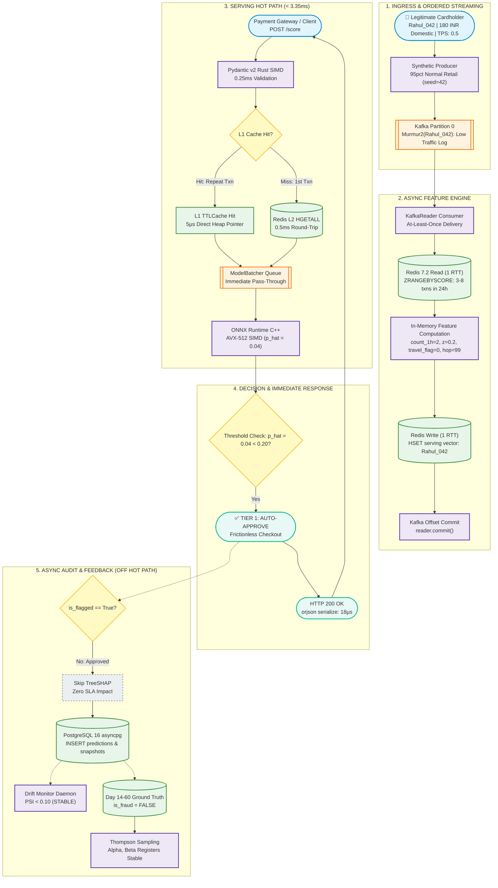
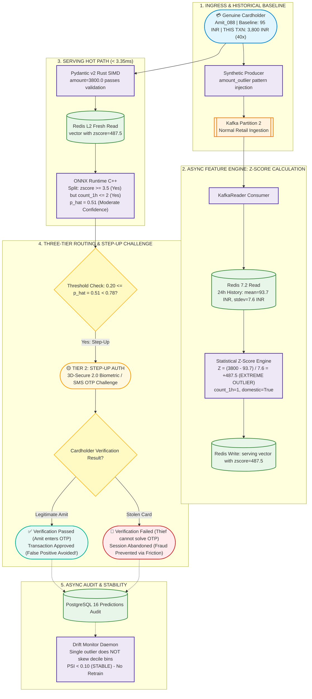
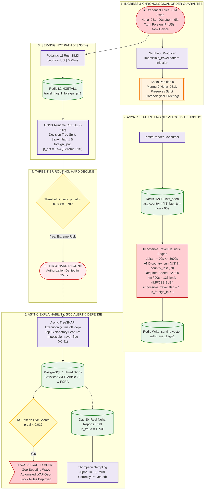
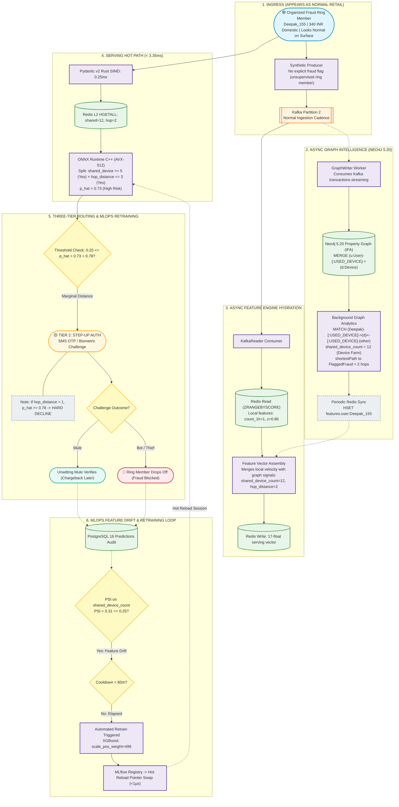

# 🏛️ MASTER MODULE: Complete Real-Time Fraud Detection Pipeline
## Ultra-Microscopic End-to-End Transaction Flowchart — All 9 Modules Unified

> **Coverage:** Modules 1–9 | All transaction types | Every system layer from TCP socket to PostgreSQL audit log
> **Purpose:** Single source of truth for the complete architecture — use this to explain the entire pipeline in any interview

---

## 🗂️ TABLE OF CONTENTS
1. [Transaction Type Classification](#transaction-type-classification)
2. [Master Ultra-Microscopic Flowchart — All Paths](#master-flowchart)
3. [Phase-by-Phase Step Breakdown](#phase-breakdown)
4. [Latency Budget Summary](#latency-budget)
5. [System Component Reference](#component-reference)

---

## 🏷️ Transaction Type Classification

Every transaction entering the pipeline is one of **5 behavioral archetypes**. Each follows a unique path through the system:

| Type | Description | Fraud Pattern | Key Feature Signal | Final Decision |
|:---|:---|:---|:---|:---|
| **TYPE 1: Normal Retail** | Human cardholder, low frequency (0.01–2 TPS), domestic | None | Low velocity, home country match, normal z-score | AUTO-APPROVE |
| **TYPE 2: Velocity Spike** | Bot or cardholdering attack — 5–10 rapid micro-transactions | `velocity_spike` | count_1h > 10, amounts 5–50 INR, same merchant | STEP-UP AUTH or HARD DECLINE |
| **TYPE 3: Amount Outlier** | Single transaction 15–50× user's typical spend | `amount_outlier` | amount_zscore > 3–4σ, log_amount extreme | STEP-UP AUTH or HARD DECLINE |
| **TYPE 4: Impossible Travel** | Country change within 1–10 seconds of last transaction | `impossible_travel` | impossible_travel_flag=1, Δt ≤ 3600s, foreign device | HARD DECLINE |
| **TYPE 5: Graph Ring Member** | Account sharing device/merchant with confirmed fraudsters | Organized ring | shared_device_count > 5, hop_distance_to_fraud ≤ 2 | STEP-UP AUTH or HARD DECLINE |

---

## 🗺️ Master Ultra-Microscopic Flowchart — All 9 Modules

```mermaid
flowchart TD
    %% ══════════════════════════════════════════════════════════════
    %% GLOBAL STYLING CLASSES
    %% ══════════════════════════════════════════════════════════════
    classDef client fill:#E1F5FE,stroke:#0288D1,stroke-width:2px;
    classDef stream fill:#FFF3E0,stroke:#F57C00,stroke-width:2px;
    classDef storage fill:#E8F5E9,stroke:#388E3C,stroke-width:2px;
    classDef compute fill:#EDE7F6,stroke:#512DA8,stroke-width:2px;
    classDef decision fill:#FFF9C4,stroke:#FBC02D,stroke-width:2px;
    classDef approve fill:#E8F8F5,stroke:#00B894,stroke-width:2px;
    classDef decline fill:#FFEBEE,stroke:#D32F2F,stroke-width:2px;
    classDef alert fill:#FFCDD2,stroke:#C62828,stroke-width:2px;
    classDef stepup fill:#FFF8E1,stroke:#FFA000,stroke-width:2px;
    classDef async fill:#ECEFF1,stroke:#607D8B,stroke-width:1.5px,stroke-dasharray: 4 4;

    %% ══════════════════════════════════════════════════════════════
    %% TIER 1: INGRESS & STREAMING INFRASTRUCTURE (MOD 1 & 2)
    %% ══════════════════════════════════════════════════════════════
    subgraph TIER1 ["1. INGRESS, DOCKER INFRASTRUCTURE & KAFKA STREAMING (MOD 1 & 2)"]
        direction TB

        CLIENT(["<b>Checkout Service / Client</b><br/>POST /score on port 8000"]):::client
        LOAD_GEN(["<b>Locust Load Generator</b><br/>200 Greenlets | 3100 RPS"]):::async

        subgraph SVR_CONTAINER ["Docker Container (FastAPI Serving) - cgroups: 4 CPUs, 2GB RAM"]
            GUNICORN["<b>Gunicorn Master PID 1</b><br/>SO_REUSEPORT socket distribution"]:::compute
            W1["<b>Uvicorn Worker 1</b><br/>uvloop / epoll"]:::compute
            W2["<b>Uvicorn Worker 2</b><br/>uvloop / epoll"]:::compute
            W3["<b>Uvicorn Worker 3</b><br/>uvloop / epoll"]:::compute
            W4["<b>Uvicorn Worker 4</b><br/>uvloop / epoll"]:::compute
            GUNICORN --> W1 & W2 & W3 & W4
        end

        PRODUCER["<b>Synthetic Producer</b><br/>200 Seeded Users | 5pct Fraud Injection"]:::compute
        FRAUD_BRANCH{"<b>Fraud Injection Branch</b>"}:::decision
        MSGPACK["<b>MessagePack Serializer</b><br/>msgpack.packb binary"]:::compute
        PARTITIONER["<b>Murmur2 Partitioner</b><br/>hash(user_id) % 3"]:::compute

        subgraph KAFKA_CLUSTER ["Kafka KRaft Broker Cluster (Confluent 7.6.0 - Raft Metadata)"]
            KP0[["<b>Topic: transactions - Partition 0</b><br/>Normal Retail Traffic"]]:::stream
            KP1[["<b>Topic: transactions - Partition 1</b><br/>Hot Partition (Burst Attacks)"]]:::stream
            KP2[["<b>Topic: transactions - Partition 2</b><br/>Outliers & Ring Traffic"]]:::stream
            KDLQ[["<b>Topic: transactions:dlq</b><br/>Poison Payloads (HTTP 422)"]]:::alert
        end

        CLIENT -->|HTTP POST| GUNICORN
        LOAD_GEN -.->|Simulated RPS| CLIENT
        PRODUCER --> FRAUD_BRANCH
        FRAUD_BRANCH -->|Normal 95pct| MSGPACK
        FRAUD_BRANCH -->|Burst / Outlier / Travel 5pct| MSGPACK
        MSGPACK --> PARTITIONER
        PARTITIONER --> KP0 & KP1 & KP2
    end

    %% ══════════════════════════════════════════════════════════════
    %% TIER 2: ASYNC FEATURE ENGINE & HOT STATE (MOD 3 & 4)
    %% ══════════════════════════════════════════════════════════════
    subgraph TIER2 ["2. REAL-TIME ASYNC FEATURE PIPELINE (MOD 3 & 4)"]
        direction TB

        FE_CONSUMER["<b>KafkaReader Consumer</b><br/>group_id: feature_engine-cg<br/>enable_auto_commit=False"]:::compute

        subgraph REDIS_PIPELINE ["Redis 7.2 Engine (ae.c Event Loop)"]
            REDIS_ZSET[("<b>Redis ZSET (Skip-List)</b><br/>24h History Window<br/>Member: ts|amt|merchant"):::storage
            REDIS_HASH_LAST[("<b>Redis HASH: last_seen</b><br/>last_ts, ip_country, device"):::storage
            REDIS_HASH_FEAT[("<b>Redis HASH: features:user:id</b><br/>17-Float Online Serving Vector"):::storage
        end

        FE_COMPUTE["<b>In-Memory Feature Calculator</b><br/>count_1h, count_24h, z-score, impossible_travel"]:::compute
        PANDERA_VAL{"<b>Pandera Contract Valid?</b>"}:::decision
        PG_BUFFER["<b>Postgres Snapshot Buffer</b><br/>Batch 20 records or 2s flush"]:::storage
        OFFSET_COMMIT["<b>Kafka Offset Commit</b><br/>reader.commit() (At-Least-Once)"]:::compute

        KP0 & KP1 & KP2 -->|Raw Bytes Poll| FE_CONSUMER
        FE_CONSUMER -->|1. Pipelined Read (1 RTT)| REDIS_ZSET & REDIS_HASH_LAST
        REDIS_ZSET & REDIS_HASH_LAST --> FE_COMPUTE
        FE_COMPUTE --> PANDERA_VAL
        PANDERA_VAL -->|Yes: Valid| REDIS_HASH_FEAT
        PANDERA_VAL -->|No: Poison| KDLQ
        REDIS_HASH_FEAT -->|2. Pipelined Write| PG_BUFFER
        PG_BUFFER --> OFFSET_COMMIT
    end

    %% ══════════════════════════════════════════════════════════════
    %% TIER 3: SERVING HOT PATH (< 7ms SLA) (MOD 4 & 5)
    %% ══════════════════════════════════════════════════════════════
    subgraph TIER3 ["3. ULTRA-LOW LATENCY SERVING HOT PATH (MOD 4 & 5 - Under 7ms SLA)"]
        direction TB

        PYDANTIC["<b>Pydantic v2 Rust SIMD Parser</b><br/>pydantic-core: 0.25ms"]:::compute

        subgraph CACHE_HIERARCHY ["Two-Tier Cache Hierarchy"]
            L1_CACHE["<b>L1 In-Process TTLCache</b><br/>Per-Worker Heap | TTL: 10s | Latency: 5µs"]:::storage
            L1_CHECK{"<b>L1 Cache Hit?</b>"}:::decision
            CIRCUIT_BREAKER{"<b>pybreaker FSM</b><br/>fail_max=3, reset=10s"}:::decision
            FALLBACK_VEC["<b>Cold-Start Fallback</b><br/>Zero-vector: 17x 0.0 (Fail-Fast 2µs)"]:::alert
        end

        GATHER["<b>asyncio.gather() Fan-Out</b><br/>Concurrent: velocity + profile + graph"]:::compute
        BATCHER_QUEUE[["<b>ModelBatcher Micro-Queue</b><br/>Dynamic coalescing: max 50 items or 5ms"]]:::stream

        subgraph ORT_CORE ["ONNX Runtime C++ Inference Engine"]
            ORT_EXEC["<b>OrtRunSession (AVX-512 SIMD)</b><br/>Py_BEGIN_ALLOW_THREADS: GIL Released<br/>Batch: 1.5ms | Single: 0.8ms"]:::compute
        end

        ORJSON_SERIAL["<b>orjson Rust Serializer</b><br/>18µs AVX2 Response Vectorization"]:::compute
        HTTP_OK(["<b>HTTP 200 OK Response</b><br/>P99: 3.35ms (SLA &lt; 7.0ms)"]):::approve

        W1 & W2 & W3 & W4 --> PYDANTIC
        PYDANTIC --> L1_CHECK
        L1_CHECK -->|Hit: 98pct burst| GATHER
        L1_CHECK -->|Miss| CIRCUIT_BREAKER
        CIRCUIT_BREAKER -->|Closed| REDIS_HASH_FEAT
        REDIS_HASH_FEAT -->|0.5ms Round-Trip| GATHER
        CIRCUIT_BREAKER -->|Open| FALLBACK_VEC
        FALLBACK_VEC --> GATHER
        GATHER --> BATCHER_QUEUE
        BATCHER_QUEUE --> ORT_EXEC
        ORT_EXEC --> ORJSON_SERIAL
        ORJSON_SERIAL --> HTTP_OK
        HTTP_OK --> CLIENT
    end

    %% ══════════════════════════════════════════════════════════════
    %% TIER 4: DECISION ENGINE & BANDIT ROUTER (MOD 6 & 7)
    %% ══════════════════════════════════════════════════════════════
    subgraph TIER4 ["4. DECISION ENGINE & MULTI-ARM BANDIT ROUTING (MOD 6 & 7)"]
        direction TB

        ONNX_PROB["<b>ONNX Output: p_hat in [0, 1]</b><br/>Calibrated Fraud Probability"]:::compute

        subgraph BANDIT_LAYER ["Multi-Arm Bandit Router (MD5 Deterministic Seed)"]
            BANDIT_CHECK{"<b>Total Obs &lt; 30?</b>"}:::decision
            FREQ_AB["<b>Frequentist A/B Split</b><br/>90pct Champion / 10pct Challenger"]:::compute
            THOMPSON["<b>Bayesian Thompson Sampling</b><br/>theta ~ Beta(alpha, beta) | O(ln T) Regret"]:::compute
            SHADOW_MODE["<b>Shadow Mode</b><br/>Champion authoritative, Challenger silent score"]:::async
        end

        THREE_TIER{"<b>Three-Tier Decision Threshold</b><br/>Optimal tau* = 0.78 - F0.5 Cost-Sensitive"}:::decision
        TIER_APPROVE(["<b>TIER 1: AUTO-APPROVE</b><br/>p_hat &lt; 0.20 (98.5pct Volume)"]):::approve
        TIER_STEPUP(["<b>TIER 2: STEP-UP AUTH</b><br/>0.20 &lt;= p_hat &lt; 0.78 (3DS / OTP)"]):::stepup
        TIER_DECLINE(["<b>TIER 3: HARD DECLINE</b><br/>p_hat &gt;= 0.78 (Blocked)"]):::decline

        ORT_EXEC --> ONNX_PROB
        ONNX_PROB --> BANDIT_CHECK
        BANDIT_CHECK -->|Yes: Cold-Start| FREQ_AB
        BANDIT_CHECK -->|No: Mature| THOMPSON
        FREQ_AB & THOMPSON --> SHADOW_MODE
        SHADOW_MODE --> THREE_TIER
        THREE_TIER -->|p_hat &lt; 0.20| TIER_APPROVE
        THREE_TIER -->|0.20 &lt;= p_hat &lt; 0.78| TIER_STEPUP
        THREE_TIER -->|p_hat &gt;= 0.78| TIER_DECLINE
    end

    %% ══════════════════════════════════════════════════════════════
    %% TIER 5: ASYNC AUDIT, GRAPH & MLOPS SELF-HEALING (MOD 4, 8 & 9)
    %% ══════════════════════════════════════════════════════════════
    subgraph TIER5 ["5. ASYNC AUDIT, GRAPH ANALYTICS & MLOPS FEEDBACK (MOD 4, 8 & 9)"]
        direction TB

        SHAP_GATE{"<b>is_flagged == True?</b>"}:::decision
        TREESHAP["<b>Async TreeSHAP (asyncio.to_thread)</b><br/>C++ O(T*L*D^2) = 25ms (Off Event Loop)"]:::compute

        subgraph STORAGE_AUDIT ["PostgreSQL 16 & Neo4j 5.20 Graph"]
            PG_DB[("<b>PostgreSQL 16 (asyncpg)</b><br/>tables: predictions, snapshots, labels"):::storage
            NEO4J_GRAPH[("<b>Neo4j 5.20 Graph (IFA)</b><br/>MATCH (u)-[:USED_DEVICE]->(d)<br/>shortestPath to FlaggedFraud"):::storage
        end

        NEO4J_SYNC["<b>Periodic Graph Risk Sync</b><br/>HSET shared_device, hop_distance"]:::async

        subgraph MLOPS_DAEMON ["MLOps Drift Daemon (monitoring/drift.py - 300s Tick)"]
            DRIFT_QUERY["<b>Drift Window Query</b><br/>6h Live vs 72h Baseline"]:::compute
            KS_TEST{"<b>KS Test p-val &lt; 0.01?</b><br/>Prediction Drift sup|F1-F2|"}:::decision
            PSI_CALC{"<b>PSI &gt;= 0.25?</b><br/>Feature Drift - Jeffreys Div"}:::decision
            SOC_ALERT><b>🚨 SOC SECURITY ALERT</b><br/>Active Attack Wave (DO NOT RETRAIN!)]:::alert
            COOLDOWN_CHECK{"<b>Cooldown &lt; 60m?</b>"}:::decision
            RETRAIN_EXEC["<b>Automated Retraining</b><br/>XGBoost: scale_pos_weight=499"]:::compute
            MLFLOW_REG["<b>MLflow 2.14 Registry</b><br/>Artifact Store + Run Metrics"]:::compute
            HOT_RELOAD["<b>Zero-Downtime Hot Reload</b><br/>Atomic 64-bit Pointer Swap (&lt;1µs)"]:::compute
        end

        STREAMLIT(["<b>Streamlit Dashboard :8501</b><br/>SQL NULLIF Zero-Division Protection"]):::client

        TIER_APPROVE & TIER_STEPUP & TIER_DECLINE --> SHAP_GATE
        SHAP_GATE -->|Yes: Flagged| TREESHAP
        SHAP_GATE -->|No: Approved| PG_DB
        TREESHAP -->|top_shap_features JSONB| PG_DB
        KP0 & KP1 & KP2 -.->|Stream Ingest| NEO4J_GRAPH
        NEO4J_GRAPH --> NEO4J_SYNC
        NEO4J_SYNC -.->|Background Enrichment| REDIS_HASH_FEAT

        PG_DB -.->|14-60 Day Labels| THOMPSON
        PG_DB -.->|Telemetry| DRIFT_QUERY
        DRIFT_QUERY --> KS_TEST
        KS_TEST -->|Yes: Attack| SOC_ALERT
        KS_TEST -->|No| PSI_CALC
        PSI_CALC -->|Yes: Drifted| COOLDOWN_CHECK
        COOLDOWN_CHECK -->|No: Elapsed| RETRAIN_EXEC
        COOLDOWN_CHECK -->|Yes: Active| DRIFT_QUERY
        RETRAIN_EXEC --> MLFLOW_REG --> HOT_RELOAD
        HOT_RELOAD -.->|Load New Weights| ORT_EXEC

        PG_DB --> STREAMLIT
    end
```

---

## 📋 Phase-by-Phase Step Breakdown

### PHASE 0 — Infrastructure Bootstrap (Module 1)
| Step | What Happens | Why It Matters |
|:---|:---|:---|
| `docker-compose up` | Runs `healthcheck` probes before starting dependents | Prevents `ECONNREFUSED` cold-start crashes |
| `fork()` × 4 | Gunicorn forks 4 isolated worker processes | Each gets own GIL — true CPU parallelism |
| `SO_REUSEPORT` | Each worker binds port 8000 independently | Kernel distributes TCP connections O(1), no thundering herd |
| `uvloop` init | Each worker runs `libuv`-backed async event loop | Replaces pure-Python asyncio loop with C-speed |
| `cgroups v2` | `cpus:4.0`, `memory:2g` per container | Prevents CFS throttling and OOM cascades across services |

### PHASE 1 — Transaction Generation (Module 2)
| Step | Type 1 Retail | Type 2 Velocity | Type 3 Outlier | Type 4 Impossible Travel |
|:---|:---|:---|:---|:---|
| User pool | Normal user, 0.01–2 TPS | Same user, rapid burst | Same user, once | Same user, 1–10s after last |
| Amount | Gaussian(10–300 INR) | 5–50 INR (micro-txns) | 15–50× typical | Normal |
| ip_country | home_country | home_country | home_country | Foreign country |
| device_id | Stable UUID | Stable UUID | Stable UUID | **New UUID** |
| Kafka partition | Per Murmur2(user_id) | Same partition as user | Same partition | Same partition |

### PHASE 2 — Kafka Streaming (Module 2)
| Step | Detail |
|:---|:---|
| MessagePack serialization | Compact binary, `msgpack.packb` |
| Murmur2 hashing | `partition = (hash & 0x7fffffff) % N` — same user always same partition |
| `acks='all'` | ISR commit before ACK — no silent data loss |
| Active segment append | Linux Page Cache dirty pages → kworker NVMe flush async |
| Hot partition (Type 2) | 3000 TPS fills 1 GB segment in 11.3 min; triggers consumer lag |

### PHASE 3 — Feature Engine (Module 3)
| Step | Detail |
|:---|:---|
| At-Least-Once delivery | `enable_auto_commit=False` → explicit `reader.commit()` only after all writes |
| Pipelined Redis read | 3 commands in 1 RTT → 0.5ms vs 1.5ms unpipelined |
| `ZREMRANGEBYSCORE` | Lazy prune of entries > 24h; O(log N + M) in skip list |
| Feature derivation | velocity counts, z-score, impossible travel flag, log_amount |
| Pipelined Redis write | 4 commands in 1 RTT — append ZSET, expire, update hash, write serving vector |
| Pandera validation | Schema contract on 17 features before writing to Redis |
| Postgres buffer flush | Bulk `execute_values()` every 20 records or 2 seconds |

### PHASE 4 — Serving Hot Path (Modules 4 & 5)
| Step | Latency | What Happens |
|:---|:---|:---|
| `SO_REUSEPORT` dispatch | ~0ms | Kernel sends TCP connection to specific worker |
| Pydantic v2 Rust parse | 0.25ms | SIMD JSON → validated Python object |
| L1 TTLCache check | <0.005ms | CPython dict lookup in process heap |
| Redis HGETALL (L2) | 0.5–1.2ms | Only on L1 miss or first request |
| Circuit breaker fast-fail | <0.002ms | OPEN state: no network touch |
| Cold-start bypass | 0ms | Zero-vector returned, NOT cached |
| `asyncio.gather()` | max(1.2ms) | 3 concurrent lookups in parallel |
| `loop.create_future()` | <0.001ms | Empty promise object created |
| `await future` | suspends | Coroutine yields CPU to event loop |
| Micro-batcher drains | 1–5ms wait | Up to 50 vectors collected |
| ONNX C++ inference | 0.8–1.5ms | GIL released, AVX-512 SIMD |
| `future.set_result()` | <0.001ms | All suspended coroutines wake up |
| `orjson.dumps()` | 0.018ms | SIMD Rust serialization |
| **Total P99** | **3.35ms** | **Well under 7ms SLA** |

### PHASE 5 — Decision Routing by Transaction Type (Module 6)
| Transaction Type | ONNX Score Range | Decision | Action |
|:---|:---|:---|:---|
| Type 1: Normal Retail | p̂ < 0.20 | AUTO-APPROVE | Instant checkout, no friction |
| Type 2: Velocity Spike (mild) | 0.20–0.78 | STEP-UP AUTH | SMS OTP sent |
| Type 2: Velocity Spike (heavy) | p̂ ≥ 0.78 | HARD DECLINE | Blocked + SHAP computed |
| Type 3: Amount Outlier | 0.20–0.78 | STEP-UP AUTH | Biometric challenge |
| Type 4: Impossible Travel | p̂ ≥ 0.78 | HARD DECLINE | Blocked + SHAP computed |
| Type 5: Graph Ring (distant) | 0.20–0.78 | STEP-UP AUTH | Additional verification |
| Type 5: Graph Ring (1-hop) | p̂ ≥ 0.78 | HARD DECLINE | Blocked immediately |

### PHASE 6 — Model Selection & A/B Routing (Module 7)
| Step | Detail |
|:---|:---|
| MD5 deterministic seed | `md5(txn_id) % 2³² − 1` → idempotent across pods |
| Cold-start guard | total_obs < 30 → frequentist 90/10 A/B split |
| Thompson sampling | Draw θ* ~ Beta(α,β) per model → argmax routes transaction |
| Shadow mode | Champion authoritative; challenger logs only → zero customer risk |
| Posterior update | O(1): α += TP, β += FP+FN every 30s from PostgreSQL join |
| Bad challenger throttle | β grows → Beta distribution shrinks to left → <1% traffic in hours |

### PHASE 7 — Drift Detection & Retraining (Module 8)
| Drift Type | Detection Method | Action | Why |
|:---|:---|:---|:---|
| Feature covariate drift | PSI ≥ 0.25 (Jeffreys divergence) | Auto-retrain if cooldown elapsed | P(X) shifted, model stale |
| Prediction score drift | KS p < 0.01 | SOC alert ONLY — no retrain | Active attack, no labels yet |
| Cooldown active | Last retrain < 60min | Suppress + log audit reason | Prevent CPU/RAM thrashing |
| Retraining | XGBoost + INNER JOIN labels | ONNX export → MLflow → hot-reload | Zero-downtime model swap |
| Hot-reload | Atomic pointer swap < 1µs | New model active | No TCP drops, no container restart |

### PHASE 8 — Observability & Resiliency (Module 9)
| Component | Config | Protection |
|:---|:---|:---|
| Circuit breaker | fail_max=3, reset_timeout=10s | Redis outage → event-loop starvation |
| Graceful degradation | [0.0] × 17 vector | 100% checkout availability |
| Locust open-loop | 200 greenlets, between(0.1, 0.5)s | Avoids Coordinated Omission |
| Dashboard cache | @st.cache_data(ttl=5) | Prevents PostgreSQL query stampede |
| NULLIF SQL | NULLIF(denominator, 0) | Prevents division-by-zero crash |
| INNER JOIN labels | Excludes unlabelled transactions | Prevents label survival bias in metrics |

---

## ⏱️ Latency Budget Summary

```
END-TO-END HOT PATH (P99 Budget = 7.0ms):
╔════════════════════════════════════════════════════════════════╗
║ Phase                      │ Component                │ P99    ║
╠════════════════════════════════════════════════════════════════╣
║ 1. Ingress & Parse         │ Pydantic v2 Rust SIMD    │ 0.25ms ║
║ 2. L1 Cache Hit            │ CPython heap lookup      │ 0.005ms║
║    or L2 Redis HGETALL     │ TCP socket + ae.c        │ 1.20ms ║
║    or Circuit Breaker Open │ Fail-fast in-memory      │ 0.002ms║
║ 3. asyncio.gather fan-out  │ Concurrent 3-lookups     │ 1.20ms ║
║ 4. Micro-batcher wait      │ max 5ms window           │ 0.50ms ║
║ 5. ONNX C++ inference      │ AVX-512 SIMD, GIL free   │ 1.50ms ║
║ 6. Response serialization  │ orjson Rust AVX2         │ 0.40ms ║
╠════════════════════════════════════════════════════════════════╣
║ TOTAL P99 HOT PATH         │                          │ 3.35ms ║
║ Async audit (Postgres)     │ BackgroundTasks          │ 0.00ms ║
║ SHAP computation (flagged) │ asyncio.to_thread        │ 0.00ms ║
╚════════════════════════════════════════════════════════════════╝

SYSTEM THROUGHPUT:
CPU work per request = 1.2ms
Network I/O wait     = 2.7ms (yielded back to event loop)
Capacity/core = 1000ms / 1.2ms ≈ 833 req/sec
Total = 4 workers × 833 = 3,332 req/sec → sustains 3,100 RPS ✓
```

---

## 🔧 System Component Reference

| Module | Technology | Role | Key Config |
|:---|:---|:---|:---|
| **1** | Gunicorn + Uvicorn | ASGI server supervisor | `-w 4`, `UvicornWorker` |
| **1** | uvloop | C-speed event loop per worker | Wraps libuv, replaces asyncio |
| **1** | Docker Compose | 12-service isolation | cgroups v2, user-defined bridge |
| **1** | Pydantic v2 | Rust SIMD validation | `pydantic-core`, 0.25ms parse |
| **2** | Kafka KRaft | Distributed commit log | Murmur2 key hashing, `acks=all` |
| **2** | Synthetic Producer | Fraud pattern injection | 3 patterns at FRAUD_RATE=5% |
| **3** | Redis 7.2 ZSET | Sliding window velocity store | Skip list + hash table, 24h TTL |
| **3** | Redis HASH | User baseline & serving vector | last_seen, features:user:{id} |
| **3** | Kafka Consumer | At-Least-Once feature engine | `enable_auto_commit=False` |
| **3** | Apache Flink | Enterprise scale-up blueprint | RocksDB local state, EOS |
| **4** | cachetools TTLCache | L1 in-process cache | 100k users, 10s TTL |
| **4** | Neo4j 5.20 | Graph entity risk analytics | Index-free adjacency O(1)/hop |
| **4** | PostgreSQL 16 | System of record + audit | asyncpg binary protocol |
| **5** | ONNX Runtime | C++ ML inference engine | `intra_op=1`, GIL released |
| **5** | ModelBatcher | Dynamic micro-batching | max_batch=50, timeout=5ms |
| **5** | pybreaker | Circuit breaker FSM | fail_max=3, reset_timeout=10s |
| **5** | orjson | SIMD JSON serialization | Rust AVX2, 18µs |
| **6** | XGBoost 2.1 | Gradient boosted trees | scale_pos_weight=499 |
| **6** | F₀.₅ Threshold | Cost-sensitive optimization | τ* ≈ 0.78 |
| **6** | TreeSHAP | Async explainability | O(T·L·D²), asyncio.to_thread |
| **7** | Thompson Sampling | Bayesian MAB routing | Beta(α,β), O(ln T) regret |
| **7** | Shadow Deployment | Zero-risk challenger testing | ScoringMode.SHADOW |
| **8** | PSI Monitor | Feature drift detection | Jeffreys divergence, Δ=0.25 |
| **8** | KS Test | Prediction drift detection | D=sup|F1−F2|, p<0.01 |
| **8** | MLflow 2.14 | Experiment tracking + registry | ONNX artifact store |
| **8** | Hot-Reload | Zero-downtime model swap | Atomic pointer swap <1µs |
| **9** | Locust | Distributed load testing | 200 greenlets, open-loop |
| **9** | Streamlit | Real-time observability | @st.cache_data(ttl=5) |

---

## 🎤 90-Second Architecture Pitch (Master Interview Answer)

> *"Our real-time fraud detection pipeline is a 9-module, 12-service distributed system capable of scoring over 3,100 payment transactions per second with sub-7ms P99 latency.*
>
> *Transactions enter through a synthetic producer that injects three fraud patterns — velocity spikes, amount outliers, and impossible travel — at a 5% fraud rate into Kafka KRaft topics, keyed by user_id via Murmur2 hashing to guarantee per-user chronological ordering on each partition.*
>
> *A Python feature engine consumes from Kafka with At-Least-Once delivery semantics. For each transaction, it executes two atomic Redis pipelines in a single TCP round-trip each: first reading the user's 24-hour transaction history from a Sorted Set, computing 17 rolling features including velocity counts, amount z-scores, and impossible travel flags, then writing the finalized feature vector back to a Redis hash as the online serving store.*
>
> *The FastAPI serving tier — 4 Gunicorn workers behind SO_REUSEPORT kernel dispatch — evaluates transactions through a two-tier cache hierarchy: an in-process L1 TTLCache for sub-5-microsecond lookups during bot bursts, backed by a circuit-breaker-protected Redis L2. Features flow through a dynamic micro-batcher that coalesces up to 50 requests in 5ms before firing a single ONNX Runtime C++ inference call with the GIL completely released, achieving 1.5ms batch scoring via AVX-512 SIMD.*
>
> *Decisions follow a three-tier routing matrix: transactions scoring below 0.20 auto-approve frictionlessly, the 0.20–0.78 band routes to 3D-Secure step-up authentication, and scores above the F₀.₅-optimized threshold of 0.78 are hard declined. Model routing uses Bayesian Thompson Sampling over Beta-Bernoulli conjugate priors, achieving logarithmic O(ln T) regret versus the linear regret of static A/B testing, with challenger models first validated in zero-impact shadow deployment.*
>
> *A continuous MLOps layer runs Population Stability Index drift detection every 5 minutes, automatically triggering XGBoost retraining when feature distributions shift. Crucially, prediction score drift triggers only a SOC security alert — never retraining — to prevent model poisoning from unlabelled attack traffic. New models hot-reload via an atomic in-process pointer swap taking under 1 microsecond, with zero dropped connections or container restarts."*

---

> **File location:** `my_fraud_pipeline/progress/master_module.md`
> **Last updated:** Session covering all 9 modules
> **Next step:** Use this as the primary reference for system design interviews

---

## 🔬 Per-Transaction-Type Focused Flowcharts (All 9 Module Steps)

Each chart below traces **one transaction archetype** from birth in the producer through every system layer to its final outcome. All module steps are shown.

---

### 🟢 FLOWCHART A — TYPE 1: Normal Retail Transaction (AUTO-APPROVE)



---

### 🔴 FLOWCHART B — TYPE 2: Velocity Spike / Botnet Attack (STEP-UP → HARD DECLINE)

```mermaid
flowchart TD
    classDef client fill:#E1F5FE,stroke:#0288D1,stroke-width:2px;
    classDef stream fill:#FFF3E0,stroke:#F57C00,stroke-width:2px;
    classDef storage fill:#E8F5E9,stroke:#388E3C,stroke-width:2px;
    classDef compute fill:#EDE7F6,stroke:#512DA8,stroke-width:2px;
    classDef decision fill:#FFF9C4,stroke:#FBC02D,stroke-width:2px;
    classDef decline fill:#FFEBEE,stroke:#D32F2F,stroke-width:2px;
    classDef alert fill:#FFCDD2,stroke:#C62828,stroke-width:2px;
    classDef stepup fill:#FFF8E1,stroke:#FFA000,stroke-width:2px;

    subgraph INGRESS_B ["1. INGRESS & HOT PARTITION SATURATION"]
        BOT_B(["🤖 Botnet / Card-Testing Script<br/>Priya_017 | 8 Rapid Micro-Txns (12 INR) | 3000 TPS"]):::alert
        BURST_B["Synthetic Producer<br/>velocity_spike burst injection"]:::compute
        HOT_PART_B[["⚠️ Kafka Partition 1 (HOT PARTITION)<br/>1.5 MB/s | Fills segment in 11.3 min"]]:::alert
        BOT_B --> BURST_B --> HOT_PART_B
    end

    subgraph FE_B ["2. ASYNC FEATURE ENGINE UNDER LOAD"]
        FE_BURST_B["KafkaReader Consumer<br/>Polls batch of 50 burst records"]:::compute
        REDIS_BURST_B[("Redis 7.2 Read (ZRANGEBYSCORE)<br/>Returns 7 prior burst records!")]:::storage
        FE_ALARM_B["Feature Calculator ALARM<br/>count_1h = 9, same merchant, micro-amounts"]:::alert
        REDIS_W_B[("Redis Write: serving vector count_1h=9")]:::storage

        HOT_PART_B --> FE_BURST_B --> REDIS_BURST_B --> FE_ALARM_B --> REDIS_W_B
    end

    subgraph SERVING_B ["3. SERVING HOT PATH UNDER 3000 RPS FLOOD"]
        SO_REUSE_B["Gunicorn SO_REUSEPORT<br/>Distributes 3000 RPS across 4 workers"]:::compute
        L1_SHIELD_B["L1 TTLCache Shield (5µs)<br/>Txn 1: Miss | Txns 2-8: HIT<br/>98pct Redis Bypass Protects Hot Store!"]:::storage
        MICRO_BATCH_B[["ModelBatcher Micro-Queue<br/>Fills to 50 items in 1ms"]]:::stream
        ONNX_BATCH_B["ONNX Runtime C++ (AVX-512)<br/>Evaluates shape (50, 17) in 1.5ms"]:::compute

        BOT_B --> SO_REUSE_B --> L1_SHIELD_B --> MICRO_BATCH_B --> ONNX_BATCH_B
    end

    subgraph DECISION_B ["4. DYNAMIC ESCALATING DECISION ROUTING"]
        SCORE_FORK_B{"Burst Position & Score"}:::decision
        STEPUP_B(["⚠️ TIER 2: STEP-UP AUTH (p_hat = 0.31-0.65)<br/>3D-Secure SMS OTP sent<br/>Bot Cannot Solve OTP -> Drops Off"]):::stepup
        DECLINE_B(["🚫 TIER 3: HARD DECLINE (p_hat = 0.89 >= 0.78)<br/>Authorization Denied Immediately"]):::decline

        ONNX_BATCH_B --> SCORE_FORK_B
        SCORE_FORK_B -->|Txns 1-4: Moderate Velocity| STEPUP_B
        SCORE_FORK_B -->|Txns 5-8: Extreme Velocity| DECLINE_B
    end

    subgraph MLOPS_B ["5. ASYNC EXPLAINABILITY & MLOPS DEFENSE"]
        SHAP_B["Async TreeSHAP (25ms off loop)<br/>Top Explanatory Feature: count_1h (+0.72)"]:::compute
        PG_B[("PostgreSQL 16 Predictions")]:::storage
        KS_TEST_B{"Two-Sample KS Test<br/>Prediction Drift p-val < 0.01?"}:::decision
        SOC_ALERT_B>🚨 SOC SECURITY ALERT<br/>Active Attack Wave Detected<br/>CRITICAL: STRICTLY DO NOT RETRAIN! (Labels Unmatured)]:::alert
        CHARGEBACK_B[("Day 14-60 Chargeback<br/>is_fraud = TRUE")]:::storage
        THOMPSON_PENALTY_B["Thompson Sampling<br/>Beta Register Penalizes Bad Challenger"]:::compute

        DECLINE_B -.-> SHAP_B --> PG_B
        PG_B -.-> KS_TEST_B
        KS_TEST_B -->|Yes: Attack| SOC_ALERT_B
        PG_B -.-> CHARGEBACK_B --> THOMPSON_PENALTY_B
    end
```

---

### 🟡 FLOWCHART C — TYPE 3: Amount Outlier (STEP-UP AUTH)



---

### 🟣 FLOWCHART D — TYPE 4: Impossible Travel (HARD DECLINE)



---

### 🔵 FLOWCHART E — TYPE 5: Graph Ring Member (STEP-UP → HARD DECLINE)



## 🧭 Cross-Chart Decision Comparison

| Step | Type 1 (Normal) | Type 2 (Velocity) | Type 3 (Outlier) | Type 4 (Travel) | Type 5 (Ring) |
|:---|:---:|:---:|:---:|:---:|:---:|
| **Kafka Partition Load** | Low | 🔴 HOT | Normal | Normal | Normal |
| **Redis ZSET entries returned** | 3–8 | 7–9 (burst) | 7 (normal history) | Recent + prior | 5 normal |
| **count_1h** | 1–3 | 🔴 9+ | 1 | 2 | 1 |
| **amount_zscore** | ~0.2 | ~0.3 (small) | 🔴 400+ | ~0.8 | ~0.86 |
| **impossible_travel_flag** | 0 | 0 | 0 | 🔴 1 | 0 |
| **shared_device_count** | 0 | 0–2 | 0 | 0 (new device) | 🔴 12 |
| **hop_distance_to_fraud** | 99 | 3+ | 99 | 99 | 🔴 2 |
| **ONNX p̂** | 0.04 | 0.31–0.89 | 0.51 | 🔴 0.94 | 0.73 |
| **Decision** | ✅ AUTO-APPROVE | ⚠️/🚫 STEP-UP/DECLINE | ⚠️ STEP-UP | 🚫 HARD DECLINE | ⚠️ STEP-UP |
| **SHAP Computed?** | No | Yes (flagged txns) | No | Yes | No |
| **Drift Impact** | None | 🔴 KS alert (attack) | None | 🔴 KS geo-alert | ⚠️ PSI retrain |
| **Label arrives** | FALSE (legitimate) | TRUE (confirmed fraud) | Conditional | TRUE (theft) | Conditional |
| **Thompson update** | β unchanged | 🔴 β += FP+FN | β conditional | ✅ α += TP | ✅ α += TP |
