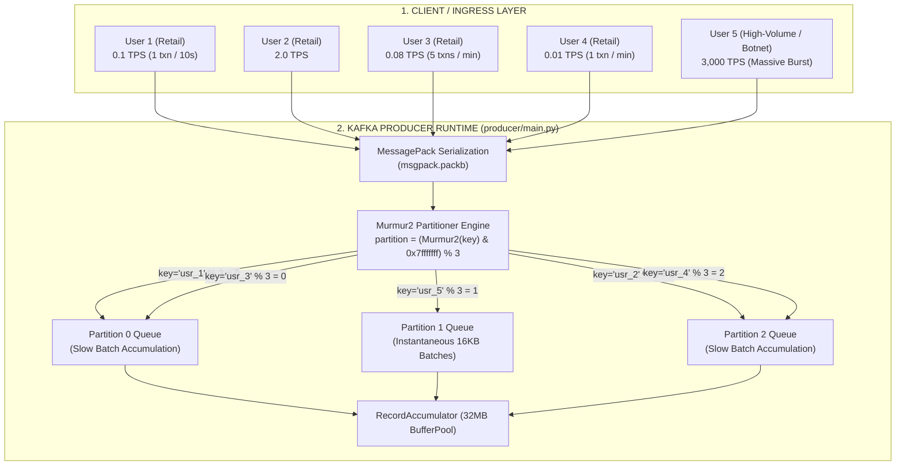

# 📘 MODULE 2: Distributed Message Streaming (Apache Kafka 7.6.0 KRaft Mode)

> **Status:** ✅ Completed
> **Estimated Study Time:** 8 Hours
> **Completed Subtopics:** Broker Architecture & Partition Mechanics | Delivery Semantics & Offset Commit Mechanics | Synthetic Transaction Producer | Feature Engine | Serving Layer (ONNX) | A/B Testing & Thompson Sampling | Consumer Groups & Assignor Strategies | Heartbeats & Rebalance Storms | Dead Letter Queue (DLQ) & Poisoned Payload Isolation

---

> Every concept below follows the **Dual-Layer Format**:
> - **🌐 General** — What is this technology from first principles? (Answers general interview questions)
> - **🔧 Our Pipeline** — Exactly how and why we use it, with codebase references.
> - **🎤 Interview Answer** — A concise verbal answer you can say out loud.

---

## 2.1 Broker Architecture, Storage Engine & Partition Mechanics

### 🌐 General: What Is Kafka Storage & Partition Architecture From First Principles?

Apache Kafka is a **distributed, append-only commit log** designed for high-throughput, fault-tolerant, real-time event streaming. Unlike traditional message queues (RabbitMQ, SQS) that treat messages as transient objects in RAM and delete them upon acknowledgment, Kafka persists all records directly into an immutable filesystem commit log.

```
/tmp/kraft-combined-logs/transactions-raw-0/
│
├── 00000000000000000000.log        <- Raw binary record batch payload (RecordBatch)
├── 00000000000000000000.index      <- Sparse offset-to-physical-byte index
├── 00000000000000000000.timeindex  <- Sparse timestamp-to-offset index
└── leader-epoch-checkpoint         <- Fencing token metadata for KRaft consensus
```

---

#### 1. Operating System Storage Primitives: Why Kafka Outperforms In-Memory Systems

A common interview question is: *"How can a system that writes every message to persistent disk outperform purely in-memory message brokers?"* The answer lies in low-level OS kernel primitives:

##### A. Sequential Disk I/O vs. Random RAM Access
- **Random Disk Access:** Mechanical hard drives incur physical seek times (5–10ms) moving read/write heads. Solid-state drives (NVMe SSDs) avoid mechanical heads but suffer from write amplification and block-erase cycles during random writes.
- **Sequential Disk Access:** Operating system disk drivers leverage read-ahead track buffers and contiguous block pre-allocation. Sequential disk writes achieve sustained throughput of **600 MB/s to 3.5 GB/s**, rivaling or exceeding random memory access across multi-socket NUMA architectures with cache-coherency bus contention.
- Kafka structures every partition as a strictly append-only sequence of bytes. Disk heads never seek backwards during writes; the write pointer moves strictly forward in O(1) time.

##### B. JVM Heap Elimination & The Linux Page Cache
Kafka executes on the Java Virtual Machine (JVM). Storing hundreds of gigabytes of message data in the JVM heap causes severe operational instability:
1. **Memory Amplification:** Java objects carry heavy memory overhead (16-byte object headers, 8-byte reference pointers, 8-byte alignment padding). A 24-byte payload often consumes over 64 bytes of heap RAM.
2. **Stop-the-World (STW) Garbage Collection:** Inspecting hundreds of millions of objects during Mark-Sweep-Compact cycles induces multi-second JVM pauses, instantly violating sub-10ms P99 SLAs.

Kafka runs with a small, fixed JVM heap (typically 4–8 GB) dedicated solely to connection metadata and active socket buffers. **All message caching is offloaded directly to the Linux Page Cache**:
- When Kafka writes a message batch, it issues a standard POSIX `write()` system call.
- The Linux kernel copies bytes into kernel-space RAM frames (`struct page`, 4096 bytes each) and marks them as `dirty`.
- Control returns to Kafka immediately.
- Background kernel daemons (`pdflush` / `kworker` / `writeback`) flush dirty pages to physical NVMe storage asynchronously in large contiguous blocks based on kernel tunings (`vm.dirty_background_ratio`).
- Active consumers reading recent data fetch directly from the kernel Page Cache in RAM without touching the physical disk.

##### C. Zero-Copy Network Egress via `sendfile()`
In standard web application servers, sending a cached file over a network socket requires four context switches and four buffer copies:

```
[Standard Path: 4 Context Switches | 4 Data Copies]
Disk -> [DMA Copy] -> Kernel Page Cache -> [CPU Copy] -> User JVM Buffer -> [CPU Copy] -> Socket Buffer -> [DMA Copy] -> NIC Buffer
```

Kafka eliminates this CPU copying by invoking the Linux **Zero-Copy** primitive via `FileChannel.transferTo()`, which maps directly to the POSIX `sendfile()` system call:

```
[Zero-Copy sendfile() Path: 2 Context Switches | Zero CPU Copies]
Disk -> [DMA Copy] -> Kernel Page Cache ─────────────────────────> [Scatter-Gather DMA Copy] -> NIC Buffer
                                                (descriptor reference)
```

1. Kafka invokes `sendfile(socket_fd, file_fd, offset, length)`.
2. The data remains in the kernel Page Cache. No bytes are copied into JVM user-space memory.
3. The kernel appends lightweight descriptor pointers (memory address and byte length) to the socket buffer.
4. The Network Interface Card (NIC) DMA engine reads bytes directly from kernel Page Cache RAM into the network transmission ring buffer.
5. CPU utilization drops to near zero, eliminating memory bus saturation.

---

#### 2. The Critical Hierarchy: Topics vs. Partitions vs. Segments

```
TOPIC: transactions-raw (Logical Event Stream)
  │
  ├── PARTITION 0 (Distributed Parallelism & Ordering Unit - Logical)
  │     ├── Segment 1: [00000000000000000000.log] (Read-Only, Closed)
  │     ├── Segment 2: [00000000000015000000.log] (Read-Only, Closed)
  │     └── Segment 3: [00000000000030000000.log] (Active Segment, Appending Writes)
  │
  ├── PARTITION 1 (Distributed Parallelism & Ordering Unit - Logical)
  │     └── ...
  │
  └── PARTITION 2 (Distributed Parallelism & Ordering Unit - Logical)
        └── ...
```

##### Why Partitions Exist (Logical Scaling & Parallelism)
- A single server cannot process 100,000 transactions per second or store petabytes of data.
- Splitting a topic into N partitions allows Kafka to distribute those partitions across multiple independent broker machines.
- A partition is the **unit of consumer parallelism**: N partitions allow up to N independent consumer worker instances to read in parallel.

##### Why Segments Exist (Physical Disk Mechanics & O(1) Retention)
On the physical drive, a partition is a directory containing multiple **Segment** files (`.log`, `.index`, `.timeindex`):
1. **O(1) Retention Deletion vs. O(N) File Rewrite:**
   If a partition were a single monolithic 500 GB file, deleting expired messages (e.g., older than 7 days) would require truncating bytes from the *beginning* of the file. Operating systems (ext4, XFS) cannot delete data from the start of a file without rewriting the entire remaining 400 GB, choking disk I/O. By dividing partitions into 1 GB segments, expiring old data is an instantaneous, single POSIX `unlink()` system call (O(1) complexity).
2. **Active vs. Immutable Segments:**
   Only the **Active Segment** accepts new writes. All previous segments are 100% frozen and immutable. This allows the OS kernel to cache them indefinitely in the Page Cache without cache-invalidation overhead.
3. **Memory-Mapped Sparse Index (`mmap`):**
   Each `.log` file has a companion `.index` file. Kafka memory-maps this index via `mmap()`. By capping segments at 1 GB (`log.segment.bytes`), index files remain compact (~10 MB), fitting entirely into CPU virtual memory tables for rapid binary searching.

##### Binary Search over Sparse Indices
Kafka does not index every record. It writes an index pointer every N bytes (default: 4,096 bytes via `index.interval.bytes`). To find offset `12`:
1. Kafka identifies the segment file via binary search over segment base offsets (the 20-digit filename).
2. Kafka executes an in-memory binary search (O(log M)) over the sparse `.index` file to locate the closest indexed offset ≤ 12.
3. Kafka seeks to that physical byte position in the `.log` file and scans forward sequentially for a few hundred bytes.

---

#### 3. Chronological Ordering Guarantees & Murmur2 Key Hashing

A foundational axiom of distributed systems: **Kafka guarantees total message ordering strictly within a single partition, never across partitions of a topic.**

##### Why Cross-Partition Ordering Fails
If transactions for the same user are scattered across partitions:
- Partition 0 and Partition 1 reside on different broker nodes or NVMe drives.
- Asynchronous network batching and TCP window stalls cause packets to arrive out of order.
- Two distinct consumer worker threads consuming from Partition 0 and Partition 1 process messages concurrently without synchronized clocks.
- A \$5,000 withdrawal created at T = 1.0s could be processed before a \$5,000 deposit created at T = 0.5s, triggering an erroneous overdraft decline or corrupted velocity counter.

##### Murmur2 Modulo Routing Formula
When a producer supplies a message key (`key=user.user_id`), Kafka's default partitioner computes the destination partition deterministically:

$$\mathbf{partition} = (\text{Murmur2}(\text{serialized\_key}) \ \& \ \text{0x7fffffff}) \pmod N$$

Where:
- Murmur2 is a 32-bit non-cryptographic hash function providing rapid execution and an avalanche property (flipping 1 bit changes ~50% of hash bits).
- `& 0x7fffffff` is a 31-bit bitwise AND mask clearing the sign bit (2's complement), preventing negative numbers resulting from Java signed integer arithmetic.
- N is the total number of partitions configured for the topic.

By setting `key=user_id`, every transaction executed by that user lands on the exact same partition commit log, receiving monotonically increasing offsets and guaranteeing strict chronological ordering for rolling velocity windows.

---

#### 4. Partition Hot-Spotting, Skew & Mitigation Strategies

Deterministic key hashing introduces the risk of **Partition Skew (Hot-Spotting)**:

$$\text{Skew Ratio} = \frac{\text{Throughput}_{\text{max\_partition}}}{\text{Throughput}_{\text{average\_partition}}}$$

##### Failure Mechanism
- Retail users execute 2–5 transactions per day.
- Institutional accounts (payroll processors, payment aggregators) or compromised accounts under botnet card-testing attacks execute **thousands of transactions per second**.
- If all transactions share the same `user_id`, a single partition receives 80–90% of all cluster traffic.
- That single broker partition saturates disk write queues, exhausts network buffers, and builds severe **Consumer Lag** on the assigned consumer thread, while other consumer instances sit idle.

##### Mitigation Strategies
1. **Key Salting:**
   The producer appends a pseudo-random integer salt S ∈ {0, ..., K-1} to the key:
   $$\text{salted\_key} = \text{user\_id} + \text{"\#"} + (\text{Hash}(\text{txn\_id}) \pmod K)$$
   - *Advantage:* Distributes the entity's load evenly across K partitions.
   - *Trade-off:* Destroys single-partition chronological ordering for that user. Downstream consumers must perform distributed scatter-gather or watermark reconciliation.
2. **Multi-Topic VIP Segmentation (Tiered Ingestion):**
   Standard users route to `transactions-raw` (keyed by `user_id`, preserving strict ordering). High-frequency commercial or botnet accounts route to `transactions-vip` configured with higher partition counts and dedicated consumer pools.

---

#### 5. Complete End-to-End System Flow: 5 Users to Disk Segments



###### Detailed Step-by-Step Execution:
1. **Client Ingress:** 5 transactions arrive at `producer/main.py`. User 1–4 are human cardholders (0.01 to 2 TPS). User 5 is a carding attack (3,000 TPS).
2. **Key Hash Routing:** Murmur2 maps User 1 & 3 to Partition 0; User 5 to Partition 1; User 2 & 4 to Partition 2.
3. **Producer Accumulator Buffering:**
   - Partition 0 & 2 buffers accumulate slowly; they wait for `linger.ms` before flushing.
   - Partition 1 fills 16 KB batches every 10ms (3000 × 500 bytes ≈ 1.5 MB/s), transmitting over TCP immediately.
4. **Broker Ingress:** The `Acceptor` thread dispatches packets to `Processor` threads, queueing requests in `RequestChannel` for execution by `KafkaRequestHandler` workers.
5. **Disk Append & Page Cache:** Writes hit the active segment `.log` file in the Linux Page Cache as `dirty` pages. Background `kworker` threads flush dirty pages to NVMe storage.
6. **Segment Rolling Divergence:**
   - Partition 0 accumulates ~90 bytes/sec; filling a 1 GB segment takes **~130 days**.
   - Partition 1 ingests 1.5 MB/sec; filling a 1 GB segment takes **~11.3 minutes**. Every 11.3 minutes, a new active segment is created.

---

#### 6. Intuitive Mental Model: The Bank Clerks & The 500-Page Notebooks

1. **The Topic is the Main Banking Hall:** Named `transactions-raw`.
2. **Partitions are the 3 Assigned Clerks (Desk 0, Desk 1, Desk 2):**
   - We distribute customers across desks using their ID card (`user_id`) via a fixed math formula (Murmur2 hash).
   - User 1 *always* goes to Desk 0. That way, Clerk 0 records all of User 1's activities in exact chronological order in a single ledger.
3. **Partition Skew is the Bot Overload:**
   - Customers 1 through 4 are normal humans visiting their desks once in a while.
   - Customer 5 is a bot dumping 3,000 slips of paper every second onto Desk 1.
   - Clerk 1 is buried alive (Hot Partition), while Clerk 0 and Clerk 2 are idle.
4. **Segments are 500-Page Notebooks (1 GB files):**
   - Clerks do not write into an infinite, never-ending notebook because you cannot tear out old pages from the beginning of a notebook without destroying the spine (operating systems cannot truncate the front of a file without rewriting it).
   - Instead, the clerk writes into a standard 500-page notebook (the **Active Segment**).
   - Once page 500 is filled, the notebook is stamped "CLOSED/READ-ONLY", placed on the archive shelf, and a new notebook is opened.
   - When old records expire after 7 days, the clerk throws the oldest closed notebook into the recycling bin in one second (O(1) `unlink()`).
   - Clerk 0 takes **months** to fill one notebook; Clerk 1 fills a notebook **every 11 minutes**.

---

### 🔧 Our Pipeline: Codebase Implementation & Configuration

#### 1. Producer Key Routing (`producer/main.py`)
```python
future = self.producer.send(
    self.topic,
    key=user.user_id.encode("utf-8"),
    value=serialized
)
```
- **What it does:** Sends serialized MessagePack records with `key=user.user_id.encode("utf-8")`.
- **Why it is used:** Omitting `key` defaults to round-robin partition distribution. Round-robin scatters a user's events across multiple partitions, allowing concurrent consumer threads to process them out of chronological order and corrupting rolling velocity features.
- **Mapping:** [producer/main.py](file:///Users/mihirkalal/Desktop/Resume_projects/Key_Projects/realtime/my_fraud_pipeline/producer/main.py#L166-L168)

#### 2. Broker KRaft Architecture (`docker-compose.yml`)
```yaml
KAFKA_PROCESS_ROLES: 'broker,controller'
KAFKA_NODE_ID: 1
KAFKA_CONTROLLER_QUORUM_VOTERS: '1@kafka:29093'
KAFKA_LISTENERS: 'PLAINTEXT://0.0.0.0:29092,CONTROLLER://0.0.0.0:29093,PLAINTEXT_HOST://0.0.0.0:9092'
KAFKA_INTER_BROKER_LISTENER_NAME: 'PLAINTEXT'
```
- **What it does:** Configures Confluent Kafka 7.6.0 in KRaft (Kafka Raft Metadata) mode, combining Broker (data plane) and Controller (consensus metadata plane) in a single JVM process on Node 1.
- **Why it is used:** Eliminates Apache ZooKeeper dependencies, removing an entire external distributed system, preventing metadata desynchronization bugs, and delivering sub-second partition leader elections.
- **Mapping:** [docker-compose.yml](file:///Users/mihirkalal/Desktop/Resume_projects/Key_Projects/realtime/my_fraud_pipeline/docker-compose.yml#L48-L52)

#### 3. Producer Durability & Ingress Contract (`producer/main.py`)
```python
KafkaProducer(
    bootstrap_servers="kafka:29092",
    acks="all",
    retries=5,
)
```
- **What it does:** Configures `acks="all"` and 5 retries on transient broker disconnects.
- **Why it is used:** Ensures the broker only acknowledges writes after all In-Sync Replicas (ISR) commit the record to their write-ahead logs, preventing silent data loss during node failover.
- **Mapping:** [producer/main.py](file:///Users/mihirkalal/Desktop/Resume_projects/Key_Projects/realtime/my_fraud_pipeline/producer/main.py#L125-L135)

---

### 🎤 Layer C: Verbal Interview Defense

##### 1. "How does Kafka achieve high write and read throughput while writing to disk?"
> *"Kafka achieves high throughput by treating storage as an append-only commit log, executing sequential disk I/O which avoids random seek latency and matches RAM bus bandwidth. It completely avoids JVM heap allocation for message caching, writing data to the Linux Page Cache as dirty pages that the kernel flushes to NVMe asynchronously. For consumers, Kafka utilizes the `sendfile()` zero-copy system call, enabling the Network Interface Card's DMA engine to transfer bytes directly from kernel Page Cache RAM to the network socket buffer without copying data into user-space memory or burning CPU cycles."*

##### 2. "Why is setting `key=user_id` strictly mandatory in a fraud detection pipeline?"
> *"Kafka guarantees message ordering strictly within an individual partition, never across partitions. In fraud detection, predictive signals depend on chronological sliding windows, such as transaction velocity and time delta since last purchase. If transactions are produced without a key, Kafka round-robins events across partitions. Independent consumer threads processing different partitions concurrently will encounter clock jitter and network latency, causing a subsequent transaction to be written to the feature store before an earlier one. This negative time delta corrupts behavioral baselines and causes the scoring model to miss fraud or generate false declines."*

##### 3. "What is the physical difference between a partition and a segment?"
> *"A partition is a logical concurrency and ordering boundary distributed across brokers for horizontal scaling. On the physical filesystem, each partition is broken down into 1 GB segment files consisting of a `.log` commit file, a memory-mapped sparse `.index` file, and a `.timeindex` file. Segments are necessary because operating systems cannot truncate data from the beginning of an open file without rewriting the entire file. By dividing partitions into segments, Kafka enforces retention policies by deleting entire expired segment files via a single O(1) `unlink()` system call while new incoming writes append to the active segment uninterrupted."*

##### 4. "How do you detect and mitigate partition hot-spotting in payment systems?"
> *"Partition hot-spotting occurs when high-volume commercial accounts or botnet card-testing attacks concentrate traffic on a single key, overloading that partition's leader broker and consumer thread while other partitions sit idle. We detect this by monitoring consumer lag and partition byte ingress rates. To mitigate it, we either apply key salting—hashing the user ID combined with a modulo salt across K sub-partitions—or implement multi-topic tiered routing, isolating standard cardholders on the default topic while directing high-volume VIP traffic to a dedicated high-partition topic."*

---

## 2.2 Consumer Groups, Delivery Semantics & Offset Commit Mechanics

### 🌐 Layer A: First Principles — Delivery Semantics & `__consumer_offsets`

#### 1. The Distributed State Problem: Fetch Position vs. Committed Offset
In Apache Kafka, a consumer maintains two distinct offset pointers for every partition assigned to it:
1. **Current Fetch Position (`position`):** The offset of the next record that the consumer will receive on its next `poll()` invocation. It advances monotonically in consumer local memory as records are read from the socket buffer.
2. **Committed Offset (`committed`):** The last offset that the consumer group has confirmed as processed and stored durably on the broker.

Kafka persists committed offsets inside an internal, highly compacted system topic named `__consumer_offsets` (configured by default with 50 partitions). The key of every message written to `__consumer_offsets` is a composite tuple:
$$\text{Key} = (\text{group\_id}, \text{topic}, \text{partition})$$
The value contains the committed offset integer, metadata string, and commit timestamp. Because it is a compacted topic, Kafka's background cleaner threads discard older offsets for the same key, retaining only the latest committed state.

When a consumer crashes, restarts, or triggers a group rebalance, the newly assigned consumer does **not** resume from where the previous consumer was executing in RAM. It issues an `OffsetFetchRequest` to the Group Coordinator broker, reads the latest value recorded in `__consumer_offsets`, and executes `seek()` to that offset. The gap between the **Committed Offset** and the **Fetch Position** dictates the delivery semantics of the streaming pipeline.

```
┌────────────────────────────────────────────────────────────────────────────────────────┐
│                        KAFKA CONSUMER OFFSET TRACKING & POSITIONS                      │
├────────────────────────────────────────────────────────────────────────────────────────┤
│                                                                                        │
│   Partition Log: [0] ─── [1] ─── [2] ─── [3] ─── [4] ─── [5] ─── [6] ─── [7]           │
│                                           ▲                       ▲                    │
│                                           │                       │                    │
│                             Committed Offset: 3           Current Fetch Position: 6    │
│                           (Saved in __consumer_offsets)     (Uncommitted in RAM)       │
│                                                                                        │
│   ◄─── Safely Processed & Acknowledged ───► ◄── In-Flight Processing in Consumer RAM ──►│
│                                                                                        │
└────────────────────────────────────────────────────────────────────────────────────────┘
```

#### 2. The Group Coordinator vs. Partition Leaders
A foundational architecture principle tested in senior engineering interviews is the decoupling of message streaming from consumer group coordination:
- **Partition Leaders:** Handle high-throughput binary data streaming. Consumers establish direct TCP sockets to the specific broker leading each assigned partition to fetch transaction payload records. Partition leaders do not track consumer group state.
- **Group Coordinator Broker:** A single broker elected to manage consumer group membership, heartbeats, and offset tracking for a given `group_id`. The coordinator is determined deterministically by hashing the consumer group identifier against the partition count of `__consumer_offsets`:
  $$\text{Coordinator Partition} = |\text{hashCode}(\text{group\_id})| \pmod{\text{offsets.topic.num.partitions}}$$
  The leader broker of that specific `__consumer_offsets` partition acts as the Group Coordinator. All offset commits (`OffsetCommitRequest`), offset lookups (`OffsetFetchRequest`), heartbeat pings (`HeartbeatRequest`), and rebalance handshakes (`JoinGroup`, `SyncGroup`) are routed exclusively to this coordinator. This eliminates multi-broker distributed consensus overhead and ensures O(1) atomic commit append operations.

#### 3. The Three Delivery Semantics & Failure Mechanics

##### A. At-Most-Once Delivery (The Auto-Commit Trap)
* **Configuration:** `enable.auto.commit = True` with `auto.commit.interval.ms` (e.g., 5000ms).
* **Execution Flow:** The consumer initiates `poll()`, fetches a batch (e.g., offsets 100–149), and immediately advances its internal fetch position to 150. While user code processes records, a background client thread periodically emits an asynchronous `OffsetCommitRequest` to the broker containing offset 150 whenever the 5-second interval expires.
* **Failure Mode (Silent Data Loss):** If downstream writes stall (e.g., a Redis or Postgres network timeout), the worker thread blocks. If the background thread reaches the 5-second mark, it commits offset 150 to `__consumer_offsets`. When the database driver subsequently throws an unhandled `TimeoutError` or the container orchestrator issues a `SIGKILL` due to failed liveness probes, the process crashes. Upon reboot, the consumer reads offset 150 from `__consumer_offsets` and resumes fetching from 150. Records 116–149 were never written to disk or feature stores, yet Kafka marks them acknowledged. **Data is permanently and silently lost.**

##### B. At-Least-Once Delivery (Production Standard)
* **Configuration:** `enable.auto.commit = False`, coupled with explicit manual synchronous or asynchronous commits (`commit()`).
* **Execution Flow:** The consumer fetches a batch, processes each record through business logic and database persistence, and issues `commit()` only after all database writes have confirmed.
* **Failure Mode (Duplicate Replays):** If the worker dies after writing 40 out of 50 records to the database but before executing `commit()`, the broker's `__consumer_offsets` remains at the start of the batch. The replacement consumer replays all 50 records.
* **Requirement for Correctness:** Demands **downstream storage idempotency**. In our pipeline, sliding window velocity sets use Redis `ZADD` (where member uniqueness prevents duplicate cardinality), and PostgreSQL uses `ON CONFLICT (txn_id) DO NOTHING`.

##### C. Exactly-Once Semantics (EOS)
* **Configuration:** `isolation.level = read_committed`, transactional producers with `transactional.id`.
* **Mechanism:** The producer initiates transactions via an internal Transaction Coordinator (`__transaction_state`). The coordinator writes non-data `COMMIT` or `ABORT` control markers into the topic partition logs following a Two-Phase Commit (2PC) protocol. Consumers configured with `read_committed` buffer messages in memory and only surface them to downstream application code once the `COMMIT` control marker is read.
* **Production Boundary:** EOS is strictly internal to Kafka (Kafka-to-Kafka topologies). It does not guarantee end-to-end atomicity across external heterogeneous databases (Redis, Neo4j, Postgres) without distributed XA transaction managers, which introduce severe network latency penalties violating sub-10ms P99 SLAs.

---

### 🔧 Layer B: Pipeline Implementation in `my_fraud_pipeline`

Our pipeline implements **At-Least-Once Delivery with Downstream Storage Idempotency**.

#### 1. Consumer Initialization (`common/kafka_reader.py`)
Lines 69–77 of `my_fraud_pipeline/common/kafka_reader.py`:
```python
self.consumer = KafkaConsumer(
    self.topic,
    bootstrap_servers=self.bootstrap_servers,
    group_id=self.group_id,
    enable_auto_commit=False,
)
```
* **`self.consumer = KafkaConsumer(...)`:** Instantiates the low-level client, establishing TCP sockets to bootstrap brokers and resolving cluster metadata.
* **`self.topic`:** Binds to `transactions-raw`.
* **`bootstrap_servers`:** Discovers cluster brokers and partition leader endpoints.
* **`group_id`:** Assigns `feature_engine-cg`, mapping consumption to the specific Group Coordinator partition in `__consumer_offsets`.
* **`enable_auto_commit=False`:** Explicitly deactivates the background timer thread from committing offsets independently of processing state, preventing silent data loss.

#### 2. Explicit Batch Commit (`feature_engine/main.py`)
Lines 540–541 of `my_fraud_pipeline/feature_engine/main.py`:
```python
# Commit Kafka offsets after processing the batch
reader.commit()
```
* **Execution Boundary:** Placed strictly after the loop completes feature calculation, Redis `ZADD`/`HSET` execution, and PostgreSQL queue insertion.
* **`reader.commit()`:** Issues a synchronous `OffsetCommitRequest` to the Group Coordinator broker and blocks until the broker writes the committed offset to `__consumer_offsets`. If a crash occurs before this line, uncommitted records are replayed safely upon restart.

#### 3. Storage Layer Idempotency Guarantees
1. **Redis Sliding Windows (`feature_engine/main.py`):**
   * Uses `ZADD user:velocity:<user_id> <timestamp> <txn_id>`. Sorted set members are strictly unique. Replaying a transaction updates the existing score in place without duplicating the member, preserving exact sliding window velocity counts.
2. **PostgreSQL Audit Persistence (`feature_snapshots` table):**
   * Primary key constraint on `txn_id`. Replayed inserts execute with `ON CONFLICT (txn_id) DO NOTHING`, ensuring database rows are never duplicated.

---

### 🎤 Layer C: Verbal Interview Defense

> *"In our real-time fraud pipeline, we enforce strict At-Least-Once delivery semantics by disabling auto-commits (`enable.auto.commit=False`) and executing explicit, synchronous batch commits only after feature vectors are durably written to Redis and Postgres. We deliberately avoid Kafka Exactly-Once Semantics (EOS) because Kafka transactions only provide atomic guarantees for Kafka-to-Kafka streaming; extending EOS to external databases like Redis or PostgreSQL requires distributed two-phase commit overhead that would destroy our sub-7ms P99 latency SLA. Instead, we achieve effective end-to-end exactly-once processing through storage layer idempotency: Redis Sorted Sets enforce transaction ID uniqueness on sliding window velocity metrics, and PostgreSQL enforces primary key deduplication via `ON CONFLICT DO NOTHING`."*

---

## 2.3 Synthetic Transaction Producer — Fraud Pattern Injection

### 🌐 General: What Is Synthetic Data Generation in ML Pipelines?

In production ML systems, especially fraud detection, **you cannot test your pipeline with real customer card data** during development. Beyond privacy regulations (GDPR, PCI-DSS), real data has a fixed fraud rate (~0.1–0.5%) with no guarantee your test transactions hit specific edge cases you care about (velocity spikes, impossible travel).

**Synthetic data generation** solves this by creating statistically realistic fake data with **controllable, labeled fraud patterns**. This serves two purposes:
1. **Pipeline testing** — verify every component (Kafka, feature engine, Redis, ONNX scorer) handles high volumes correctly.
2. **Model training** — create a labeled dataset with known fraud/non-fraud ground truth for XGBoost training.

The key requirement: synthetic users must behave consistently across runs (deterministic), so the feature engine's rolling history is realistic rather than random noise.

### 🔧 Our Pipeline: `producer/main.py` — `TransactionProducer` and `SyntheticUser`

**User Pool (200 deterministic users):**
```python
random.seed(42)  # Deterministic seed — same users every run
self.users = [SyntheticUser(f"{name}_{i:03d}") for i, name in enumerate(
    random.choices(INDIAN_NAMES, k=num_users)
)]
```
`random.seed(42)` ensures that restarting the producer always generates the exact same 200 synthetic users. This is critical for testing: if users change identity between restarts, the Redis rolling history built up by the feature engine becomes inconsistent.

**Each `SyntheticUser` has:**
- `home_country` — derived from `_home_country_for_user(user_id)`: SHA-256 hash of the user ID, modulo 8, selecting from `["US", "GB", "IN", "DE", "BR", "NG", "SG", "AU"]`. **Deterministic per user ID.** The same user always has the same home country, ensuring `is_foreign_ip` feature computation is consistent between the producer and feature engine.
- `typical_amount` — a Gaussian draw from 10–300 INR at construction time, fixed for the user's lifetime.
- `device_id` — a UUID hex string, stable per user.

**The 3 Fraud Patterns (injected at `FRAUD_RATE=5%` default):**

1. **`velocity_spike`** — Triggers a burst of 5–10 consecutive small transactions (5–50 INR). Uses `self._velocity_burst_remaining` dict to track how many more burst transactions are left for each user. The amount override uses Pydantic v2's immutable API: `txn.model_copy(update={"amount": round(random.uniform(5, 50), 2)})`.

2. **`amount_outlier`** — A single transaction 15–50x the user's `typical_amount`. If a user's typical spend is 100 INR, this generates a 1,500–5,000 INR transaction. Maps directly to the `amount_zscore` feature: a z-score above ~3–4 standard deviations is a strong fraud signal.

3. **`impossible_travel`** — Sets `ip_country` to a foreign country and `timestamp` to only 1–10 seconds after the user's last transaction. This directly triggers the `impossible_travel_flag = 1` computation in the feature engine (country changed + seconds_since_last_txn ≤ 3600). Also injects a new `device_id` to simulate an unrecognized device.

**Why Pydantic v2's `model_copy(update={...})` instead of direct mutation:**
`Transaction` is a Pydantic v2 `BaseModel` — instances are immutable by default. You cannot do `txn.amount = 50.0`. The `model_copy()` method returns a **new** `Transaction` object with the specified fields overridden, leaving the original unchanged. This enforces data integrity — the original transaction cannot be accidentally mutated elsewhere.

### 🎤 Interview Answer: "How do you test a fraud pipeline without real data?"

> *"We use a synthetic transaction generator that simulates 200 deterministic users with realistic spending patterns — amounts drawn from a Gaussian distribution, home countries assigned via a hash of the user ID for consistency. The producer injects 3 labeled fraud patterns at a configurable rate: velocity spikes (rapid-fire small purchases), amount outliers (15–50x the user's normal spend), and impossible travel (country change within 10 seconds of a previous transaction). These patterns directly correspond to the features our model is trained on. The key design constraint is determinism — the same seed produces the same users, so the Redis rolling history stays consistent across restarts."*

---

## 2.4 Serving Layer — ONNX Runtime, Micro-Batching, and GIL Release

### 🌐 General: What Is ONNX and ONNX Runtime?

**ONNX (Open Neural Network Exchange)** is an open standard format for representing machine learning models. Think of it as a "universal adapter" for ML models — a model trained in PyTorch, TensorFlow, XGBoost, or scikit-learn can be converted to ONNX format and then run on any ONNX-compatible inference engine, regardless of the original training framework.

An **ONNX model** is a computation graph — a directed acyclic graph (DAG) where nodes are mathematical operators (matrix multiply, sigmoid, threshold compare) and edges are tensors (n-dimensional arrays of numbers).

**ONNX Runtime (ORT)** is Microsoft's high-performance C++ inference engine for ONNX models. It applies several optimization passes to the computation graph at model load time:
- **Constant folding** — Pre-computes subgraphs that don't depend on the input (e.g., fixed bias vectors are pre-added into weight matrices).
- **Operator fusion** — Combines adjacent operators (e.g., MatMul + ReLU + BatchNorm) into a single fused kernel to eliminate intermediate memory allocations.
- **Hardware-specific backends** — Automatically uses the best available CPU instruction set: AVX-512, AVX2, SSE4.2.

For XGBoost specifically, ONNX Runtime runs the decision tree ensemble as a series of **vectorized threshold comparisons** using SIMD instructions — evaluating multiple tree nodes in parallel across a batch of input vectors.

### 🌐 General: What Are SIMD Instructions and AVX-512?

**SIMD (Single Instruction, Multiple Data)** is a CPU hardware feature where one machine instruction operates on multiple data points simultaneously, using special **vector registers** wider than a normal 64-bit register.

- A normal 64-bit register (`rax`) holds 1 × `float64` or 2 × `float32`.
- An AVX2 256-bit register (`ymm0`) holds 8 × `float32`.
- An AVX-512 512-bit register (`zmm0`) holds **16 × `float32`**.

The instruction `VFMADD231PS` (Vector Fused Multiply-Add for Packed Singles) computes:
$$\text{zmm0}[i] = \text{zmm1}[i] \times \text{zmm2}[i] + \text{zmm0}[i] \quad \text{for all } i \in [0, 15]$$
in **one single CPU clock cycle**.

**Why FMA counts as 2 operations per element, not 1:**
In standard arithmetic, `(A × B) + C` requires two separate CPU instructions — one multiply, one add — with an intermediate result stored between them. FMA has a **dedicated hardware circuit** that performs both operations atomically in one instruction with a single rounding step. This is why FMA is counted as 2 FLOPs (floating-point operations) per element, not 1.

**The full throughput derivation:**
- AVX-512 register = 512 bits ÷ 32 bits per `float32` = **16 floats per register**.
- One FMA instruction on one AVX-512 register = 16 elements × 2 ops = **32 FLOPs per clock cycle, per core**.
- With 4 CPU cores running simultaneously at 3.0 GHz:
$$4 \text{ cores} \times 32 \text{ FLOPs/cycle} \times 3{,}000{,}000{,}000 \text{ cycles/sec} = \mathbf{384 \text{ GigaFLOPs/second}}$$

**Before ONNX vs. After ONNX — What Actually Changed:**

Before ONNX (4 workers, native Python/XGBoost scoring):
- Each core doing **scalar math** — 1 floating-point operation per clock cycle per core.
- XGBoost's native Python `booster.predict()` holds the GIL for the entire duration of inference (~15–25ms). This means: while Worker 1's event loop thread is scoring one transaction, it cannot process incoming network packets, Redis responses, or any other async task. The event loop is **frozen** for the duration of inference.

After ONNX (`intra_op_num_threads=1` per session):
- Each worker still uses one core. But now within that one core, every scoring operation runs at SIMD speed — **32 FLOPs per clock cycle** (via AVX-512 FMA).
- Because ONNX releases the GIL, other workers' event loops continue processing network I/O, Redis responses, and Pydantic validation simultaneously.

The two dimensions of improvement:
1. **Per-transaction speed:** Scoring one transaction drops from ~15–25ms (Python scalar XGBoost) to ~0.8ms (ONNX AVX-512).
2. **Concurrency:** Because the GIL is released, the asyncio event loop never freezes. Incoming requests, Redis callbacks, and DB writes happen in parallel with inference.

### 🔧 Our Pipeline: `serving/model_registry.py` — ONNX Session Configuration

**ONNX Session Options — Why Each Setting Exists:**
```python
opts = ort.SessionOptions()
opts.intra_op_num_threads = 1       # No ONNX-internal thread pool per request
opts.inter_op_num_threads = 1
opts.execution_mode = ort.ExecutionMode.ORT_SEQUENTIAL
opts.graph_optimization_level = ort.GraphOptimizationLevel.ORT_ENABLE_ALL
```

- `intra_op_num_threads = 1` — With 4 Gunicorn workers each running their own ONNX session, all 4 CPU cores are already saturated at the **process level**. If ONNX internally spawned 4 threads per session, you'd have `4 workers × 4 threads = 16 threads` fighting for 4 CPU cores — massive context-switch thrashing. With `1 thread per session`, you have exactly `4 workers × 1 thread = 4 threads`, each pinned to its own core. Zero contention. This is the standard HFT/serving configuration.
- `ORT_ENABLE_ALL` — The graph is fully optimized **once at load time** (constant folding, operator fusion, layout transformation). Every subsequent inference call runs the pre-optimized graph. No re-compilation overhead per request.

**The Dynamic Micro-Batcher (`serving/scoring.py` — `ModelBatcher`):**

```python
class ModelBatcher:
    max_batch_size = 50          # Max 50 transactions per ONNX call
    batch_timeout_ms = 5         # Wait up to 5ms to accumulate a batch
    queue = asyncio.Queue()      # Thread-safe FIFO for (vector, future) pairs
```

Each incoming `/score` request:
```python
loop = asyncio.get_running_loop()
future = loop.create_future()           # Empty promise — result TBD
await batcher.queue.put((vector, future))  # Enqueue, then suspend
f_prob, inference_latency_ms = await future  # Resume when batcher delivers result
```

The batcher's `_process_loop` background task:
```python
item = await self.queue.get()     # Block until at least 1 item
batch = [item]
await asyncio.sleep(batch_timeout_ms / 1000.0)   # Wait 5ms for more
while len(batch) < 50 and not self.queue.empty():
    batch.append(self.queue.get_nowait())

np_batch = np.array([b[0] for b in batch], dtype=np.float32)  # (N, 16) matrix
ort_inputs = {model.ort_session.get_inputs()[0].name: np_batch}
ort_outs = model.ort_session.run(None, ort_inputs)   # GIL dropped here
```

**The GIL Release (the exact moment):**

Inside `ort_session.run(None, ort_inputs)`, the ONNX Runtime C++ Python binding executes:
```c
Py_BEGIN_ALLOW_THREADS       // CPython GIL is released
OrtRunSession(session, input_tensors, output_tensors);  // Pure C++
Py_END_ALLOW_THREADS         // GIL re-acquired
```

**Why Releasing the GIL Does NOT Cause Race Conditions:**

ONNX Runtime completely bypasses CPython's memory model using a strict three-phase execution boundary:

```
[ PHASE 1: GIL HELD (Python Boundary) ]
1. Inspect Python array `np_batch` (contiguous float32 buffer).
2. Extract the raw C-memory pointer: const float* raw_data = (float*)array.data.
3. Wrap the raw pointer into a native C++ tensor (Ort::Value).
4. Allocate a separate native C++ output buffer for results.
       │
       ▼
Py_BEGIN_ALLOW_THREADS  <─── [ GIL DROPPED HERE ]
       │
[ PHASE 2: GIL RELEASED (Isolated C++ Hardware Execution) ]
1. Model Weights: Strictly Read-Only in RAM. Concurrent reads are 100% thread-safe.
2. Input Buffers: Private and thread-local to this batch.
3. Output Buffers: Dedicated memory allocated exclusively for this batch.
4. Math Execution: CPU AVX-512 vector units run raw assembly on registers.
5. ZERO PyObjects are touched or mutated during this entire window.
       │
       ▼
Py_END_ALLOW_THREADS    <─── [ GIL RE-ACQUIRED HERE ]
       │
[ PHASE 3: GIL HELD (Python Boundary) ]
1. Wrap the raw C++ output float buffer into a Python-managed structure.
2. Increment Python reference counts safely under the GIL.
3. Return results to Python caller.
```

Because there is **zero shared mutable state** during Phase 2 (weights are immutable, I/O buffers are thread-local, and Python heap objects are untouched), data races are mathematically impossible.

### 🎤 Interview Answer: "What is ONNX Runtime and why use it over native XGBoost for serving?"

> *"ONNX Runtime is Microsoft's C++ inference engine for ONNX-format models. When you train an XGBoost model and convert it to ONNX, the runtime applies graph optimizations at load time — constant folding, operator fusion, layout transforms — and executes inference using hardware SIMD instructions like AVX-512, processing 16 floating-point operations per CPU clock cycle. The critical production advantage is that ONNX Runtime releases the Python GIL during `session.run()`, so heavy model inference doesn't block the asyncio event loop or stall other concurrent requests. In our pipeline, we set `intra_op_num_threads=1` because we already have 4 Gunicorn workers saturating all 4 CPU cores — spinning up per-request thread pools would cause context-switch thrashing. Combined with our ModelBatcher that groups up to 50 concurrent requests into a single ONNX call, we achieve sub-millisecond inference latency per transaction."*

---

## 2.5 Model Selection — A/B Testing and Bayesian Thompson Sampling

### 🌐 Layer A: First Principles — What Is a Multi-Armed Bandit & The Beta Distribution?

#### 1. The Multi-Armed Bandit (MAB) Problem
The Multi-Armed Bandit problem is a foundational decision-theory challenge: an agent faces K slot machines ("arms"), each with an unknown underlying probability of success θ_k ∈ [0, 1]. At every step, the agent must choose which arm to pull to maximize total cumulative reward over time.

This introduces the **Exploration vs. Exploitation Trade-off**:
* **Exploit:** Pull the arm that has performed best so far to maximize short-term payoff. Risk: you may permanently miss an even better arm because of early unrepresentative noise.
* **Explore:** Pull less-frequently tested arms to gather more statistical evidence. Risk: you waste opportunities on demonstrably inferior arms.

#### 2. Linear Regret of Static A/B Testing vs. Logarithmic Regret of Thompson Sampling
In classical software A/B testing, incoming traffic is statically divided 50/50 between Model A (Champion) and Model B (Challenger) for a fixed experimental window (e.g., 14 days):
* If Model B suffers from an undiscovered algorithmic flaw or data drift (e.g., precision drops from 95% to 60%), a static 50/50 split forces 50% of production traffic through the defective model for the entire two weeks.
* This accumulates **Linear Regret** O(T): total financial loss grows linearly with every passing transaction:
  $$\text{Regret}_{\text{A/B}}(T) = \sum_{t=1}^T (\theta^* - \theta_{\text{chosen}(t)}) = \Delta \cdot \frac{T}{2}$$
* **Thompson Sampling (Posterior Sampling)** formulates model selection as Bayesian probability matching. Instead of a static split, traffic is routed to an arm in exact proportion to the posterior probability that the arm is optimal:
  $$\mathbb{P}(\text{Route to Model } k) = \mathbb{P}\left(\theta_k = \max_{j} \theta_j \mid \mathcal{D}_{1:t-1}\right)$$
* As empirical evidence accumulates, traffic to the inferior model chokes down automatically, achieving **Logarithmic Regret** O(log T):
  $$\text{Regret}_{\text{MAB}}(T) = O\left(\sum_{k: \Delta_k > 0} \frac{\ln T}{\Delta_k}\right)$$

#### 3. Mathematical Foundations of the Beta Distribution
For binary classification outcomes (a model correctly identifies a fraud or makes an error), the conjugate prior for the Bernoulli/Binomial likelihood is the **Beta distribution**.

Its continuous Probability Density Function (PDF) is defined as:
$$P(\theta; \alpha, \beta) = \frac{1}{\text{B}(\alpha, \beta)} \theta^{\alpha - 1} (1 - \theta)^{\beta - 1}, \quad \theta \in [0, 1]$$

Where:
* **θ ∈ [0, 1] (Bayesian Belief Parameter):** Represents our continuous probabilistic belief regarding the model's true underlying accuracy rate.
* **α > 0 (Success Shape Parameter):** Represents observed successful outcomes (True Positives) + prior.
* **β > 0 (Failure Shape Parameter):** Represents observed classification failures (False Positives + False Negatives) + prior.
* **B(α, β) (The Beta Function Normalizing Constant):**
  $$\text{B}(\alpha, \beta) = \int_0^1 t^{\alpha - 1} (1 - t)^{\beta - 1} dt = \frac{\Gamma(\alpha)\Gamma(\beta)}{\Gamma(\alpha + \beta)}$$
  Ensures that the total area under the probability density integrates strictly to 1.

**Key Summary Statistics:**
* **Expected Value (Mean):**
  $$\mathbb{E}[\theta] = \frac{\alpha}{\alpha + \beta}$$
* **Mode (Peak Density for α, β > 1):**
  $$\text{Mode}[\theta] = \frac{\alpha - 1}{\alpha + \beta - 2}$$
* **Variance (Uncertainty):**
  $$\text{Var}(\theta) = \frac{\alpha \beta}{(\alpha + \beta)^2 (\alpha + \beta + 1)}$$

#### 4. Fundamental Distinction: Theta (θ) vs. Fraud Score (P(fraud|txn))
A frequent conceptual misconception is confusing the bandit draw with the ML inference score:
* **θ ~ Beta(α, β) (Model Quality Belief):** Evaluated **before routing**. It is a random draw representing a plausible estimate of the *model's global competence*. It is used exclusively by the router to pick which model handles the request.
* **Fraud Probability P(fraud|txn) ∈ [0.0, 1.0]:** Evaluated **after routing**. The chosen model inspects the physical transaction feature vector (velocity, amount, IP geodistance, graph risk) and computes the probability that *this specific transaction* is fraudulent.

```
[Incoming Transaction]
         │
         ▼
[Step 1: Bandit Routing Engine]
  Draw θ_A ~ Beta(α_A, β_A)
  Draw θ_B ~ Beta(α_B, β_B)
  Winner = argmax(θ_A, θ_B)  ──► Winner: Model A
         │
         ▼
[Step 2: ONNX Model Inference]
  Model A runs feature vector [amount, velocity_1h, graph_risk...]
  Outputs: P(fraud | txn) = 0.942 ──► Flag Fraud & Queue SHAP
```

#### 5. Why Does the Superior Model Attract ~99% (Asymptotically 100%) of Traffic?
As the pipeline processes tens of thousands of labeled transactions, α and β grow into large numbers.

Observe the variance formula:
$$\text{Var}(\theta) = \frac{\alpha \beta}{(\alpha + \beta)^2 (\alpha + \beta + 1)} \xrightarrow[\alpha + \beta \to \infty]{} 0$$

* When α + β is small (e.g., Beta(2, 2)), variance is high (0.05), meaning the distribution is wide and flat—reflecting heavy epistemic uncertainty.
* When α + β is large (e.g., Model A has Beta(9500, 500) with mean 0.95, while Model B has Beta(7800, 2200) with mean 0.78), the variance collapses below 0.00001.
* The probability density functions turn into **needle-sharp spikes**:
  - Sampled θ_A will almost exclusively fall in [0.945, 0.955].
  - Sampled θ_B will almost exclusively fall in [0.775, 0.785].
* Because 0.95 > 0.78 is virtually guaranteed on every random draw:
  $$\mathbb{P}(\theta_A > \theta_B) \approx 99.9\%$$
* **Continuous Residual Exploration (~0.1% - 1%):** Because the Beta support is mathematically open across (0, 1), there remains an infinitesimal chance of Model B drawing a higher value, preserving a trace trickle of traffic to detect if Model B recovers.
* **True 100% Transition:** A true hardcoded 100% occurs when human engineers or automated CI/CD monitors observe the decisive divergence and **decommission / unload** Model B from the serving memory pool.

---

### 🔧 Layer B: Pipeline Implementation — `serving/scoring.py` & `serving/model_registry.py`

#### 1. Physical Models in the Ring
In our pipeline, models are not theoretical black boxes:
* **Architecture:** Gradient-Boosted Decision Trees trained via XGBoost (`MODEL_NAME = "fraud-xgb"`).
* **Execution Format:** Serialized to **ONNX (Open Neural Network Exchange)** format via `onnxmltools` (`export_onnx.py`) with `target_opset=15`.
* **Runtime:** Executed inside the FastAPI container using **ONNX Runtime (C++)**, where model weights are immutable C++ arrays with `intra_op_num_threads=1` to allow zero-lock parallel inference while completely releasing the Python GIL.
* **Active Contestants:** Typically **Model V1 (Champion)** and **Model V2 (Challenger with Graph Embeddings / Retrained Weights)** loaded concurrently in memory.

#### 2. The Two-Phase Routing Engine (`serving/scoring.py:pick_model`)
Every transaction hitting `POST /score` passes through `pick_model()`:

```python
MIN_OBSERVATIONS_FOR_MAB = 30

def pick_model(txn_id: str, models: list[LoadedModel], ab_split_percentage: int) -> LoadedModel:
    if len(models) == 1:
        return models[0]

    # Deterministic seed per transaction (idempotent routing)
    seed_val = int(hashlib.md5(txn_id.encode()).hexdigest(), 16) % (2**32 - 1)
    rng = np.random.default_rng(seed_val)

    total_obs = sum((m.alpha - 1) + (m.beta - 1) for m in models)

    # PHASE 1: Cold Start / Burn-in (< 30 ground-truth labels observed)
    if total_obs < MIN_OBSERVATIONS_FOR_MAB:
        roll = rng.uniform(0, 100)
        return models[0] if roll < ab_split_percentage else models[1]

    # PHASE 2: Bayesian Exploitation via Thompson Sampling (>= 30 obs)
    sampled_thetas = [rng.beta(m.alpha, m.beta) for m in models]
    best_idx = int(np.argmax(sampled_thetas))
    return models[best_idx]
```

**Key Architectural Guardrails:**
1. **Idempotent Hashing (`seed_val`):** By hashing the transaction's unique `txn_id` via MD5, any payment gateway network timeout or client retry routes deterministically to the exact same model, preventing split-decision state corruption.
2. **Cold-Start Burn-In Guardrail (N < 30):** Prevents unvetted models from being starved or overloaded before sufficient ground-truth labels exist. Defaults to a conservative split (e.g., 90% Champion / 10% Challenger).

#### 3. Dynamic Feedback Loop (`serving/model_registry.py:update_metrics`)
Every 30 seconds, an asynchronous background thread queries PostgreSQL via `PERFORMANCE_SQL` joining `predictions` against delayed ground-truth chargeback `labels`:

```python
# In model_registry.py
m.alpha = float(row["tp"] or 0) + 1.0          # True Positives + Prior
m.beta = float(row["fp"] or 0) + float(row["fn"] or 0) + 1.0  # Errors + Prior
```
* **Success (α):** True Positives (TP) — fraud correctly flagged and intercepted.
* **Failure (β):** False Positives (FP, legitimate customer blocked) + False Negatives (FN, fraud slipped through).
* Both models update their Beta shape parameters concurrently under a lightweight `threading.Lock()`.

---

### 🎤 Layer C: Verbal Interview Defense

> *"In our production serving architecture, we reject static 50/50 A/B testing because it incurs linear cumulative regret—if a challenger model is flawed, half our transaction volume leaks fraud for the entire experimental duration. Instead, we implement Bayesian Thompson Sampling in `serving/scoring.py`. Each model maintains a conjugate Beta(α, β) posterior updated periodically from PostgreSQL ground truth, where α tracks True Positives and β tracks classification errors (FP + FN). For every request, we sample from each model's Beta distribution using a deterministic MD5 seed of the transaction ID and route to the highest draw.*
>
> *As empirical proof accumulates, the Beta variance collapses, naturally driving ~99% of live traffic to the superior model with logarithmic regret. This never compromises system performance because our Champion model is already provisioned for 100% peak volume, and our async `ModelBatcher` coalesces requests into 50-item batches evaluated in parallel by ONNX Runtime's C++ SIMD engine in under 2ms. Once divergence is confirmed, the degraded challenger is evicted entirely."*

---

## 2.6 Complete Timing Map (Codebase-Verified)

```
─── PRODUCER ────────────────────────────────────────────────────────────────
T = 0ms        producer/main.py: Transaction built, msgpack.packb() serialized
T = 0–1ms      KafkaProducer.send("transactions-raw", value=bytes)
               future.get(timeout=5) blocks until broker acks (acks="all")
               Broker appends to partition log. Offset assigned.

─── FEATURE ENGINE ──────────────────────────────────────────────────────────
T = 1–2ms      feature_engine polls: consumer.poll(timeout_ms=1000, max_records=50)
               msgpack.unpackb() → Transaction.model_validate(data_payload)
               Validation error? → r.lpush("dlq:feature_engine", payload)

T = 2–5ms      FeatureComputer.compute_and_store(txn):
               Redis pipeline: ZREMRANGEBYSCORE + ZRANGEBYSCORE + HGETALL → 1 round-trip
               Parse history: extract amounts[], merchants{}, count_1h, count_24h
               statistics.fmean() + statistics.pstdev() on 24h amounts
               impossible_travel_flag: check last_country vs txn.ip_country + seconds_delta
               graph_writer.write(txn) → Neo4j MERGE (Cypher, synchronous)
               get_shared_device_count() + get_shared_merchant_fraud_count() + get_hop_distance()
               → 3 Cypher queries on Neo4j

T = 5–6ms      FeatureVector assembled (19 fields: 16 ML features + 3 metadata)
               validate_feature_vector(fv)  → Pandera schema check
               Redis pipeline write: ZADD + EXPIRE + HSET(last_seen) + EXPIRE + HSET(features) + EXPIRE
               pg_writer.enqueue(row, txn)  → background thread buffer

               reader.commit()  → Kafka offset committed for entire batch

─── SERVING (triggered by POST /score from external client) ─────────────────
T = 0.00ms     FastAPI receives POST /score body bytes
               Pydantic v2 Rust core (pydantic-core): validates Transaction struct
               → ~0.25ms

T = 0.25ms     score_transaction() called
               redis_store.get_feature_vector(txn.user_id):
                 TTLCache hit? → return in <0.001ms
                 TTLCache miss? → redis.asyncio HGETALL("features:user:{user_id}")
                 → ~0.5ms network round-trip
               vector: list[float] of 16 values assembled from FEATURE_COLUMNS order

T = 0.75ms     _score_single_async():
               pick_model(txn.txn_id, models, AB_SPLIT_PERCENTAGE) → model selection
               batcher = _get_batcher(model, models)
               future = loop.create_future()
               await batcher.queue.put((vector, future))
               await future  → coroutine suspends; event loop free for other tasks

T = 5.75ms     ModelBatcher._process_loop fires (5ms timeout or 50 items):
               np_batch = np.array(all_vectors, dtype=np.float32)  shape: (N, 16)
               ort_session.run(None, {input_name: np_batch})
                 → Py_BEGIN_ALLOW_THREADS (GIL released)
                 → ONNX C++ evaluates XGBoost trees via SIMD on CPU
                 → ort_outs[1] = list of {0: P(legit), 1: P(fraud)} dicts
                 → Py_END_ALLOW_THREADS (GIL re-acquired)
               inference_latency_ms recorded (perf_counter_ns precision)
               future.set_result((f_prob, inference_latency_ms))  → coroutine wakes

T = 6.00ms     is_flagged = f_prob >= model.metrics["best_threshold"]
               FraudScore built with txn_id, fraud_probability, is_flagged,
                          model_version, top_shap_features=[], latency_ms, inference_latency_ms

T = 6.00ms     HTTP 200 response returned to client (primary_score.model_dump())
               BackgroundTask queued: log_prediction_background(txn, primary_score)
               BackgroundTask queued: _compute_and_store_shap(...) if is_flagged

T = 6.00ms+    Background: asyncpg INSERT INTO transactions + predictions (async, 0ms to client)
               Background: asyncio.to_thread(SHAP._compute()) → XGBoost TreeExplainer
                           → top-5 SHAP features ranked by |shap_value|
                           → UPDATE predictions SET top_shap_features = $1::jsonb
```

---

---

## 2.7 Consumer Groups, Partition Assignment Strategies & Rebalance Mechanics

### 🌐 Layer A: First Principles, OS Kernel Primitives & Coordination Protocols

#### 1. What Is a Consumer at the OS and Process Level?
A common misconception is that a Kafka consumer is a passive server or push-based webhook. **This is false.**
- **Active Polling Client:** A Kafka consumer is an active, long-running user-space process (or thread) that initiates and maintains an outbound TCP socket connection (file descriptor) to the Kafka broker on port 9092.
- **Kernel I/O Multiplexing:** The consumer invokes POSIX `poll()` / `select()` on its socket file descriptor. The broker sends records across the network, and the Linux kernel buffers incoming TCP packets into the socket receive buffer (`SO_RCVBUF`).
- **Data Transfer:** When the consumer calls `consumer.poll()`, bytes are copied from the kernel socket buffer into application heap memory, deserialized into object structures, and processed.

```
┌────────────────────────────────────────────────────────────────────────┐
│ USER SPACE: Container Process (feature_engine)                         │
│                                                                        │
│   while True:                                                          │
│     records = consumer.poll() ───[Process & Compute Features]──┐       │
│                                                                │       │
│                                           commit() ◄───────────┘       │
└───────────────────▲──────────────────────────┬─────────────────────────┘
                    │ read()                   │ write()
┌───────────────────┴──────────────────────────▼─────────────────────────┐
│ LINUX KERNEL: Socket Buffers                                           │
│   Socket FD (TCP connection to broker:9092)                            │
│   [ SO_RCVBUF (Incoming Data) ]     [ SO_SNDBUF (Outgoing Commits) ]   │
└───────────────────▲──────────────────────────┬─────────────────────────┘
                    │                          │
                 Network                    Network
                    │                          │
┌───────────────────┴──────────────────────────▼─────────────────────────┐
│ KAFKA BROKER (Host / Container)                                        │
│   Topic: transactions-raw (Partitions 0, 1, 2)                         │
└────────────────────────────────────────────────────────────────────────┘
```

---

#### 2. The Consumer Group Scaling Invariant
In Apache Kafka, a **Consumer Group** coordinates a pool of distributed worker processes to divide and consume partitions from subscribed topics.

Kafka enforces an absolute architectural invariant:
$$\forall p \in \text{Partitions}, \quad |\{c \in \text{Group} : c \text{ reads } p\}| \le 1$$

> **The Invariant:** Within a single consumer group, a partition can be actively assigned to at most **one** consumer instance at any given time.

##### Why This Invariant Exists:
1. **Elimination of Distributed Locks:** If multiple consumers in the same group consumed from Partition 0 concurrently, they would race to advance the committed offset in `__consumer_offsets`. Ensuring a strict 1:1 mapping eliminates distributed lock contention and guarantees monotonic sequential message processing without cache invalidation storms.
2. **Deterministic Scaling Bounds:** Consumer parallelism is bounded by partition count ($P$). If a topic has $P = 3$ partitions:
   - $N = 1$ consumer $\implies$ processes all 3 partitions.
   - $N = 3$ consumers $\implies$ each processes exactly 1 partition (ideal 1:1 scaling).
   - $N = 5$ consumers $\implies$ the 4th and 5th consumers receive **zero partitions**. They remain in an idle state consuming virtually 0% CPU, acting as **Hot Standbys (Failover Spares)** that immediately assume orphaned partitions if an active consumer crashes.

```
TOPIC: transactions-raw (3 Partitions)
┌─────────────────┐    ┌─────────────────┐    ┌─────────────────┐
│   Partition 0   │    │   Partition 1   │    │   Partition 2   │
└────────┬────────┘    └────────┬────────┘    └────────┬────────┘
         │                      │                      │
         ▼                      ▼                      ▼
┌─────────────────┐    ┌─────────────────┐    ┌─────────────────┐
│ Consumer 1 (C1) │    │ Consumer 2 (C2) │    │ Consumer 3 (C3) │
└─────────────────┘    └─────────────────┘    └─────────────────┘
                         CONSUMER GROUP: feature_engine-cg
```

---

#### 3. Group Coordinator & The 2-Phase Rebalance Protocol
Coordination does not use external distributed locks (like ZooKeeper or Consul). It is managed internally via a state machine executed by a designated Kafka broker:

1. **The Group Coordinator:** The broker hosting the leader replica of the internal `__consumer_offsets` partition hashed from the `group_id`:
   $$\text{Coordinator Partition} = \text{Murmur2}(\text{group\_id}) \pmod{50}$$
2. **The Group Leader:** The first consumer to connect during a join phase is designated by the coordinator as the **Group Leader**. The coordinator delegates partition assignment calculation to this client to minimize broker CPU utilization and allow client-side assignor algorithms.

```
Consumer (Leader)             Group Coordinator Broker             Consumer (Follower)
       │                                  │                                  │
       │─── 1. FindCoordinatorRequest ───>│                                  │
       │<── 2. FindCoordinatorResponse ───│                                  │
       │                                  │                                  │
       │─── 3. JoinGroupRequest ─────────>│<─── 3. JoinGroupRequest ─────────│
       │<── 4. JoinGroupResponse ─────────│─── 4. JoinGroupResponse ────────>│
       │    (Contains member list)        │    (Leader selected: C1)         │
       │                                  │                                  │
       │    [Runs Assignor Algorithm]     │                                  │
       │                                  │                                  │
       │─── 5. SyncGroupRequest ─────────>│                                  │
       │    (Sends calculated assignments)│<─── 5. SyncGroupRequest ─────────│
       │                                  │    (Empty payload)               │
       │<── 6. SyncGroupResponse ─────────│─── 6. SyncGroupResponse ────────>│
       │    (Receives P0, P1)             │    (Receives P2)                 │
```

---

#### 4. Partition Assignment Strategies: Mathematical Comparison

##### Strategy A: `RangeAssignor` (Legacy Default)
- **Algorithm:** Operates on a per-topic basis. Partitions and consumers are sorted lexicographically.
  $$\text{parts\_per\_consumer} = \frac{\text{partitions}}{\text{consumers}}, \quad \text{remainder} = \text{partitions} \pmod{\text{consumers}}$$
  The first `remainder` consumers receive one extra partition.
- **The Colocation Skew Defect:** Suppose 2 consumers ($C_1, C_2$) subscribe to 10 topics, each having 3 partitions ($P_0, P_1, P_2$). For every single topic, $C_1$ gets $P_0, P_1$ and $C_2$ gets $P_2$. Across 10 topics, **$C_1$ gets 20 partitions while $C_2$ gets 10 partitions**. $C_1$ suffers 200% load, risking OOM crashes.

##### Strategy B: `RoundRobinAssignor`
- **Algorithm:** Collects all partitions across all subscribed topics into a single ordered list and assigns them round-robin ($C_1 \to C_2 \to C_3 \to C_1 \dots$).
- **Advantage:** Eliminates colocation skew ($\pm 1$ max variance).
- **Defect:** Relies on the **Eager Rebalance Protocol** (Stop-the-World).

##### Strategy C: `CooperativeStickyAssignor` (Modern Enterprise Standard - KIP-429)
- **Eager Protocol (Legacy):** All consumers revoke **100% of their partitions** upon rebalance. Zero processing occurs during renegotiation (Stop-the-World freeze).
- **Incremental Cooperative Protocol:** 
  1. **Stickiness:** Preserves existing partition assignments to protect local in-memory caches.
  2. **Cooperative Migration:** Consumers do **not** revoke unaffected partitions. Only partitions moving from one consumer to another are paused and reassigned in a second phase, allowing 66%–90%+ of streams to process at full line rate without latency cliffs.

---

#### 5. Dual-Thread Liveness Architecture & Rebalance Storms

```
┌────────────────────────────────────────────────────────────────────────┐
│ KAFKA CONSUMER PROCESS (JVM / CPython)                                 │
│                                                                        │
│  ┌───────────────────────────┐        ┌─────────────────────────────┐  │
│  │    HEARTBEAT THREAD       │        │     MAIN PROCESSING LOOP    │  │
│  │ (Background OS Thread)    │        │ (Foreground Worker Thread)  │  │
│  │                           │        │                             │  │
│  │ Sends heartbeat every:    │        │ Executes:                   │  │
│  │ heartbeat.interval.ms (3s)│        │   records = consumer.poll() │  │
│  │                           │        │   compute_features(records) │  │
│  │ Timeout threshold:        │        │                             │  │
│  │ session.timeout.ms (45s)  │        │ Max processing deadline:    │  │
│  │                           │        │ max.poll.interval.ms (300s) │  │
│  └─────────────┬─────────────┘        └──────────────┬──────────────┘  │
└────────────────┼─────────────────────────────────────┼─────────────────┘
                 │ TCP Heartbeat                       │ Fetch / Commit
                 ▼                                     ▼
┌────────────────────────────────────────────────────────────────────────┐
│ KAFKA BROKER (Group Coordinator)                                       │
│                                                                        │
│ 1. Did I receive heartbeat within session.timeout.ms?                  │
│    NO  --> Node is dead/unreachable. Revoke partitions immediately.    │
│    YES --> Network connection is alive. Check poll interval.           │
│                                                                        │
│ 2. Did consumer call poll() within max.poll.interval.ms?              │
│    NO  --> Consumer is stuck/deadlocked. Kick out of group.            │
│    YES --> Healthy. Continue message delivery.                         │
└────────────────────────────────────────────────────────────────────────┘
```

##### Two Distinct Failure Detection Mechanisms:
1. **Machine Liveness (`session.timeout.ms` & `heartbeat.interval.ms`):**
   - Background thread sends periodic TCP `HeartbeatRequest` packets.
   - Rule: $\text{heartbeat.interval.ms} \le \frac{\text{session.timeout.ms}}{3}$.
   - Detects kernel panics, machine crashes, and network splits.
2. **Application Liveness (`max.poll.interval.ms`):**
   - Tracks time elapsed between consecutive `consumer.poll()` invocations.
   - **Crucial Nuance:** If the main application thread deadlocks on a database call (e.g., a 400-second unindexed Neo4j lock wait), the heartbeat thread remains unblocked and continues sending heartbeats. `session.timeout.ms` **never fires**. Instead, `max.poll.interval.ms` (300s) expires. The client detects the violation and evicts itself from the group.

##### The Anatomy of a Rebalance Storm (Cascading Cluster Failure):
```
       [ Upstream Surge: 3,100+ TPS ]
                     │
                     ▼
       ┌───────────────────────────────┐
       │   Slow Downstream Storage     │ (e.g., Postgres lock contention,
       │   (Redis/Postgres/Neo4j)      │  Neo4j GC pause, network latency)
       └──────────────┬────────────────┘
                      │
   Consumer 1 processing time per batch exceeds max.poll.interval.ms (300s)
                      │
                      ▼
 ┌───────────────────────────────────────────────┐
 │ Coordinator evicts Consumer 1 as "Deadlocked" │
 └────────────────────┬──────────────────────────┘
                      │
                      ▼  Triggers Group Rebalance
 ┌───────────────────────────────────────────────┐
 │ Consumer 1's partitions migrated to Consumer 2│
 └────────────────────┬──────────────────────────┘
                      │
                      ▼
 ┌───────────────────────────────────────────────┐
 │ Consumer 2 now handles 2x partition volume!   │
 │ Batch processing time doubles.                │
 │ Consumer 2 exceeds max.poll.interval.ms!      │
 └────────────────────┬──────────────────────────┘
                      │
                      ▼  Triggers Second Rebalance
 ┌───────────────────────────────────────────────┐
 │ Consumer 2 evicted. Consumer 3 gets 3x load!  │
 │ Complete Cluster Stalling & Cascading Freeze. │
 └───────────────────────────────────────────────┘
```

##### The "Zombie Consumer" Threat & Offset Fencing via Monotonic Generation IDs:
If Consumer 1 stalls for 330 seconds, gets evicted at 300s, and its partition is reassigned to Consumer 2, Consumer 1 is now a **Zombie Consumer**. When it unfreezes at 330s and attempts `consumer.commit()`:
- The coordinator maintains a monotonic integer: $\text{Generation ID}_{k+1} = \text{Generation ID}_k + 1$.
- Consumer 1 submits with stale `Generation ID = 5`, while the group is now at `Generation ID = 6`.
- The broker coordinator **rejects the offset commit** with `CommitFailedException` (`ILLEGAL_GENERATION`). Zero corruption occurs.

---

### 🔧 Layer B: Codebase Implementation & Production Rationale

In `my_fraud_pipeline`:
- **Consumer Configuration:** [`common/kafka_reader.py:69-77`](file:///Users/mihirkalal/Desktop/Resume_projects/Key_Projects/realtime/my_fraud_pipeline/common/kafka_reader.py#L69-L77) initializes `KafkaConsumer` with `group_id="feature_engine-cg"`, `enable_auto_commit=False`, and `client_id=CONSUMER_NAME`.
- **Batch Size Safety Margin:** In [`common/kafka_reader.py:83-87`](file:///Users/mihirkalal/Desktop/Resume_projects/Key_Projects/realtime/my_fraud_pipeline/common/kafka_reader.py#L83-L87), `batch_size = 50`. Each transaction averages ~4.5ms across Redis and Neo4j queries. A batch of 50 finishes in $\approx 225\text{ms}$, giving orders-of-magnitude safety margin below `max.poll.interval.ms` (300,000ms) to eliminate rebalance storms.
- **Graceful Shutdown:** [`feature_engine/main.py:511`](file:///Users/mihirkalal/Desktop/Resume_projects/Key_Projects/realtime/my_fraud_pipeline/feature_engine/main.py#L511) binds `while not stop_flag.is_set():` to `SIGTERM` / `SIGINT`, finishing in-flight batches and cleanly closing connections before exit.

---

### 🎤 Layer C: Verbal Interview Defense

> *"In our production pipeline, `feature_engine` instances form the `feature_engine-cg` consumer group reading from 3 partitions. Because each partition maps to at most one consumer, we achieve horizontal scaling without distributed locks while preserving strict ordering per user ID.*
>
> *We decouple failure detection into machine availability (`session.timeout.ms = 45s` via the heartbeat thread) and application health (`max.poll.interval.ms = 300s` via the main poll loop). To eliminate rebalance storms, we cap micro-batches at `max_records=50`, guaranteeing batches complete in ~225ms. If an evicted zombie consumer unfreezes and attempts to commit, Kafka's broker coordinator fences the commit using monotonic generation IDs, raising a `CommitFailedException` and preventing offset rewind corruption."*

---

## 2.8 Dead Letter Queue (DLQ) Pattern & Poisoned Payload Isolation

### 🌐 Layer A: First Principles & Quarantine Mechanics

#### 1. The "Poison Pill" Failure Mode in Commit Logs
In an append-only commit log, messages within a partition are strictly ordered by sequential offsets. Unlike traditional message queues that allow selective deletion, **Kafka partition consumption cannot skip an uncommitted offset without advancing the pointer**.

```
Partition 0 Commit Log:
[ Offset 100: Valid ] -> [ Offset 101: POISON PILL (Malformed JSON) ] -> [ Offset 102: Valid ] -> [ Offset 103: Valid ]
                                   │
                                   ▼
                       Consumer Throws Exception!
                                   │
                                   ▼
                       Consumer Process Crashes
                                   │
                                   ▼
                       Docker / K8s Restarts Container
                                   │
                                   ▼
         Re-reads Committed Offset (100) -> Fetches Offset 101 again!
                                   │
                     ┌─────────────┴─────────────┐
                     │  INFINITE CRASH RESTART   │  <-- PARTITION HEAD-OF-LINE BLOCKING
                     │         LOOP (STALL)      │      (Offsets 102+ starve forever)
                     └───────────────────────────┘
```

If a consumer crashes on a malformed record (truncated byte buffer, schema drift, invalid types), the container restarts, re-fetches the exact same uncommitted offset, crashes again, and enters an **infinite CrashLoopBackOff**, causing **Head-of-Line Blocking** that freezes downstream processing.

#### 2. The DLQ Isolation Architectural Contract
The DLQ pattern establishes a non-blocking containment boundary:
$$\text{Incoming Record } r \xrightarrow{\text{validate}} \begin{cases} 
\text{Valid} & \implies \text{Feature Computation} \to \text{DB Write} \to \text{Commit Offset} \\
\text{Invalid} & \implies \text{Quarantine to DLQ} \to \text{Log Alert} \to \text{Commit Offset}
\end{cases}$$

##### Failure Semantics & Replay Architecture:
1. **Failure Semantics during Quarantine:** If the DLQ sink (Redis) is down when a poisoned payload arrives, `r.lpush()` raises an uncaught exception, skipping `reader.commit()`. The container restarts and re-attempts processing once Redis is restored, preserving strict **At-Least-Once** delivery.
2. **Event-Time Preservation during Replay:** When replaying DLQ messages, workers must **never use system clock `time.time()`**. They must strictly use the payload's original **event timestamp** (`txn.timestamp`) as the score in Redis Sorted Sets (`ZSET`). Because `ZSET` orders items purely by score, replayed transactions slot into their mathematically correct historical positions without corrupting sliding window velocity.
3. **Dedicated Replay Topic:** Replayed transactions are routed to a dedicated Kafka topic (`transactions-replay`) and processed by an offline replay worker to prevent high-volume replay bursts from polluting live sub-7ms P99 inference SLAs.

---

### 🔧 Layer B: Codebase Implementation & Production Rationale

In `my_fraud_pipeline`, poisoned payloads are quarantined using a **Two-Tier Validation Defense**:
1. **Tier 1 (Wire Deserialization & Pydantic Ingress Validation):** In [`common/kafka_reader.py:106-121`](file:///Users/mihirkalal/Desktop/Resume_projects/Key_Projects/realtime/my_fraud_pipeline/common/kafka_reader.py#L106-L121), deserialization exceptions are intercepted and wrapped inside `StreamMessage(validation_error=exc)`.
2. **Tier 2 (Feature Schema Validation via Pandera):** In [`feature_engine/main.py:528-532`](file:///Users/mihirkalal/Desktop/Resume_projects/Key_Projects/realtime/my_fraud_pipeline/feature_engine/main.py#L528-L532), statistical domain checks that fail Pandera schema verification are quarantined to Redis `dlq:feature_engine`.

The exact 5-line quarantine execution block in [`feature_engine/main.py:516-520`](file:///Users/mihirkalal/Desktop/Resume_projects/Key_Projects/realtime/my_fraud_pipeline/feature_engine/main.py#L516-L520):

```python
if msg.validation_error:
    logger.error("Pydantic validation failed for offset=%s", msg.message_id)
    r.lpush("dlq:feature_engine", json.dumps(msg.raw_payload) if isinstance(msg.raw_payload, dict) else str(msg.raw_payload))
    reader.ack(msg.message_id)
    continue
```

- **`if msg.validation_error:`** Checks whether validation failed during `read_batch()`.
- **`logger.error(...)`** Emits structured trace with partition and offset for automated alerting.
- **`r.lpush("dlq:feature_engine", ...)`** Atomically isolates the raw payload into a Redis List in $O(1)$ time.
- **`reader.ack(...)`** Passes acknowledgment to satisfy the reader interface.
- **`continue`** Bypasses all feature computation and database writes, allowing the loop to proceed and commit the batch offset past the corrupt record.

---

### 🎤 Layer C: Verbal Interview Defense

> *"In an append-only distributed log, an unhandled exception causes Head-of-Line blocking, where a single malformed 'poison pill' crashes the consumer and freezes the entire partition. In `my_fraud_pipeline`, we enforce a strict two-stage Dead Letter Queue (DLQ) pattern in `common/kafka_reader.py` and `feature_engine/main.py`.*
>
> *If an ingress message fails wire deserialization or Pydantic validation, or if the computed feature vector violates our Pandera schema contract, we intercept the exception immediately. We quarantine the raw payload to our Redis `dlq:feature_engine` list in O(1) time and allow the consumer loop to commit past the corrupt offset. This eliminates partition crash loops, guarantees our strict sub-7ms P99 SLAs for healthy transactions, and preserves the raw payload for offline forensic analysis."*

---

## 2.9 Complete End-to-End Module 2 Architectural & Transaction Handling Flowchart

This master diagram synthesizes every core teaching of Module 2 into an integrated, color-coded execution map. It tracks all transaction archetypes from synthesis in `producer/main.py` through the Linux Page Cache, Zero-Copy networking, the Dead Letter Queue (DLQ), Redis sliding windows, Neo4j graph traversals, Bayesian Thompson Sampling, and ONNX SIMD vector inference.

```mermaid
flowchart TD
    %% ─────────────────────────────────────────────────────────────────────────
    %% SUBGRAPH 1: INGRESS & INJECTION LAYER
    %% ─────────────────────────────────────────────────────────────────────────
    subgraph SG1 ["1. TRANSACTION INGRESS & FRAUD INJECTION (producer/main.py)"]
        direction TB
        T_NORM["🟢 Normal Retail Transaction<br/>• Gaussian spend: ₹10–₹300<br/>• Domestic IP and stable device<br/>• Cadence: 0.01–2.0 TPS"]
        T_VEL["🟠 Fraud Type 1: Velocity Spike<br/>• Burst of 5–10 small txns (₹5–₹50)<br/>• Interval: milliseconds apart<br/>• Burst counter tracked in RAM"]
        T_OUT["🟠 Fraud Type 2: Amount Outlier<br/>• 15x–50x typical amount (₹1,500–₹5,000)<br/>• Triggers extreme z-score (> 3.5)<br/>• Pydantic model_copy() override"]
        T_TRAV["🟠 Fraud Type 3: Impossible Travel<br/>• Foreign IP and new device_id<br/>• Delta-t = 1–10s since last domestic txn<br/>• Triggers travel flag (Delta-t <= 3600s)"]
        T_POIS["🔴 Poison Pill / Malformed Payload<br/>• Truncated binary byte buffer<br/>• Missing schema fields / bad JSON<br/>• Tests quarantine isolation"]
        T_BOT["🟣 Botnet Carding / VIP Influx<br/>• 3,000+ TPS on single key/account<br/>• High partition skew risk"]

        PROD_SER["MessagePack Serialization<br/>msgpack.packb(txn.model_dump())"]
        PROD_MURMUR["Murmur2 Key Hashing<br/>partition = (Murmur2(user_id) & 0x7fffffff) % 3<br/>• Strict chronological per-user ordering"]
        PROD_SALT["Key Salting / VIP Tiering<br/>salted_key = user_id + '#' + (hash % K)<br/>• Distributes load across K partitions"]
        PROD_ACC["RecordAccumulator (32MB BufferPool)<br/>• 16KB batches per partition<br/>• linger.ms timeout flush<br/>• acks=all, retries=5"]
    end

    %% ─────────────────────────────────────────────────────────────────────────
    %% SUBGRAPH 2: BROKER & STORAGE ENGINE
    %% ─────────────────────────────────────────────────────────────────────────
    subgraph SG2 ["2. KAFKA BROKER & STORAGE ENGINE (Apache Kafka 7.6.0 KRaft)"]
        direction TB
        KAFKA_P0["Partition 0 Leader Log<br/>transactions-raw-0"]
        KAFKA_P1["Partition 1 Leader Log<br/>transactions-raw-1"]
        KAFKA_P2["Partition 2 Leader Log<br/>transactions-raw-2"]

        K_OS_PAGE["Linux Kernel Page Cache (RAM)<br/>• Sequential writes hit struct page dirty frames<br/>• Zero JVM heap allocation for message buffers<br/>• kworker flushes dirty pages to NVMe"]
        K_SEGMENTS["1GB Segment Architecture<br/>• Active Segment: open for append writes<br/>• Closed Segments: immutable read-only<br/>• O(1) Retention cleanup via POSIX unlink()"]
        K_INDEX["Memory-Mapped Sparse Index (mmap)<br/>• .index (offset) & .timeindex (timestamp)<br/>• In-memory binary search O(log M)"]
        K_ZERO_COPY["Zero-Copy Network Egress<br/>FileChannel.transferTo() -> sendfile()<br/>• Direct DMA: Kernel Page Cache -> NIC Buffer<br/>• 2 context switches, 0 CPU buffer copies"]
    end

    %% ─────────────────────────────────────────────────────────────────────────
    %% SUBGRAPH 3: CONSUMER GROUP & INGRESS VALIDATION
    %% ─────────────────────────────────────────────────────────────────────────
    subgraph SG3 ["3. CONSUMER GROUP & INGRESS VALIDATION (feature_engine)"]
        direction TB
        CG_COORD["Group Coordinator & Liveness<br/>• Murmur2(group_id) % 50 in __consumer_offsets<br/>• Heartbeat Thread: session.timeout.ms=45s<br/>• Poll Loop: max.poll.interval.ms=300s<br/>• Generation ID fences zombie consumers"]
        FE_POLL["Micro-Batch Ingress<br/>consumer.poll(max_records=50, timeout=1s)<br/>• CooperativeStickyAssignor 1:1 partition mapping"]
        
        FE_TIER1{"Tier 1 Validation Gate<br/>msgpack.unpackb() &<br/>Transaction.model_validate()"}
        DLQ_ISOLATE["Dead Letter Queue (DLQ) Quarantine<br/>r.lpush('dlq:feature_engine', raw_payload)<br/>• O(1) containment in Redis List<br/>• reader.ack(msg_id) commits corrupt offset<br/>• Prevents Head-of-Line CrashLoopBackOff"]
    end

    %% ─────────────────────────────────────────────────────────────────────────
    %% SUBGRAPH 4: FEATURE ENGINE & STATE STORE
    %% ─────────────────────────────────────────────────────────────────────────
    subgraph SG4 ["4. STATE STORE & FEATURE COMPUTATION (feature_engine)"]
        direction TB
        FE_REDIS_READ["Redis Pipeline Read (1 RTT)<br/>• ZREMRANGEBYSCORE user:velocity (evict >24h)<br/>• ZRANGEBYSCORE user:velocity (fetch 1h, 24h)<br/>• HGETALL user:last_seen:{user_id}"]
        FE_MATH["Real-Time Feature Math<br/>• count_1h, count_24h, sum_24h<br/>• amount_zscore via fmean() & pstdev()<br/>• impossible_travel_flag (country mismatch & Delta-t <= 3600s)"]
        FE_NEO4J["Neo4j Identity Graph Queries<br/>• MERGE (u:User)-[:MADE]->(t:Transaction)<br/>• MERGE (t)-[:USED_DEVICE]->(d:Device)<br/>• shared_device_count, shared_merchant_fraud, hop_distance"]
        
        FE_TIER2{"Tier 2 Validation Gate<br/>Pandera Schema Check<br/>validate_feature_vector(fv)"}
        FE_DLQ2["Pandera Quarantine<br/>r.lpush('dlq:feature_engine', bad_vector)<br/>• Alert on statistical domain violation"]

        FE_IDEMP_WRITE["Redis Idempotent Pipeline Write<br/>• ZADD user:velocity [ts] [txn_id] (Unique member prevents replay dupes)<br/>• HSET features:user:{user_id} (16 ML feature values)<br/>• EXPIRE TTL keys (rolling retention)"]
        FE_PG_WRITE["PostgreSQL Audit Persistence<br/>• INSERT INTO feature_snapshots<br/>• ON CONFLICT (txn_id) DO NOTHING (Storage Idempotency)"]
        FE_COMMIT["Synchronous Kafka Offset Commit<br/>reader.commit() -> __consumer_offsets<br/>• At-Least-Once Delivery strictly enforced"]
    end

    %% ─────────────────────────────────────────────────────────────────────────
    %% SUBGRAPH 5: SERVING LAYER & ONNX SCORING
    %% ─────────────────────────────────────────────────────────────────────────
    subgraph SG5 ["5. REAL-TIME SERVING & ONNX INFERENCE (serving/POST /score)"]
        direction TB
        SRV_INGRESS["Client Ingress: POST /score<br/>• Pydantic v2 Rust core validation (~0.25ms)"]
        SRV_CACHE["Feature Vector Retrieval<br/>• TTLCache hit: <0.001ms in RAM<br/>• TTLCache miss: async HGETALL (~0.5ms)"]
        
        SRV_MAB{"Bayesian Thompson Sampling Router<br/>seed = MD5(txn_id) % (2^32 - 1)"}
        MAB_COLD["Cold-Start / Burn-In (N < 30)<br/>Static A/B Split (e.g. 90% Champion / 10% Challenger)"]
        MAB_THOMPSON["Posterior Sampling (N >= 30)<br/>• Draw θ_A ~ Beta(α_A, β_A)<br/>• Draw θ_B ~ Beta(α_B, β_B)<br/>• Pick argmax(θ) -> ~99% to superior model<br/>• Logarithmic Regret O(log T)"]

        SRV_BATCHER["ModelBatcher Micro-Batching<br/>• Enqueue to asyncio.Queue & suspend on Future<br/>• Coalesces up to 50 requests or 5ms timeout"]
        SRV_ONNX["ONNX Runtime C++ Engine (ORT)<br/>• intra_op_num_threads=1 (No thread pool contention)<br/>• Py_BEGIN_ALLOW_THREADS -> GIL DROPPED<br/>• SIMD AVX-512 FMA Vector Execution (32 FLOPs/cycle)<br/>• Py_END_ALLOW_THREADS -> GIL RE-ACQUIRED<br/>• Sub-millisecond inference (~0.8ms)"]

        SRV_DECISION{"Threshold Decision<br/>is_flagged = P(fraud) >= best_threshold"}
        SRV_APPROVE["Decision: APPROVED<br/>• Low fraud probability<br/>• Return HTTP 200 (<6ms total SLA)"]
        SRV_DECLINE["Decision: FLAGGED FRAUD<br/>• High fraud probability<br/>• Trigger alert & async explainability"]
    end

    %% ─────────────────────────────────────────────────────────────────────────
    %% SUBGRAPH 6: ASYNCHRONOUS BACKGROUND & FEEDBACK
    %% ─────────────────────────────────────────────────────────────────────────
    subgraph SG6 ["6. ASYNC BACKGROUND TASKS & FEEDBACK LOOP"]
        direction TB
        BG_PG["Async PostgreSQL Logger<br/>asyncpg INSERT INTO transactions + predictions<br/>• Zero latency added to client response"]
        BG_SHAP["Async SHAP Explainability Engine<br/>asyncio.to_thread(TreeExplainer)<br/>• Top-5 feature attributions ranked by |SHAP|<br/>• UPDATE predictions SET top_shap_features"]
        BG_MAB["30-Second MAB Feedback Loop<br/>Join predictions against ground-truth chargebacks<br/>• α = TP + 1.0 (Correct Fraud Detections)<br/>• β = (FP + FN) + 1.0 (Classification Errors)<br/>• Dynamically adjusts Beta posteriors"]
    end

    %% ─────────────────────────────────────────────────────────────────────────
    %% WIRING & CONNECTIONS
    %% ─────────────────────────────────────────────────────────────────────────
    
    %% Ingress Wiring
    T_NORM --> PROD_SER
    T_VEL --> PROD_SER
    T_OUT --> PROD_SER
    T_TRAV --> PROD_SER
    PROD_SER --> PROD_MURMUR
    T_BOT --> PROD_SALT
    PROD_SALT --> PROD_MURMUR
    T_POIS -->|"Corrupt Bytes / Invalid Schema"| PROD_ACC
    PROD_MURMUR --> PROD_ACC

    %% Storage Wiring
    PROD_ACC -->|"key user_1 % 3 = 0"| KAFKA_P0
    PROD_ACC -->|"key user_5 % 3 = 1"| KAFKA_P1
    PROD_ACC -->|"key user_2 % 3 = 2"| KAFKA_P2

    KAFKA_P0 --> K_OS_PAGE
    KAFKA_P1 --> K_OS_PAGE
    KAFKA_P2 --> K_OS_PAGE
    K_OS_PAGE --> K_SEGMENTS
    K_SEGMENTS --- K_INDEX
    K_OS_PAGE --> K_ZERO_COPY

    %% Consumer Wiring
    K_ZERO_COPY --> FE_POLL
    CG_COORD -.-> FE_POLL
    FE_POLL --> FE_TIER1

    %% Tier 1 Validation Branch
    FE_TIER1 -->|"Malformed / Poison Pill"| DLQ_ISOLATE
    DLQ_ISOLATE -->|"Offset Acknowledged (Skip Loop)"| FE_COMMIT
    FE_TIER1 -->|"Valid Payload"| FE_REDIS_READ

    %% Feature Computation Wiring
    FE_REDIS_READ --> FE_MATH
    FE_MATH --> FE_NEO4J
    FE_NEO4J --> FE_TIER2

    %% Tier 2 Validation Branch
    FE_TIER2 -->|"Pandera Domain Failure"| FE_DLQ2
    FE_DLQ2 --> FE_COMMIT
    FE_TIER2 -->|"Schema Verified"| FE_IDEMP_WRITE
    FE_IDEMP_WRITE --> FE_PG_WRITE
    FE_PG_WRITE --> FE_COMMIT

    %% Serving Wiring
    FE_IDEMP_WRITE -.->|"Features in Redis"| SRV_CACHE
    SRV_INGRESS --> SRV_CACHE
    SRV_CACHE --> SRV_MAB

    SRV_MAB -->|"Total Obs < 30"| MAB_COLD
    SRV_MAB -->|"Total Obs >= 30"| MAB_THOMPSON
    MAB_COLD --> SRV_BATCHER
    MAB_THOMPSON --> SRV_BATCHER
    SRV_BATCHER --> SRV_ONNX
    SRV_ONNX --> SRV_DECISION

    %% Decision Branches
    SRV_DECISION -->|"P(fraud) < Threshold (Normal Txn)"| SRV_APPROVE
    SRV_DECISION -->|"P(fraud) >= Threshold (Fraud Types)"| SRV_DECLINE

    %% Async Background Wiring
    SRV_APPROVE --> BG_PG
    SRV_DECLINE --> BG_PG
    SRV_DECLINE --> BG_SHAP
    BG_PG -.->|"Ground-Truth Labels"| BG_MAB
    BG_MAB -.->|"Updates α and β Shapes Every 30s"| MAB_THOMPSON

    %% ─────────────────────────────────────────────────────────────────────────
    %% NODE STYLING (Color-Coded Classes)
    %% ─────────────────────────────────────────────────────────────────────────
    classDef normalTxn fill:#d1fae5,stroke:#059669,stroke-width:2px,color:#065f46;
    classDef fraudTxn fill:#fef3c7,stroke:#d97706,stroke-width:2px,color:#92400e;
    classDef poisonTxn fill:#fee2e2,stroke:#dc2626,stroke-width:2px,color:#991b1b;
    classDef botTxn fill:#f3e8ff,stroke:#9333ea,stroke-width:2px,color:#6b21a8;
    classDef kafkaNode fill:#ede9fe,stroke:#6366f1,stroke-width:2px,color:#3730a3;
    classDef storageNode fill:#e0e7ff,stroke:#4f46e5,stroke-width:2px,color:#312e81;
    classDef dlqNode fill:#fecaca,stroke:#b91c1c,stroke-width:2px,color:#7f1d1d;
    classDef engineNode fill:#e0f2fe,stroke:#0284c7,stroke-width:2px,color:#075985;
    classDef servingNode fill:#ecfdf5,stroke:#10b981,stroke-width:2px,color:#064e3b;
    classDef decisionNode fill:#fef08a,stroke:#ca8a04,stroke-width:2px,color:#854d0e;
    classDef asyncNode fill:#f1f5f9,stroke:#64748b,stroke-width:2px,color:#334155;

    class T_NORM normalTxn;
    class T_VEL,T_OUT,T_TRAV fraudTxn;
    class T_POIS poisonTxn;
    class T_BOT botTxn;

    class PROD_SER,PROD_MURMUR,PROD_SALT,PROD_ACC kafkaNode;
    class KAFKA_P0,KAFKA_P1,KAFKA_P2,K_OS_PAGE,K_SEGMENTS,K_INDEX,K_ZERO_COPY storageNode;
    class CG_COORD,FE_POLL,FE_REDIS_READ,FE_MATH,FE_NEO4J,FE_IDEMP_WRITE,FE_PG_WRITE,FE_COMMIT engineNode;
    class FE_TIER1,FE_TIER2 decisionNode;
    class DLQ_ISOLATE,FE_DLQ2 dlqNode;

    class SRV_INGRESS,SRV_CACHE,SRV_BATCHER,SRV_ONNX servingNode;
    class SRV_MAB,MAB_COLD,MAB_THOMPSON,SRV_DECISION decisionNode;
    class SRV_APPROVE normalTxn;
    class SRV_DECLINE fraudTxn;

    class BG_PG,BG_SHAP,BG_MAB asyncNode;
```



---

### 📋 Transaction Archetype Matrix: Ingress Signatures, Processing Mechanics & Failure Defenses

| Transaction Archetype | Ingress Signature (`producer/main.py`) | Kafka Routing & Storage Mechanics | Feature Engine Transformations | Serving Layer Routing & ONNX Scoring | Failure Prevention & Architectural Defense |
| :--- | :--- | :--- | :--- | :--- | :--- |
| **1. Normal Retail Transaction** | • Gaussian amount: ₹10–₹300<br/>• Domestic IP (`home_country`)<br/>• Normal cadence (0.01–2.0 TPS) | • Keyed by `user_id.encode()`<br/>• Murmur2 lands on deterministic partition (P0/P1/P2)<br/>• Appended to Active Segment in Linux Page Cache | • Redis `ZRANGEBYSCORE` extracts clean historical baseline<br/>• `amount_zscore` ≈ 0<br/>• `impossible_travel_flag` = 0<br/>• Neo4j verifies known device | • MAB routes to Champion (Model A)<br/>• ONNX SIMD AVX-512 evaluates tree threshold comparisons<br/>• $P(\text{fraud}) \ll \text{threshold}$<br/>• **Decision: APPROVED** (HTTP 200 in <6ms) | • Storage layer idempotency via Redis `ZADD` and Postgres `ON CONFLICT DO NOTHING`<br/>• Sub-millisecond inference ensures zero queue buildup |
| **2. Velocity Spike (Fraud Pattern 1)** | • Burst of 5–10 rapid txns<br/>• Small amounts (₹5–₹50)<br/>• Milliseconds apart<br/>• Tracked by `_velocity_burst_remaining` | • All burst txns share the same `user_id`<br/>• Murmur2 guarantees **all burst records land on the same partition in strict chronological order** | • Redis Sorted Set (`ZSET`) adds timestamps in order<br/>• `count_1h` & `count_24h` spike rapidly<br/>• Sliding window rolling sum surges<br/>• Feature vector flagged with extreme velocity signals | • MAB routes request to model batcher<br/>• Vectorized decision trees trigger on `velocity_1h` rules<br/>• $P(\text{fraud}) \ge \text{best\_threshold}$<br/>• **Decision: FLAGGED FRAUD** | • Single-partition ordering prevents race conditions where a later transaction is processed before an earlier one, guaranteeing velocity counts never under-report |
| **3. Amount Outlier (Fraud Pattern 2)** | • 15x–50x user's `typical_amount`<br/>• Single massive transaction (₹1,500–₹5,000)<br/>• `model_copy(update={"amount": ...})` | • Routed via Murmur2 hash of `user_id`<br/>• Pushed through 16KB producer accumulator batch | • Feature computer reads 24h history from Redis<br/>• Computes `fmean()` and `pstdev()` on historical amounts<br/>• `amount_zscore` exceeds +3.5 to +5.0 standard deviations | • High z-score triggers tree splits for monetary anomaly<br/>• $P(\text{fraud}) \ge \text{best\_threshold}$<br/>• **Decision: FLAGGED FRAUD**<br/>• Async SHAP identifies `amount_zscore` as top explanatory feature | • Pandera schema validation verifies float32 boundaries, catching NaN/infinite values before model scoring |
| **4. Impossible Travel (Fraud Pattern 3)** | • Foreign IP (`ip_country != home_country`)<br/>• Δt = 1–10s since last purchase<br/>• New random `device_id` hex | • Standard Murmur2 partition routing<br/>• Zero-Copy `sendfile()` streaming to `feature_engine-cg` | • Feature engine compares `txn.ip_country` with Redis `last_seen:country`<br/>• Calculates $\Delta t = \text{txn.timestamp} - \text{last\_seen:timestamp}$<br/>• If $\Delta t \le 3600\text{s}$ and country differs $\implies$ `impossible_travel_flag = 1`<br/>• Neo4j creates new device node, `shared_device_count` reflects unfamiliar hardware | • Extreme fraud probability ($P(\text{fraud}) > 0.90$)<br/>• **Decision: FLAGGED FRAUD**<br/>• Async SHAP ranks `impossible_travel_flag` and `graph_shared_devices` in top-5 | • Deterministic user generation (`random.seed(42)` and hashed home countries) prevents false geographic inconsistencies during testing |
| **5. Poison Pill / Malformed Payload** | • Truncated wire byte buffer<br/>• Corrupt JSON / bad MessagePack header<br/>• Missing required Pydantic fields | • Ingested into Kafka partition commit log as raw unparsed bytes | • Tier 1: Deserialization / Pydantic validation raises exception<br/>• **Quarantine:** Raw payload atomically pushed to Redis `dlq:feature_engine` via `r.lpush()` in O(1)<br/>• Loop executes `reader.ack()` and `continue` | • **Bypassed completely.** Never reaches serving layer or database | • **Eliminates Head-of-Line Blocking:** Consumer does not crash, avoiding the infinite CrashLoopBackOff cycle where uncommitted offsets freeze healthy traffic behind the bad record |
| **6. Botnet / High-Volume Surge** | • 3,000+ TPS concentrated on a single merchant or compromised user ID<br/>• Carding attack / bot testing | • **Risk:** Severe Partition Skew (Partition 1 receives 90% of traffic, saturating disk queues and lagging consumers)<br/>• **Mitigation:** Producer Key Salting (`user_id#salt`) or Multi-Topic VIP Ingestion (`transactions-vip`) | • Load distributed across consumer instances or dedicated VIP consumer pools<br/>• Capped micro-batching (`max_records=50`) limits single-batch execution time to ~225ms | • Async `ModelBatcher` queues requests and dispatches in 50-item batches<br/>• ONNX Runtime releases the GIL (`Py_BEGIN_ALLOW_THREADS`), running SIMD inference on background C++ threads | • Dual-thread liveness architecture: Heartbeat thread continues sending pings (`session.timeout.ms=45s`) while batch finishes in 225ms, orders of magnitude below `max.poll.interval.ms=300s`, preventing Rebalance Storms |

---

### 🔍 Deep-Dive: First-Principles Architecture & Failure Prevention Walkthrough

#### 1. Why Single-Partition Chronological Ordering Is Structurally Mandatory
* **The Vulnerability:** Velocity features calculate rolling event counts over moving temporal windows:
  $$\text{velocity}_{1\text{h}}(u) = \sum_{t_i \in [T - 3600, T]} \mathbb{I}(u_i = u)$$
  If the producer omitted `key=user.user_id.encode("utf-8")`, Kafka would distribute transactions across Partitions 0, 1, and 2 in a round-robin sequence.
* **The Failure Mode:** Two distinct consumer processes reading Partition 0 and Partition 1 concurrently will encounter network jitter, garbage collection pauses, or database lock delays. A subsequent transaction $T_2$ ($t = 12:00:05$) processed by Consumer 1 could be written to Redis *before* an earlier transaction $T_1$ ($t = 12:00:01$) processed by Consumer 2. When $T_1$ finally writes, its calculated $\Delta t$ is negative, its velocity counter is under-reported, and the scoring model misses an active card-testing bot attack.
* **The Engine Defense:** `producer/main.py` enforces deterministic Murmur2 key hashing. Every transaction executed by a user lands on the exact same partition commit log, guaranteeing strictly monotonic offset assignment and deterministic in-order processing.

#### 2. Why Zero-Copy `sendfile()` Outperforms Application-Level Socket Writing
* **The Traditional Kernel Bottleneck:** A conventional application server reading from disk and writing to a network socket incurs **4 context switches and 4 memory copies**:
  1. Disk to Kernel Page Cache (DMA Copy).
  2. Kernel Page Cache to User-Space Heap Buffer (CPU Copy).
  3. User-Space Heap Buffer to Socket Buffer (CPU Copy).
  4. Socket Buffer to Network Interface Card (DMA Copy).
* **The Kafka KRaft Optimization:** Kafka invokes Linux `sendfile()` via Java's `FileChannel.transferTo()`. Message data remains entirely within the Linux kernel Page Cache. Lightweight file descriptors are appended to the socket buffer, and the Network Interface Card's DMA engine copies bytes directly from kernel Page Cache RAM to the network ring buffer. CPU utilization drops to near zero, memory bus contention is eliminated, and network egress achieves true line rate.

#### 3. Why the Dead Letter Queue (DLQ) Prevents Catastrophic Head-of-Line Blocking
* **The Immutable Offset Constraint:** Kafka partitions are append-only logs. Offsets are strictly sequential integers. A consumer cannot selectively "skip" offset 101 to read offset 102 without advancing its committed offset.
* **The Poison Pill Scenario:** If a malformed payload (e.g. truncated binary from an interrupted network connection) lands at offset 101, an unhandled deserialization error crashes the consumer thread. The orchestration engine (Docker/Kubernetes) restarts the container. Upon reboot, the consumer queries `__consumer_offsets`, fetches offset 101 again, crashes again, and enters an infinite CrashLoopBackOff. **Offsets 102 through 10,000+ are completely starved.**
* **The Two-Tier Defense:** In `feature_engine/main.py`, Tier 1 intercepts wire unpack and Pydantic validation errors, while Tier 2 intercepts Pandera schema failures. Corrupt payloads are quarantined into Redis `dlq:feature_engine` via `r.lpush()` in $O(1)$ time, `reader.ack()` marks the offset, and `continue` skips feature computation. The batch completes cleanly and commits past the poison pill in `__consumer_offsets`, protecting system availability.

#### 4. Why Dynamic Micro-Batching and SIMD AVX-512 GIL Release Prevent Serving Latency Cliffs
* **The Python GIL Bottleneck:** Native Python XGBoost (`booster.predict()`) holds CPython's Global Interpreter Lock (GIL) during inference. In a FastAPI server, executing a 15–25ms model inference blocks the single-threaded asyncio event loop. Concurrent HTTP requests, Redis socket reads, and database background tasks are completely frozen.
* **The ONNX SIMD Engine:** `serving/scoring.py` implements an async `ModelBatcher` that coalesces incoming `/score` requests over a 5ms window into a single matrix of shape $(N, 16)$. ONNX Runtime invokes `Py_BEGIN_ALLOW_THREADS`, completely dropping the GIL. C++ worker threads execute vectorized threshold comparisons across tree ensembles using Intel AVX-512 FMA instructions (processing 16 single-precision floats per clock cycle, delivering 32 FLOPs/cycle).
* **The Concurrency Guarantee:** Because model weights are immutable C++ arrays in RAM and input/output tensors are thread-local, releasing the GIL is 100% thread-safe. While C++ evaluates inference in ~0.8ms, the Python event loop continues accepting new network connections, fetching cached features from Redis, and streaming responses to clients without stalling.
