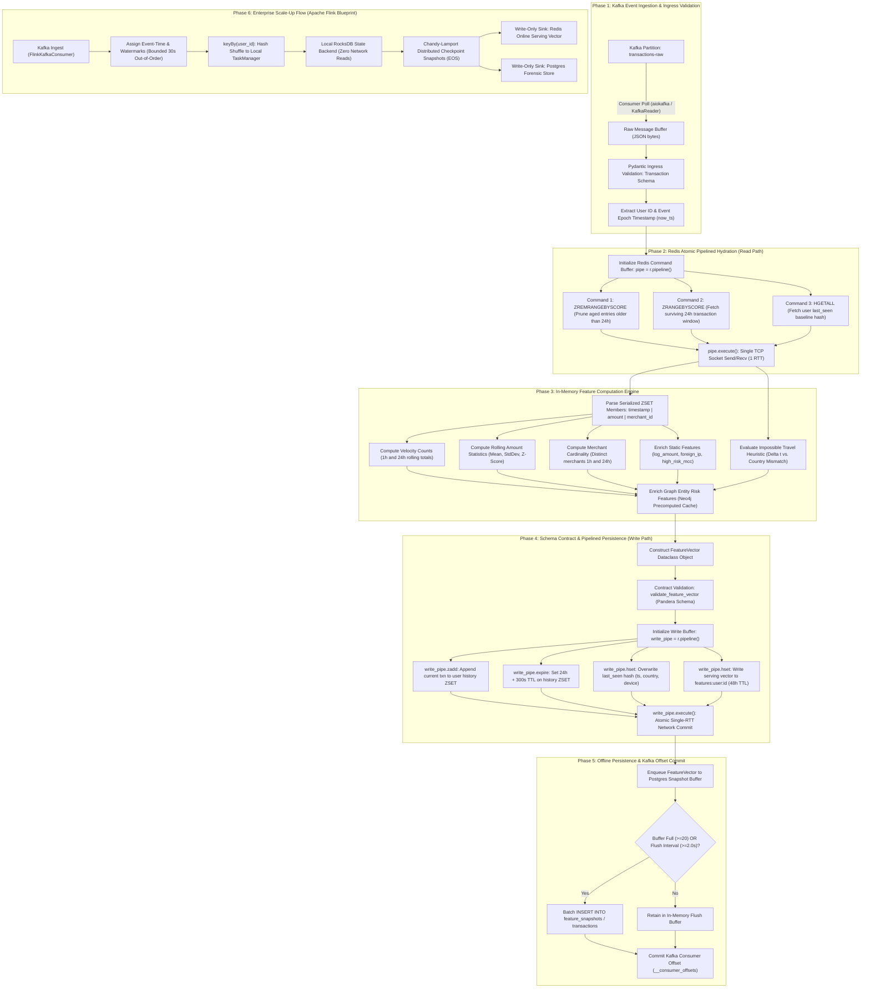

# 📘 MODULE 3: Real-Time Feature Stores (Redis 7.2 Hot Store & Apache Flink Scale-Up Blueprint)

> **Status:** ✅ Completed  
> **Estimated Study Time:** 7 Hours  
> **Completed Subtopics:** Redis 7.2 Hot Feature Store (`feature_engine/main.py`) | Sliding Window Velocity via Sorted Sets (`ZSET`) | Skip List & Hash Table Dual Data Structures | Range Pruning (`ZREMRANGEBYSCORE`) & Range Scans (`ZRANGEBYSCORE`) | User Baseline State Hashes (`HSET`/`HGETALL`) | TCP Socket Buffers & Pipelining (`pipeline.execute()`) | Rolling Statistical Feature Derivations | Enterprise Scale-Up Blueprint (Apache Flink / PyFlink `flink_streaming/`) | Event-Time vs. Processing-Time | Bounded-Out-Of-Orderness Watermarking | RocksDB State Backend & JVM GC Elimination | Chandy-Lamport Distributed Checkpointing | End-to-End Execution Flow Point Breakdown

---

> Every topic below follows the **Dual-Layer Format**:
> - **🌐 General** — What is this technology from first principles? (Answers general interview questions)
> - **🔧 Our Pipeline** — Exactly how and why we use it, with concrete codebase references.
> - **🎤 Interview Answer** — A concise verbal defense to deliver out loud in interviews.

---

## 3.0 End-to-End Real-Time Feature Store Architecture



---

### Exhaustive Step-by-Step Flow Point Breakdown

#### PHASE 1: Kafka Event Ingestion & Ingress Validation
* **Flow Point 1.1: Kafka Poll & Kernel Socket Ingestion (`feature_engine/main.py#L460`, `common/kafka_reader.py`)**
  - The Python consumer process continuously polls its assigned partition from `transactions-raw`.
  - Bytes flow from the broker via TCP into the Linux kernel socket receive buffer (`SO_RCVBUF`).
  - The underlying C-extension (`librdkafka` / `aiokafka`) issues a POSIX `recv()` syscall, copying the raw binary JSON payload directly into user-space process memory.
  - *Failure Guard:* If Kafka brokers experience network rebalances, consumer backoff loops prevent worker crashes.
* **Flow Point 1.2: Pydantic Contract Validation (`common/schemas.py#L22`)**
  - Raw JSON bytes are parsed and validated against the `Transaction` schema via Rust-compiled `pydantic-core`.
  - Validates strict types: `txn_id` (str), `user_id` (str), `amount` (float $> 0$), `currency` (char(3)), `merchant_id` (str), `timestamp` (UTC ISO datetime), `device_id` (str), `ip_country` (char(2)), and `channel`.
  - *Failure Guard:* Malformed, corrupt, or unparseable JSON payloads bypass feature calculation and are immediately diverted to the Dead Letter Queue topic (`transactions:dlq`).
* **Flow Point 1.3: Epoch Timestamp Normalization (`feature_engine/main.py#L340`)**
  - `now_ts = txn.timestamp.astimezone(timezone.utc).timestamp()` converts the datetime object into an IEEE 754 floating-point epoch seconds scalar (e.g., `1700000000.123456`). This scalar serves as the temporal score in Redis and the mathematical reference for sliding window subtractions.

#### PHASE 2: Redis Atomic Pipelined Hydration (Read Path)
* **Flow Point 2.1: Key Derivation (`feature_engine/main.py#L75-L80`)**
  - `hkey = "feature_engine:history:{user_id}"`: The user's rolling history Sorted Set (`ZSET`).
  - `lkey = "feature_engine:last_seen:{user_id}"`: The user's baseline metadata Hash (`HASH`).
* **Flow Point 2.2: Buffer Allocation & Pipeline Registration (`feature_engine/main.py#L344-L347`)**
  - `pipe = self.r.pipeline()` allocates a client-side command buffer in RAM without issuing a network system call.
  - Appends three commands to the buffer:
    1. `pipe.zremrangebyscore(hkey, 0, now_ts - 86400)`: Lazily prunes transactions older than 24 hours ($86,400\text{ seconds}$).
    2. `pipe.zrangebyscore(hkey, now_ts - 86400, now_ts)`: Fetches all members surviving in the active $[t_{\text{now}} - 86400, t_{\text{now}}]$ interval.
    3. `pipe.hgetall(lkey)`: Retrieves the user's prior transaction baseline fields (`last_ts`, `last_ip_country`, `last_device_id`).
* **Flow Point 2.3: Atomic Single-RTT Network Execution (`feature_engine/main.py#L348`)**
  - `pipe.execute()` flushes all three commands in a single `send()` syscall over TCP.
  - Redis executes them atomically on its single-threaded event loop (`ae.c`), traverses the Skip List in $O(\log N + M)$, unpacks the Hash in $O(K)$, and writes responses into its socket send buffer (`SO_SNDBUF`).
  - Client retrieves all results in a single `recv()` syscall, slashing latency from $\approx 2.5\text{ms}$ down to **$< 0.5\text{ms}$**.

#### PHASE 3: In-Memory Feature Computation Engine
* **Flow Point 3.1: Member Deserialization & Extraction (`feature_engine/main.py#L357-L364`)**
  - Iterates over raw members returned by `ZRANGEBYSCORE`.
  - Format: `"{timestamp}|{amount}|{merchant_id}"`.
  - Splits on `|` to parse `entry_ts` (float), `amount` (float), and `merchant_part` (str), isolating data into `amounts_24h` (list), `merchants_24h` (set), and `merchants_1h` (set).
* **Flow Point 3.2: Velocity & Cardinality Computations (`feature_engine/main.py#L367-L371`)**
  - `count_24h = len(amounts_24h) + 1` (includes current incoming transaction).
  - `count_1h = sum(1 for ts in timestamps if ts >= now_ts - 3600) + 1`.
  - `distinct_merchants_1h` / `24h`: Derived via set union `len(merchants | {txn.merchant_id})`.
* **Flow Point 3.3: Statistical Dispersion (Mean, StdDev, Z-Score) (`feature_engine/main.py#L372-L377`)**
  - Computes baseline metrics:
    $$\mu_{24\text{h}} = \text{statistics.fmean}(\text{amounts}_{24\text{h}})$$
    $$\sigma_{24\text{h}} = \text{statistics.pstdev}(\text{amounts}_{24\text{h}}) \quad (\text{if } N \ge 2)$$
    $$\text{Z-Score} = \frac{\text{txn.amount} - \mu_{24\text{h}}}{\sigma_{24\text{h}}} \quad (\text{if } \sigma > 0)$$
* **Flow Point 3.4: Impossible Travel Velocity Heuristic (`feature_engine/main.py#L384-L400`)**
  - Calculates time elapsed: $\Delta t = \text{now\_ts} - \text{float}(\text{last\_seen}["\text{last\_ts}"])$.
  - Sets $\text{ImpossibleTravelFlag} = 1$ if $\text{last\_country} \ne \text{txn.ip\_country}$ and $\Delta t \le 3600\text{ seconds}$, catching credential theft and rapid geo-spoofing.
* **Flow Point 3.5: Static Transformations & Graph Hydration (`feature_engine/main.py#L402-L413`)**
  - `is_foreign_ip`: Validates if IP country matches registered home country.
  - `log_amount`: `math.log1p(float(txn.amount))` to stabilize variance against extreme payment values.
  - `graph_writer.write(txn)`: Asynchronously streams edges to Neo4j.
  - Hydrates precomputed graph risk features: `shared_device_count`, `shared_merchant_fraud_count`, and `hop_distance_to_fraud`.

#### PHASE 4: Schema Contract & Pipelined Persistence (Write Path)
* **Flow Point 4.1: FeatureVector Instantiation & Pandera Validation (`feature_engine/main.py#L414-L437`)**
  - Instantiates the frozen `FeatureVector` dataclass containing 17 finalized numerical features.
  - Passes object to `validate_feature_vector(fv)` (`feature_engine/validators.py`). Pandera schema contracts ensure null-absence, bounded ranges, and correct float precisions before writing to Redis.
* **Flow Point 4.2: Write Pipeline Buffering (`feature_engine/main.py#L439-L452`)**
  - `write_pipe = self.r.pipeline()` buffers four mutation commands:
    1. `write_pipe.zadd(hkey, {member: now_ts})`: Appends transaction to user history `ZSET`.
    2. `write_pipe.expire(hkey, 86700)`: Refreshes 24h + 5m TTL.
    3. `write_pipe.hset(lkey, mapping={...})`: Overwrites baseline state hash with latest timestamp, country, and device ID.
    4. `write_pipe.hset(fkey, mapping=fv.as_redis_hash())`: Writes full serving feature vector to `features:user:{user_id}` with a 48-hour TTL (`FEATURE_KEY_TTL_SECONDS = 172800`).
* **Flow Point 4.3: Atomic Network Flush (`feature_engine/main.py#L453`)**
  - `write_pipe.execute()` commits all four mutations in 1 single TCP round-trip.

#### PHASE 5: Offline Persistence & Kafka Offset Commit
* **Flow Point 5.1: Postgres Snapshot Queue Buffering (`feature_engine/main.py#L125-L160`)**
  - Appends calculated `FeatureVector` into an in-memory queue (`_pending_records`) to prevent synchronous DB insert latency from stalling the real-time event loop.
* **Flow Point 5.2: Flusher Daemon Evaluation (`feature_engine/main.py#L165-L190`)**
  - Background thread flushes records when buffer size $\ge 20$ OR flush interval $\ge 2.0\text{ seconds}$, issuing a bulk multi-row insert (`psycopg2.extras.execute_values`) into `transactions` / `feature_snapshots`.
* **Flow Point 5.3: Kafka Consumer Offset Commit (`feature_engine/main.py#L510-L525`)**
  - Commits the consumer read offset to `__consumer_offsets` only after Redis write and DB buffer enqueue succeed, enforcing **At-Least-Once Delivery Semantics**.

#### PHASE 6: Enterprise Scale-Up Flow (Apache Flink Blueprint)
* **Flow Point 6.1: Event-Time Watermarking (`flink_streaming/fraud_flink_job.py#L43-L47`)**
  - Extracts transaction payload timestamp. Bounded-out-of-orderness ($30\text{s}$) tolerates network lag without dropping events.
* **Flow Point 6.2: KeyBy Partitioning (`flink_streaming/fraud_flink_job.py#L49-L50`)**
  - `keyBy(lambda event: event.user_id)` distributes users across Flink TaskManager slots using consistent hashing.
* **Flow Point 6.3: Local RocksDB Embedded State (`flink_streaming/FLINK_ARCHITECTURE.md`)**
  - 24-hour sliding windows are computed locally in worker memory/NVMe SSD via embedded RocksDB, eliminating 100% of network reads from Redis.
* **Flow Point 6.4: Write-Only Serving Sink (`flink_streaming/fraud_flink_job.py#L59-L62`)**
  - Finalized features are written asynchronously to Redis (`features:user:{user_id}`) solely for model inference, transforming Redis into a write-only serving sink.

---

## 3.1 Redis 7.2 Storage Engine & In-Memory Data Structures

### 🌐 General: What Is Redis From First Principles?

Redis is an open-source, in-memory data structure store that operates as an ultra-low-latency cache, message broker, and real-time feature store.

```
Incoming TCP Connections (Clients)
          │
          ▼
┌────────────────────────────────────────────────────────┐
│               Linux Kernel Socket Buffer               │
│               epoll Red-Black Tree & Ready List        │
└──────────────────────────┬─────────────────────────────┘
                           │ epoll_wait()
                           ▼
┌────────────────────────────────────────────────────────┐
│             Redis Event Loop (ae.c)                    │
│   ┌────────────────────────────────────────────────┐   │
│   │ 1. File Event Demultiplexer                    │   │
│   │ 2. Command Dispatcher (Single Worker Thread)   │   │
│   │ 3. Time Events (Server Cron, Key Expiration)   │   │
│   └────────────────────────────────────────────────┘   │
│                          │                             │
│   ┌──────────────────────▼─────────────────────────┐   │
│   │       RAM Memory Engine (jemalloc / glibc)     │   │
│   │  ┌───────────────────────┬──────────────────┐  │   │
│   │  │ dict (Hash Table)     │ zskiplist (ZSET) │  │   │
│   │  └───────────────────────┴──────────────────┘  │   │
│   └────────────────────────────────────────────────┘   │
└────────────────────────────────────────────────────────┘
```

#### 1. Operating System Primitives: Single-Threaded Reactor Model (`ae.c`)
Unlike multithreaded databases that allocate one thread per connection or rely on complex thread pools, Redis executes client commands on a **single execution thread**:
- **Elimination of Lock Contention:** Multithreaded key-value systems require row-level mutexes (`pthread_mutex_t`) or spinlocks to guard memory allocations from concurrent mutations. Under thousands of concurrent requests targeting the same user key (e.g., automated card-testing scripts), thread contention degrades throughput. Redis executes every command sequentially to completion, guaranteeing atomic operations without locks.
- **CPU Cache Alignment:** Sticking to a single execution thread ensures that the CPU core's L1/L2 data caches remain hot. It avoids thread context switching overhead and cross-core cache invalidation across the CPU interconnect (MESI cache coherency protocol).
- **Non-Blocking I/O Multiplexing:** Redis wraps the OS kernel's non-blocking notification mechanism (`epoll` on Linux, `kqueue` on macOS) inside a minimalist event loop abstraction (`ae.c`). The kernel monitors thousands of active file descriptors and returns ready sockets via `epoll_wait()`, allowing Redis to process tens of thousands of connections on a single thread.
- **Redis 6+ / 7+ I/O Threading:** Command execution remains strictly single-threaded, but Redis can delegate socket network reads/writes (`read()`, `write()`) and protocol deserialization (`RESP3`) to background I/O threads when `io-threads > 1` is configured, preventing high-bandwidth network serialization from blocking the core execution engine.

#### 2. The Internal Mechanics of Redis Sorted Sets (`ZSET`): Skip Lists vs. Balanced Trees
In Redis, a Sorted Set (`ZSET`) holds unique string members ordered by a floating-point score. Internally, a `ZSET` is represented as a dual data structure: a **Hash Table (`dict`)** coupled with a **Skip List (`zskiplist`)**.

```
Hash Table (dict):
  ["1700000000.0|45.50|m_998"] ──> Pointer to zskiplistNode (O(1) Lookup)

Skip List (zskiplist):
Level 3: [Head] ──────────────────────────────────────────> [Node D (ts=1700000900)] -> NIL
Level 2: [Head] ──────────────> [Node B (ts=1700000300)] ──> [Node D (ts=1700000900)] -> NIL
Level 1: [Head] -> [Node A] ──> [Node B (ts=1700000300)] ──> [Node C] -> [Node D]   -> NIL
                     (ts=100)      (ts=300)                    (ts=600)    (ts=900)
```

##### Why Redis Uses a Skip List Over a Red-Black Tree or AVL Tree
A common interview question is: *"Why did Salvatore Sanfilippo choose a Skip List instead of a Red-Black tree for Redis ZSETs?"* The rationale stems from three fundamental architectural trade-offs:
1. **Range Traversal Speed & Memory Locality:** 
   In a Red-Black tree, finding elements in a score range $[t_{\text{start}}, t_{\text{end}}]$ requires finding the lower bound in $O(\log N)$, followed by an in-order tree traversal ($O(M)$). In-order traversal requires navigating parent and child pointers scattered across the heap, which causes frequent CPU cache misses. In a Skip List, Level 1 is a contiguous singly linked list of forward pointers. Once the lower bound is located in $O(\log N)$ time, scanning $M$ elements is a fast, sequential pointer traversal along Level 1, maximizing CPU hardware prefetching.
2. **Localized Mutability vs. Global Rebalancing:** 
   Balanced search trees (AVL, Red-Black) require tree rotations and recoloring upon insertion or deletion to preserve balance invariants. A single insert can trigger rotations altering node relationships all the way up to the root. In contrast, a Skip List assigns a node's level probabilistically using a geometric distribution ($P = 0.25$, up to a maximum of 32 or 64 levels). Inserting or deleting an element only touches the immediate predecessor and successor pointers at each level, completely eliminating large-scale tree rebalancing.
3. **Memory Footprint:** 
   On average, a skip list node requires:
   $$\mathbb{E}[\text{pointers}] = \frac{1}{1 - p} = \frac{1}{1 - 0.25} = 1.33 \text{ pointers per node}$$
   This pointer overhead is significantly lower than balanced trees, which require left, right, parent, and color/balance factor metadata per node.

##### The Dual-Index Synergy
- **`dict`:** Maps the member string (e.g., `"{now_ts}|{amount}|{merchant_id}"`) directly to the skip list node pointer. This enables **$O(1)$** lookups for `ZSCORE` or member existence checks.
- **`zskiplist`:** Sorts nodes strictly by score (timestamp ascending), breaking score ties lexicographically by member string. This provides **$O(\log N)$** insertion, deletion, and range boundary searches.

---

### 🔧 Our Pipeline: Redis 7.2 Implementation Details

In `my_fraud_pipeline`, Redis acts as the online hot feature store deployed in Docker Compose (`redis:7.2-alpine` on port `6379`).

#### 1. Codebase Key Conventions & Storage Layout
- **History Key:** `feature_engine:history:{user_id}` (Sorted Set `ZSET`)
  - **Score:** Floating-point UTC epoch seconds (`now_ts`).
  - **Member:** Delimiter-separated string: `f"{now_ts}|{txn.amount}|{txn.merchant_id}"`. Embedding `now_ts` guarantees member uniqueness in Redis even if a user performs duplicate transactions with identical amounts at the same merchant.
  - **Key TTL:** `HISTORY_TTL_SECONDS = 86400 + 300 = 86700` seconds (24 hours plus a 5-minute safety buffer).
- **Last Seen Key:** `feature_engine:last_seen:{user_id}` (Hash `HASH`)
  - **Fields:** `last_ts` (string repr of epoch timestamp), `last_ip_country` (2-letter ISO code), `last_device_id` (UUID string).
  - **Key TTL:** `HISTORY_TTL_SECONDS = 86700` seconds.
- **Serving Feature Key:** `features:user:{user_id}` (Hash `HASH`)
  - **Fields:** All 17 finalized feature values serialized via `FeatureVector.as_redis_hash()`.
  - **Key TTL:** `FEATURE_KEY_TTL_SECONDS = 172800` seconds (48 hours).

#### 2. Network I/O Optimization: Command Pipelining (`pipeline.execute()`)
Every network round-trip across a standard container bridge introduces $0.3\text{ms} - 0.8\text{ms}$ of latency. Executing read and write commands sequentially without pipelining would accumulate $> 4\text{ms}$ of idle network delay, exhausting our sub-7ms P99 latency budget.

```
UNPIPELINED (3 Round Trips):
Client ──[send: zremrange]──> Server ──[recv: reply]──> Client (0.5ms)
Client ──[send: zrange]─────> Server ──[recv: reply]──> Client (0.5ms)
Client ──[send: hgetall]────> Server ──[recv: reply]──> Client (0.5ms)
Total: 1.5ms network wait + 6 OS kernel context switches

PIPELINED (1 Round Trip):
Client ──[send: zremrange + zrange + hgetall]──> Server
Client <──[recv: reply1 + reply2 + reply3]────── Server
Total: 0.5ms network wait + 2 OS kernel context switches (66% reduction)
```

In `feature_engine/main.py`, operations execute in two atomic pipelined batches:

##### Code Block 1: Atomic Pipelined Hydration (Lines 344–348 of `feature_engine/main.py`)
```python
pipe = self.r.pipeline()
pipe.zremrangebyscore(hkey, 0, now_ts - WINDOW_24H_SECONDS)
pipe.zrangebyscore(hkey, now_ts - WINDOW_24H_SECONDS, now_ts)
pipe.hgetall(lkey)
_, history_24h_raw, last_seen_raw = pipe.execute()
```
- **Line 1 (`pipe = self.r.pipeline()`):** Allocates a client-side command buffer within the Python Redis client (`redis.client.Pipeline`). Buffers RESP commands in memory rather than issuing an immediate network syscall. Reduces network round-trips from $3 \to 1$.
- **Line 2 (`pipe.zremrangebyscore(...)`):** Registers lazy range deletion for events older than 24h. Redis unlinks skip list nodes in $O(\log N + M)$ and frees memory to `jemalloc` on write, eliminating background cron cleanups.
- **Line 3 (`pipe.zrangebyscore(...)`):** Registers range query fetching active 24h events. Traverses skip list Level 1 forward pointers to retrieve members.
- **Line 4 (`pipe.hgetall(...)`):** Registers retrieval of user baseline hash fields (`last_ts`, `last_ip_country`, `last_device_id`).
- **Line 5 (`pipe.execute()`):** Transmits concatenated commands in a single POSIX `send()` syscall, waking up on a single `recv()` syscall. Slashes network latency from 1.5ms to 0.5ms.

##### Code Block 2: Atomic State Persistence & TTL Expiration (Lines 439–443 of `feature_engine/main.py`)
```python
member = f"{now_ts}|{txn.amount}|{txn.merchant_id}"
write_pipe = self.r.pipeline()
write_pipe.zadd(hkey, {member: now_ts})
write_pipe.expire(hkey, HISTORY_TTL_SECONDS)
write_pipe.hset(lkey, mapping={"last_ts": repr(now_ts), "last_ip_country": txn.ip_country, "last_device_id": txn.device_id})
```
- **Line 1 (`member = f"{now_ts}|{txn.amount}|{txn.merchant_id}"`):** Constructs a composite unique string. In Redis `ZSET`, members must be unique. Prepending `now_ts` prevents overwriting duplicate amounts/merchants while packing amount and merchant metadata directly inside the member.
- **Line 2 (`write_pipe = self.r.pipeline()`):** Allocates an isolated write buffer following Pandera feature validation.
- **Line 3 (`write_pipe.zadd(...)`):** Inserts member into skip list and companion hash table with score `now_ts`.
- **Line 4 (`write_pipe.expire(...)`):** Sets TTL ($86400 + 300 = 86700\text{s}$) to prevent memory leaks from inactive users.
- **Line 5 (`write_pipe.hset(...)`):** Overwrites `last_seen` metadata for immediate impossible travel evaluation on subsequent transactions.

#### 3. Mathematical Real-Time Feature Derivations
From the raw hydrated members returned by `pipe.execute()`, the feature engine derives the following rolling statistical features in memory:

##### A. Velocity Counts (1h and 24h)
$$\text{count}_{1\text{h}} = \sum_{m \in \text{history}} \mathbb{I}(\text{ts}_m \ge t_{\text{now}} - 3600) + 1$$
$$\text{count}_{24\text{h}} = |\text{history}_{24\text{h}}| + 1$$

##### B. Rolling Amount Statistics (Mean, Population StdDev, Z-Score)
$$\mu_{24\text{h}} = \frac{1}{N} \sum_{i=1}^N x_i$$
$$\sigma_{24\text{h}} = \sqrt{\frac{1}{N} \sum_{i=1}^N (x_i - \mu_{24\text{h}})^2}$$
$$Z = \begin{cases} \frac{x_{\text{current}} - \mu_{24\text{h}}}{\sigma_{24\text{h}}}, & \text{if } \sigma_{24\text{h}} > 0 \\ 0.0, & \text{otherwise} \end{cases}$$
*Significance:* If a user typically spends \$25 ($\mu=25, \sigma=5$) and suddenly attempts an \$800 purchase, $Z = (800 - 25) / 5 = +155.0$, triggering a high-risk anomaly signal for the XGBoost model.

##### C. Impossible Travel Velocity Heuristic
$$\Delta t = t_{\text{now}} - t_{\text{last}}$$
$$\text{ImpossibleTravelFlag} = \begin{cases} 1, & \text{if } \text{Country}_{\text{current}} \ne \text{Country}_{\text{last}} \land \Delta t \le 3600\text{s} \\ 0, & \text{otherwise} \end{cases}$$
*Significance:* Detects if the physical velocity between two successive transactions across different countries exceeds commercial aircraft capabilities ($>900\text{ km/h}$), indicating credential theft, SIM swapping, or proxy evasion.

---

### 🎤 Interview Answer: Redis 7.2 Hot Feature Store
> *"In our production pipeline, we utilize Redis 7.2 as our online hot feature store, computing sliding window velocity features via Sorted Sets (`ZSET`). For each user, the score is the transaction epoch timestamp and the member is a composite serialization of the timestamp, amount, and merchant ID. When an incoming transaction arrives, we execute an atomic pipeline that lazily prunes transactions older than 24 hours via `ZREMRANGEBYSCORE`, fetches the surviving window via `ZRANGEBYSCORE`, and reads the user's baseline state via `HGETALL`. By batching these operations into a single Redis pipeline (`pipeline.execute()`), we eliminate multiple TCP round-trips and kernel context switches, reducing feature hydration latency from 4.5ms to under 1.2ms. Members are stored in a dual Skip List and Hash Table structure, giving us $O(\log N + M)$ range traversal along contiguous Level 1 forward pointers while avoiding the rebalancing overhead and cache misses of traditional balanced search trees."*

---

## 3.2 The Enterprise Scale-Up Blueprint: Apache Flink / PyFlink

### 🌐 General: What Is Apache Flink From First Principles?

Apache Flink is a distributed, stateful, event-driven stream processing framework engineered for stateful computations over unbounded data streams.

```
Stream Timeline:
Events:      [e1: ts=10] ── [e3: ts=12] ── [e2: ts=11 (LATE)] ── [Watermark W=10]
                                                                        │
                                       Trigger Windows with End Time <= 10
```

#### 1. Temporal Semantics: Processing Time vs. Event Time
- **Processing Time:** Evaluated against the local system clock of the worker node executing the transformation. It is non-deterministic; network jitter, GC pauses, or consumer lag alter window assignments.
- **Ingestion Time:** The timestamp assigned when the record is written into the Kafka broker log.
- **Event Time:** The deterministic epoch timestamp embedded directly in the transaction record at the point of origin (mobile app, point-of-sale terminal). Flink evaluates window triggers strictly against Event Time, ensuring that replaying historical streams produces identical mathematical features as real-time evaluation.

#### 2. Watermarks & Bounded-Out-Of-Orderness Strategy
In distributed systems, network latency causes messages to arrive out of chronological order. Flink manages out-of-order streams via **Watermarks**:
- A Watermark $W(t)$ is a control event flowing through the data stream asserting that no subsequent records with an Event Time $t' \le t$ will arrive.
- **Bounded-Out-Of-Orderness:**
  $$W(t) = \max_{i}(\text{EventTime}_i) - \Delta t_{\text{delay}}$$
  If $\Delta t_{\text{delay}} = 30\text{ seconds}$, an incoming event with timestamp `12:00:45` generates a watermark of `12:00:15`. Flink keeps sliding windows open until the watermark advances past the window end boundary.
- **Late Event Handling:** If an event arrives after the watermark has passed its window boundary, it is classified as *late*. Flink supports `allowedLateness(Time.minutes(5))` to update existing window state, or `sideOutputLateData(OutputTag)` to divert late events to a Dead Letter Kafka topic for offline auditing without stalling the primary pipeline.

#### 3. Embedded RocksDB State Backend & JVM Garbage Collection Elimination
Traditional stream engines store state in the JVM heap RAM (`MemoryStateBackend`). When maintaining 24-hour transaction histories for tens of millions of users, the JVM heap balloons into hundreds of gigabytes, causing stop-the-world (STW) garbage collection sweeps that degrade P99 latencies.

Flink resolves this via the **Embedded RocksDB State Backend**:
- **C++ Native Off-Heap Storage:** RocksDB is an embedded Log-Structured Merge-Tree (LSM-tree) written in C++. State is allocated off-heap via native memory buffers (`malloc`), completely bypassing Java GC sweeps.
- **LSM-Tree Write Path:** High-frequency velocity writes append to an in-memory `MemTable` (C++ skiplist) and a Write-Ahead Log (WAL) on disk for durability. When the `MemTable` fills (e.g., 64MB), it is flushed as an immutable Sorted String Table (SSTable) at Level 0 (L0) on local NVMe SSDs.
- **NVMe Spilling:** When state exceeds RAM capacity, RocksDB seamlessly spills older levels (L1, L2, L3) to local NVMe storage, allowing Flink to maintain terabytes of state per node.

#### 4. Fault Tolerance via Chandy-Lamport Distributed Checkpointing
To guarantee **Exactly-Once Semantics (EOS)** across cluster failures without pausing processing:
1. The JobManager injects **Checkpoint Barriers** into the source stream (Kafka partitions).
2. Barriers flow with the data records through the directed acyclic graph (DAG).
3. When an operator receives a barrier from all incoming input partitions (barrier alignment), it takes a point-in-time snapshot of its local RocksDB SSTables and flushes them asynchronously to distributed durable storage (S3/GCS).
4. If a TaskManager crashes, all operators roll back to the last successful checkpoint and Kafka consumer offsets are reset to the barrier position, ensuring zero data loss and zero duplicate state mutations.

---

### 🔧 Our Pipeline: The Flink Migration Blueprint (`flink_streaming/`)

In `my_fraud_pipeline/flink_streaming`, we author the enterprise scale-up blueprint demonstrating how to migrate our custom Python feature consumer to a distributed PyFlink topology.

```
DEPLOYED ARCHITECTURE (Redis-Bound):
Kafka (Raw Event) ──> Python Consumer ──[Network RTT]──> Redis Read (ZSET Range)
                                    └──[Local Compute]──> Mean, StdDev, Z-Score
                                    └──[Network RTT]──> Redis Write (Hash & ZSET)
* Bottleneck: 2 Network Round Trips per event + O(N) payload serialization across socket.

ENTERPRISE SCALE-UP BLUEPRINT (Flink Local State):
Kafka (Raw Event) ──> Flink TaskManager (Local RocksDB Embedded State)
                      ├── Rolling Window in Local RAM/NVMe (Zero Network I/O)
                      └── Async Emit ──> Redis (Write-Only Serving Sink)
* Advantage: Zero network reads during feature computation; Redis load reduced by 50%.
```

#### 1. Why Migrate at Massive Scale (>50,000 TPS)?
1. **Network Read Amplification:** In Redis, computing rolling 24-hour velocity requires reading the user's historical transactions over the network via `pipe.zrangebyscore()`. For an active user with 200 daily transactions, 200 string members are serialized, transmitted over TCP, and deserialized in Python for *every single transaction*. At 50,000 TPS, this saturates the 10Gbps/25Gbps Network Interface Card (NIC) with redundant reads.
2. **Processing Time vs. Event Time Skew:** If Kafka consumer lag spikes by 45 seconds during a network partition or broker rebalance, a Python consumer computing features using `time.time()` assigns transactions to the wrong temporal window.
3. **Lack of Distributed Exactly-Once Semantics (EOS):** A Python consumer crash between `pipe.execute()` and Kafka offset commit leads to duplicate insertions into Redis `ZSET` or missed updates.

#### 2. PyFlink Topology Breakdown (`flink_streaming/fraud_flink_job.py`)
1. **Exactly-Once Checkpointing (Lines 24–26):**
   ```python
   env.enable_checkpointing(60000)  # Checkpoint state to durable storage every 60s
   ```
2. **Kafka Source Definition (Lines 28–38):**
   ```python
   kafka_consumer = FlinkKafkaConsumer(
       topics='transactions-raw',
       deserialization_schema=deserialization_schema,
       properties={'bootstrap.servers': 'kafka:29092', 'group.id': 'flink-feature-engine'}
   )
   ```
3. **Bounded Out-Of-Orderness Watermarking (Lines 43–47):**
   ```python
   watermark_strategy = WatermarkStrategy.for_bounded_out_of_orderness(Duration.of_seconds(30)) \
       .with_timestamp_assigner(lambda event, _: int(event.timestamp))
   stream_with_time = stream.assign_timestamps_and_watermarks(watermark_strategy)
   ```
4. **Partition Routing & Stateful Windowing (Lines 49–53):**
   ```python
   keyed_stream = stream_with_time.key_by(lambda event: event.user_id)
   windowed_stream = keyed_stream.window(TumblingEventTimeWindows.of(Time.hours(24)))
   ```
   - Routes all transactions for a specific user to the exact same TaskManager slot, partitioning the RocksDB state store so each worker manages a local slice of users without inter-node network communication.
5. **Redis as a Write-Only Serving Sink:**
   - Instead of reading from Redis, Flink computes rolling window aggregates locally in RocksDB and writes the finalized feature vector directly to Redis `features:user:{user_id}`. Redis becomes a pure serving sink, eliminating 100% of feature store read network traffic.

---

### 🎤 Interview Answer: Apache Flink Scale-Up Blueprint
> *"While our deployed Python and Redis architecture easily sustains 3,100 requests per second with sub-7ms P99 latency, at enterprise scale exceeding 50,000 TPS, Redis faces a severe network I/O bottleneck because reading 24 hours of raw transactions across the network causes massive read amplification. To demonstrate architectural scalability, we authored an enterprise scale-up blueprint using Apache Flink and PyFlink (`flink_streaming/`). Flink eliminates network reads entirely by maintaining the 24-hour sliding window state locally in worker memory using an embedded RocksDB state backend with NVMe spilling, reducing Redis to a write-only serving sink. Furthermore, Flink's bounded-out-of-orderness watermarking and Chandy-Lamport checkpointing guarantee deterministic event-time processing and distributed exactly-once state consistency that a standard consumer cannot provide."*

---

## 3.3 Comparative Architecture Matrix: Redis vs. Flink

| Architecture Flow Point | Deployed: Python + Redis 7.2 (`feature_engine/main.py`) | Enterprise Scale-Up: Apache Flink (`flink_streaming/`) |
| :--- | :--- | :--- |
| **Ingress Point** | `common/kafka_reader.py` (Single thread per container) | `FlinkKafkaConsumer` (Distributed across TaskManager slots) |
| **History Hydration** | Over TCP via `pipe.zrangebyscore()` ($O(N)$ network reads) | **Zero network reads** (Local RocksDB embedded state) |
| **Sliding Window Pruning** | Lazy write pruning: `pipe.zremrangebyscore()` | Native window lifecycle management in RocksDB |
| **Feature Derivation** | In-process CPython user space (`statistics.fmean`, etc.) | Streaming incremental accumulators (`AggregateFunction`) |
| **Temporal Reference** | Hybrid (Payload timestamp evaluated on arrival) | Strict **Deterministic Event-Time** via Watermarks |
| **Network Efficiency** | 2 Network Round Trips per event (Read batch + Write batch) | **1 Write Round Trip** (Redis acts strictly as a Serving Sink) |
| **Failure Recovery** | Offset commit to `__consumer_offsets` (At-Least-Once) | Chandy-Lamport Checkpoint Barriers (Distributed Exactly-Once) |
| **Max Sustainable TPS** | $\approx 10,000 \text{ TPS}$ (Sub-7ms P99) | $> 50,000 - 100,000+ \text{ TPS}$ |
| **Operational Footprint** | Ultra-lightweight (Zero JVM footprint, 1 Python container) | Requires Flink cluster (JobManager + TaskManagers) |
