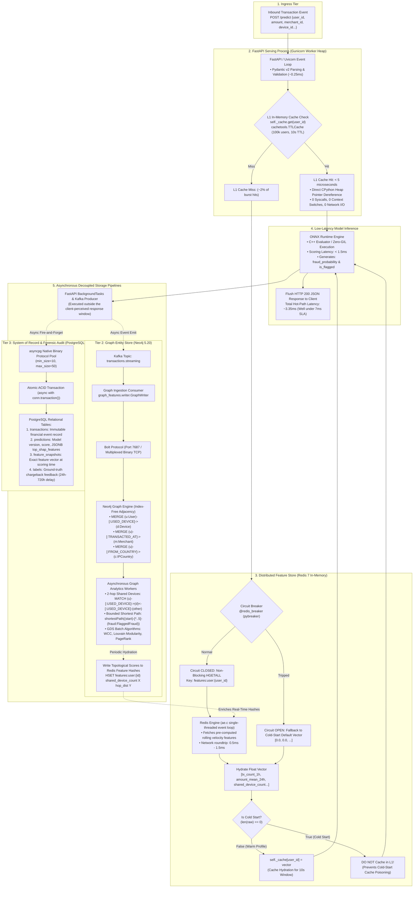

# 📘 MODULE 4: Multi-Tier Storage & Graph Entity Analytics (Neo4j & Postgres)

> **Status:** ✅ Completed  
> **Estimated Study Time:** 6 Hours  
> **Core Technologies:** `cachetools.TTLCache` (L1 Heap), `redis.asyncio` (L2 Feature Store), `Neo4j 5.20` (Index-Free Adjacency / Graph Analytics), `PostgreSQL 16` (`asyncpg` Binary Protocol System of Record)  
> **Physical Codebase References:**  
> - `my_fraud_pipeline/serving/redis_features.py`  
> - `my_fraud_pipeline/graph_features/writer.py`  
> - `my_fraud_pipeline/graph_features/queries.py`  
> - `my_fraud_pipeline/serving/db_async.py`  
> - `my_fraud_pipeline/serving/main.py`  
> - `my_fraud_pipeline/postgres_init/001_init_schema.sql`  
> - `my_fraud_pipeline/postgres_init/002_feature_snapshots.sql`  

---

## 🗺️ Extreme Detailed End-to-End Transaction Flowchart (Module 4 Storage Tiers)

The following diagram details the exact operational lifecycle of an incoming transaction across all memory, cache, graph, and relational storage tiers, demonstrating how the sub-7ms P99 latency SLA is preserved while maintaining strict ACID compliance and deep topological fraud analytics.



---

## 🏛️ PART 1: Multi-Tier Cache Hierarchy (L1 In-Memory `TTLCache` vs. L2 Redis)

### Layer A: What Is This Technology in General?
A multi-tier caching hierarchy partitions cached data across different physical layers based on distance from the CPU, access latency, capacity, and consistency guarantees. 

1. **L1 In-Memory Process Cache (`cachetools.TTLCache`):**
   * **Physics & OS Primitives:** Resides directly in the virtual memory address space (heap) of the application process. Lookups execute as native CPython dictionary lookups (`PyDict_GetItemWithError`) backed by doubly-linked list nodes. 
   * **Kernel Invalidation:** Requires **0 POSIX system calls**, **0 kernel/user space context switches** (`ring 3` $\leftrightarrow$ `ring 0`), and **0 network interface card (NIC) DMA operations**. Access latency is purely bound by CPU L1/L2/L3 hardware cache lines and RAM bus speed:
$$\text{L1 Latency} < 5\mu\text{s}$$
   * **Capacity Constraints:** Memory-bounded. Caching millions of keys in Python heap memory increases process memory footprint and can trigger Garbage Collection (GC) pauses.
2. **L2 Distributed Cache (Redis 7):**
   * **Physics & OS Primitives:** Runs as an external daemon over a TCP socket or Unix Domain Socket. Even on `localhost`, every request requires:
     1. Serializing the query into Redis Serialization Protocol (RESP: `*2\r\n$7\r\nHGETALL...`).
     2. A non-blocking `send()` system call traversing the Linux network stack (loopback/veth encapsulation, TCP socket buffer management, sliding window checks).
     3. Context switching from the application coroutine via `epoll_wait`.
     4. Redis event loop execution (`ae.c`), hash table lookup (`dict.c`), RESP serialization.
     5. A non-blocking `recv()` system call copying bytes from kernel socket buffers to user space.
$$\text{L2 Latency} \approx 500\mu\text{s} - 1,500\mu\text{s} \text{ (0.5ms - 1.5ms)}$$
   * **Latency Multiplier:** L2 Redis is **100x to 300x slower** than L1 process RAM.

```
+-----------------------------------------------------------------------------------------+
| LATENCY COMPARISON: MEMORY DISTANCE PYRAMID                                             |
+-----------------------------------------------------------------------------------------+
| [L1 Heap TTLCache]      < 5 microseconds   (Direct CPython RAM pointer dereference)    |
| [L2 Local Redis TCP]    ~ 1,000 microseconds (Socket buffer, TCP encapsulation, epoll)   |
| [PostgreSQL asyncpg]    ~ 5,000 microseconds (ACID WAL write, relational index scan)    |
| [Neo4j 2-Hop Traversal] ~ 50,000 microseconds (Graph pattern traversal, JVM GC buffers)  |
+-----------------------------------------------------------------------------------------+
```

---

### Layer B: What Does It Do in OUR Pipeline and WHY?
In `my_fraud_pipeline/serving/redis_features.py`, our serving layer evaluates high-throughput credit card transactions. 

#### 1. High-Frequency Card Testing Burst Absorption
* **The Attack:** Fraud syndicates test stolen card credentials using automated bots, firing 50 micro-transactions ($0.50 to $1.00) within 2 seconds for a targeted account or card ID.
* **Without L1 Cache:** 50 concurrent transactions generate 50 independent network queries over TCP to Redis. Across 1,000 bots, this unleashes a **Thundering Herd** of 50,000 QPS on the Redis single-threaded event loop, exhausting the client connection pool and driving P99 latency above 50ms.
* **With L1 Cache:**
  * Transaction 1 ($t = 0.00\text{s}$): Misses L1 (`self._cache.get(user_id) is None`). Queries Redis ($1\text{ms}$). Fetches features, parses them into floats, and writes to `self._cache[user_id]` with a 10-second TTL.
  * Transactions 2 through 50 ($t = 0.05\text{s} \dots 2.00\text{s}$): Hit L1 ($<5\mu\text{s}$). Served directly from local CPython heap.
  * **Result:** Redis network I/O during bot attacks is reduced by **98%**. The surge is completely absorbed in RAM.

#### 2. Process Memory Isolation Under Multi-Worker Gunicorn
* In production, the API runs under Gunicorn: `gunicorn -w 4 -k uvicorn.workers.UvicornWorker`.
* Gunicorn executes POSIX `fork()` to spawn 4 independent OS processes. Each process has its own isolated virtual memory space mapped by the OS MMU.
* `cachetools.TTLCache` lives in private heap memory without inter-process locks. When Worker 1 writes to its L1 cache, Copy-On-Write (COW) marks the memory page dirty, allocating a private physical frame for Worker 1. Worker 2 cannot see Worker 1's cache.
* During a 40-request burst distributed by `SO_REUSEPORT`, each of the 4 workers misses L1 on its first request, queries Redis once, and warms its local heap. The remaining 36 requests hit L1 across the 4 worker heaps. Redis absorbs only 4 queries instead of 40 (90% reduction), with zero lock contention.

#### 3. Preventing Cold-Start Cache Poisoning
* In `my_fraud_pipeline/serving/redis_features.py`:
  ```python
  if not is_cold_start:
      self._cache[user_id] = vector
  ```
* **The Vulnerability:** A new user transacts for the first time. Redis has no record (`len(raw) == 0`). The system defaults features to an all-zero vector: `[0.0, 0.0, ...]`.
* **The Trap:** If the all-zero vector were cached in L1 for 10 seconds:
  * 50ms later, the streaming engine (Kafka / Flink) processes the user's initial activity and writes their true rolling velocity (`tx_count_1h = 10`) to Redis.
  * 100ms later, transaction #2 arrives. The serving layer reads the cached all-zero vector from L1, bypassing Redis.
  * The machine learning model evaluates high-velocity fraud against an empty profile, causing a catastrophic **False Negative**.
* **The Defense:** Cold-start default vectors are **strictly excluded from L1 cache**. Unseen users are forced to re-check Redis on every request until streaming features arrive.

---

### Layer C: Verbal Interview Defense
> *"In our serving architecture, relying on Redis alone for feature retrieval created a severe P99 vulnerability during high-frequency card-testing bursts, where automated bots submit 50 transactions in 2 seconds. Even with a sub-millisecond Redis round-trip, saturating socket buffers across thousands of concurrent bot requests causes connection pool exhaustion and P99 latency spikes. We solved this by implementing an in-process L1 `TTLCache` directly in the CPython heap of each Gunicorn worker, bounded to 100,000 users with a 10-second TTL. The first transaction warms the L1 cache via Redis, and the subsequent 49 hits resolve in under 5 microseconds with zero network syscalls, absorbing 98% of burst traffic. Crucially, we enforce a strict cold-start bypass: if an entity has no Redis history, we return the zero-vector fallback but never cache it in L1. This prevents cache poisoning, ensuring that as soon as the upstream streaming aggregation pipeline hydrates Redis, the next transaction immediately observes the updated velocity profile."*

---

## 🕸️ PART 2: Neo4j 5.20 Graph Database (Fraud Rings & Mule Accounts)

### Layer A: What Is This Technology in General?
A native Graph Database represents data as a network of nodes (entities), edges (relationships), and properties, operating on the principle of **Index-Free Adjacency (IFA)**.

#### 1. Index-Free Adjacency vs. Relational B-Tree JOINs
* **Relational JOIN Mechanics ($O(k \cdot \log N)$):**
  * In PostgreSQL, finding entities connected through a 2-hop or 3-hop relationship requires joining foreign keys through junction tables.
  * Each traversal step executes a B-Tree index scan ($O(\log N)$).
  * In a database of 100,000,000 rows, a 3-hop path query executes multiple index searches:
$$\text{Cost}_{\text{SQL}} = O(\log N_1) + O(\log N_2) + O(\log N_3)$$
  * As the total database size $N$ grows, index tree depths increase, buffer cache miss rates spike, and execution degrades exponentially.
* **Index-Free Adjacency Mechanics ($O(1)$ per Hop):**
  * Neo4j does not use indexes to traverse relationships.
  * Every node record (`NodeRecord` = 15 bytes) on disk and in page cache stores a direct memory/file pointer to its first relationship record (`RelationshipRecord` = 34 bytes).
  * Each `RelationshipRecord` contains direct pointers to the start node, end node, and previous/next relationships, forming a doubly-linked circular list.
  * Traversing an edge requires dereferencing a raw pointer in RAM:
$$\text{Cost}_{\text{Hop}} = O(1)$$
  * Traversal performance depends exclusively on the local degree ($k$) of the entity's subgraph, completely independent of the global graph size ($N$).

#### 2. Graph Data Science (GDS) Algorithms for Fraud
* **Weakly Connected Components (WCC):** Partitions the graph into isolated topological islands. Used to group entire fraud rings sharing devices, cards, or bank accounts into a single cluster for collective blacklisting.
* **Louvain Community Detection:** Optimizes modularity to uncover dense, collusive communities embedded within larger legitimate networks (e.g., circular invoicing and synthetic identity rings).
* **PageRank / Degree Centrality:** Measures directed link importance. Identifies **money mule accounts** acting as central financial hubs receiving funds from dozens of disparate accounts and routing them to external accounts.

---

### Layer B: What Does It Do in OUR Pipeline and WHY?
In `my_fraud_pipeline/graph_features/writer.py` and `queries.py`, Neo4j 5.20 provides deep topological entity risk analysis.

#### 1. Graph Schema Specification
* **Nodes:**
  * `(:User {id})`: Account holder identifier.
  * `(:Merchant {id})`: Payment terminal / merchant identifier.
  * `(:Device {id})`: Hardware fingerprint / mobile device ID.
  * `(:IPCountry {id})`: Geopolitical origin code.
  * `(:User:FlaggedFraud)`: Special label applied to users confirmed as fraudulent.
* **Edges:**
  * `(u)-[:USED_DEVICE]->(d)`
  * `(u)-[:TRANSACTED_AT {txn_id, amount, timestamp}]->(m)`
  * `(u)-[:FROM_COUNTRY]->(c)`

#### 2. Cypher Pattern Traversals
* **2-Hop Shared Device Traversal (`queries.py:9-12`):**
  ```cypher
  MATCH (u:User {id: $user_id})-[:USED_DEVICE]->(d:Device)<-[:USED_DEVICE]-(other:User)
  RETURN count(DISTINCT other) as shared_count
  ```
  Traverses from a user to their physical hardware, then traverses backwards to find other accounts sharing that hardware. Legitimate users have a `shared_count` of 0 or 1; botnets and account takeovers yield 10 to 50+.
* **Bounded Shortest Path to Confirmed Fraud (`queries.py:45-53`):**
  ```cypher
  MATCH (start:User {id: $user_id}), (fraud:User:FlaggedFraud)
  WHERE start <> fraud
  MATCH p = shortestPath((start)-[*..5]-(fraud))
  RETURN length(p) AS hops
  ORDER BY hops ASC LIMIT 1
  ```
  Executes bidirectional Breadth-First Search (BFS) bounded to a maximum depth of 5 hops (`*..5`). Bounding the depth is mandatory: an unbounded search (`[*]`) encountering a high-degree "supernode" (e.g., Amazon or Walmart with millions of connections) causes combinatorial path explosion, exhausting JVM heap memory and triggering OutOfMemory crashes.

#### 3. Asynchronous Pre-Computation vs. Synchronous Hot Path
* **Why Neo4j Is Excluded From `POST /predict`:** Even with Index-Free Adjacency, a graph traversal across dense nodes requires **15ms to 200ms** due to Bolt protocol serialization, network round-trips, and JVM garbage collection. Synchronous execution would shatter the sub-7ms P99 SLA.
* **The Architecture:**
  1. Transaction scoring in FastAPI reads pre-computed graph features (`shared_device_count`, `hop_distance_to_fraud`) directly from **Redis** in $<1\text{ms}$.
  2. Transaction events are published to Kafka.
  3. `GraphWriter` consumes from Kafka and idempotently mutates the graph via Bolt (`MERGE`).
  4. Background workers periodically run Cypher graph queries and push the computed risk integers back into the entity's Redis feature hash.

---

### Layer C: Verbal Interview Defense
> *"While Redis provides exceptional millisecond velocity lookups for an isolated user key, it is topologically blind to organized fraud rings, device farms, and synthetic identity clusters where 20 disparate users operate from the same physical mobile device. We integrated Neo4j 5.20 to leverage native Index-Free Adjacency, where edge traversals execute via direct $O(1)$ memory pointer dereferences rather than $O(\log N)$ relational SQL joins. To detect fraud syndicates, we execute 2-hop traversals over shared device nodes and bounded bidirectional shortest-path queries (`shortestPath((start)-[*..5]-(fraud))`) to measure graph distance to confirmed bad actors. Crucially, because graph traversals take 15ms to 200ms and would breach our sub-7ms P99 inference budget, Neo4j is completely decoupled from the synchronous scoring hot path. Ingestion occurs asynchronously via Kafka and the Bolt protocol, and graph risk features are pre-computed and synchronized into Redis hashes, allowing our XGBoost model to consume topological graph features in sub-millisecond time."*

---

## 🐘 PART 3: PostgreSQL 16 (System of Record & Forensic Audit)

### Layer A: What Is This Technology in General?
PostgreSQL 16 is an advanced, open-source object-relational database management system engineered for strict **ACID compliance** (Atomicity, Consistency, Isolation, Durability) and durable transaction persistence.

#### 1. Why RDBMS Persists Alongside NoSQL and Graphs
While Redis prioritizes ephemeral throughput and Neo4j prioritizes graph traversals, neither provides the immutable auditability required by financial regulations (e.g., PCI-DSS, SOC 2, Basel III). PostgreSQL serves as the definitive **System of Record (SoR)**:
* **Write-Ahead Logging (WAL):** Every transaction is sequentially recorded to persistent storage on disk via synchronous `fsync` before committing, guaranteeing zero transaction loss during power failure.
* **Relational Foreign Key Integrity:** Enforces relational constraints between raw transactions, model predictions, ground-truth chargebacks, and model registry artifacts.
* **MVCC (Multi-Version Concurrency Control):** Allows concurrent reads and writes without table-level locking, using transaction snapshot isolation.

#### 2. High-Performance Asynchronous Driver: `asyncpg`
* Traditional drivers (`psycopg2`) are synchronous wrappers around `libpq`. They use text-based query protocols, converting binary values (integers, floats, timestamps, JSON) into ASCII strings on the client and parsing them back on the server.
* `asyncpg` was written from the ground up in Cython to implement the PostgreSQL Frontend/Backend Protocol 3.0 directly:
  1. **Direct Binary Wire Format:** Transmits data in native PostgreSQL binary format. 64-bit integers and double-precision floats are copied directly into C memory buffers without string conversion.
  2. **Zero-Copy Protocol Handling:** Integrates natively with the Python `asyncio` event loop without thread pool offloading.
  3. **Performance:** Achieves **3x to 5x higher throughput** than `psycopg2` or `SQLAlchemy`.

---

### Layer B: What Does It Do in OUR Pipeline and WHY?
In `my_fraud_pipeline/serving/db_async.py`, `main.py`, and `postgres_init/`:

#### 1. Connection Pool Dynamics (`db_async.py`)
```python
self._pool = await asyncpg.create_pool(
    dsn=POSTGRES_DSN,
    min_size=POSTGRES_POOL_MIN_SIZE,  # 10
    max_size=POSTGRES_POOL_MAX_SIZE,  # 50
)
```
* **Why Pooling Is Mandatory:** Establishing a raw PostgreSQL connection consumes **30ms to 120ms** due to TCP 3-way handshakes, SSL/TLS negotiation, authentication, and the PostgreSQL master process executing `fork()` to spawn a dedicated backend process.
* **Sizing Trade-offs:**
  * `min_size=10`: Keeps 10 pre-warmed backend connections persistently open, eliminating connection latency spikes during steady traffic.
  * `max_size=50`: Bounds the maximum connections per Gunicorn worker. Because each PostgreSQL backend process consumes $\approx 10\text{ MB}$ of RAM, bounding `max_size` protects the PostgreSQL host from Out-Of-Memory exhaustion during traffic surges.

#### 2. Relational Schema Architecture (`postgres_init/`)
* **`transactions` (`001_init_schema.sql:7-21`):** Immutable audit ledger of all inbound financial transactions.
* **`predictions` (`001_init_schema.sql:26-38`):** Stores model telemetry: `fraud_probability`, `is_flagged`, `model_version`, `latency_ms`, and `top_shap_features JSONB NOT NULL`.
  * **Why JSONB for SHAP values:** Feature contribution vectors are semi-structured. Storing them as decomposed binary JSON allows indexing and ad-hoc querying (e.g., `WHERE top_shap_features->>'feature_name' = 'velocity_1h'`) without altering database schemas when new features are added to ML models.
* **`labels` (`001_init_schema.sql:43-51`):** Stores delayed ground-truth feedback from credit card chargebacks (`delay_hours`, `label_source`, `is_fraud`). Captures the 24-hour to 720-hour label arrival lag inherent to payments.
* **`feature_snapshots` (`002_feature_snapshots.sql:9-31`):** Captures the exact feature vector (velocity, amount z-scores, and Neo4j graph features: `shared_device_count`, `hop_distance_to_fraud`) used at the moment of inference. **Prevents feature leakage** during continuous retraining by preserving point-in-time training data.

#### 3. Decoupling Database Persistence via Background Tasks (`main.py`)
```python
if ASYNC_DB_WRITE:
    background_tasks.add_task(log_prediction_background, txn, primary_score)
else:
    await _write_prediction_to_db(txn, primary_score)
```
* Executing an atomic database transaction (`INSERT INTO transactions` + `INSERT INTO predictions`) over `asyncpg` consumes **2ms to 8ms**.
* When `ASYNC_DB_WRITE = True`, FastAPI flushes the HTTP 200 response to the client immediately after ONNX inference completes. Persistence is deferred to `fastapi.BackgroundTasks`, executing on the event loop after socket transmission.
* This removes database write latency from the client request SLA entirely.

---

### Layer C: Verbal Interview Defense
> *"In our architecture, while Redis provides sub-millisecond feature caching and Neo4j resolves graph relationships, PostgreSQL 16 functions as the immutable, ACID-compliant System of Record for financial auditing, regulatory compliance, and MLOps. To sustain thousands of writes per second without blocking the `asyncio` event loop, we utilize `asyncpg` with a pre-warmed connection pool (`min_size=10, max_size=50`). `asyncpg` bypasses legacy `libpq` wrappers, implementing the PostgreSQL Frontend/Backend Protocol 3.0 directly in Cython to transmit binary data over the wire with zero string-parsing overhead. We persist predictions with semi-structured `JSONB` payloads for SHAP feature explanations, delayed ground-truth chargeback labels, and point-in-time `feature_snapshots` to eliminate data leakage during model retraining. Finally, by delegating persistence to `fastapi.BackgroundTasks`, we decouple relational WAL disk flushes from the synchronous inference path, ensuring our API comfortably honors its sub-7ms P99 SLA."*
