# 📘 MODULE 6: Fraud Machine Learning Mathematics & Decision Theory

> **Status:** ✅ Completed  
> **Estimated Study Time:** 10 Hours  
> **Core Technologies:** XGBoost 2.1+, 2nd-Order Taylor Objective, Gradient & Hessian Scaling (`scale_pos_weight`), Precision-Recall AUC (Average Precision), Cost-Sensitive $F_{0.5}$ Score Optimization, Three-Tier Decision Routing (Auto-Approve, 3D-Secure Step-Up, Hard Decline), TreeSHAP ($\mathcal{O}(T \cdot L \cdot D^2)$), Asynchronous Event-Loop Non-Blocking Offloading (`asyncio.to_thread`).  
> **Physical Codebase References:**  
> - `my_fraud_pipeline/training/train.py`  
> - `my_fraud_pipeline/serving/scoring.py`  
> - `my_fraud_pipeline/serving/scoring_onnx.py`  
> - `my_fraud_pipeline/serving/main.py`  
> - `my_fraud_pipeline/serving/model_registry.py`  
> - `my_fraud_pipeline/postgres_init/001_init_schema.sql`  

---

## 🗺️ Ultra-Detailed End-to-End Transaction Flowchart (Module 6 Machine Learning & Decision Theory)

The following diagram maps the complete mathematical training, threshold optimization, inference scoring, and asynchronous explainability lifecycle implemented in our pipeline:

```mermaid
flowchart TD
    subgraph DataPrep ["1. Extreme Imbalance & Training Ingress"]
        RAW["PostgreSQL feature_snapshots + labels<br/>1,000,000 Transactions | ~0.2% Fraud Rate<br/>N_neg = 998,000 (99.8%) | N_pos = 2,000 (0.2%)"]
        SPLIT["Stratified 70/10/20 Train-Val-Test Split<br/>train_test_split(..., stratify=y)<br/>Preserves 0.20% Fraud Ratio Across Partitions"]
        CALC_WEIGHT["Calculate scale_pos_weight (train.py:182)<br/>w = N_neg / max(N_pos, 1) ≈ 499.0"]
    end

    subgraph XGBoostMath ["2. XGBoost 2nd-Order Taylor Objective & Tree Building"]
        TAYLOR["2nd-Order Taylor Expansion of Logistic Loss:<br/>l(y, ŷ) ≈ l(y, ŷᵗ⁻¹) + gᵢ·fₜ(xᵢ) + 0.5·hᵢ·fₜ²(xᵢ)"]
        GRAD_HESS["Compute Scaled Gradients & Hessians:<br/>• If yᵢ = 1 (Fraud): gᵢ* = 499·(p̂ᵢ - 1),  hᵢ* = 499·p̂ᵢ(1 - p̂ᵢ)<br/>• If yᵢ = 0 (Valid): gᵢ* = p̂ᵢ,          hᵢ* = p̂ᵢ(1 - p̂ᵢ)"]
        SPLIT_GAIN["Evaluate Tree Node Split Gain:<br/>Gain = 0.5 · [ G_L²/(H_L + λ) + G_R²/(H_R + λ) - G²/(H + λ) ] - γ<br/>Numerator scales quadratically with w² (499² ≈ 249,000)<br/>Prevents tree pruner from collapsing minority fraud splits"]
        BOOSTER["XGBoost Booster Trained (tree_method='hist')<br/>300 Estimators | Early Stopping on Validation PR-AUC"]
    end

    subgraph EvaluationMetrics ["3. Evaluation: PR-AUC vs. The ROC-AUC Fallacy"]
        ROC_FAIL["The ROC-AUC Fallacy in Payments:<br/>FPR = FP / (FP + TN) where TN = 998,000<br/>• 20,000 False Positives yields deceptive FPR ≈ 2.0%<br/>• Yields deceptive ROC-AUC > 0.985<br/>• BUT Precision = 1,800 / (1,800 + 20,000) = 8.25% (92% customer insult rate)"]
        PR_MANDATE["Mandatory Metric: PR-AUC (Average Precision):<br/>PR-AUC = ∫ Precision(R) dR = ∑ (Rₖ - Rₖ₋₁) · Pₖ<br/>• Completely excludes True Negatives (TN)<br/>• Random baseline = 0.0020 (fraud prevalence)<br/>• Models tracked and gated strictly on PR-AUC in MLflow"]
    end

    subgraph ThresholdOpt ["4. Cost-Sensitive Threshold Optimization with F₀.₅ Score"]
        COST_MATRIX["Economic Asymmetric Loss Matrix:<br/>• C(FN) = Txn amount ($150) + Chargeback fee ($20) = $170<br/>• C(FP) = Interchange lost + Customer LTV churn = $400<br/>• Precision must be weighted 2x over Recall to prevent business churn"]
        F05_SWEEP["Validation Threshold Grid Search (train.py:221-234):<br/>Sweep τ ∈ [0.01, 0.99] in 99 steps<br/>Guard: if predicted flag rate > 3·fraud_rate: continue<br/>F₀.₅ = 1.25·(P·R) / (0.25P + R)  -->  Optimal τ* ≈ 0.78"]
    end

    subgraph LiveServing ["5. High-Throughput Live Inference & Three-Tier Routing"]
        REQ["Incoming Transaction POST /score<br/>Hydrated 24-element float32 feature vector"]
        ORT_INFER["ONNX Runtime Execution (ort.InferenceSession)<br/>SIMD Vectorized Inference in 1.50ms"]
        
        ROUTING{"Three-Tier Decision Routing Matrix<br/>Based on Score p̂ and F₀.₅ Optimal Boundary (τ* = 0.78)"}
        TIER1["TIER 1: AUTO-APPROVE (p̂ < 0.20)<br/>• 98.5% of total volume<br/>• Frictionless checkout in 3.35ms P99"]
        TIER2["TIER 2: STEP-UP AUTH (0.20 ≤ p̂ < 0.78)<br/>• Intercepted via 3D-Secure 2.0 (SMS / Biometric OTP)<br/>• Legitimate cardholders verify; bots drop"]
        TIER3["TIER 3: HARD DECLINE (p̂ ≥ 0.78)<br/>• High-confidence fraud blocked immediately<br/>• Flagged is_flagged = True"]
    end

    subgraph ExplainabilityTier ["6. Asynchronous Explainable AI (TreeSHAP Offloading)"]
        SLA_GUARD{"Is Transaction Flagged?<br/>(is_flagged == True)"}
        RETURN_HTTP["Return HTTP 200 Score Immediately<br/>• P99 Latency: ~3.35ms (Protects < 7.0ms SLA)<br/>• top_shap_features sent empty in critical response"]
        
        ASYNC_DISPATCH["FastAPI BackgroundTasks.add_task<br/>_compute_and_store_shap(txn_id, vector, model)"]
        THREAD_OFFLOAD["asyncio.to_thread(_compute) (serving/scoring.py:177)<br/>Delegates to CPython Worker Threadpool<br/>Leaves FastAPI Event Loop Unblocked for 3,000 TPS Socket I/O"]
        TREESHAP["TreeSHAP C++ Execution: O(T · L · D²)<br/>Calculates exact Shapley values in 25ms"]
        TOP_K["Extract Top 3 Features (np.argsort(-|SHAP|))<br/>[{feature, shap_value, feature_value}, ...]"]
        PG_PATCH["PostgreSQL Async Patch (serving/main.py:87):<br/>UPDATE predictions SET top_shap_features = $1::jsonb<br/>WHERE txn_id = $2<br/>Satisfies FCRA / GDPR Article 22 Compliance"]
    end

    RAW --> SPLIT --> CALC_WEIGHT --> TAYLOR --> GRAD_HESS --> SPLIT_GAIN --> BOOSTER
    BOOSTER --> ROC_FAIL --> PR_MANDATE --> COST_MATRIX --> F05_SWEEP
    F05_SWEEP --> REQ --> ORT_INFER --> ROUTING
    ROUTING -- "p̂ < 0.20" --> TIER1
    ROUTING -- "0.20 ≤ p̂ < 0.78" --> TIER2
    ROUTING -- "p̂ ≥ 0.78" --> TIER3
    TIER1 & TIER2 & TIER3 --> SLA_GUARD
    SLA_GUARD -- "No (Approved)" --> RETURN_HTTP
    SLA_GUARD -- "Yes (Flagged)" --> RETURN_HTTP
    SLA_GUARD -- "Yes (Async)" --> ASYNC_DISPATCH --> THREAD_OFFLOAD --> TREESHAP --> TOP_K --> PG_PATCH
```



---

## Subtopic 1: Extreme Class Imbalance & XGBoost Mathematics

### Layer A: First Principles & Mathematical Foundations

#### 1. The 0.2% Fraud Reality & The Accuracy Fallacy
In global payment infrastructure, credit card fraud is a heavy-tail anomaly. Empirical fraud prevalence in production card-not-present (CNP) processing hovers between **$0.1\%$ and $0.2\%$** (1 to 2 fraudulent transactions per 1,000 processed).

Consider an audited population of $N = 1,000,000$ transactions:
* Legitimate transactions ($y_i = 0$): $N_{\text{neg}} = 998,000$ ($99.80\%$)
* Fraudulent transactions ($y_i = 1$): $N_{\text{pos}} = 2,000$ ($0.20\%$)

A naive majority-class classifier that trivially outputs $h(x) = 0$ for every incoming transaction achieves:
$$\text{Accuracy} = \frac{\text{TP} + \text{TN}}{\text{TP} + \text{TN} + \text{FP} + \text{FN}} = \frac{0 + 998,000}{0 + 998,000 + 0 + 2,000} = \mathbf{99.80\%}$$

While presenting an executive metric of $99.80\%$ accuracy, the pipeline delivers **$0.0\%$ Recall** ($\text{TP} / (\text{TP} + \text{FN}) = 0$). Every fraudulent transaction settles successfully, resulting in total principal loss, chargeback arbitration fees (\$15–\$25 per transaction), and card scheme termination. Standard accuracy assumes symmetric misclassification penalties ($C(\text{FP}) = C(\text{FN})$), which fails catastrophically in financial risk.

#### 2. The 2nd-Order Taylor Expansion of the XGBoost Objective
At boosting round $t$, XGBoost minimizes a regularized objective:
$$\mathcal{L}^{(t)} = \sum_{i=1}^N l\left(y_i, \hat{y}_i^{(t-1)} + f_t(x_i)\right) + \Omega(f_t), \quad \Omega(f_t) = \gamma T + \frac{1}{2} \lambda \sum_{j=1}^T w_j^2$$

Taking the 2nd-order Taylor expansion around the previous score $\hat{y}_i^{(t-1)}$:
$$l\left(y_i, \hat{y}_i^{(t-1)} + f_t(x_i)\right) \approx l\left(y_i, \hat{y}_i^{(t-1)}\right) + g_i f_t(x_i) + \frac{1}{2} h_i f_t^2(x_i)$$
where $g_i$ and $h_i$ are the first and second partial derivatives with respect to margin score $\hat{y}_i^{(t-1)}$:
$$g_i = \frac{\partial l(y_i, \hat{y}_i^{(t-1)})}{\partial \hat{y}_i^{(t-1)}}, \quad h_i = \frac{\partial^2 l(y_i, \hat{y}_i^{(t-1)})}{\partial (\hat{y}_i^{(t-1)})^2}$$

For binary logistic cross-entropy loss with sigmoid probability $\hat{p}_i = \sigma(\hat{y}_i) = \frac{1}{1 + e^{-\hat{y}_i}}$:
$$g_i = \hat{p}_i - y_i, \quad h_i = \hat{p}_i (1 - \hat{p}_i)$$

#### 3. Leaf Weight Optimization and Split Gain Collapse
Mapping instances $I_j = \{i \mid q(x_i) = j\}$ to leaf $j$, optimal leaf weight $w_j^*$ is:
$$w_j^* = - \frac{G_j}{H_j + \lambda} \quad \text{where } G_j = \sum_{i \in I_j} g_i, \quad H_j = \sum_{i \in I_j} h_i$$
The resulting split **Gain** across candidate partitions $I = I_L \cup I_R$ is:
$$\text{Gain} = \frac{1}{2} \left[ \frac{G_L^2}{H_L + \lambda} + \frac{G_R^2}{H_R + \lambda} - \frac{(G_L + G_R)^2}{H_L + H_R + \lambda} \right] - \gamma$$

**Why Unweighted Trees Collapse:** In an unweighted 99.8% majority dataset, the aggregate negative gradients in $I_R$ dominate the sum. Small clusters of 5–10 positive fraud instances in $I_L$ yield a tiny $G_L^2$ relative to the complexity penalty $\gamma$. The split gain becomes negative ($\text{Gain} < 0$), causing the tree pruner to eliminate the split entirely. Trees collapse into uniform negative predictions.

#### 4. The `scale_pos_weight` Mathematical Correction
XGBoost remedies this by scaling positive instance loss by scalar factor $w$:
$$w = \text{scale\_pos\_weight} = \frac{N_{\text{neg}}}{N_{\text{pos}}} = \frac{998,000}{2,000} = 499.0$$
Adjusted gradients and Hessians:
$$g_i^* = \begin{cases} w \cdot (\hat{p}_i - 1), & \text{if } y_i = 1 \\ \hat{p}_i, & \text{if } y_i = 0 \end{cases}, \quad h_i^* = \begin{cases} w \cdot \hat{p}_i (1 - \hat{p}_i), & \text{if } y_i = 1 \\ \hat{p}_i (1 - \hat{p}_i), & \text{if } y_i = 0 \end{cases}$$
Because the split gain numerator scales quadratically:
$$(G_L^*)^2 = \left(\sum_{i \in I_L} w \cdot g_i\right)^2 \propto w^2 \approx 499^2 \approx 249,000$$
The gain of isolating positive instances is magnified by orders of magnitude over complexity penalty $\gamma$, compelling the C++ histogram engine to construct deep, dedicated leaves for fraud clusters.

#### 5. Why `scale_pos_weight` is Mathematically Superior to SMOTE
Synthesizing artificial minority instances via SMOTE (Synthetic Minority Over-sampling Technique) interpolates convex combinations: $x_{\text{new}} = x_i + \lambda(x_{zi} - x_i)$. In production streaming fraud systems, SMOTE is rejected for three mathematical reasons:
* **Feature Manifold Violation:** Fraud feature vectors contain discrete temporal counters (`user_txn_count_1h`), cyclic time features, and graph network degrees (`source_ip_degree_24h`). Linear interpolation across Euclidean space generates physically impossible intermediate graph topologies and fractional transaction counts that corrupt tree split boundaries.
* **Posterior Probability Distortion:** Synthesizing artificial positives alters the prior marginal distribution $P(Y)$, destroying the calibration of posterior predicted probabilities $\hat{p} = P(Y=1 \mid X)$ required for downstream expected-value financial routing.
* **Memory & I/O Inflation:** Upsampling a $0.2\%$ minority class to parity inflates dataset size by $\sim 500\times$, bloating training memory footprints and slowing down tree histogram construction without introducing true statistical entropy. `scale_pos_weight` achieves identical gradient boosting directly in the loss function without altering a single training row.

---

### Layer B: Pipeline Implementation & Codebase Mapping

* **File:** [training/train.py:180-192](file:///Users/mihirkalal/Desktop/Resume_projects/Key_Projects/realtime/my_fraud_pipeline/training/train.py#L180-L192)

```python
n_pos = int(y_train.sum())
n_neg = int(len(y_train) - n_pos)
scale_pos_weight = float(n_neg) / max(n_pos, 1)
params: dict[str, Any] = {
    "scale_pos_weight": scale_pos_weight,
```

#### Line-by-Line Technical Analysis (5-Line Limit):
1. **`n_pos = int(y_train.sum())`**  
   *What:* Vectorized C-level summation over the NumPy contiguous binary ground-truth buffer.  
   *Internals:* Single-pass reduction in $O(N)$ time, bypassing Python iterative overhead.  
   *Why:* Exact positive count needed to parameterize class weighting.  
   *Analogy:* Counting counterfeit currency notes in an audited bank vault.  
   *File:* [train.py:180](file:///Users/mihirkalal/Desktop/Resume_projects/Key_Projects/realtime/my_fraud_pipeline/training/train.py#L180)
2. **`n_neg = int(len(y_train) - n_pos)`**  
   *What:* $O(1)$ arithmetic derivation of majority-class sample size.  
   *Internals:* Subtracts `n_pos` from the NumPy array shape header descriptor.  
   *Why:* Avoids executing a redundant condition evaluation `(y_train == 0).sum()`.  
   *Analogy:* Subtracting counterfeit bills from the total stack to get legitimate bills.  
   *File:* [train.py:181](file:///Users/mihirkalal/Desktop/Resume_projects/Key_Projects/realtime/my_fraud_pipeline/training/train.py#L181)
3. **`scale_pos_weight = float(n_neg) / max(n_pos, 1)`**  
   *What:* Dynamic calculation of the gradient multiplier scalar $w = N_{\text{neg}} / N_{\text{pos}}$.  
   *Internals:* Employs `max(n_pos, 1)` guard to prevent IEEE 754 division-by-zero crashes.  
   *Why:* Eliminates hardcoded constants, automatically adapting to drift during retraining.  
   *Analogy:* Adjusting an audio amplifier gain knob to boost a faint whisper over crowd noise.  
   *File:* [train.py:182](file:///Users/mihirkalal/Desktop/Resume_projects/Key_Projects/realtime/my_fraud_pipeline/training/train.py#L182)
4. **`params: dict[str, Any] = {`**  
   *What:* Instantiation of the C++ XGBoost core configuration dictionary.  
   *Internals:* Maps directly to the underlying `Booster` memory struct in `libxgboost.so`.  
   *Why:* Decouples learning objective, tree method (`hist`), and regularization parameters.  
   *Analogy:* Blueprint specifications handed to a factory foreman.  
   *File:* [train.py:184](file:///Users/mihirkalal/Desktop/Resume_projects/Key_Projects/realtime/my_fraud_pipeline/training/train.py#L184)
5. **`"scale_pos_weight": scale_pos_weight,`**  
   *What:* Ingestion of the calculated scalar into the XGBoost gradient engine.  
   *Internals:* Instructs histogram binning to scale $g_i$ and $h_i$ of all positive instances.  
   *Why:* Avoids synthetic sample generation (SMOTE) while directly resolving gradient imbalance.  
   *Analogy:* Instructing security officers to inspect flagged luggage with 500x scrutiny.  
   *File:* [train.py:192](file:///Users/mihirkalal/Desktop/Resume_projects/Key_Projects/realtime/my_fraud_pipeline/training/train.py#L192)

---

### Layer C: Verbal Interview Defense

> *"In payment networks with a 0.2% fraud prevalence, standard accuracy is an invalid metric because a trivial null classifier achieves 99.8% accuracy while yielding 0% recall. Under standard binary cross-entropy, the massive volume of legitimate transactions swamps the aggregate gradients ($G_j = \sum g_i$), resulting in negative tree split gains ($\text{Gain} < \gamma$) and causing tree leaves to collapse into pure negative predictions.  
> We solve this without synthetic oversampling by computing `scale_pos_weight = N_neg / N_pos` (~499.0) in `train.py`. This scales the 2nd-order Taylor expansion gradients ($g_i^* = w \cdot (\hat{p}_i - 1)$) and Hessians ($h_i^* = w \cdot \hat{p}_i(1 - \hat{p}_i)$) for positive instances, quadratically increasing the numerator $(G_L^*)^2$ in the split gain equation and forcing XGBoost to construct deep, isolated leaf partitions for rare fraud clusters."*

---

## Subtopic 2: Evaluation Metrics: PR-AUC vs. The ROC-AUC Fallacy

### Layer A: First Principles & Mathematical Foundations

#### 1. Metric Formulations on the Contingency Matrix
$$\text{TPR} = \frac{\text{TP}}{\text{TP} + \text{FN}} = \frac{\text{TP}}{P}, \quad \text{FPR} = \frac{\text{FP}}{\text{FP} + \text{TN}} = \frac{\text{FP}}{N}, \quad \text{Precision} = \frac{\text{TP}}{\text{TP} + \text{FP}}$$

#### 2. The Mathematical Mechanics of the ROC-AUC Fallacy
The ROC curve plots $\text{TPR}(\tau)$ against $\text{FPR}(\tau)$ across thresholds $\tau \in [0, 1]$. In a test cohort of $1,000,000$ transactions ($2,000$ fraud, $998,000$ valid):
Suppose a model operates at threshold $\tau$ yielding:
* $\text{TP} = 1,800$ (catching $90\%$ of fraud; $\text{FN} = 200$)
* $\text{FP} = 20,000$ (falsely flagging $20,000$ legitimate customers; $\text{TN} = 978,000$)

Compute the ROC coordinates:
$$\text{TPR} = \frac{1,800}{2,000} = \mathbf{0.9000} \quad (90.0\%), \quad \text{FPR} = \frac{20,000}{20,000 + 978,000} = \frac{20,000}{998,000} = \mathbf{0.02004} \quad (2.0\%)$$
Integrating across thresholds yields a deceptively stellar score: **$\text{ROC-AUC} \ge 0.985$**.

Now compute operational **Precision**:
$$\text{Precision} = \frac{\text{TP}}{\text{TP} + \text{FP}} = \frac{1,800}{1,800 + 20,000} = \frac{1,800}{21,800} = \mathbf{0.0825} \quad (\mathbf{8.25\%})$$
**Operational Catastrophe:** Despite a $0.985$ ROC-AUC, **92 out of every 100 declines are innocent cardholders**, triggering massive customer churn and scheme dispute fines. True Negatives ($\text{TN}$) in the denominator of $\text{FPR}$ mask the explosion of False Positives.

#### 3. Precision-Recall AUC (PR-AUC / Average Precision)
$$\text{PR-AUC} = \int_0^1 \text{Precision}(R) \, dR, \quad \text{AP} = \sum_{k=1}^K (R_k - R_{k-1}) \cdot P_k$$
Neither Precision nor Recall incorporates $\text{TN}$ in their formulations. PR-AUC evaluates performance strictly over the minority class and false alarm load.
* **ROC-AUC Uninformative Baseline:** $\mathbb{E}[\text{ROC-AUC}_{\text{random}}] = 0.50$ (regardless of class balance).
* **PR-AUC Uninformative Baseline:** $\mathbb{E}[\text{PR-AUC}_{\text{random}}] = \pi = \frac{P}{P + N} = \mathbf{0.0020}$ ($0.2\%$ prevalence).
A model achieving $\text{PR-AUC} = 0.60$ delivers a **$300\times$ signal improvement** over random chance ($\frac{0.60}{0.0020} = 300$).

#### 4. Mathematical Proof: Expected PR-AUC of Random Guessing Equals $\pi$
For a dummy classifier assigning uniform random scores $\hat{p} \sim U(0, 1)$, selecting threshold $\tau \in [0, 1]$ flags a transaction if $\hat{p} \ge \tau$ with probability $P(\hat{p} \ge \tau) = 1 - \tau$.  
Because predictions are statistically independent of true target $Y$:
$$\mathbb{E}[\text{TP}] = P \cdot (1 - \tau), \quad \mathbb{E}[\text{FP}] = N \cdot (1 - \tau)$$
Evaluating expected precision at threshold $\tau$:
$$\mathbb{E}[\text{Precision}(\tau)] = \frac{\mathbb{E}[\text{TP}]}{\mathbb{E}[\text{TP}] + \mathbb{E}[\text{FP}]} = \frac{P(1 - \tau)}{P(1 - \tau) + N(1 - \tau)} = \frac{P}{P + N} = \pi$$
Since $\text{Recall}(\tau) = \frac{\text{TP}}{P} = 1 - \tau$, the differential is $dR = -d\tau$. Integrating under the curve:
$$\text{PR-AUC} = \int_0^1 \text{Precision}(R) \, dR = \int_0^1 \pi \, dR = \pi \cdot [1 - 0] = \mathbf{\pi}$$
For a $0.2\%$ fraud rate, a random classifier yields an expected PR-AUC of exactly $\mathbf{0.0020}$.

#### 5. Non-Monotonicity of the Precision-Recall Curve (The Sawtooth Profile)
While the ROC curve is strictly monotonic because both $\text{TPR}(\tau)$ and $\text{FPR}(\tau)$ are cumulative distributions decreasing monotonically as $\tau \to 1$, the PR curve is **not monotonic**.  
Recall decreases monotonically as threshold $\tau$ increases, but Precision ($\text{TP} / (\text{TP} + \text{FP})$) is a ratio of two dynamically changing values. If incrementing the threshold by $\Delta \tau$ eliminates a True Positive while retaining a cluster of False Positives, the ratio drops locally. This causes the characteristic "sawtooth" profile with local dips across decision thresholds.

---

### Layer B: Pipeline Implementation & Codebase Mapping

* **File:** [training/train.py:186, 240-244](file:///Users/mihirkalal/Desktop/Resume_projects/Key_Projects/realtime/my_fraud_pipeline/training/train.py#L186)

```python
params["eval_metric"] = ["auc", "aucpr", "logloss"]
metrics = {
    "auc": float(roc_auc_score(y_test, y_test_pred_proba)),
    "pr_auc": float(average_precision_score(y_test, y_test_pred_proba)),
    "log_loss": float(log_loss(y_test, y_test_pred_proba, labels=[0, 1])),
```

#### Line-by-Line Technical Analysis (5-Line Limit):
1. **`params["eval_metric"] = ["auc", "aucpr", "logloss"]`**  
   *What:* Multi-metric validation array registered in the XGBoost Booster training configuration.  
   *Internals:* Evaluates validation DMatrix after every boosting round across ROC-AUC, PR-AUC, and log loss.  
   *Why:* Ensures early stopping monitors the PR curve trajectory rather than relying solely on majority-dominated cross-entropy.  
   *Analogy:* Monitoring blood oxygen saturation alongside heart rate during surgery.  
   *File:* [train.py:186](file:///Users/mihirkalal/Desktop/Resume_projects/Key_Projects/realtime/my_fraud_pipeline/training/train.py#L186)
2. **`"auc": float(roc_auc_score(y_test, y_test_pred_proba)),`**  
   *What:* Scikit-learn calculation of standard Area Under the ROC Curve.  
   *Internals:* Trapezoidal integration over sorted $(FPR, TPR)$ threshold pairs.  
   *Why:* Retained for historical model governance, but never used as the single acceptance gate.  
   *Analogy:* A gross revenue figure that ignores operational expenses.  
   *File:* [train.py:241](file:///Users/mihirkalal/Desktop/Resume_projects/Key_Projects/realtime/my_fraud_pipeline/training/train.py#L241)
3. **`"pr_auc": float(average_precision_score(y_test, y_test_pred_proba)),`**  
   *What:* Scikit-learn computation of Precision-Recall Area Under the Curve.  
   *Internals:* Computes $\sum (R_k - R_{k-1}) P_k$ without linear interpolation over empty segments.  
   *Why:* Directly reflects operational precision; false alarm spikes immediately collapse this metric.  
   *Analogy:* Net profit margin after deducting all operating losses.  
   *File:* [train.py:242](file:///Users/mihirkalal/Desktop/Resume_projects/Key_Projects/realtime/my_fraud_pipeline/training/train.py#L242)
4. **`"log_loss": float(log_loss(y_test, y_test_pred_proba, labels=[0, 1])),`**  
   *What:* Cross-entropy penalizing probabilistic divergence.  
   *Internals:* Calculates $-\frac{1}{N} \sum [y_i \ln \hat{p}_i + (1 - y_i) \ln (1 - \hat{p}_i)]$.  
   *Why:* Measures probability calibration quality, essential for downstream thresholding.  
   *Analogy:* Calibration error of an analog multimeter.  
   *File:* [train.py:243](file:///Users/mihirkalal/Desktop/Resume_projects/Key_Projects/realtime/my_fraud_pipeline/training/train.py#L243)

---

### Layer C: Verbal Interview Defense

> *"In payment fraud systems with a 0.2% prevalence, ROC-AUC is mathematically deceptive. Because the False Positive Rate formula ($\text{FPR} = \text{FP} / (\text{FP} + \text{TN})$) has True Negatives in its denominator, hundreds of thousands of legitimate transactions absorb massive spikes in False Positives. A model can achieve a deceptive 0.98 ROC-AUC while exhibiting an 8% precision, meaning 92 out of 100 blocked transactions are legitimate customers.  
> We mandate Precision-Recall AUC (PR-AUC / Average Precision) in `train.py` because PR-AUC completely excludes True Negatives. It directly penalizes false alarms against minority-class recovery, providing an authentic operational measure of business impact where the random baseline is the 0.002 fraud prevalence rather than an arbitrary 0.50."*

---

## Subtopic 3: Cost-Sensitive Threshold Optimization with $F_{0.5}$ Score

### Layer A: First Principles & Mathematical Foundations

#### 1. Mathematical Derivation of $F_{0.5}$ Score
From the weighted harmonic mean of Precision and Recall:
$$F_\beta = (1 + \beta^2) \frac{P \cdot R}{\beta^2 P + R}$$
Setting $\beta = 0.5$ ($\beta^2 = 0.25$):
$$F_{0.5} = 1.25 \frac{\text{Precision} \times \text{Recall}}{0.25 \cdot \text{Precision} + \text{Recall}} = \frac{5 \cdot \text{Precision} \times \text{Recall}}{\text{Precision} + 4 \cdot \text{Recall}}$$
Setting $\beta = 0.5$ weights Precision **twice as heavily** as Recall.

#### 2. Analytical Limit Proof: Convergence of $F_\beta$ to Precision as $\beta \to 0$
Evaluating the limit of the general $F_\beta$ formulation as $\beta \to 0$:
$$\lim_{\beta \to 0} F_\beta = \lim_{\beta \to 0} (1 + \beta^2) \frac{P \cdot R}{\beta^2 P + R} = (1 + 0) \frac{P \cdot R}{0 \cdot P + R} = \frac{P \cdot R}{R} = \mathbf{P} \quad (\mathbf{\text{Precision}})$$
As $\beta \to 0$, $F_\beta$ eliminates Recall from the objective and converges strictly to Precision. Conversely, as $\beta \to \infty$, $F_\beta$ converges strictly to Recall.

#### 3. The Economic Loss Matrix
$$\mathbb{E}[\text{Cost}] = C(\text{FN}) \cdot P(\text{FN}) + C(\text{FP}) \cdot P(\text{FP})$$
* **Cost of False Negative ($C_{\text{FN}}$):** Transaction principal (\$150) + scheme chargeback fee (\$20) $\approx \$170$ (bounded).
* **Cost of False Positive ($C_{\text{FP}}$):** Lost interchange fee (\$4) + support triage (\$12) + **Customer Lifetime Value Churn** (\$384 based on 32% cardholder abandonment) $\approx \mathbf{\$400}$ (unbounded).
Because legitimate transactions outnumber fraud 500:1, optimizing for $F_{0.5}$ shifts the hard classification threshold from $0.50$ to **$\tau^* \approx 0.78$**.

#### 4. Operational Safety Constraint: Flag Rate Bounding Against Overfitting
In `train.py`, the validation grid search enforces:
$$\text{if } \hat{\pi}_{\text{val}} > 3 \cdot \pi_{\text{prior}} \text{ or } \hat{\pi}_{\text{val}} < 0.5 \cdot \pi_{\text{prior}}: \text{continue}$$
On noisy validation slices, an unconstrained optimizer could select an aggressive threshold that captures a cluster of noisy positives, yielding a high $F_{0.5}$ score on that small slice while predicting a 5% flag rate. In production processing 3,000 TPS, flagging 5% would mean 150 manual reviews/declines per second, crashing customer operations. The guard bounds the model's global flag rate to operational capacity.

#### 5. Three-Tier Decision Matrix
* **Auto-Approve ($\hat{p} < 0.20$):** Frictionless sub-5ms path (98.5% of volume).
* **Step-Up Authentication ($0.20 \le \hat{p} < 0.78$):** 3D-Secure 2.0 challenge (SMS/Biometric OTP). Averts customer churn while blocking credential bots.
* **Hard Decline ($\hat{p} \ge 0.78$):** High-confidence fraud blocked immediately based on $F_{0.5}$ boundary.

---

### Layer B: Pipeline Implementation & Codebase Mapping

* **File:** [training/train.py:221-233](file:///Users/mihirkalal/Desktop/Resume_projects/Key_Projects/realtime/my_fraud_pipeline/training/train.py#L221-L233)

```python
for thresh in np.linspace(0.01, 0.99, 99):
    y_val_pred = (y_val_pred_proba >= thresh).astype(int)
    if y_val_pred.mean() > fraud_rate * 3.0 or y_val_pred.mean() < fraud_rate * 0.5:
        continue
    f05 = fbeta_score(y_val, y_val_pred, beta=0.5, zero_division=0)
    if f05 > best_f05: best_f05, best_thresh = f05, thresh
```

#### Line-by-Line Technical Analysis (5-Line Limit):
1. **`for thresh in np.linspace(0.01, 0.99, 99):`**  
   *What:* Grid search across 99 evenly spaced decision boundaries from 0.01 to 0.99.  
   *Internals:* 1D NumPy float array with step size $\Delta \tau = 0.01$.  
   *Why:* Sweeps validation probability spectrum to evaluate global metric peak.  
   *Analogy:* Testing 99 pressure valve settings to identify maximum efficiency.  
   *File:* [train.py:221](file:///Users/mihirkalal/Desktop/Resume_projects/Key_Projects/realtime/my_fraud_pipeline/training/train.py#L221)
2. **`y_val_pred = (y_val_pred_proba >= thresh).astype(int)`**  
   *What:* SIMD-vectorized binary thresholding of validation predictions.  
   *Internals:* Vectorized comparison generating boolean mask cast to 32-bit integer array.  
   *Why:* Evaluates 100,000 predictions in $<1\text{ms}$ without Python loops.  
   *Analogy:* Sifting gravel through a calibrated wire mesh.  
   *File:* [train.py:222](file:///Users/mihirkalal/Desktop/Resume_projects/Key_Projects/realtime/my_fraud_pipeline/training/train.py#L222)
3. **`if y_val_pred.mean() > fraud_rate * 3.0 or y_val_pred.mean() < fraud_rate * 0.5:`**  
   *What:* Operational business constraint bounding predicted flag rate.  
   *Internals:* Rejects thresholds predicting $>0.60\%$ or $<0.10\%$ flag rates.  
   *Why:* Prevents degenerate edge cases where optimizer selects extreme thresholds.  
   *Analogy:* Engine governor preventing operation above redline RPM.  
   *File:* [train.py:224-226](file:///Users/mihirkalal/Desktop/Resume_projects/Key_Projects/realtime/my_fraud_pipeline/training/train.py#L224-L226)
4. **`f05 = fbeta_score(y_val, y_val_pred, beta=0.5, zero_division=0)`**  
   *What:* Calculation of $F_{0.5}$ metric on candidate binary prediction vector.  
   *Internals:* Evaluates $\frac{1.25 \cdot P \cdot R}{0.25P + R}$ with zero division protection.  
   *Why:* Mathematically enforces the $2\times$ precision penalty.  
   *Analogy:* Exam scoring where incorrect guesses deduct double penalty points.  
   *File:* [train.py:228](file:///Users/mihirkalal/Desktop/Resume_projects/Key_Projects/realtime/my_fraud_pipeline/training/train.py#L228)
5. **`if f05 > best_f05: best_f05, best_thresh = f05, thresh`**  
   *What:* Greedy state tracking retaining the optimal threshold maximizing $F_{0.5}$.  
   *Internals:* Updates scalar registers for persistence into MLflow run metrics.  
   *Why:* Linear search guarantees locating global maximum along the discretized grid.  
   *Analogy:* Recording the winning lap time during qualifying trials.  
   *File:* [train.py:230-233](file:///Users/mihirkalal/Desktop/Resume_projects/Key_Projects/realtime/my_fraud_pipeline/training/train.py#L230-L233)

---

### Layer C: Verbal Interview Defense

> *"In payment fraud systems, we reject the default 0.50 threshold and optimize for the $F_{0.5}$ score. A False Negative costs the transaction amount plus a \$20 chargeback fee, but a False Positive destroys Customer Lifetime Value by insulting legitimate cardholders, causing over 30% of falsely declined users to abandon the merchant entirely.  
> The $F_{0.5}$ metric mathematically weights precision twice as heavily as recall ($F_{0.5} = 1.25 \cdot (P \cdot R) / (0.25P + R)$), shifting the optimal decline threshold to approximately 0.78. We then enforce a three-tier decision strategy: transactions below 0.20 are auto-approved, scores above 0.78 are hard declined, and the ambiguous band between 0.20 and 0.78 is routed to 3D-Secure SMS/biometric step-up authentication, converting potential false declines into verified checkouts."*

---

## Subtopic 4: Asynchronous Explainable AI (TreeSHAP Offloading)

### Layer A: First Principles & Mathematical Foundations

#### 1. Regulatory Compliance Mandates
* **FCRA Adverse Action Notices (15 U.S.C. § 1681m):** Legally mandates stating principal factors (top 4) when rejecting credit or transactions.
* **GDPR Article 22:** Grants cardholders a "Right to an Explanation" for automated decisions.

#### 2. Shapley Values & TreeSHAP Complexity
$$\phi_i(x) = \sum_{S \subseteq F \setminus \{i\}} \frac{|S|! \, (|F| - |S| - 1)!}{|F|!} \left[ f(S \cup \{i\}) - f(S) \right]$$
* **Model-Agnostic KernelSHAP:** Scales exponentially $\mathcal{O}(M \cdot 2^{|F|}) = \mathcal{O}(24 \cdot 2^{24}) \approx 400\text{ million}$ operations ($>1,000\text{ms}$).
* **TreeSHAP (Lundberg et al., 2020):** Evaluates conditional expectations down tree partitions in polynomial time:
  $$\mathcal{O}(T \cdot L \cdot D^2) = \mathcal{O}(300 \times 32 \times 5^2) = \mathcal{O}(240,000) \text{ operations} \quad (15\text{ms} - 40\text{ms})$$

#### 3. The Consistency (Monotonicity) Axiom vs. Gini Importance Heuristics
Shapley values are the only attribution framework satisfying the **Consistency (Monotonicity)** axiom: if a model changes such that feature $i$'s marginal contribution increases or remains unchanged across all possible sub-coalitions:
$$f'(S \cup \{i\}) - f'(S) \ge f(S \cup \{i\}) - f(S) \quad \forall S$$
then its attribution cannot decrease: $\phi_i(f') \ge \phi_i(f)$.  
Heuristic metrics like Gini feature importance or split-gain count violate consistency: adding an informative feature can paradoxically decrease another important feature's reported importance.

#### 4. The Sub-7ms SLA Dilemma & Asynchronous Background Offloading
Executing TreeSHAP ($25\text{ms}$) synchronously inside the scoring path breaks the $7.0\text{ms}$ P99 SLA ($1.5\text{ms} + 25\text{ms} = 26.5\text{ms}$).
We decouple execution:
1. **Synchronous Critical Path:** FastAPI scores via ONNX Runtime in $1.5\text{ms}$ and returns HTTP 200 immediately (total P99 latency $\sim 3.35\text{ms}$).
2. **Selective Execution:** SHAP runs only if transaction was flagged (`is_flagged == True`).
3. **Thread Offloading (`asyncio.to_thread`):** Dispatched via `background_tasks.add_task` and `asyncio.to_thread(_compute)` to worker threads. While C++ releases the GIL during parts of tree traversal, running CPU-bound routines directly on the asyncio thread stalls `epoll` polling. At 3,000 TPS, a 30ms block stalls ~90 connections, violating SLAs. Delegating to `ThreadPoolExecutor` leaves the primary event loop completely unblocked.
4. **PostgreSQL Patch:** Top 3 SHAP features patched into `predictions` via `UPDATE predictions SET top_shap_features = $1::jsonb WHERE txn_id = $2`.

---

### Layer B: Pipeline Implementation & Codebase Mapping

* **File:** [serving/main.py:288-294](file:///Users/mihirkalal/Desktop/Resume_projects/Key_Projects/realtime/my_fraud_pipeline/serving/main.py#L288-L294)

```python
background_tasks.add_task(
    _compute_and_store_shap,
    txn.txn_id,
    vector,
    primary_model,
    primary_score.is_flagged,
)
```

#### Line-by-Line Technical Analysis (5-Line Limit):
1. **`background_tasks.add_task(`**  
   *What:* Registration of an asynchronous task executed after HTTP response flush.  
   *Internals:* Defers execution until socket bytes are written, decoupling auditing from latency.  
   *Why:* Preserves client-facing latency SLA.  
   *Analogy:* Letting a passenger pass border control while filing paperwork in back office.  
   *File:* [main.py:288](file:///Users/mihirkalal/Desktop/Resume_projects/Key_Projects/realtime/my_fraud_pipeline/serving/main.py#L288)
2. **`_compute_and_store_shap,`**  
   *What:* Coroutine handle for conditional SHAP computation and database persistence.  
   *Internals:* Enforces `if not is_flagged: return`, running only on flagged transactions.  
   *Why:* Saves CPU cycles on 99.8% of legitimate transactions.  
   *Analogy:* Conducting forensic audits only on flagged accounts.  
   *File:* [main.py:289](file:///Users/mihirkalal/Desktop/Resume_projects/Key_Projects/realtime/my_fraud_pipeline/serving/main.py#L289)
3. **`txn.txn_id, vector,`**  
   *What:* Immutable state parameters passed to the background worker.  
   *Internals:* Passes transaction UUID string and 24-element float feature vector snapshot.  
   *Why:* Guarantees attribution evaluates exact point-in-time scoring state.  
   *Analogy:* Handing photographic evidence to a forensic specialist.  
   *File:* [main.py:290-291](file:///Users/mihirkalal/Desktop/Resume_projects/Key_Projects/realtime/my_fraud_pipeline/serving/main.py#L290-L291)
4. **`primary_model,`**  
   *What:* Memory pointer to active `LoadedModel` enclosing the `TreeExplainer`.  
   *Internals:* Reuses pre-warmed C++ tree explainer in memory ($<30\text{ms}$ execution).  
   *Why:* Instantiating `TreeExplainer` from scratch takes $>100\text{ms}$.  
   *Analogy:* Keeping emergency room medical equipment powered on and calibrated.  
   *File:* [main.py:292](file:///Users/mihirkalal/Desktop/Resume_projects/Key_Projects/realtime/my_fraud_pipeline/serving/main.py#L292)
5. **`primary_score.is_flagged,`**  
   *What:* Boolean flag derived from $F_{0.5}$ optimal threshold ($\hat{p} \ge 0.78$).  
   *Internals:* Evaluates `True` only for high-risk declined transactions.  
   *Why:* Restricts background task queue saturation during peak traffic.  
   *Analogy:* Red alarm tripwire triggering forensic inspection.  
   *File:* [main.py:293](file:///Users/mihirkalal/Desktop/Resume_projects/Key_Projects/realtime/my_fraud_pipeline/serving/main.py#L293)

---

### Layer C: Verbal Interview Defense

> *"Financial regulatory frameworks such as FCRA Adverse Action Notices and GDPR Article 22 legally mandate that automated declines provide transparent, auditable feature attributions. While model-agnostic KernelSHAP scales exponentially ($\mathcal{O}(2^{|F|})$), TreeSHAP optimizes this to polynomial time ($\mathcal{O}(T \cdot L \cdot D^2)$) by recursively tracing conditional expectations down tree partitions.  
> However, even TreeSHAP requires 15ms to 40ms on CPU, which directly violates our payment gateway's sub-7ms P99 SLA. We resolve this by isolating TreeSHAP from the synchronous scoring path: FastAPI returns the ONNX score in 3.35ms, and only if a transaction is flagged ($\hat{p} \ge 0.78$) does a background worker asynchronously compute the top 3 Shapley values via `asyncio.to_thread()` and patch them as JSONB into PostgreSQL. This guarantees full regulatory explainability without degrading transaction throughput or violating latency budgets."*
