# 📘 MODULE 7: Dynamic Model Routing & Bayesian Bandits

> **Status:** ✅ Completed  
> **Estimated Study Time:** 6 Hours  
> **Core Technologies:** Multi-Armed Bandits (MAB), Bayesian Thompson Sampling, Beta-Bernoulli Conjugate Prior, Lai-Robbins Regret Lower Bound ($\mathcal{O}(\ln T)$), Cryptographic MD5 Deterministic Seeding, Read-Only Shadow Deployment (`ScoringMode.SHADOW`), Asynchronous PostgreSQL Metric Aggregation.  
> **Physical Codebase References:**  
> - `my_fraud_pipeline/serving/scoring.py`  
> - `my_fraud_pipeline/serving/model_registry.py`  
> - `my_fraud_pipeline/serving/main.py`  
> - `my_fraud_pipeline/serving/ab_test_metrics.py`  

---

## 🗺️ Ultra-Detailed End-to-End Transaction Flowchart (Module 7 Dynamic Routing & Bayesian Bandits)

The following diagram maps the complete routing decision engine from transaction ingress, deterministic pseudo-random hash seeding, cold-start bootstrap logic, Bayesian posterior sampling, dual-model primary/shadow scoring, and closed-loop ground-truth metric updates:

```mermaid
flowchart TD
    subgraph ClientIngress ["1. Transaction Ingress & Deterministic Hashing"]
        TXN["Incoming Transaction POST /score<br/>txn_id = '550e8400-e29b-41d4-a716-446655440000'<br/>Hydrated Feature Vector x ∈ ℝ²⁴"]
        MD5["Cryptographic MD5 Hashing (serving/scoring.py:29):<br/>seed = int(hashlib.md5(txn_id).hexdigest(), 16) % (2³² - 1)<br/>• Deterministic across horizontally scaled FastAPI worker pods<br/>• Idempotent: identical retries route to identical model arm<br/>• Avalanche Effect: uniform distribution across [0, 1]"]
        RNG["NumPy PCG-64 Bit Generator:<br/>rng = np.random.default_rng(seed)"]
    end

    subgraph StateCheck ["2. Sample Complexity & Cold-Start Guard"]
        MODELS["In-Memory LoadedModel Registry (serving/model_registry.py):<br/>• Model A (Champion): α_A, β_A<br/>• Model B (Challenger): α_B, β_B"]
        TOTAL_OBS["Calculate Total Empirical Observations (serving/scoring.py:32):<br/>total_obs = ∑ [ (m.α - 1) + (m.β - 1) ]<br/>Subtracts Laplace Priors (α₀=1, β₀=1)"]
        CHECK{"total_obs < MIN_OBSERVATIONS_FOR_MAB?<br/>(Threshold: 30 Observations)"}
    end

    subgraph FrequentistFallback ["3. Phase 1: Frequentist A/B Bootstrap"]
        ROLL["Uniform Random Draw:<br/>roll = rng.uniform(0, 100)"]
        AB_SPLIT{"roll < ab_split_percentage?<br/>(Default: 90% Champion / 10% Challenger)"}
        PICK_CHAMP_AB["Select Model A (Champion)"]
        PICK_CHALL_AB["Select Model B (Challenger)"]
    end

    subgraph ThompsonSampling ["4. Phase 2: Bayesian Thompson Sampling Engine"]
        BETA_SAMPLE["Stochastic Beta Posterior Sampling (serving/scoring.py:38):<br/>Draw random success rates from active arm posteriors:<br/>θ_A* ~ Beta(α_A, β_A),   θ_B* ~ Beta(α_B, β_B)"]
        ARGMAX["Greedy Action Selection (serving/scoring.py:39-40):<br/>best_idx = argmax(θ_A*, θ_B*)<br/>P(Select Arm k) ∝ P(Arm k is Optimal | Data)"]
        WINNER["Winning Primary Model Arm Selected<br/>• Superior arm captures traffic proportional to win probability<br/>• Degraded challenger traffic decays exponentially to < 1%<br/>• Achieves Lai-Robbins Logarithmic Regret O(ln T)"]
    end

    subgraph ExecutionModes ["5. Execution & Shadow Scoring Tier (serving/main.py:270-286)"]
        MODE_CHECK{"ScoringMode Setting?"}
        
        subgraph ModeShadow ["ScoringMode.SHADOW (Read-Only Safety)"]
            EXEC_CHAMP_SHADOW["Primary Scoring: Champion Model (v1)<br/>• Authoritative Decision for Payment Network<br/>• Determines is_flagged & customer authorization"]
            EXEC_CHALL_SHADOW["Async Shadow Scoring: Challenger Model (v2)<br/>• Evaluates identical feature vector concurrently<br/>• Logs prediction and latency to PostgreSQL<br/>• ZERO impact on customer authorization"]
        end

        subgraph ModeBandit ["ScoringMode.AB_TEST / BANDIT (Live Monetary Routing)"]
            EXEC_BANDIT["Execute Selected Model Arm<br/>• Computes ONNX Inference in ~1.50ms<br/>• Authoritative Decision sent to Payment Switch"]
        end
    end

    subgraph FeedbackLoop ["6. Ground-Truth Feedback & Posterior Update Loop"]
        PG_PRED["PostgreSQL predictions Table:<br/>Logs: txn_id, model_version, is_flagged, score, scored_at"]
        PG_LABEL["PostgreSQL labels Table (Delayed Feedback):<br/>Logs: txn_id, is_fraud, confirmed_at (24h - 720h Dispute Window)"]
        
        JOIN_METRICS["Async Aggregation Query (model_registry.py:35-43):<br/>JOIN predictions p ON labels l WHERE model_version = v<br/>• True Positive (TP): p.is_flagged AND l.is_fraud<br/>• False Positive (FP): p.is_flagged AND NOT l.is_fraud<br/>• False Negative (FN): NOT p.is_flagged AND l.is_fraud"]
        
        UPDATE_REGS["Instantaneous O(1) Conjugate Posterior Update (model_registry.py:209-210):<br/>• Reward (Fraud Caught): α = TP + 1.0<br/>• Penalty (Insult + Miss): β = FP + FN + 1.0"]
    end

    TXN --> MD5 --> RNG --> TOTAL_OBS --> CHECK
    CHECK -- "Yes (< 30 obs)" --> ROLL --> AB_SPLIT
    AB_SPLIT -- "Yes (< 90%)" --> PICK_CHAMP_AB --> MODE_CHECK
    AB_SPLIT -- "No (≥ 90%)" --> PICK_CHALL_AB --> MODE_CHECK
    CHECK -- "No (≥ 30 obs)" --> BETA_SAMPLE --> ARGMAX --> WINNER --> MODE_CHECK

    MODE_CHECK -- "SHADOW" --> EXEC_CHAMP_SHADOW & EXEC_CHALL_SHADOW
    MODE_CHECK -- "AB_TEST" --> EXEC_BANDIT

    EXEC_CHAMP_SHADOW & EXEC_CHALL_SHADOW & EXEC_BANDIT --> PG_PRED
    PG_PRED -. "24h-720h Chargeback Delay" .-> PG_LABEL
    PG_PRED & PG_LABEL --> JOIN_METRICS --> UPDATE_REGS
    UPDATE_REGS -. "Updates in-memory α and β registers every 30s" .-> MODELS
```



---

## Subtopic 1: Multi-Armed Bandit (MAB) vs. Traditional 50/50 A/B Testing

### Layer A: First Principles & Mathematical Foundations

#### 1. The Exploration vs. Exploitation Trade-Off
Deploying candidate machine learning models into high-throughput payment streams requires resolving the **exploration-exploitation dilemma**:
* **Exploitation:** Route 100% of traffic to the incumbent champion model known to minimize financial fraud losses and false decline customer insults.
* **Exploration:** Allocate a fraction of transactions to candidate challenger models to validate real-world performance under macroeconomic distribution shifts.

#### 2. The Failure of Fixed A/B Testing: Linear Cumulative Regret $\mathcal{O}(T)$
In classical hypothesis testing, traffic is split statically (e.g., 50% Champion, 50% Challenger) until fixed sample sizes reach significance ($p < 0.05$).
Let $\mu^* = \max_k \mu_k$ be the expected reward of the optimal model, and let $\Delta_a = \mu^* - \mu_a$ be the suboptimality gap of model arm $a$.
Cumulative Regret $R(T)$ measures total economic loss incurred by the system:
$$R(T) = T \cdot \mu^* - \sum_{t=1}^T \mathbb{E}[\mu_{a(t)}] = \sum_{a: \mu_a < \mu^*} \Delta_a \cdot \mathbb{E}[N_a(T)]$$
In a static 50/50 split over duration $T$:
$$N_{\text{challenger}}(T) = 0.50 \cdot T \implies R(T) = \Delta \cdot (0.50 \cdot T) = \mathbf{\mathcal{O}(T)}$$

**The Economic Cost in Production:**
* If Challenger B suffers from an undetected bug (e.g., an incorrect categorical encoding dropping precision by $15\%$):
* In a gateway processing $3,000\text{ TPS}$ ($259,200,000$ transactions daily), a 14-day 50/50 test exposes **$1.81\text{ billion}$ transactions** to the inferior model.
* Cumulative regret grows linearly without bound, losing millions in fraudulent chargebacks or customer churn until human intervention terminates the experiment.

#### 3. Thompson Sampling & Logarithmic Cumulative Regret $\mathcal{O}(\ln T)$
In 1985, **Lai and Robbins** established the theoretical asymptotic lower bound on cumulative regret for any consistent bandit policy:
$$\liminf_{T \to \infty} \frac{R(T)}{\ln T} \ge \sum_{a: \mu_a < \mu^*} \frac{\Delta_a}{\text{KL}(\mu_a \parallel \mu^*)}$$
Thompson Sampling achieves this theoretical lower bound, reducing regret from linear to **logarithmic**:
$$R(T) = \mathbf{\mathcal{O}(\ln T)}$$
By sampling allocations in proportion to the posterior probability of being optimal:
$$P(\text{Select Arm } a) = P\left(a = \arg\max_k \theta_k \mid \mathcal{D}_t\right)$$
If a challenger model is flawed, negative feedback accumulates immediately. The probability of drawing $\theta_B^* > \theta_A^*$ decays exponentially, choking challenger traffic to $<1\%$ within hours.

#### 4. The Information-Theoretic Role of KL Divergence in Regret Bounds
In the Lai-Robbins bound $\liminf_{T \to \infty} \frac{R(T)}{\ln T} \ge \sum \frac{\Delta_a}{\text{KL}(\mu_a \parallel \mu^*)}$, the Kullback-Leibler divergence $\text{KL}(\mu_a \parallel \mu^*)$ in the denominator measures how statistically distinguishable arm $a$'s reward distribution is from the optimal arm $*$:
$$\text{KL}(\mu_a \parallel \mu^*) = \mu_a \ln\left(\frac{\mu_a}{\mu^*}\right) + (1 - \mu_a) \ln\left(\frac{1 - \mu_a}{1 - \mu^*}\right)$$
When two competing models have nearly identical performance ($\Delta_a \to 0$), $\text{KL}(\mu_a \parallel \mu^*) \to 0$. The sample size required to statistically differentiate them diverges: $\mathbb{E}[N_a(T)] \approx \frac{\ln T}{\text{KL}} \to \infty$. However, because $\Delta_a \approx 0$, the financial penalty incurred per exploratory draw is near-zero. Total cumulative regret remains bounded and negligible.

#### 5. Deterministic Hash Seeding Across Horizontal Pod Replicas
In horizontally scaled serving clusters, multiple stateless FastAPI worker pods run behind an L4/L7 load balancer. If an upstream payment gateway retries a request or splits a transaction workflow across multiple asynchronous calls, generating an unseeded random draw (`np.random.beta()`) causes non-deterministic model assignments (attempt 1 could route to Model A, while attempt 2 routes to Model B).  
Hashing `txn_id` via MD5 guarantees **idempotent routing**: any replica in the cluster evaluating the same transaction UUID produces the identical pseudo-random seed and executes the identical model version, while the cryptographic avalanche effect ensures an even, uncorrelated distribution of seeds across different transactions.

---

### Layer B: Pipeline Implementation & Codebase Mapping

* **File:** [serving/scoring.py:29-36](file:///Users/mihirkalal/Desktop/Resume_projects/Key_Projects/realtime/my_fraud_pipeline/serving/scoring.py#L29-L36)

```python
seed_val = int(hashlib.md5(txn_id.encode()).hexdigest(), 16) % (2**32 - 1)
rng = np.random.default_rng(seed_val)
total_obs = sum((m.alpha - 1) + (m.beta - 1) for m in models)
if total_obs < MIN_OBSERVATIONS_FOR_MAB:
    return models[0] if rng.uniform(0, 100) < ab_split_percentage else models[1]
```

#### Line-by-Line Technical Analysis (5-Line Limit):
1. **`seed_val = int(hashlib.md5(txn_id.encode()).hexdigest(), 16) % (2**32 - 1)`**  
   *What:* Deterministic 32-bit pseudo-random seed via cryptographic MD5 hashing of transaction UUID.  
   *Internals:* Converts 128-bit hash digest modulo $2^{32}-1$.  
   *Why:* Ensures idempotent routing across distributed stateless FastAPI pods without inter-node locks.  
   *Analogy:* Assigning a passenger deterministically to an inspection lane using passport number.  
   *File:* [scoring.py:29](file:///Users/mihirkalal/Desktop/Resume_projects/Key_Projects/realtime/my_fraud_pipeline/serving/scoring.py#L29)
2. **`rng = np.random.default_rng(seed_val)`**  
   *What:* Instantiation of NumPy PCG-64 bit generator.  
   *Internals:* Allocates a fast, thread-isolated pseudo-random bit generator initialized with `seed_val`.  
   *Why:* Avoids global lock contention associated with Python's legacy `random` module.  
   *Analogy:* Handing an auditor a private, sealed envelope containing pre-shuffled lottery numbers.  
   *File:* [scoring.py:30](file:///Users/mihirkalal/Desktop/Resume_projects/Key_Projects/realtime/my_fraud_pipeline/serving/scoring.py#L30)
3. **`total_obs = sum((m.alpha - 1) + (m.beta - 1) for m in models)`**  
   *What:* Arithmetic summation of mature ground-truth feedback events collected across active arms.  
   *Internals:* Subtracts Laplace conjugate prior constants ($\alpha_0=1, \beta_0=1$) from parameter registers.  
   *Why:* Verifies minimum sample complexity to prevent premature convergence on prior noise.  
   *Analogy:* Ensuring a clinical trial enrolls the required patient cohort before unblinding results.  
   *File:* [scoring.py:32](file:///Users/mihirkalal/Desktop/Resume_projects/Key_Projects/realtime/my_fraud_pipeline/serving/scoring.py#L32)
4. **`if total_obs < MIN_OBSERVATIONS_FOR_MAB:`**  
   *What:* Algorithmic conditional guard gating the activation of Bayesian Thompson Sampling.  
   *Internals:* Checks if `total_obs < 30` (constant defined on line 17 of `serving/scoring.py`).  
   *Why:* Ensures uniform randomized exploration while newly deployed arms collect initial feedback.  
   *Analogy:* Enforcing a mandatory probationary period before granting full algorithmic autonomy.  
   *File:* [scoring.py:34](file:///Users/mihirkalal/Desktop/Resume_projects/Key_Projects/realtime/my_fraud_pipeline/serving/scoring.py#L34)
5. **`return models[0] if rng.uniform(0, 100) < ab_split_percentage else models[1]`**  
   *What:* Fallback deterministic percentage-based A/B routing execution.  
   *Internals:* Compares uniform draw $U(0, 100)$ against `ab_split_percentage` (e.g., $90\% / 10\%$).  
   *Why:* Guarantees safe cold-start traffic splitting during the initial bootstrap window.  
   *Analogy:* Diverting 1 out of 10 vehicles to a test lane for random inspection.  
   *File:* [scoring.py:36](file:///Users/mihirkalal/Desktop/Resume_projects/Key_Projects/realtime/my_fraud_pipeline/serving/scoring.py#L36)

---

### Layer C: Verbal Interview Defense

> *"Traditional 50/50 A/B testing is financially dangerous in high-volume fraud pipelines because fixed traffic allocations generate Linear Cumulative Regret ($\mathcal{O}(T)$). If a candidate model underperforms, a static 50% split continues to expose hundreds of millions of transactions to financial loss until an arbitrary p-value sample size is achieved weeks later.  
> We replace static testing with Bayesian Multi-Armed Bandits via Thompson Sampling, achieving the theoretical lower bound of Logarithmic Regret ($\mathcal{O}(\ln T)$) established by Lai and Robbins. By routing traffic dynamically based on posterior reward distributions ($\theta \sim \text{Beta}(\alpha, \beta)$), underperforming challenger models have their allocation exponentially throttled down to $<1\%$ within hours of negative feedback, protecting revenue while continuously exploring optimal decision boundaries."*

---

## Subtopic 2: Bayesian Thompson Sampling Mechanics

### Layer A: First Principles & Mathematical Foundations

#### 1. Conjugate Prior Theory: The Beta-Bernoulli Model
Let $\theta \in [0, 1]$ represent the unobserved true success rate of a model arm. Modeling transaction outcomes via a Bernoulli likelihood:
$$P(\mathcal{D} \mid \theta) = \binom{n}{k} \theta^k (1 - \theta)^{n - k}$$
The conjugate prior is the **Beta distribution** $\text{Beta}(\alpha, \beta)$:
$$P(\theta; \alpha, \beta) = \frac{1}{\text{B}(\alpha, \beta)} \theta^{\alpha - 1} (1 - \theta)^{\beta - 1}, \quad \text{B}(\alpha, \beta) = \frac{\Gamma(\alpha)\Gamma(\beta)}{\Gamma(\alpha + \beta)}$$
Applying Bayes' Theorem yields an analytically closed-form posterior:
$$P(\theta \mid \mathcal{D}) \propto P(\mathcal{D} \mid \theta) P(\theta) \implies \theta \mid \mathcal{D} \sim \text{Beta}(\alpha + k, \, \beta + n - k)$$
This eliminates Markov Chain Monte Carlo (MCMC) numerical integration. Updating posterior registers requires only **$\mathcal{O}(1)$ integer addition**:
$$\alpha \leftarrow \alpha + \text{Successes}, \quad \beta \leftarrow \beta + \text{Failures}$$

#### 2. Reward Engineering for Fraud Detection
In `my_fraud_pipeline`, model metrics are queried from the join of `predictions` and mature `labels`:
$$\alpha_m = \text{TP}_m + 1.0, \quad \beta_m = \text{FP}_m + \text{FN}_m + 1.0$$
* **Success ($\alpha$ increment):** True Positive ($\text{TP}$) — model intercepted verified fraud.
* **Penalty ($\beta$ increment):** False Positive ($\text{FP}$, customer insult) + False Negative ($\text{FN}$, missed chargeback).
* **Laplace Prior:** $\alpha_0 = 1.0, \beta_0 = 1.0$ (uniform prior $\text{Beta}(1, 1) = U(0, 1)$).

#### 3. Live Action Selection Mechanics
At scoring time:
1. Sample random parameters from active arm posteriors: $\theta_m^* \sim \text{Beta}(\alpha_m, \beta_m)$.
2. Route transaction to: $m^* = \arg\max_m \theta_m^*$.

* **Exploration:** A new model with $\alpha=2, \beta=1$ has high variance ($\sigma^2 \approx 0.056$). Its draws swing between $0.10$ and $0.95$, winning routing auctions to collect empirical data.
* **Exploitation:** A mature model with $\alpha=950, \beta=50$ has tight variance ($\sigma^2 \approx 0.000047$) centered at $\mu = 0.95$, consistently producing draws $\theta^* \approx 0.95$ and securing the vast majority of volume.

#### 4. Analytical Variance Spread & Monte Carlo Extreme Draws
Consider two competing models:
* **Model A:** $\text{TP}=90, \text{FP}=5, \text{FN}=5 \implies \alpha=91, \beta=11 \implies \mathbb{E}[\theta] \approx 0.892, \text{Var}(\theta) \approx 0.00093$
* **Model B:** $\text{TP}=9, \text{FP}=0, \text{FN}=1 \implies \alpha=10, \beta=2 \implies \mathbb{E}[\theta] \approx 0.833, \text{Var}(\theta) \approx 0.01068$
Model B exhibits over **$11\times$ higher variance** than Model A. Because its distribution has a wide, heavy right tail, Model B has a significantly higher probability of producing an extreme random draw $\theta^* > 0.95$ than Model A (whose draws are tightly concentrated around $0.89$). This property naturally drives Thompson Sampling to explore newer arms until their variance shrinks.

#### 5. Concurrency Safety: Why `threading.Lock` is Mandatory Under the GIL
The CPython Global Interpreter Lock (GIL) guarantees atomic execution only for individual bytecode instructions (e.g., `LOAD_FAST`, `STORE_NAME`). It provides zero concurrency protection for compound multi-step operations.  
In `model_registry.py`, checking active versions, querying PostgreSQL across the network, downloading ONNX files, and mutating `m.alpha` and `m.beta` across multiple object references spans millions of CPU bytecode cycles and network I/O descheduling points. Without `self._lock`, a concurrent scoring thread running in the worker threadpool could read half-instantiated model pointers or access an arm whose memory buffers were partially mutated during a hot-reload, producing segmentation faults or unhandled runtime exceptions.

#### 6. Shadow Deployment Mode (`ScoringMode.SHADOW`)
Before granting an unverified model traffic rights in the live bandit, enterprise risk governance mandates a **Shadow Deployment**:
* Primary scoring executes Champion Model (v1), which dictates the authoritative checkout authorization sent to the payment network.
* Challenger Model (v2) executes concurrently in read-only mode on the identical feature vector. Its score and latency are persisted to PostgreSQL (`predictions`).
* Validates inference latency, memory stability, and ONNX graph performance under live concurrency with **zero monetary or customer risk**.

---

### Layer B: Pipeline Implementation & Codebase Mapping

* **Metric Aggregation:** [serving/model_registry.py:206-210](file:///Users/mihirkalal/Desktop/Resume_projects/Key_Projects/realtime/my_fraud_pipeline/serving/model_registry.py#L206-L210)
* **Thompson Action Selection:** [serving/scoring.py:38-40](file:///Users/mihirkalal/Desktop/Resume_projects/Key_Projects/realtime/my_fraud_pipeline/serving/scoring.py#L38-L40)

```python
tp = float(row["tp"] or 0)
m.alpha = tp + 1.0
m.beta = float(row["fp"] or 0) + float(row["fn"] or 0) + 1.0
sampled_thetas = [rng.beta(m.alpha, m.beta) for m in models]
return models[int(np.argmax(sampled_thetas))]
```

#### Line-by-Line Technical Analysis (5-Line Limit):
1. **`tp = float(row["tp"] or 0)`**  
   *What:* Extraction of verified True Positive counts from PostgreSQL metrics aggregation.  
   *Internals:* Parses SQL `SUM(CASE WHEN p.is_flagged AND l.is_fraud THEN 1 ELSE 0 END)`.  
   *Why:* Measures verified fraud captures confirmed by the delayed feedback ground-truth simulator.  
   *Analogy:* Tallying valid counterfeit bills intercepted by a bank teller.  
   *File:* [model_registry.py:206](file:///Users/mihirkalal/Desktop/Resume_projects/Key_Projects/realtime/my_fraud_pipeline/serving/model_registry.py#L206)
2. **`m.alpha = tp + 1.0`**  
   *What:* In-memory update of Beta shape parameter $\alpha$ (reward register).  
   *Internals:* Increments observed True Positives by Laplace prior constant $1.0$ inside `LoadedModel`.  
   *Why:* Provides instantaneous $O(1)$ conjugate posterior update without MCMC sampling.  
   *Analogy:* Adding a positive merit token to an employee's performance file.  
   *File:* [model_registry.py:209](file:///Users/mihirkalal/Desktop/Resume_projects/Key_Projects/realtime/my_fraud_pipeline/serving/model_registry.py#L209)
3. **`m.beta = float(row["fp"] or 0) + float(row["fn"] or 0) + 1.0`**  
   *What:* In-memory update of Beta shape parameter $\beta$ (penalty register).  
   *Internals:* Sums False Positives (customer insults) and False Negatives (chargebacks) plus prior $1.0$.  
   *Why:* Unifies both operational error types into a single Bayesian penalty term.  
   *Analogy:* Adding negative demerit marks for missed violations and false alarms.  
   *File:* [model_registry.py:210](file:///Users/mihirkalal/Desktop/Resume_projects/Key_Projects/realtime/my_fraud_pipeline/serving/model_registry.py#L210)
4. **`sampled_thetas = [rng.beta(m.alpha, m.beta) for m in models]`**  
   *What:* Stochastic Monte Carlo sampling from the posterior Beta distribution of each active arm.  
   *Internals:* Calls PCG-64 bit generator executing the standard Johnk/Cheng Beta variate algorithm.  
   *Why:* Automatically balances exploration and exploitation based on posterior parameter spread.  
   *Analogy:* Rolling custom-weighted dice for each candidate to select the leader.  
   *File:* [scoring.py:38](file:///Users/mihirkalal/Desktop/Resume_projects/Key_Projects/realtime/my_fraud_pipeline/serving/scoring.py#L38)
5. **`return models[int(np.argmax(sampled_thetas))]`**  
   *What:* Dynamic selection of the winning model arm for transaction scoring.  
   *Internals:* Evaluates array index corresponding to $\max(\theta_1^*, \dots, \theta_K^*)$ in $<2\mu\text{s}$.  
   *Why:* Negligible $O(K)$ computational overhead within the sub-7ms latency budget.  
   *Analogy:* Awarding the contract to whichever bidder submitted the strongest proposal in this round.  
   *File:* [scoring.py:39-40](file:///Users/mihirkalal/Desktop/Resume_projects/Key_Projects/realtime/my_fraud_pipeline/serving/scoring.py#L39-L40)

---

### Layer C: Verbal Interview Defense

> *"In our real-time serving layer, we implement Bayesian Thompson Sampling over the Beta-Bernoulli conjugate model to dynamically route transactions between champion and challenger models. Each model arm maintains posterior shape parameters where successes are defined as True Positives ($\alpha = \text{TP} + 1$) and failures combine False Positives and False Negatives ($\beta = \text{FP} + \text{FN} + 1$).  
> At scoring time, the system deterministically seeds a pseudo-random generator with the hashed `txn_id` and draws random parameters from each model's distribution ($\theta^* \sim \text{Beta}(\alpha, \beta)$), routing the transaction to $\arg\max(\theta^*)$. This allows high-performing models to capture the vast majority of volume while preserving natural Bayesian exploration. Furthermore, before joining the active bandit pool, all challenger models must complete a zero-impact shadow deployment (`ScoringMode.SHADOW`) to verify inference latency and memory stability under live concurrency."*
