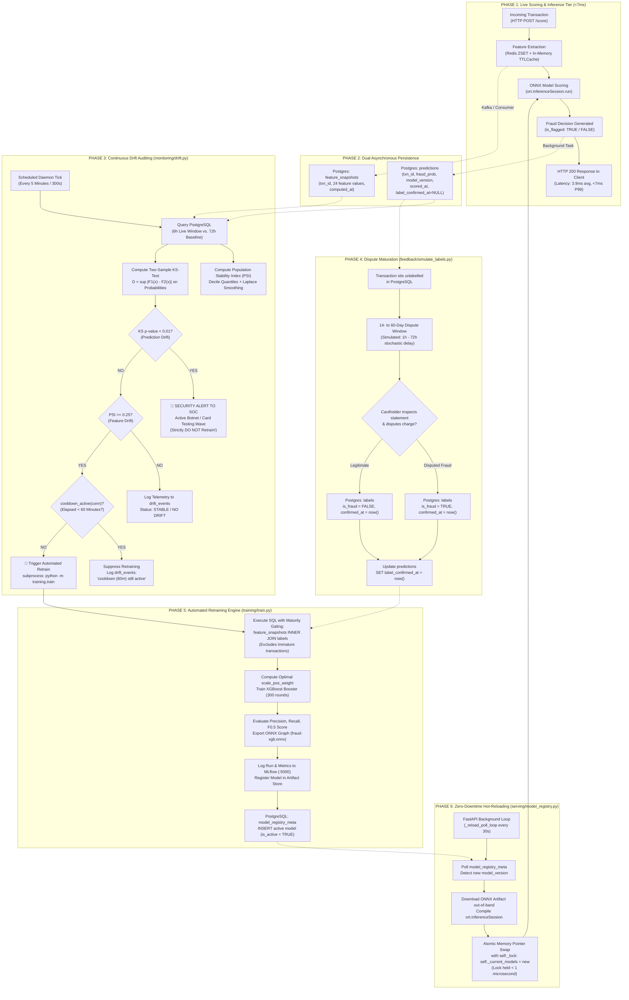

# 📘 MODULE 8: Continuous MLOps, Drift Detection & Feedback Loops

> **Status:** ✅ Completed  
> **Estimated Study Time:** 8 Hours  
> **Core Technologies:** MLflow 2.14 / 2.17 Tracking Server & Model Registry, In-Process Zero-Downtime Hot-Reloading (`ModelHandle`), Atomic Memory Pointer Swapping, Population Stability Index (PSI), Symmetrized Jeffreys Divergence, Quantile Decile Binning, Outermost Edge Pinning, Laplace Probability Clipping, Two-Sample Kolmogorov-Smirnov (KS) Test ($D = \sup_x |F_1(x) - F_2(x)|$), The Retraining Safety Rule (Feature Drift vs. Prediction Attack Drift), Retraining Thrashing Prevention, 60-Minute Relational Cooldown Lock (`drift_events`), Delayed Chargeback Simulator (`feedback/simulate_labels.py`), Label Delay Survival Bias (False Negative Pollution), Observation Window Partitioning (`INNER JOIN labels`).  
> **Physical Codebase References:**  
> - `my_fraud_pipeline/training/train.py`  
> - `my_fraud_pipeline/serving/model_registry.py`  
> - `my_fraud_pipeline/monitoring/drift.py`  
> - `my_fraud_pipeline/feedback/simulate_labels.py`  
> - `my_fraud_pipeline/postgres_init/001_init_schema.sql`  

---

## 🗺️ Extreme Detail Flowchart: The Complete Transaction MLOps Lifecycle

The following architectural flowchart diagrams the complete, multi-stage lifecycle of an incoming transaction as it flows through online inference, asynchronous feature/prediction logging, continuous drift auditing, delayed dispute maturation, automated retraining, and zero-downtime hot-reloading.



---

## Subtopic 1: MLflow Registry, Staging & Zero-Downtime Hot-Reloading

### Layer A: First Principles & Mathematical Foundations

#### 1. The Tripartite Architecture of MLflow
In enterprise machine learning platforms, MLflow decouples model experimentation from live serving through three distinct architectural subsystems:
* **Tracking Server (REST API on `:5000`):** Collects run parameters, metrics curves, and commit hashes via HTTP JSON endpoints.
* **Backend Store (Relational PostgreSQL):** Stores relational metadata: run UUIDs, experiment configurations, metrics histories, and model version registrations.
* **Artifact Store (S3 / GCS / Local POSIX Filesystem):** Stores binary payloads: XGBoost boosters, ONNX computation graphs (`fraud-xgb.onnx`), and SHAP validation summaries.

#### 2. The Operational Failure of Container Restarts
In naive DevOps pipelines, deploying a newly retrained model version involves updating an environment variable and triggering a container restart or Kubernetes rolling update. In high-throughput payment infrastructure ($>3,000\text{ TPS}$), this causes immediate production failures:
* **CPython Cold-Start Penalties:** Booting the interpreter, loading shared C-extension libraries (`libonnxruntime.so`, `libxgboost.so`), parsing Pydantic schemas, and initializing `asyncpg` and `redis-py` connection pools consumes **$3.0\text{s} - 8.0\text{s}$**.
* **TCP Socket Resets & Dropped In-Flight Transactions:** Terminating a running container resets TCP connections to upstream payment switches, returning HTTP 502/504 errors and triggering automated merchant transaction retries.
* **JIT & OS Page Cache Misses:** A newly spawned process starts with an empty CPU cache hierarchy and unmapped memory pages. Initial inference passes suffer severe latency spikes ($>50\text{ms}$), temporarily violating the sub-7ms P99 SLA.

#### 3. In-Process Dynamic Hot-Reloading via Atomic Memory Pointer Swapping
Our serving engine implements zero-downtime hot-reloading entirely within the active Python process:
* Every 30 seconds, an asynchronous background loop (`_reload_poll_loop` in `serving/main.py`) invokes `model_handle.maybe_reload` in a worker thread via `asyncio.to_thread()`.
* It queries the PostgreSQL `model_registry_meta` table for active models (`is_active = TRUE`).
* If a new version is detected, it downloads the ONNX binary and compiles the `ort.InferenceSession` entirely out-of-band without holding locks.
* Once verified, it executes an atomic memory pointer swap:
  $$\text{with self.\_lock: self.\_current\_models} = \text{new\_loaded}$$
  In CPython, assigning a new list reference to an object attribute is implemented at the C-level as an atomic pointer reassignment (`Py_INCREF` on the new list, `Py_DECREF` on the old list, followed by an immediate 64-bit word pointer swap). The lock is held for **$< 1\mu\text{s}$**.
* In-flight requests continue evaluating against the old model memory block; subsequent requests evaluate against the new model pointer. Zero dropped connections, zero latency spikes, and zero container restarts.
* **Lock Contention Avoidance:** All network I/O (`mlflow.artifacts.download_artifacts`) and ONNX session initialization are completed *before* acquiring the lock, preventing live scoring requests from blocking.

---

### Layer B: Pipeline Implementation & Codebase Mapping

* **File:** [serving/model_registry.py:155-174](file:///Users/mihirkalal/Desktop/Resume_projects/Key_Projects/realtime/my_fraud_pipeline/serving/model_registry.py#L155-L174)

```python
target_versions = [r["model_version"] for r in rows]
if not force and set(target_versions) == set(current_versions.keys()):
    return False
new_loaded = [_load_from_row(row) for row in rows]
with self._lock: self._current_models = new_loaded
```

#### Line-by-Line Technical Analysis (5-Line Limit):
1. **`target_versions = [r["model_version"] for r in rows]`**  
   *What:* Extraction of active model version strings from the PostgreSQL `model_registry_meta` table.  
   *Internals:* Parses SQL rows returned by `SELECT model_uri, model_version, mlflow_run_id, metrics FROM model_registry_meta WHERE is_active = TRUE`.  
   *Why:* Relies on transactional SQL as the authoritative single source of truth for active deployments.  
   *Analogy:* Checking an airport departure board to see which gates have active flights.  
   *File:* [model_registry.py:155](file:///Users/mihirkalal/Desktop/Resume_projects/Key_Projects/realtime/my_fraud_pipeline/serving/model_registry.py#L155)
2. **`if not force and set(target_versions) == set(current_versions.keys()):`**  
   *What:* Fast-path no-op equality check between target database versions and in-memory versions.  
   *Internals:* Compares Python set hashes in $O(K)$ time. If identifiers match, execution halts immediately.  
   *Why:* Prevents redundant MLflow artifact downloads and memory allocations on every 30s cycle.  
   *Analogy:* Glancing at a digital clock and taking no action if the minute has not changed.  
   *File:* [model_registry.py:157](file:///Users/mihirkalal/Desktop/Resume_projects/Key_Projects/realtime/my_fraud_pipeline/serving/model_registry.py#L157)
3. **`return False`**  
   *What:* Immediate short-circuit exit returning boolean flag indicating no reload occurred.  
   *Internals:* Pops the current execution frame off the CPython call stack in $<100\text{ns}$.  
   *Why:* Minimizes CPU cycles consumed by background maintenance tasks.  
   *Analogy:* Returning to standby mode when an automated sensor detects no change.  
   *File:* [model_registry.py:158](file:///Users/mihirkalal/Desktop/Resume_projects/Key_Projects/realtime/my_fraud_pipeline/serving/model_registry.py#L158)
4. **`new_loaded = [_load_from_row(row) for row in rows]`**  
   *What:* Out-of-band artifact fetching, ONNX runtime instantiation, and memory buffer allocation.  
   *Internals:* Calls `mlflow.artifacts.download_artifacts()`, compiles `ort.InferenceSession()`, and warms input buffers *outside* the locking block.  
   *Why:* Isolates expensive I/O and C++ model compilation ($100\text{ms}$) so worker threads running inference are never blocked.  
   *Analogy:* Assembling and testing a replacement jet engine in the hangar before rolling it to the aircraft.  
   *File:* [model_registry.py:167](file:///Users/mihirkalal/Desktop/Resume_projects/Key_Projects/realtime/my_fraud_pipeline/serving/model_registry.py#L167)
5. **`with self._lock: self._current_models = new_loaded`**  
   *What:* Thread-safe atomic pointer assignment swapping the active model ensemble reference.  
   *Internals:* Acquires `self._lock` for $<1\mu\text{s}$, mutates the 64-bit list reference to point to the newly instantiated `LoadedModel` instances, and immediately releases the lock.  
   *Why:* Guarantees that concurrent scoring requests see an atomic transition from old models to new models without intermediate invalid states.  
   *Analogy:* Flipping a railroad track switch in a split second between passing trains.  
   *File:* [model_registry.py:173-174](file:///Users/mihirkalal/Desktop/Resume_projects/Key_Projects/realtime/my_fraud_pipeline/serving/model_registry.py#L173-L174)

---

### Layer C: Verbal Interview Defense

> *"In financial transaction gateways processing thousands of requests per second, restarting containers to deploy new models is unacceptable because interpreter cold-starts drop TCP connections and cause multi-second latency spikes. We decouple MLflow artifact storage from live serving through an in-process, zero-downtime hot-reloading architecture.  
> Every 30 seconds, an asynchronous background thread checks the PostgreSQL `model_registry_meta` table for updated active model versions. If a new version exists, the thread downloads the ONNX binary and compiles the `ort.InferenceSession` entirely out-of-band without holding locks. Once verified, it executes an atomic pointer swap (`with self._lock: self._current_models = new_loaded`) taking less than 1 microsecond. If artifact loading fails, the error is isolated and the old model remains active, guaranteeing zero dropped connections and 100% uptime."*

---

## Subtopic 2: Population Stability Index (PSI)

### Layer A: First Principles & Mathematical Foundations

#### 1. Mathematical Formulation & Symmetrized Jeffreys Divergence
The **Population Stability Index (PSI)** measures the divergence between a reference baseline probability distribution $P$ and a live target distribution $Q$:
$$\mathbf{PSI} = \sum_{b=1}^B \left( Q_b - P_b \right) \times \ln\left( \frac{Q_b}{P_b} \right)$$
where $B$ is the number of quantile bins ($B = 10$), $P_b$ is the baseline probability, and $Q_b$ is the live serving probability.

##### Derivation from Symmetrized Kullback-Leibler (KL) Divergence:
Standard KL divergence is asymmetric: $\text{KL}(Q \parallel P) \neq \text{KL}(P \parallel Q)$. In statistical monitoring, distribution shift must be symmetric. Adding both directional divergences yields the **Jeffreys Divergence**:
$$\text{Jeffreys}(P, Q) = \text{KL}(Q \parallel P) + \text{KL}(P \parallel Q) = \sum_{b=1}^B Q_b \ln\left(\frac{Q_b}{P_b}\right) - \sum_{b=1}^B P_b \ln\left(\frac{Q_b}{P_b}\right) = \sum_{b=1}^B (Q_b - P_b) \ln\left(\frac{Q_b}{P_b}\right) \equiv \mathbf{PSI}$$

##### Non-Negativity Proof:
For any bucket $b$:
* If $Q_b > P_b$, then $(Q_b - P_b) > 0$ and $\ln(Q_b / P_b) > 0 \implies \text{term} > 0$.
* If $Q_b < P_b$, then $(Q_b - P_b) < 0$ and $\ln(Q_b / P_b) < 0 \implies \text{term} > 0$.
* If $Q_b = P_b$, then $(Q_b - P_b) = 0$ and $\ln(1) = 0 \implies \text{term} = 0$.
Every term is strictly non-negative: $\mathbf{PSI \ge 0}$, with $\text{PSI} = 0$ if and only if $Q_b = P_b$ across all buckets.

#### 2. Three Mandatory Implementation Constraints
1. **Quantile Decile Binning ($B=10$, Equal Frequency):**
   Baseline data is partitioned into 10 quantiles so that baseline probabilities are uniformly balanced:
   $$P_b = \frac{1}{B} = 0.10 \quad (10\% \text{ per bucket})$$
   Equal-frequency binning prevents power-law features (e.g., `user_velocity_amount_1h`) from collapsing all data into a single bin.
2. **Quantile Deduplication via `np.unique()`:**
   Discrete features with zero-inflation (e.g., `user_chargeback_count_30d = 0` for 98% of rows) generate duplicate quantile edges (`[0, 0, 0, ...]`). Calling `np.unique()` is mandatory to prevent `np.histogram()` from throwing `ValueError: bins must increase monotonically`.
3. **Outermost Edge Pinning to $[-\infty, \infty]$:**
   Live streaming features will inevitably exceed the min and max observed in training:
   $$\text{edges}[0] = -\infty, \quad \text{edges}[-1] = +\infty$$
   This guarantees that every real value in production maps cleanly to a bucket without falling outside histogram array bounds.
4. **Laplace Probability Clipping:**
   If a bucket has zero live observations ($Q_b = 0$), evaluating $\ln(0 / P_b) = -\infty$, causing `NaN` overflow. Probabilities are clipped:
   $$Q_b^* = \max(Q_b, \, \epsilon) \quad \text{where } \epsilon = 10^{-6}$$

#### 3. Threshold Action Matrix
* $\text{PSI} < 0.10$: **Stable / No Shift**. Model baseline is healthy.
* $0.10 \le \text{PSI} < 0.25$: **Moderate Drift**. Warning alert dispatched to MLOps on-call.
* $\mathbf{\text{PSI} \ge 0.25}$: **Severe Drift**. Population has fundamentally transformed; **triggers automated retraining pipeline**.

---

### Layer B: Pipeline Implementation & Codebase Mapping

* **File:** [monitoring/drift.py:126-145](file:///Users/mihirkalal/Desktop/Resume_projects/Key_Projects/realtime/my_fraud_pipeline/monitoring/drift.py#L126-L145)

```python
qs = np.linspace(0, 1, num_buckets + 1)
edges = np.unique(np.quantile(values, qs))
edges[0], edges[-1] = -np.inf, np.inf
probs = np.clip(counts / counts.sum(), EPS, None)
return float(np.sum((live_probs - baseline_probs) * np.log(live_probs / baseline_probs)))
```

#### Line-by-Line Technical Analysis (5-Line Limit):
1. **`qs = np.linspace(0, 1, num_buckets + 1)`**  
   *What:* Generation of 11 evenly spaced percentile quantiles ($0.0, 0.1, \dots, 1.0$) for decile binning.  
   *Internals:* Allocates a 64-bit float NumPy array defining target cumulative probability cutoffs.  
   *Why:* Guarantees baseline data will be partitioned into equal-frequency ($10\%$) cohorts.  
   *Analogy:* Marking 10 equal divisions along an empty measuring beaker.  
   *File:* [drift.py:126](file:///Users/mihirkalal/Desktop/Resume_projects/Key_Projects/realtime/my_fraud_pipeline/monitoring/drift.py#L126)
2. **`edges = np.unique(np.quantile(values, qs))`**  
   *What:* Quantile extraction with automatic deduplication of identical bin edges.  
   *Internals:* Computes inverse CDF cutoffs and strips duplicate values using `np.unique()`.  
   *Why:* Prevents zero-inflated discrete features from creating zero-width histogram bins and crashing `np.histogram`.  
   *Analogy:* Removing duplicate ticket numbers when organizing passenger boarding groups.  
   *File:* [drift.py:127-128](file:///Users/mihirkalal/Desktop/Resume_projects/Key_Projects/realtime/my_fraud_pipeline/monitoring/drift.py#L127-L128)
3. **`edges[0], edges[-1] = -np.inf, np.inf`**  
   *What:* Outermost bin boundary pinning to negative and positive infinity.  
   *Internals:* Overwrites minimum and maximum scalar slots with IEEE 754 infinity constants.  
   *Why:* Guarantees that any real number in live production $(-\infty < x < \infty)$ maps to a bucket.  
   *Analogy:* Extending boundary nets all the way to the horizon so no ball can exit the field.  
   *File:* [drift.py:132-133](file:///Users/mihirkalal/Desktop/Resume_projects/Key_Projects/realtime/my_fraud_pipeline/monitoring/drift.py#L132-L133)
4. **`probs = np.clip(counts / counts.sum(), EPS, None)`**  
   *What:* Bucket frequency normalization with Laplace-style lower-bound clipping.  
   *Internals:* Divides raw counts by total sample size and executes SIMD clipping with $\text{EPS} = 10^{-6}$.  
   *Why:* Eliminates zeroes from the probability vector, preventing `log(0) = -inf` crashes.  
   *Analogy:* Maintaining minimum residual pressure in an industrial line to prevent vacuum collapse.  
   *File:* [drift.py:141-142](file:///Users/mihirkalal/Desktop/Resume_projects/Key_Projects/realtime/my_fraud_pipeline/monitoring/drift.py#L141-L142)
5. **`return float(np.sum((live_probs - baseline_probs) * np.log(live_probs / baseline_probs)))`**  
   *What:* Vectorized execution of the symmetrized Jeffreys Divergence formula.  
   *Internals:* Performs element-wise difference, division, log, and array summation in C-level NumPy loops.  
   *Why:* Computes exact PSI across all 24 features for hundreds of thousands of transactions in $<5\text{ms}$.  
   *Analogy:* Calculating the total net distance between two topographic terrain maps.  
   *File:* [drift.py:145](file:///Users/mihirkalal/Desktop/Resume_projects/Key_Projects/realtime/my_fraud_pipeline/monitoring/drift.py#L145)

---

### Layer C: Verbal Interview Defense

> *"In real-time fraud pipelines, we detect feature distribution decay using the Population Stability Index (PSI), derived as the symmetric Jeffreys Divergence ($\text{PSI} = \sum (Q_b - P_b) \ln(Q_b / P_b)$). We establish baseline deciles ($B=10, P_b=0.10$) over historical feature snapshots and pin outer edges to $[-\infty, \infty]$ while enforcing epsilon clipping ($10^{-6}$) to prevent $\ln(0)$ crashes on unseen values.  
> Every 5 minutes, our drift monitoring worker computes PSI across the last 6 hours of live feature snapshots. If any feature or the global mean exceeds the critical $\text{PSI} \ge 0.25$ threshold, it flags severe population shift and triggers the automated retraining pipeline, preventing performance degradation caused by macroeconomic behavioral drift."*

---

## Subtopic 3: Two-Sample Kolmogorov-Smirnov (KS) Test & The Retraining Safety Rule

### Layer A: First Principles & Mathematical Foundations

#### 1. Mathematical Mechanics of the Two-Sample KS-Test
While PSI evaluates feature-level covariate shift across discrete quantile bins, model prediction probabilities $\hat{p} \in [0, 1]$ represent a continuous distribution requiring non-parametric evaluation.

The **Two-Sample Kolmogorov-Smirnov (KS) Test** evaluates whether baseline predictions $X_{\text{base}} = \{p_1, \dots, p_m\}$ and live inference predictions $X_{\text{live}} = \{p'_1, \dots, p'_n\}$ share the identical continuous cumulative distribution function $F(x)$.
Let $F_1(x)$ and $F_2(x)$ be empirical cumulative distribution functions (eCDFs):
$$F_1(x) = \frac{1}{m} \sum_{i=1}^m \mathbb{I}(p_i \le x), \quad F_2(x) = \frac{1}{n} \sum_{j=1}^n \mathbb{I}(p'_j \le x)$$
The **Kolmogorov-Smirnov Test Statistic $D$** is the **supremum (maximum vertical absolute distance)** between the two eCDFs across all prediction thresholds $x \in [0, 1]$:
$$\mathbf{D_{m, n}} = \sup_{x \in [0, 1]} |F_1(x) - F_2(x)|$$

Under null hypothesis $H_0$ ($F_1 = F_2$), the scaled test statistic converges asymptotically to the Kolmogorov distribution:
$$\lim_{m, n \to \infty} P\left(\sqrt{\frac{m \cdot n}{m + n}} D_{m, n} \le z\right) = K(z) = 1 - 2 \sum_{k=1}^\infty (-1)^{k-1} e^{-2 k^2 z^2}$$
If $p < 0.01$, we reject $H_0$ with $99\%$ confidence: the live output scoring profile has undergone a non-random distribution shift.

#### 2. The Retraining Safety Rule: The Poisoning Feedback Loop Trap
A critical vulnerability in automated MLOps is coupling automated retraining directly to prediction score drift:

* **Feature Drift (PSI $\ge 0.25$):** Reflects macroeconomic changes in legitimate user purchasing behaviors. The relationship $P(Y \mid X)$ remains valid, but input space $P(X)$ shifted. **Triggers automated retraining.**
* **Prediction Score Drift (KS $p < 0.01$):** Indicates an active criminal attack: a botnet credential-stuffing or card-testing wave is hammering the gateway, causing an abnormal surge in high risk scores ($\hat{p} \ge 0.85$).
* **Why Prediction Drift Must NEVER Auto-Retrain:**
  1. Chargeback dispute labels take **14 to 60 days to mature**. The thousands of fraudulent attack transactions currently being scored have **no confirmed chargeback labels yet** in PostgreSQL.
  2. If the pipeline auto-retrained on this recent window, the retraining engine would observe these unconfirmed attack transactions without fraud tags, treating them as legitimate volume.
  3. **Model Poisoning:** Retraining would adjust XGBoost leaf splits to normalize the botnet's traffic patterns, baking the attacker's attack signatures directly into the champion baseline. When the syndicate attacks again tomorrow, the retrained model would approve the transactions.
* **Enforced Operational Policy:** Prediction score drift ($p < 0.01$) writes an audit event to `drift_events` and fires a critical security alert to the Security Operations Center (SOC) to deploy WAF IP blocks and rate limits, but **strictly bypasses automated retraining**.

---

### Layer B: Pipeline Implementation & Codebase Mapping

* **File:** [monitoring/drift.py:243-247](file:///Users/mihirkalal/Desktop/Resume_projects/Key_Projects/realtime/my_fraud_pipeline/monitoring/drift.py#L243-L247)

```python
if pred_rows and len(baseline["prediction_probs"]) >= 20:
    live_pred = np.array([float(r["fraud_probability"]) for r in pred_rows])
    if len(live_pred) >= 20:
        result = stats.ks_2samp(baseline["prediction_probs"], live_pred)
        ks_stat, ks_pvalue = float(result.statistic), float(result.pvalue)
```

#### Line-by-Line Technical Analysis (5-Line Limit):
1. **`if pred_rows and len(baseline["prediction_probs"]) >= 20:`**  
   *What:* Sample complexity guard on historical baseline prediction probabilities.  
   *Internals:* Verifies that baseline dataset contains at least 20 historical predictions in PostgreSQL.  
   *Why:* The Kolmogorov asymptotic approximation fails on sample sizes $N < 20$.  
   *Analogy:* Refusing to conduct a metallurgical stress test without a minimum number of standardized samples.  
   *File:* [drift.py:243](file:///Users/mihirkalal/Desktop/Resume_projects/Key_Projects/realtime/my_fraud_pipeline/monitoring/drift.py#L243)
2. **`live_pred = np.array([float(r["fraud_probability"]) for r in pred_rows])`**  
   *What:* Vectorized float array extraction of live model prediction scores over the sliding 6-hour window.  
   *Internals:* Allocates a contiguous NumPy float64 buffer containing all raw $\hat{p}$ outputs logged to `predictions`.  
   *Why:* Provides an unbinned, continuous empirical representation of live output scoring behavior.  
   *Analogy:* Extracting a continuous digital audio recording from an acoustic sensor.  
   *File:* [drift.py:244](file:///Users/mihirkalal/Desktop/Resume_projects/Key_Projects/realtime/my_fraud_pipeline/monitoring/drift.py#L244)
3. **`if len(live_pred) >= 20:`**  
   *What:* Secondary statistical power guard evaluating live inference volume.  
   *Internals:* Ensures that live inference sample size satisfies two-sample hypothesis testing requirements.  
   *Why:* Prevents statistical noise during low-traffic maintenance periods from generating false drift alerts.  
   *Analogy:* Requiring a minimum quorum of voter ballots before certifying an election tally.  
   *File:* [drift.py:245](file:///Users/mihirkalal/Desktop/Resume_projects/Key_Projects/realtime/my_fraud_pipeline/monitoring/drift.py#L245)
4. **`result = stats.ks_2samp(baseline["prediction_probs"], live_pred)`**  
   *What:* SciPy execution of the two-sample Kolmogorov-Smirnov test algorithm.  
   *Internals:* Sorts both arrays in $O(N \log N)$ time and walks empirical CDFs to compute $D = \sup_x |F_1(x) - F_2(x)|$.  
   *Why:* Non-parametric test requiring zero distributional assumptions (does not assume normality).  
   *Analogy:* Laying two transparent blueprints on top of each other to measure the maximum gap.  
   *File:* [drift.py:246](file:///Users/mihirkalal/Desktop/Resume_projects/Key_Projects/realtime/my_fraud_pipeline/monitoring/drift.py#L246)
5. **`ks_stat, ks_pvalue = float(result.statistic), float(result.pvalue)`**  
   *What:* Extraction and casting of test statistic $D$ and asymptotic p-value.  
   *Internals:* Converts NumPy float types to native Python floats for insertion into PostgreSQL `drift_events`.  
   *Why:* Provides structured audit telemetry for downstream monitoring dashboards and SOC security alerts.  
   *Analogy:* Recording the exact seismic Richter scale reading into the geological survey ledger.  
   *File:* [drift.py:247](file:///Users/mihirkalal/Desktop/Resume_projects/Key_Projects/realtime/my_fraud_pipeline/monitoring/drift.py#L247)

---

### Layer C: Verbal Interview Defense

> *"In continuous MLOps, we strictly distinguish between feature drift and prediction score drift. We monitor feature drift using the Population Stability Index (PSI), and prediction drift using the Two-Sample Kolmogorov-Smirnov (KS) test ($D = \sup_x |F_1(x) - F_2(x)|$) to measure the supremum vertical distance between baseline and live prediction CDFs without binning.  
> Crucially, our architecture enforces a strict Retraining Safety Rule: while severe feature drift ($\text{PSI} \ge 0.25$) triggers automated model retraining, prediction drift ($p < 0.01$) triggers a security alert and NEVER auto-retrains. A sudden spike in prediction scores indicates an ongoing botnet or card-testing attack. Because chargeback dispute labels take 14 to 60 days to mature, retraining immediately on unconfirmed attack traffic would treat fraudulent transactions as normal volume, baking the attacker's behavioral patterns directly into the model baseline."*

---

## Subtopic 4: Retraining Thrashing & Cooldown Windows

### Layer A: First Principles & Mathematical Foundations

#### 1. The Catastrophic Failure Mode: Retraining Thrashing
In continuous MLOps architectures, drift detection is typically configured to run on high-frequency schedules (e.g., our pipeline polls every 5 minutes: `CHECK_INTERVAL_SECONDS = 300`). 

When a genuine macroeconomic or seasonal shift occurs—such as Black Friday, an unexpected currency devaluation, or a sudden change in international e-commerce traffic—the incoming population distribution diverges significantly from the historical baseline. Consequently, the Population Stability Index surpasses the critical threshold ($\text{PSI} \ge 0.25$) on every evaluation pass.

Without an enforced operational cooldown window, this creates **Retraining Thrashing**:
* Every 5 minutes, another heavy retraining job is spawned.
* **Host Compute & Memory Starvation:** Training an enterprise XGBoost model across hundreds of thousands of transactions involves parallel histogram construction, gradient/Hessian computation, and cross-validation across tree depths. If spawned repeatedly, competing training processes saturate the OS scheduler's CPU run queues, starving the asynchronous event loop (`asyncio`) in the FastAPI serving container and the Kafka consumer threads in the feature engine, causing immediate P99 latency spikes ($>100\text{ms}$).
* **Linux OOM Cascades:** Memory allocations from multiple concurrent XGBoost training matrix instances exhaust physical RAM and swap space, forcing the Linux kernel to invoke the Out-Of-Memory (OOM) Killer, terminating live serving containers.
* **Model Registry & Artifact Store Bloat:** Uncontrolled retraining registers dozens of redundant models per day into PostgreSQL (`model_registry_meta`) and MLflow POSIX/S3 artifact storage, triggering continuous download cycles in serving workers.
* **Statistical Churn on Transient Noise:** A sudden 15-minute traffic spike (e.g., a marketing email push) will trigger retraining on transient behavior. Once the surge subsides, the newly deployed model is overfitted to a temporary spike rather than the true underlying transaction distribution.

#### 2. State-Based Cooldown Enforcement via Relational Persistence
To prevent thrashing, the system enforces a strict temporal lockout (`RETRAIN_COOLDOWN_MINUTES = 60`):
* **State Persistence:** The cooldown check cannot rely on volatile in-memory process variables, as container restarts or worker cycling would reset the timer. Instead, cooldown state is persisted relationally in PostgreSQL within the `drift_events` ledger.
* **Temporal Predicate:**
  $$\Delta t = t_{\text{current}} - t_{\text{last\_retrain}}$$
  $$\text{Cooldown Active} \iff \Delta t < T_{\text{cooldown}} \quad (60\text{ minutes})$$
* **Non-Blocking Telemetry Auditing:** If $\text{PSI} \ge 0.25$ while the cooldown is active, retraining is suppressed, but the drift metrics ($\text{PSI}$, $\text{KS}$, feature histograms) are still committed to `drift_events` with `retrain_triggered = FALSE` and `retrain_skipped_reason = 'drift detected but retrain cooldown (60min) still active'`. This maintains an unbroken observability trail for auditability without destabilizing host compute.

---

### Layer B: Pipeline Implementation & Codebase Mapping

* **File:** [monitoring/drift.py:263-268](file:///Users/mihirkalal/Desktop/Resume_projects/Key_Projects/realtime/my_fraud_pipeline/monitoring/drift.py#L263-L268)

```python
cur.execute(LAST_RETRAIN_SQL)
row = cur.fetchone()
if not row: return False
elapsed = datetime.now(timezone.utc) - row["checked_at"]
return elapsed < timedelta(minutes=RETRAIN_COOLDOWN_MINUTES)
```

#### Line-by-Line Technical Analysis (5-Line Limit):
1. **`cur.execute(LAST_RETRAIN_SQL)`**  
   *What:* Targeted query retrieving the timestamp of the most recent triggered retraining run.  
   *Internals:* Evaluates `SELECT checked_at FROM drift_events WHERE retrain_triggered = TRUE ORDER BY checked_at DESC LIMIT 1;` using the B-Tree index on `(retrain_triggered, checked_at DESC)`.  
   *Why:* Queries durable PostgreSQL disk storage rather than volatile RAM, ensuring state survives worker restarts.  
   *Analogy:* Checking an electronic punch clock to see when a furnace was last serviced.  
   *File:* [monitoring/drift.py:263](file:///Users/mihirkalal/Desktop/Resume_projects/Key_Projects/realtime/my_fraud_pipeline/monitoring/drift.py#L263)
2. **`row = cur.fetchone()`**  
   *What:* Fetches the single newest row or returns `None` if no prior retraining runs exist.  
   *Internals:* Reads the single tuple returned over the PostgreSQL wire protocol (`libpq`) into a Python dictionary.  
   *Why:* Only the single most recent execution timestamp is required to evaluate elapsed time.  
   *Analogy:* Looking at the very top entry on an inspection clipboard.  
   *File:* [monitoring/drift.py:264](file:///Users/mihirkalal/Desktop/Resume_projects/Key_Projects/realtime/my_fraud_pipeline/monitoring/drift.py#L264)
3. **`if not row: return False`**  
   *What:* Guard clause handling cold-start initialization.  
   *Internals:* If `row is None`, the table has no historical records where `retrain_triggered = TRUE`. The function immediately exits returning `False`.  
   *Why:* On day zero, the first detected drift event must execute retraining immediately without false cooldown blocks.  
   *Analogy:* Allowing a factory engine to start immediately if it has never run before.  
   *File:* [monitoring/drift.py:265-266](file:///Users/mihirkalal/Desktop/Resume_projects/Key_Projects/realtime/my_fraud_pipeline/monitoring/drift.py#L265-L266)
4. **`elapsed = datetime.now(timezone.utc) - row["checked_at"]`**  
   *What:* Calculation of timezone-aware elapsed wall-clock duration since the last retraining run.  
   *Internals:* Subtracts the PostgreSQL `TIMESTAMPTZ` object from current UTC time to yield a Python `datetime.timedelta` object with microsecond precision.  
   *Why:* Explicit UTC enforcement prevents daylight saving time transitions or container clock discrepancies from corrupting duration math.  
   *Analogy:* Calculating hours elapsed between two timestamps on an international shipping manifest.  
   *File:* [monitoring/drift.py:267](file:///Users/mihirkalal/Desktop/Resume_projects/Key_Projects/realtime/my_fraud_pipeline/monitoring/drift.py#L267)
5. **`return elapsed < timedelta(minutes=RETRAIN_COOLDOWN_MINUTES)`**  
   *What:* Boolean predicate returning `True` if elapsed time is strictly less than the configured cooldown threshold.  
   *Internals:* Compares the 64-bit integer microsecond representations inside the two `timedelta` instances.  
   *Why:* Evaluates whether the retraining subsystem must remain dormant or is permitted to trigger.  
   *Analogy:* An automated thermal interlock preventing a furnace from reigniting until it has cooled for 60 minutes.  
   *File:* [monitoring/drift.py:268](file:///Users/mihirkalal/Desktop/Resume_projects/Key_Projects/realtime/my_fraud_pipeline/monitoring/drift.py#L268)

---

### Layer C: Verbal Interview Defense

> *"In automated MLOps pipelines, continuous drift monitoring on a 5-minute schedule introduces a critical failure mode: retraining thrashing. During sustained macroeconomic shifts or holiday surges, feature distributions remain drifted across consecutive checks, causing naive pipelines to spawn heavy, overlapping retraining jobs that exhaust host CPU and memory, ultimately triggering Linux OOM-killer crashes on the live serving engine.  
> To protect our serving SLA, our architecture enforces a mandatory 60-minute retraining cooldown window persisted durably in PostgreSQL. Every 5 minutes, our drift monitor checks `LAST_RETRAIN_SQL` from the `drift_events` table. If drift is detected but the elapsed duration since the last retrain is under 60 minutes, subprocess execution is skipped, and the drift metrics are safely logged with an explicit audit reason. This guarantees compute isolation, protects serving SLAs, and prevents overfitting to short-term behavioral spikes."*

---

## Subtopic 5: The Delayed Chargeback Simulator & Observation Window Partitioning

### Layer A: First Principles & Mathematical Foundations

#### 1. The 14- to 60-Day Dispute Maturity Window in Payment Rails
In financial payment processing (Visa, Mastercard, SWIFT, ACH), transaction scoring happens synchronously in milliseconds, but **ground-truth fraud labels do not arrive in real time**:
* **Day 0:** Transaction approved by payment gateway ($<7\text{ms}$). Funds captured.
* **Days 1–28:** Cardholder is unaware. Cardholder awaits monthly billing statement.
* **Day 30:** Cardholder inspects statement, spots unauthorized charge, calls issuing bank.
* **Day 32:** Issuing bank files formal chargeback request over Visa/Mastercard dispute rails.
* **Day 45:** Acquiring bank receives chargeback notice and debits merchant account.
* **Day 60:** Dispute arbitration closes. Ground-truth label (`is_fraud = TRUE`) finalized in PostgreSQL.

In production banking, chargeback arrival follows a **long-tailed Weibull or Lognormal distribution**. Less than 5% of fraud disputes arrive within 48 hours; over 90% arrive between 14 and 60 days.

#### 2. The Catastrophic Hazard of Label Delay Survival Bias (False Negative Pollution)
A common mistake in continuous learning systems is assuming that any transaction without a chargeback is legitimate. 

Consider an automated pipeline that queries all transactions from the last 7 days to retrain an XGBoost model:
* **The Ground Truth Reality:** Suppose 500 unauthorized card-testing transactions occurred 3 days ago.
* **The Missing Label State:** Because only 72 hours have elapsed, none of the victims have received their monthly statements or filed dispute paperwork. In PostgreSQL, these transactions have `label = NULL`.
* **The Naive Imputation Disaster:** If the training script assumes `label = 0` (non-fraud) for all unlabelled rows, those 500 fraudulent transactions are fed into XGBoost as positive examples of **legitimate user behavior**.
* **Mathematical Gradient Corruption:**
  $$\mathcal{L}(\theta) = \sum_{i} \left[ y_i \ln(p_i) + (1 - y_i) \ln(1 - p_i) \right]$$
  For an unconfirmed fraud transaction $i$ where true label $y_i^* = 1$, setting $y_i = 0$ inverts the sign of the first-order gradient $g_i$:
  $$g_i = p_i - y_i \implies g_i = p_i - 0 = p_i > 0$$
  Instead of penalizing the model for underestimating fraud risk, the gradient pushes the tree split thresholds to **lower** the risk score for card-testing attack signatures. The model is actively poisoned into classifying future attacks as normal volume.

#### 3. Observation Window Partitioning (The Maturity Buffer)
To eliminate false negative pollution, enterprise training datasets must enforce an **Observation Maturity Window** ($T_{\text{maturity}}$):
$$t_{\text{train\_end}} \le t_{\text{current}} - T_{\text{maturity}}$$
In production systems, $T_{\text{maturity}}$ is set to **60–90 days**. Transactions younger than $T_{\text{maturity}}$ are strictly excluded from the training and validation sets because their dispute status has not reached statistical maturity.

In our local pipeline environment, the 60-day real-world dispute lifecycle is simulated by `feedback/simulate_labels.py`, compressing the distribution into a configurable delay window (`LABEL_DELAY_MIN_HOURS = 1` to `LABEL_DELAY_MAX_HOURS = 72`) with stochastic arrival intervals.

---

### Layer B: Pipeline Implementation & Codebase Mapping

* **File:** [feedback/simulate_labels.py:98-103](file:///Users/mihirkalal/Desktop/Resume_projects/Key_Projects/realtime/my_fraud_pipeline/feedback/simulate_labels.py#L98-L103)
* **File:** [training/train.py:107](file:///Users/mihirkalal/Desktop/Resume_projects/Key_Projects/realtime/my_fraud_pipeline/training/train.py#L107)

```python
txn_age_hours = (now - row["txn_timestamp"]).total_seconds() / 3600.0
assigned_delay = rng.uniform(LABEL_DELAY_MIN_HOURS, LABEL_DELAY_MAX_HOURS)
if txn_age_hours < assigned_delay:
    continue
is_fraud = simulate_ground_truth(row, rng)
```

#### Line-by-Line Technical Analysis (5-Line Limit):
1. **`txn_age_hours = (now - row["txn_timestamp"]).total_seconds() / 3600.0`**  
   *What:* Computes the continuous elapsed duration in hours since transaction creation.  
   *Internals:* Evaluates the difference between current UTC system time and the transaction's stored PostgreSQL timestamp, converting microsecond deltas to floating-point hours.  
   *Why:* Establishes the exact temporal maturity of the transaction record.  
   *Analogy:* Checking the postmark date on an incoming bank envelope to measure transit time.  
   *File:* [feedback/simulate_labels.py:98](file:///Users/mihirkalal/Desktop/Resume_projects/Key_Projects/realtime/my_fraud_pipeline/feedback/simulate_labels.py#L98)
2. **`assigned_delay = rng.uniform(LABEL_DELAY_MIN_HOURS, LABEL_DELAY_MAX_HOURS)`**  
   *What:* Draws a stochastic label arrival maturity threshold for the specific transaction.  
   *Internals:* Samples a continuous uniform random variate across the interval $[1.0, 72.0]$ using a seeded pseudo-random number generator (`random.Random`).  
   *Why:* Simulates the non-deterministic delay between transaction settlement and human cardholder dispute filing.  
   *Analogy:* Simulating how different cardholders inspect their bank statements on different days of the month.  
   *File:* [feedback/simulate_labels.py:99](file:///Users/mihirkalal/Desktop/Resume_projects/Key_Projects/realtime/my_fraud_pipeline/feedback/simulate_labels.py#L99)
3. **`if txn_age_hours < assigned_delay:`**  
   *What:* Maturity boundary predicate evaluating whether the transaction's dispute window has matured.  
   *Internals:* Compares the elapsed age against the assigned stochastic threshold.  
   *Why:* Defers labeling for transactions whose real-world dispute maturity window has not elapsed.  
   *Analogy:* An investigator waiting for lab results before closing an open case.  
   *File:* [feedback/simulate_labels.py:100](file:///Users/mihirkalal/Desktop/Resume_projects/Key_Projects/realtime/my_fraud_pipeline/feedback/simulate_labels.py#L100)
4. **`continue`**  
   *What:* Skips label generation for the current loop iteration, leaving the transaction unlabelled in PostgreSQL.  
   *Internals:* Jumps directly to the next iteration of the inner loop without executing SQL `INSERT` statements.  
   *Why:* Prevents immature transactions from entering the `labels` table prematurely.  
   *Analogy:* Leaving unripe fruit on the vine for a future harvest pass.  
   *File:* [feedback/simulate_labels.py:101](file:///Users/mihirkalal/Desktop/Resume_projects/Key_Projects/realtime/my_fraud_pipeline/feedback/simulate_labels.py#L101)
5. **`is_fraud = simulate_ground_truth(row, rng)`**  
   *What:* Generates deterministic ground-truth fraud classification once the maturity window has closed.  
   *Internals:* Evaluates business rules (amount $> \$1,000$, IP country mismatch against user profile, card-not-present channel) against synthetic ground truth.  
   *Why:* Produces an authoritative chargeback label that can now be safely joined by `training/train.py` via `INNER JOIN labels l ON l.txn_id = rf.txn_id`.  
   *Analogy:* The formal receipt of a signed affidavit from the cardholder confirming fraudulent intent.  
   *File:* [feedback/simulate_labels.py:103](file:///Users/mihirkalal/Desktop/Resume_projects/Key_Projects/realtime/my_fraud_pipeline/feedback/simulate_labels.py#L103)

---

### Layer C: Verbal Interview Defense

> *"In payment fraud systems, ground-truth labels do not arrive in real time because cardholder dispute cycles on Visa and Mastercard networks take 14 to 60 days to mature. Naively training on recent transactions by treating unlabelled transactions as non-fraud introduces catastrophic label delay survival bias: active card-testing fraud is erroneously labeled as legitimate volume, inverting XGBoost gradients and baking attacker patterns directly into the model.  
> To prevent this, our pipeline implements an observation window maturity buffer. Our delayed chargeback simulator (`feedback/simulate_labels.py`) models stochastic dispute arrival delays, and our training engine (`training/train.py`) strictly trains only on matured transactions where labels have been explicitly confirmed via `INNER JOIN labels l ON l.txn_id = rf.txn_id`. This guarantees zero false-negative label pollution and ensures training data integrity."*

---

## 📊 Summary of Operational Policies & Guardrails in Module 8

| Component | Trigger / Condition | Enforced Operational Action | Failure Mode Prevented |
| :--- | :--- | :--- | :--- |
| **Model Serving** | New model registered in `model_registry_meta` | Atomic memory pointer swap (`self._current_models = new`) in $<1\mu\text{s}$ | Cold-start TCP drops, 502/504 gateway timeouts |
| **Covariate Shift** | Feature Population Stability Index $\mathbf{\text{PSI} \ge 0.25}$ | Dispatches warning alert; triggers automated retrain if cooldown is inactive | Silent accuracy decay from macroeconomic shifts |
| **Attack Shift** | Prediction Two-Sample Kolmogorov-Smirnov $\mathbf{p < 0.01}$ | **Fires critical SOC security alert; NEVER auto-retrains** | Model poisoning on unconfirmed card-testing bursts |
| **Retrain Lock** | Drift detected but last retrain $< 60$ minutes ago | Suppresses retraining execution; logs audit event with reason | Retraining thrashing, CPU starvation, Linux OOM |
| **Data Partitioning** | Transactions unlabelled / younger than maturity buffer | Excluded from training set via `INNER JOIN labels` | Label delay survival bias, gradient sign inversion |
