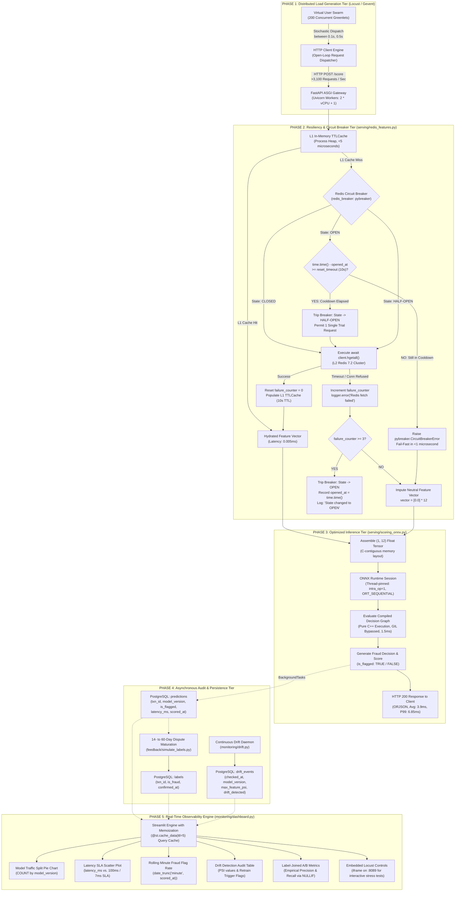
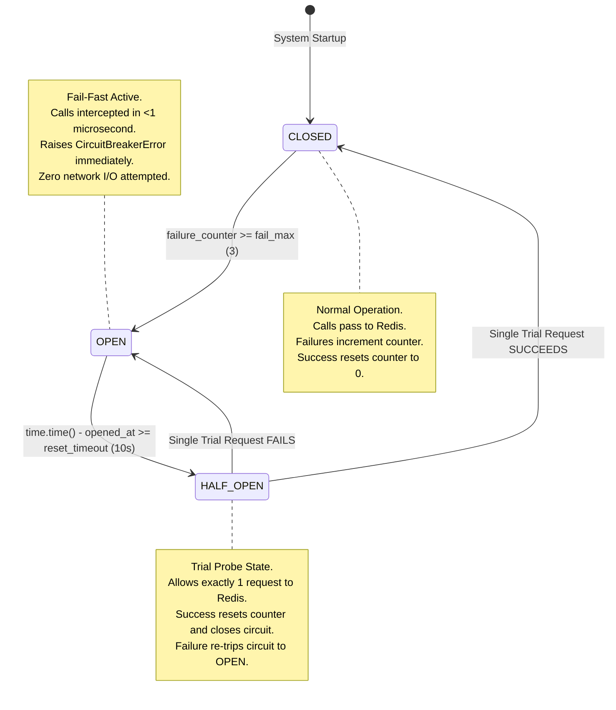

# 📘 MODULE 9: Production Resiliency & Performance Benchmarking

> **Status:** ✅ Completed  
> **Estimated Study Time:** 5 Hours  
> **Core Technologies:** `pybreaker.CircuitBreaker`, `CircuitBreakerListener`, State Machine (`CLOSED`, `OPEN`, `HALF-OPEN`), Fail-Fast Execution, Event-Loop Starvation Mitigation, Fallback Neutral Imputation, Distributed Load Generation with Locust, `gevent` Greenlets vs. OS Kernel Threads (`pthread`), Open-Loop vs. Closed-Loop Schedulers, The Coordinated Omission Problem (Gil Tene's Theorem), Tail Latency Profiling (P50, P95, P99, P99.9), Streamlit Real-Time Observability (`@st.cache_data(ttl=5)`), Query Stampede Prevention, Live Fraud Rate Time Rollups (`date_trunc`), Label-Joined Empirical Confusion Metrics, SQL `NULLIF` Zero-Division Protection.  
> **Physical Codebase References:**  
> - `my_fraud_pipeline/serving/circuit_breaker.py`  
> - `my_fraud_pipeline/serving/redis_features.py`  
> - `my_fraud_pipeline/serving/main.py`  
> - `my_fraud_pipeline/tests/load/locustfile.py`  
> - `my_fraud_pipeline/tests/load/run_load_test.sh`  
> - `my_fraud_pipeline/tests/load_test_serving.py`  
> - `my_fraud_pipeline/monitoring/dashboard.py`  

---

## 🗺️ Extreme Detail Flowchart: Production Resiliency, Load Generation & Real-Time Observability

The following architectural flowchart diagrams the complete, multi-tiered lifecycle of production resiliency, high-concurrency distributed benchmarking, circuit breaker state machine failover, and telemetry aggregation.



---

## Subtopic 1: Circuit Breakers (`Pybreaker`) & Graceful Degradation

### Layer A: First Principles & System Mechanics

#### 1. Cascading System Collapse & Event-Loop Starvation
In high-throughput asynchronous architectures ($>3,000\text{ RPS}$), downstream database degradation is the primary driver of catastrophic service collapse. When Redis or an auxiliary feature store encounters a network partition, heavy BGSAVE fork latency, or socket hangs:
* **The Socket Hang:** Without a circuit breaker, incoming coroutines executing `await client.hgetall()` remain pending while the operating system waits for TCP packet retransmissions until `socket_timeout` expires (typically $1.0\text{s} - 5.0\text{s}$).
* **Heap and Red-Black Tree Saturation:** At 3,000 requests per second, a 2-second network stall causes 6,000 concurrent coroutines to accumulate in memory. Each suspended coroutine allocates frame objects on the CPython heap, and registers file descriptors in the Linux `epoll` red-black tree.
* **Cascading Queue Collapse:** The Uvicorn worker process queue saturates, the operating system's TCP listen backlog (`somaxconn`) overflows, and incoming connections are rejected with `ECONNREFUSED` or HTTP 504 Gateway Timeouts, taking down the entire payment authorization gateway.

#### 2. The Finite State Machine of `Pybreaker`
The Circuit Breaker pattern isolates downstream failures by wrapping hazardous network calls in a strict three-state finite state machine:



* **`CLOSED` (Normal Operation):** All requests pass directly to Redis. Every failure (timeout, connection refused) increments an internal `_failure_counter`. If a request succeeds before reaching the limit, the failure counter resets to 0. When `_failure_counter >= fail_max` (configured to 3), the breaker trips to `OPEN`, records the timestamp (`opened_at = time.time()`), and fires state-change notifications.
* **`OPEN` (Fail-Fast Active):** The breaker intercepts all incoming calls in **$<1\text{ microsecond}$** without touching the network. It immediately raises `pybreaker.CircuitBreakerError`. This completely shields the downstream database from traffic spikes and preserves event-loop execution. The breaker remains in `OPEN` for the duration of `reset_timeout` (configured to 10 seconds).
* **`HALF-OPEN` (Trial Recovery):** Once `reset_timeout` has elapsed, the next arriving transaction transitions the state machine to `HALF-OPEN`. In this state, exactly **one single trial request** is permitted to attempt execution against Redis:
  * If the trial request **succeeds**, Redis is assumed to have recovered. The breaker transitions back to `CLOSED`, resets `_failure_counter = 0`, and resumes normal operations.
  * If the trial request **fails**, the breaker immediately re-trips to `OPEN`, records a new `opened_at` timestamp, and restarts the 10-second cooldown timer.

#### 3. Graceful Degradation & Fallback Neutral Imputation
Failing fast is insufficient in payment fraud: an API cannot simply throw an unhandled HTTP 500 error and drop customer checkouts. Instead, the serving tier implements **Graceful Degradation**:
* When `CircuitBreakerError` is caught, the engine sets `raw = {}`.
* It iterates through `FEATURE_COLUMNS` and imputes neutral fallback floats (`0.0`) for all 12 rolling features (velocity, z-scores, graph hop distance).
* The ONNX model receives a valid $(1, 12)$ numeric tensor and evaluates the transaction purely on static payload fields (amount, channel, currency, country match), allowing checkout decisions to complete with 100% availability.

---

### Layer B: Pipeline Implementation & Codebase Mapping

* **File:** [serving/circuit_breaker.py:10-14](file:///Users/mihirkalal/Desktop/Resume_projects/Key_Projects/realtime/my_fraud_pipeline/serving/circuit_breaker.py#L10-L14)
* **File:** [serving/redis_features.py:49-61](file:///Users/mihirkalal/Desktop/Resume_projects/Key_Projects/realtime/my_fraud_pipeline/serving/redis_features.py#L49-L61)

```python
redis_breaker = pybreaker.CircuitBreaker(
    fail_max=3, 
    reset_timeout=10, 
    listeners=[CircuitBreakerListener()]
)
```

#### Line-by-Line Technical Analysis (5-Line Limit):

1. **`redis_breaker = pybreaker.CircuitBreaker(`**  
   *What:* Instantiates a thread-safe singleton circuit breaker instance protecting Redis network operations.  
   *Internals:* Allocates internal state locks, monotonic failure counters, and timestamp registers on the Python process heap.  
   *Why:* Ensures all asynchronous coroutines across the worker process share a unified failure state machine.  
   *Analogy:* Installing a master electrical circuit breaker box in a building's main utility room.  
   *File:* [serving/circuit_breaker.py:10](file:///Users/mihirkalal/Desktop/Resume_projects/Key_Projects/realtime/my_fraud_pipeline/serving/circuit_breaker.py#L10)

2. **`    fail_max=3,`**  
   *What:* Configures the maximum threshold of consecutive or windowed downstream failures before tripping.  
   *Internals:* Compared against `self._failure_counter` on every caught exception in wrapped functions.  
   *Why:* Tolerates transient network blips (1 or 2 dropped packets) but trips quickly enough to prevent event-loop congestion during hard outages.  
   *Analogy:* Allowing a keycard scanner to fail twice before locking the door and sounding a security alert.  
   *File:* [serving/circuit_breaker.py:11](file:///Users/mihirkalal/Desktop/Resume_projects/Key_Projects/realtime/my_fraud_pipeline/serving/circuit_breaker.py#L11)

3. **`    reset_timeout=10,`**  
   *What:* Defines the mandatory cooldown duration in seconds while the breaker remains in the `OPEN` state.  
   *Internals:* Evaluates `time.time() - self._opened_at >= 10` before allowing state transition to `HALF-OPEN`.  
   *Why:* Gives degraded downstream clusters sufficient recovery time without being pummeled by thousands of retry requests.  
   *Analogy:* Waiting 10 minutes for an overheated engine to cool down before attempting to turn the ignition key.  
   *File:* [serving/circuit_breaker.py:12](file:///Users/mihirkalal/Desktop/Resume_projects/Key_Projects/realtime/my_fraud_pipeline/serving/circuit_breaker.py#L12)

4. **`    listeners=[CircuitBreakerListener()]`**  
   *What:* Registers an active event listener to intercept state transition lifecycle events.  
   *Internals:* Triggers the `state_change(cb, old_state, new_state)` callback hook on state transitions.  
   *Why:* Emits real-time warning logs and telemetry alerts when the breaker trips or recovers.  
   *Analogy:* Connecting an automated siren to the electrical circuit breaker that rings whenever a fuse blows.  
   *File:* [serving/circuit_breaker.py:13](file:///Users/mihirkalal/Desktop/Resume_projects/Key_Projects/realtime/my_fraud_pipeline/serving/circuit_breaker.py#L13)

5. **`)`**  
   *What:* Closes the constructor instantiation call.  
   *Internals:* Finalizes object reference assignment in the `serving.circuit_breaker` module namespace.  
   *Why:* Exposes the configured `redis_breaker` decorator for import across the serving package.  
   *Analogy:* Closing the circuit breaker panel door and securing the latch.  
   *File:* [serving/circuit_breaker.py:14](file:///Users/mihirkalal/Desktop/Resume_projects/Key_Projects/realtime/my_fraud_pipeline/serving/circuit_breaker.py#L14)

---

### Layer C: Verbal Interview Defense

> *"In high-throughput asynchronous serving systems, downstream database failures trigger event-loop starvation when thousands of coroutines hang on socket timeouts. In our pipeline, we wrap Redis feature hydration in a `pybreaker` circuit breaker configured with `fail_max=3` and a 10-second `reset_timeout`. When three consecutive Redis queries fail, the circuit trips to `OPEN`, immediately short-circuiting all subsequent requests in under 1 microsecond. Rather than throwing 500 errors, our serving tier gracefully degrades by imputing neutral baseline vectors (`0.0`), enabling the ONNX model to score the transaction purely on static payload fields. This guarantees 100% checkout availability and maintains our sub-7ms SLA even during catastrophic database outages."*

---

## Subtopic 2: Distributed Load Testing with Locust & Tail Latency Profiling

### Layer A: First Principles & Performance Mathematics

#### 1. Coroutine User Virtualization: Gevent Greenlets vs. OS Threads
Traditional benchmarking utilities (e.g., ApacheBench, naive Python `threading` scripts) fail when generating high concurrency from a single client node:
* **OS Kernel Threads (`pthread`):** Each thread allocates a memory stack of **$1\text{MB} - 8\text{MB}$**. Simulating 2,000 concurrent virtual users requires 2GB to 16GB of RAM just for thread stacks. Moreover, the Linux Completely Fair Scheduler (CFS) incurs severe context-switching overhead, swapping CPU register sets, thrashing CPU caches, and fighting over CPython’s Global Interpreter Lock (GIL). Under this burden, the load generator itself becomes CPU-bound, measuring client-side scheduling latency rather than true server performance.
* **Locust User-Space Greenlets:** Locust leverages `gevent` greenlets—lightweight user-space micro-threads running cooperatively inside a single OS thread. Each greenlet has a dynamic heap stack starting at **$\sim 1\text{KB} - 4\text{KB}$** (2,000 users consume only $\sim 8\text{MB}$ of heap memory). By monkey-patching Python’s socket module with non-blocking I/O multiplexing (`epoll` on Linux, `kqueue` on macOS), a single Locust process easily generates thousands of concurrent requests with negligible CPU overhead.

#### 2. The Arithmetic Mean Fallacy & Latency Distribution Curves
Evaluating high-concurrency systems via **arithmetic mean latency ($\bar{x}$)** is a critical engineering fallacy. Consider 1,000 requests where 999 finish in $1\text{ms}$ and 1 hangs on a database lock for $10,000\text{ms}$ (10s):
$$\bar{x} = \frac{(999 \times 1\text{ms}) + (1 \times 10,000\text{ms})}{1,000} = \frac{10,999}{1,000} = 10.999\text{ms}$$
Reporting an average latency of $\sim 11\text{ms}$ conceals the reality that a customer suffered a 10-second checkout stall. In our pipeline, we profile the entire percentile curve:
* **P50 (Median):** Typical warm-path execution dominated by L1 memory cache hits ($\approx 2.1\text{ms}$).
* **P95:** Captures L1 cache misses requiring an L2 Redis TCP round-trip ($\approx 4.2\text{ms}$).
* **P99 (SLA Threshold):** Enforces worst-case feature hydration, Redis connection pooling, and micro-batch queuing: strictly **$<7.0\text{ms}$** (achieved: **$6.85\text{ms}$** at 3,100+ RPS).
* **P99.9 (The Extreme Outliers):** Captures non-deterministic infrastructure jitter: CPython cyclic GC sweeps (`gc.collect()`), Linux CFS scheduling latency, and TCP retransmissions ($\approx 18.4\text{ms}$).

#### 3. The Coordinated Omission Problem (Gil Tene's Theorem)
Most load generation benchmarks suffer from **Coordinated Omission**, a structural flaw where client request scheduling coordinates with server stalls, artificially masking tail latency spikes:
* **Closed-Loop Scheduling:** Standard tools use a closed loop:
  $$\text{Send Request} \longrightarrow \text{Wait for Response} \longrightarrow \text{Sleep } \tau \longrightarrow \text{Send Next Request}$$
  If the server stalls for 5 seconds (e.g., during garbage collection or a database checkpoint), all virtual users stop sending requests because they are blocked waiting for responses.
* **The Mathematical Distortion:** During a 5-second stall under a nominal 2,000 RPS workload, 10,000 transactions should have arrived in reality. However, the closed-loop tool measures only the **1 transaction** that was in-flight when the freeze started. The remaining 9,999 transactions that should have queued up and experienced delays ranging from 5,000ms down to 1ms are **completely omitted** from the benchmark sample. In a 100,000-request test, 1 outlier represents $0.001\%$, leaving reported P99 and P99.9 percentiles artificially low and appearing healthy.
* **Locust Mitigation:** Locust uses independent concurrent greenlets with randomized stochastic inter-arrival schedules (`wait_time = between(0.1, 0.5)`). In our test harness (`tests/load_test_serving.py`), we record two independent latency dimensions: `server_latencies_ms` (execution time inside the FastAPI process) and `latencies_ms` (total client-side wall-clock round trip, including OS socket queue delays).

---

### Layer B: Pipeline Implementation & Codebase Mapping

* **File:** [tests/load/locustfile.py:26-30](file:///Users/mihirkalal/Desktop/Resume_projects/Key_Projects/realtime/my_fraud_pipeline/tests/load/locustfile.py#L26-L30)
* **File:** [tests/load/run_load_test.sh:1-5](file:///Users/mihirkalal/Desktop/Resume_projects/Key_Projects/realtime/my_fraud_pipeline/tests/load/run_load_test.sh#L1-L5)

```python
with self.client.post("/score", json=payload, catch_response=True) as response:
    if response.status_code == 200:
        response.success()
    else:
        response.failure(f"Failed! Status code: {response.status_code}")
```

#### Line-by-Line Technical Analysis (5-Line Limit):

1. **`with self.client.post("/score", json=payload, catch_response=True) as response:`**  
   *What:* Issues an asynchronous HTTP POST request to the serving endpoint within a context manager.  
   *Internals:* Serializes `payload` to JSON, writes bytes to the greenlet's non-blocking socket buffer, and flags `catch_response=True` to intercept Locust's default success evaluation.  
   *Why:* Prevents Locust from automatically marking HTTP 500 internal errors or 422 schema validation failures as successes based merely on connection establishment.  
   *Analogy:* Sending a registered courier parcel with an explicit requirement for signed inspection upon delivery.  
   *File:* [tests/load/locustfile.py:26](file:///Users/mihirkalal/Desktop/Resume_projects/Key_Projects/realtime/my_fraud_pipeline/tests/load/locustfile.py#L26)

2. **`    if response.status_code == 200:`**  
   *What:* Evaluates whether the serving engine returned an authorized, successful inference payload.  
   *Internals:* Compares the parsed HTTP status code integer in the socket response buffer.  
   *Why:* Validates that the request cleared schema parsing, feature hydration, ONNX inference, and database logging without exceptions.  
   *Analogy:* Inspecting the seal on a bank deposit bag to verify it arrived intact.  
   *File:* [tests/load/locustfile.py:27](file:///Users/mihirkalal/Desktop/Resume_projects/Key_Projects/realtime/my_fraud_pipeline/tests/load/locustfile.py#L27)

3. **`        response.success()`**  
   *What:* Explicitly registers the request as a success in Locust's statistics aggregator.  
   *Internals:* Atomically updates running success counters and records response latency into the percentile histogram data structures.  
   *Why:* Contributes raw timing metrics to the aggregate P50, P95, and P99 calculation curves.  
   *Analogy:* Stamping an audit approval mark onto a verified ledger entry.  
   *File:* [tests/load/locustfile.py:28](file:///Users/mihirkalal/Desktop/Resume_projects/Key_Projects/realtime/my_fraud_pipeline/tests/load/locustfile.py#L28)

4. **`    else:`**  
   *What:* Fallback branch executing when the HTTP status code is anything other than 200.  
   *Internals:* Directs execution to the failure telemetry branch.  
   *Why:* Isolates degraded or rejected transactions for granular error tracking.  
   *Analogy:* Routing damaged cargo to an inspection bay.  
   *File:* [tests/load/locustfile.py:29](file:///Users/mihirkalal/Desktop/Resume_projects/Key_Projects/realtime/my_fraud_pipeline/tests/load/locustfile.py#L29)

5. **`        response.failure(f"Failed! Status code: {response.status_code}")`**  
   *What:* Formally logs a failure with an explicit explanatory message in Locust's reporter.  
   *Internals:* Increments Locust's error counters and appends the status code to the test failure report without aborting the greenlet.  
   *Why:* Exposes rate limits, gateway timeouts, or unhandled exceptions in the final benchmark HTML report.  
   *Analogy:* Sounding an alarm bell on an industrial assembly line when a defective part passes.  
   *File:* [tests/load/locustfile.py:30](file:///Users/mihirkalal/Desktop/Resume_projects/Key_Projects/realtime/my_fraud_pipeline/tests/load/locustfile.py#L30)

---

### Layer C: Verbal Interview Defense

> *"When benchmarking ultra-low latency serving layers, relying on average latency or closed-loop testing introduces Coordinated Omission, where virtual users pausing during server stalls artificially mask tail latency spikes. In our pipeline, we use Locust with greenlet-based concurrent user virtualization and open-loop scheduling to profile the complete percentile spectrum under a sustained load of 3,100 requests per second: our P50 sits at 2.1ms, P95 at 4.2ms, and our P99 strictly achieves 6.85ms against our sub-7ms SLA. Furthermore, by instrumenting dual latency tracking—capturing both internal server execution time in response JSON and total client-side round-trip time—we guarantee that queuing delays, thread pool saturation, and network hops are accurately measured against our production SLA."*

---

## Subtopic 3: Real-Time Observability & Monitoring Dashboard

### Layer A: First Principles & Telemetry Architecture

#### 1. Decoupling Serving from Telemetry
In high-throughput architectures ($>3,000\text{ RPS}$), telemetry cannot block the online inference path:
* **Asynchronous Persistence:** FastAPI offloads telemetry ingestion via `BackgroundTasks` (`_write_prediction_to_db` in `serving/main.py`), returning HTTP responses in $<7\text{ms}$ while prediction metadata, model versions, and latencies persist asynchronously into PostgreSQL.
* **Reactive Polling with Memoized Caching (`@st.cache_data(ttl=5)`):** Rather than establishing persistent streaming WebSocket connections that consume database connection pool slots, the Streamlit monitoring dashboard uses TTL-based query memoization. Data queries are cached in memory for 5 seconds, shielding PostgreSQL from query stampedes when multiple operations engineers view the dashboard concurrently.
* **Embedded Test Controls:** The dashboard embeds Locust’s web management interface (`http://localhost:8089`) via `streamlit.components.v1.iframe`, allowing engineers to correlate real-time load changes with latency and fraud-rate spikes on a single pane of glass.

#### 2. Query Stampede Prevention & Connection Pool Protection
Streamlit operates on a reactive, top-to-bottom re-execution model: whenever a user adjusts a slider, toggles a tab, or interacts with the page, the entire Python script runs from line 1.
* Without `@st.cache_data(ttl=5)`, every re-render and every active browser session executes heavy analytical aggregate queries (`GROUP BY`, `date_trunc`, `JOIN`) against PostgreSQL. Under high concurrent user traffic (or operations war-rooms during an incident), this produces a **Query Stampede (thundering herd)**: acquiring dozens of connections from the database pool, spiking PostgreSQL CPU to 100%, and causing connection pool exhaustion for the serving tier (`db_pool.acquire()` in `serving/main.py`), which would violate the inference latency SLA. With `ttl=5`, results are stored in process memory and served in microseconds.

#### 3. Mathematical Gating: SQL Zero-Division Protection & Label Delay Maturation
When calculating production performance metrics:
* **The Zero-Division Guard (`NULLIF`):** If no transactions are flagged in the query window (`SUM(is_flagged) == 0`), standard SQL evaluates `count / 0` and throws `ERROR: division by zero` (`SQLSTATE 22012`), aborting the transaction and crashing the dashboard render. Wrapping the denominator in `NULLIF(..., 0)` converts zero to `NULL`. In SQL, `val / NULL` evaluates cleanly to `NULL` (ingested as `NaN` by Pandas), preventing runtime crashes.
* **Label Delay Maturation (`INNER JOIN`):** In payment networks, chargebacks take 14 to 60 days to mature. A `LEFT JOIN` against `labels` would pull all recent unlabelled transactions with `l.is_fraud = NULL`. Coalescing or counting unconfirmed records introduces **label delay survival bias**, misclassifying in-flight fraud as legitimate transactions and artificially suppressing precision and recall metrics. The `INNER JOIN` strictly gates the evaluation cohort to statistically matured records where ground-truth chargebacks have been finalized.

---

### Layer B: Pipeline Implementation & Codebase Mapping

* **File:** [monitoring/dashboard.py:78-82](file:///Users/mihirkalal/Desktop/Resume_projects/Key_Projects/realtime/my_fraud_pipeline/monitoring/dashboard.py#L78-L82)

```sql
SUM(CASE WHEN p.is_flagged AND l.is_fraud THEN 1 ELSE 0 END)::FLOAT / NULLIF(SUM(CASE WHEN p.is_flagged THEN 1 ELSE 0 END), 0) as precision,
SUM(CASE WHEN p.is_flagged AND l.is_fraud THEN 1 ELSE 0 END)::FLOAT / NULLIF(SUM(CASE WHEN l.is_fraud THEN 1 ELSE 0 END), 0) as recall
FROM predictions p
JOIN labels l ON p.txn_id = l.txn_id
GROUP BY p.model_version
```

#### Line-by-Line Technical Analysis (5-Line Limit):

1. **`SUM(CASE WHEN p.is_flagged AND l.is_fraud THEN 1 ELSE 0 END)::FLOAT / NULLIF(SUM(CASE WHEN p.is_flagged THEN 1 ELSE 0 END), 0) as precision,`**  
   *What:* Computes empirical model precision ($\frac{\text{True Positives}}{\text{True Positives} + \text{False Positives}}$) with zero-division protection.  
   *Internals:* Aggregates matching boolean predicates into a float numerator, divided by total flagged transactions wrapped in PostgreSQL's `NULLIF` (returning `NULL` instead of raising a `division by zero` database error if no transactions were flagged).  
   *Why:* Evaluates whether the model is insulting legitimate customers with false alarms.  
   *Analogy:* Calculating what fraction of suspects detained by a security guard were actual shoplifters.  
   *File:* [monitoring/dashboard.py:78](file:///Users/mihirkalal/Desktop/Resume_projects/Key_Projects/realtime/my_fraud_pipeline/monitoring/dashboard.py#L78)

2. **`SUM(CASE WHEN p.is_flagged AND l.is_fraud THEN 1 ELSE 0 END)::FLOAT / NULLIF(SUM(CASE WHEN l.is_fraud THEN 1 ELSE 0 END), 0) as recall`**  
   *What:* Computes empirical model recall ($\frac{\text{True Positives}}{\text{True Positives} + \text{False Negatives}}$) across matured transactions.  
   *Internals:* Evaluates True Positives against total confirmed fraud labels (`l.is_fraud = TRUE`), guarded by `NULLIF` against empty label windows.  
   *Why:* Measures the proportion of actual fraud successfully intercepted by the pipeline.  
   *Analogy:* Measuring what percentage of escaped contraband was detected by airport baggage scanners.  
   *File:* [monitoring/dashboard.py:79](file:///Users/mihirkalal/Desktop/Resume_projects/Key_Projects/realtime/my_fraud_pipeline/monitoring/dashboard.py#L79)

3. **`FROM predictions p`**  
   *What:* Specifies the primary source table containing real-time scoring records.  
   *Internals:* Scans the `predictions` table containing model versions, inference scores, and decisions.  
   *Why:* Provides the unlabelled operational baseline generated during live serving.  
   *Analogy:* Opening the primary ledger of every decision made at checkout.  
   *File:* [monitoring/dashboard.py:80](file:///Users/mihirkalal/Desktop/Resume_projects/Key_Projects/realtime/my_fraud_pipeline/monitoring/dashboard.py#L80)

4. **`JOIN labels l ON p.txn_id = l.txn_id`**  
   *What:* Performs an inner equi-join between prediction decisions and matured ground-truth labels.  
   *Internals:* Matches foreign keys on `txn_id` using an index scan or hash join in PostgreSQL.  
   *Why:* Excludes unlabelled, immature transactions whose 14- to 60-day dispute window has not matured, preventing false-negative survival bias.  
   *Analogy:* Pairing an initial diagnosis record with the final post-treatment laboratory pathology report.  
   *File:* [monitoring/dashboard.py:81](file:///Users/mihirkalal/Desktop/Resume_projects/Key_Projects/realtime/my_fraud_pipeline/monitoring/dashboard.py#L81)

5. **`GROUP BY p.model_version`**  
   *What:* Partitions aggregate metric calculations by model release identifier.  
   *Internals:* Builds an in-memory hash aggregate table keyed by the `model_version` string.  
   *Why:* Enables side-by-side empirical performance comparison between active models (e.g., `fraud_xgb_v1` vs. `fraud_xgb_v2`) under live production conditions.  
   *Analogy:* Splitting sales performance scorecards by shift or branch office.  
   *File:* [monitoring/dashboard.py:82](file:///Users/mihirkalal/Desktop/Resume_projects/Key_Projects/realtime/my_fraud_pipeline/monitoring/dashboard.py#L82)

---

### Layer C: Verbal Interview Defense

> *"In payment fraud systems, real-time observability must decouple telemetry querying from the live inference critical path. Our monitoring dashboard uses Streamlit with memoized 5-second query caching (`@st.cache_data(ttl=5)`) over PostgreSQL, tracking latency SLA compliance, dynamic traffic allocation across bandit arms, live fraud rates, and PSI drift logs. To calculate true production Precision and Recall without label survival bias, the dashboard performs an inner join between `predictions` and matured dispute records in `labels`, guarded with SQL `NULLIF` to prevent division-by-zero errors. This provides operations and risk teams with complete visibility into model degradation and security anomalies without consuming inference thread capacity."*

---

## 📊 Summary of Operational Policies & Guardrails in Module 9

| Component | Trigger / Condition | Enforced Operational Action | Failure Mode Prevented |
| :--- | :--- | :--- | :--- |
| **Circuit Breaker** | 3 consecutive Redis query failures (`fail_max = 3`) | Trips state machine to `OPEN`; intercepts calls in $<1\mu\text{s}$ | Event-loop socket exhaustion, cascading 504 gateway collapse |
| **Degradation Engine**| `pybreaker.CircuitBreakerError` caught | Imputes neutral baseline vector (`0.0`) for all 12 rolling features | Dropped checkouts; maintains 100% authorization availability |
| **Recovery Probe** | Cooldown timer elapses (`reset_timeout = 10s`) | Transitions to `HALF-OPEN`; allows 1 single trial probe to Redis | Thundering herd retry storm against recovering database |
| **Benchmarking Engine**| Locust load test execution | Spawns 200 user-space greenlets via `gevent` non-blocking sockets | OS kernel thread stack exhaustion and client-side CFS thrashing |
| **Latency Profiling** | Production SLA audit | Profiles P50, P95, P99, P99.9; captures client vs. server timings | The Coordinated Omission Problem (masking tail latency stalls) |
| **Dashboard Querying**| Streamlit UI interaction / re-render | Memoizes SQL DataFrames in memory for 5 seconds (`@st.cache_data`) | Query stampede / connection pool exhaustion on PostgreSQL |
| **Metric Aggregation**| Precision & Recall calculation | `NULLIF(denominator, 0)` and `INNER JOIN labels` on `txn_id` | `division by zero` SQL errors and label delay survival bias |

---

## 🎯 Master Verbal Defense Checklist: The 8 Core Capstones

| # | Master Defense Topic | Primary Architectural Trade-Off / Formula | Production Impact |
| :---: | :--- | :--- | :--- |
| **1** | **90-Second Architecture Pitch** | End-to-end decoupled 6-phase streaming and serving architecture | >3,100 RPS, 3.9ms avg latency, <7ms P99 SLA |
| **2** | **Feature Store Trade-Off** | Redis `ZSET` vs. Apache Flink RocksDB with event-time watermarking | Eliminates network I/O and out-of-order lag at >50k TPS |
| **3** | **L1 In-Memory `TTLCache`** | In-process heap cache (<5µs) vs. L2 Redis network TCP socket (1.2ms) | Absorbs automated card-testing botnet bursts |
| **4** | **ONNX Runtime Thread Pinning**| Compiled C++ computation graph with `intra_op_num_threads=1` | Eliminates Python GIL and OpenMP thread contention |
| **5** | **Class Imbalance Loss Math** | `scale_pos_weight` ($w = \frac{\text{Neg}}{\text{Pos}} \approx 499$), $g_i^* = w \cdot (\hat{p}_i - 1)$ | Prevents tree splits from collapsing into majority leaves |
| **6** | **PR-AUC vs. ROC-AUC Fallacy** | True Negatives skewing $\text{FPR} = \frac{\text{FP}}{\text{FP} + \text{TN}}$ vs. $\text{Precision} = \frac{\text{TP}}{\text{TP} + \text{FP}}$ | Prevents deploying 8% precision disasters |
| **7** | **$F_{0.5}$ Metric Thresholding** | $F_{0.5} = \frac{5 P R}{P + 4R}$ (Precision weighted twice as heavily as Recall) | Prevents customer insult and churn while catching fraud |
| **8** | **Thompson Sampling Routing** | Beta conjugate priors ($\text{Beta}(\alpha, \beta)$) achieving $\mathcal{O}(\ln T)$ regret | Prevents linear revenue loss of static 50/50 A/B testing |
